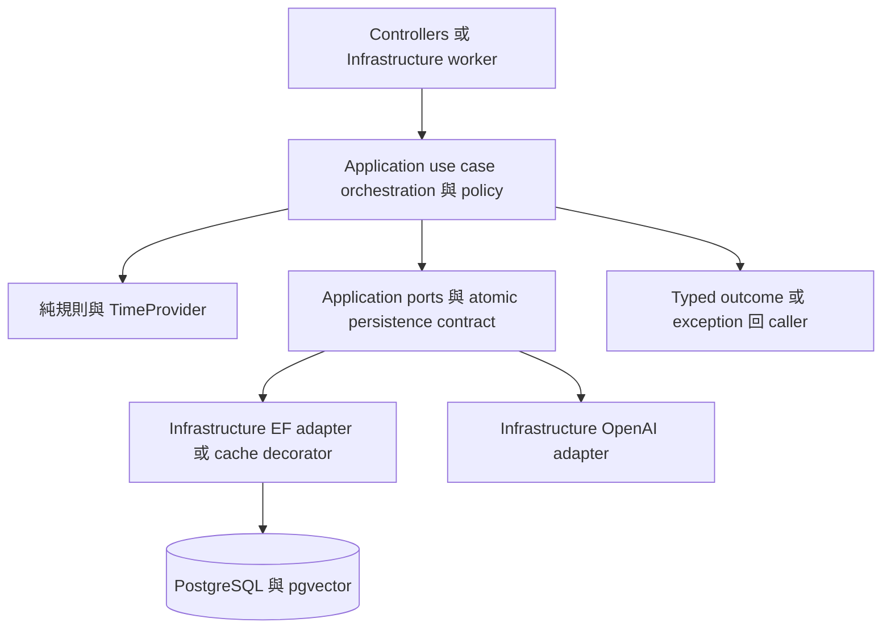
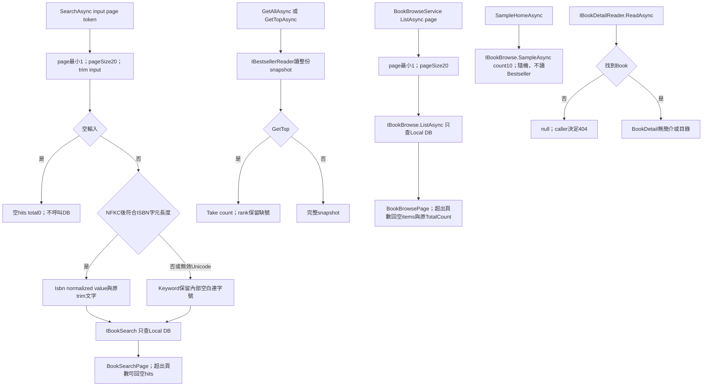
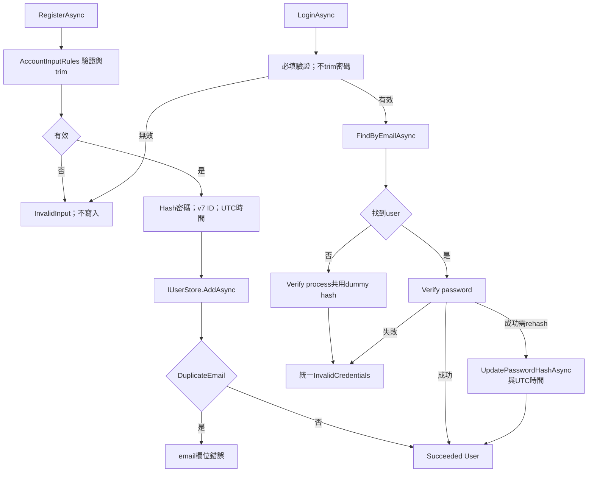
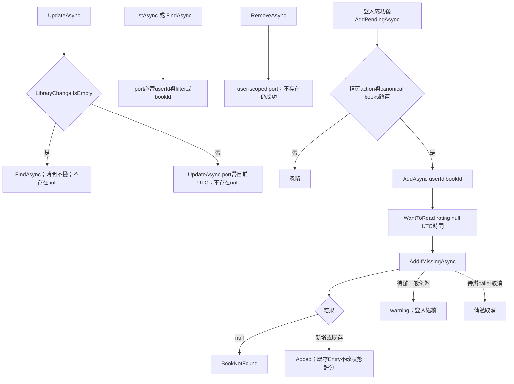
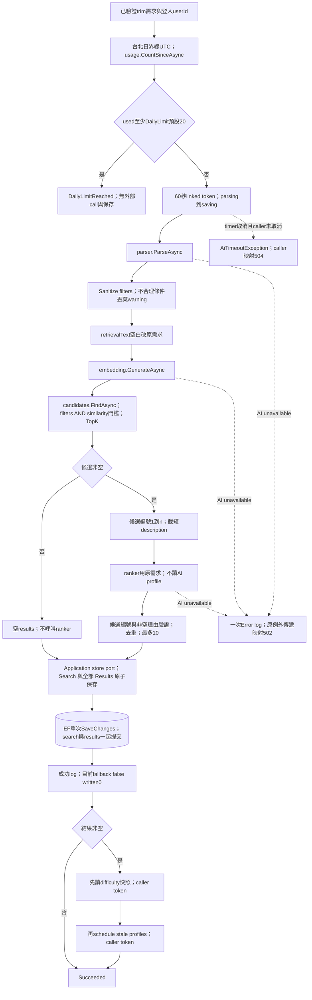
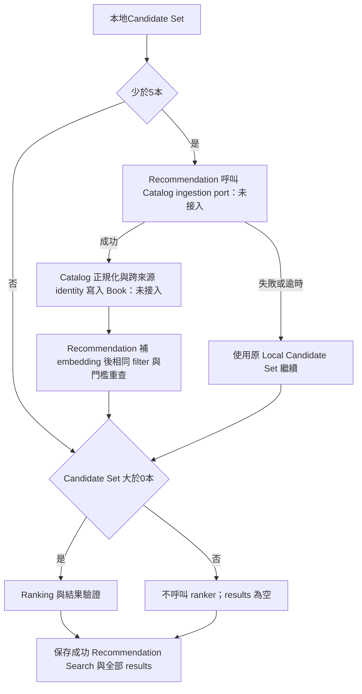
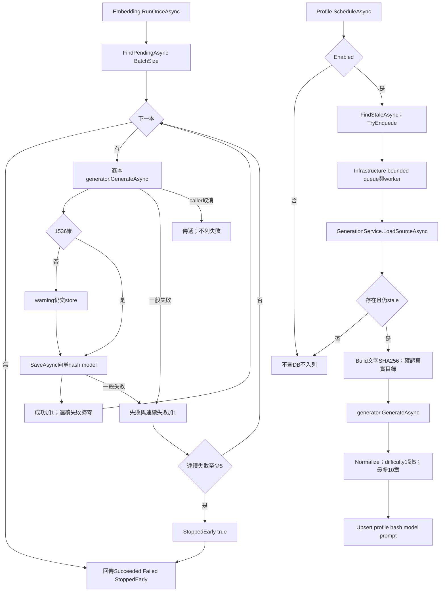

# Application 流程與責任

> 查核日期：2026-10-24；Git 基準 `91333c3`。目標 `Application/`；本次僅靜態查核，未執行 build、測試、資料庫或外部服務。規格、實作與測試證據分開記錄。

## 入口及規格

| 入口 | 原始碼與輸出 | Authority |
|---|---|---|
| 書庫（#109） | [BookBrowseService](../Catalog/BookBrowseService.cs) ListAsync/SampleHomeAsync → BookBrowsePage / 隨機樣本 | [book-catalog](../../Docs/modules/book-catalog.md) §3.6 書庫瀏覽 |
| 暢銷榜（後端保留） | [BestsellerService](../Bestsellers/BestsellerService.cs) GetTopAsync/GetAllAsync → snapshot；#109 後 Web 無呼叫者 | [bestseller](../../Docs/modules/bestseller.md) §2～6 |
| 搜尋/詳細資料 | [BookSearchService](../Catalog/BookSearchService.cs)、[IBookDetailReader](../Catalog/IBookDetailReader.cs) → page/nullable detail | [book-catalog](../../Docs/modules/book-catalog.md) §3～4 |
| 註冊/登入 | [AccountService](../Identity/AccountService.cs) → typed outcome | [identity-auth](../../Docs/modules/identity-auth.md) §3～6 |
| Library/登入後待辦 | [LibraryService](../Library/LibraryService.cs) CRUD、AddPendingAsync | [user-library](../../Docs/modules/user-library.md) §3～5 |
| 推薦 | [RecommendationService](../Recommendation/RecommendationService.cs) → Succeeded/DailyLimitReached | [recommendation](../../Docs/modules/recommendation.md) §3～14 |
| 推薦紀錄 | [IRecommendationHistory](../Recommendation/IRecommendationHistory.cs) ListAsync/GetAsync | recommendation §12 |
| 背景補齊 | [EmbeddingBackfillService](../Recommendation/EmbeddingBackfillService.cs)、[BookProfileGenerationService](../Recommendation/BookProfileGenerationService.cs) | recommendation §9～10 |

HTTP auth、antiforgery、binding、狀態碼與畫面在 Web 邊界。Application 接收 caller 的 userId，定義 use case 的 atomic / transaction boundary；SQL、DbContext、transaction mechanics、cache implementation 與 queue worker 屬於 Infrastructure。Application 不直接操作 EF transaction。

## Catalog 與 Bestseller

ISBN 判定只驗長度與字元，不是 checksum 檢驗。讀取例外/取消直接傳遞；沒有外部 fallback 或重試。空榜 CapturedAt=null。cache decorator 位於 Infrastructure；PublishedDateText 只依已知 precision 格式化，不自行猜測。

## Identity

cookie/JWT 簽發、returnUrl 安全判定在 caller/Infrastructure。唯一 email 判定由 DB 的 lower(email) unique index 支援，服務接 DuplicateEmail outcome。dummy hash 用靜態 LazyInitializer 共用；不宣稱已做 constant-time 實測。

## Library CRUD 與待辦

[PendingLibraryAction](../Library/PendingLibraryAction.cs) 僅接受 add-to-library 與 `/books/{D格式GUID}`，不接受 query、fragment、尾斜線、額外 segment 或外部 URL。[LibraryChange](../Library/LibraryChange.cs) 區分 rating Unchanged/Clear/Set；JSON 型別與評分驗證在 Web parser。LibraryService 不重複檢查 HTTP JSON 規則。

## 推薦主流程：現況

parser/embedding/search/ranker 失敗不進保存。Application 透過 [IRecommendationStore.SaveAsync](../Recommendation/IRecommendationStore.cs) 定義 Search 與全部 Results 必須一起保存的 atomic boundary，零結果也保存 Search；[EfRecommendationStore](../../Infrastructure/Persistence/EfRecommendationStore.cs) 用單次 EF SaveChanges／DB transaction 實現此 contract，保存失敗不留半成品。Application 不直接操作 DbContext 或 EF transaction mechanics。所有 ports 須配合 cancellation，傳 token 不等於強制中斷。timer 的60秒不包含 quota query，也不包含保存後 enrichment。

**保存後與保存前必須分開**：difficulty一般讀取失敗回空字典，scheduler一般失敗只記 warning；兩者使用 caller token，若 caller 在此取消，OperationCanceledException 仍可傳遞，但 search 已保存。不得概括為「所有失敗不保存」。保存後 timer 觸發不將已保存搜尋改為 timeout。見 APP-T10、T11、T17。

歷史 ListAsync 按使用者與分頁讀；GetAsync 在不存在/屬於別人均回 null。rank/reason/relevance 是保存 snapshot，title/authors/thumbnail 讀現有 Book；difficulty 另由 BookDifficultyReader 即時讀。

### 尚未實作的規格目標

[recommendation §6](../../Docs/modules/recommendation.md) 是 authority；ParsedRequirement.GoogleQueries 未被 orchestration 使用，無 Google adapter port，log 固定 false/0。這是 APP-B01 未實作規格差距，不是已核准取消 fallback。Google 失敗／逾時保留原 Local Candidate Set；成功重查後亦須判斷候選數，零候選不呼叫 ranker，直接保存零結果 Search（APP-T16）。Recommendation 擁有觸發條件與 orchestration；Google Books normalization、cross-source identity resolution、Book persistence 規則由 [Book Catalog §6](../../Docs/modules/book-catalog.md) 擁有，Catalog 完成後由 Recommendation 補 embedding、重新 retrieval，再進 ranking。Catalog ingestion 與 Search／Results 保存是不同 atomic boundary；已寫入 Book 不隨後續推薦失敗回滾。

## 背景補齊與 profile

generation例外向 worker 傳遞，由 worker 記錄並處理下一本；Application無 retry。queue容量/去重/滿載丟棄屬 Infrastructure。profile 無真目錄不可聲稱 official。embedding/profile 的簡介各截2000 code points；profile目錄另截2000。deterministic text/hash 供 stale 判定。

## 導覽

[流程](workflow-diagram.md)・[架構](architecture.md)・[待辦](backlog.md)・[歷史](update-history.md)・[案例](test-suite.md)
