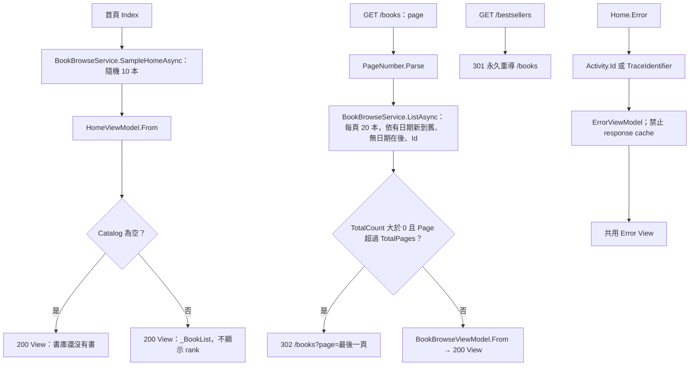
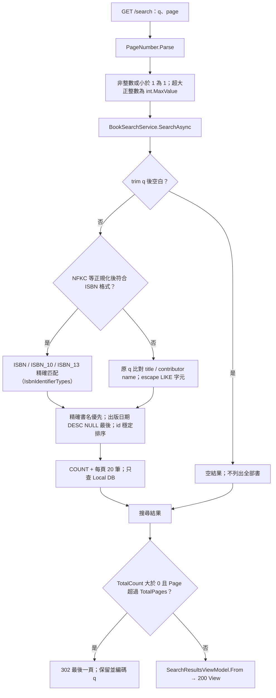
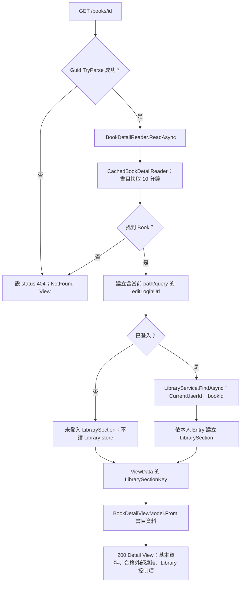
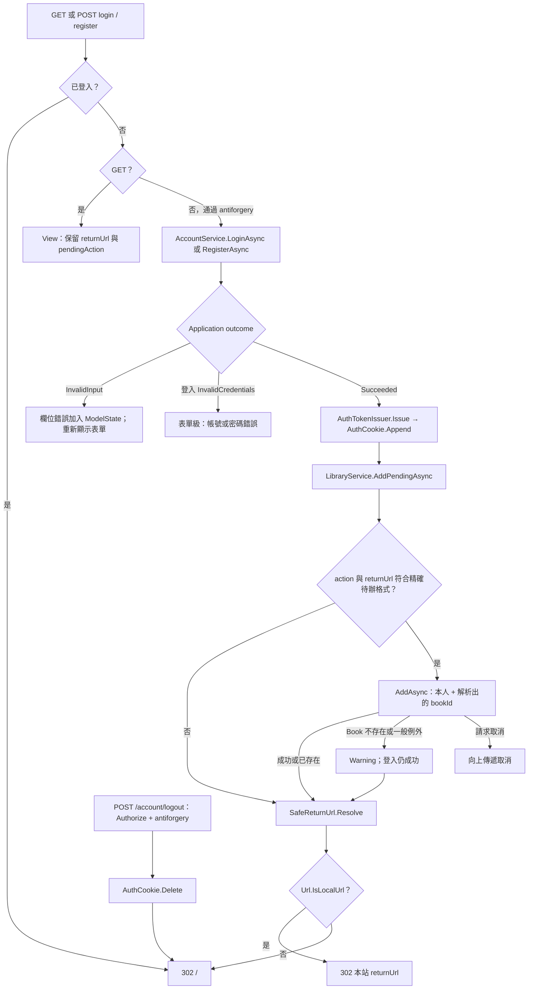
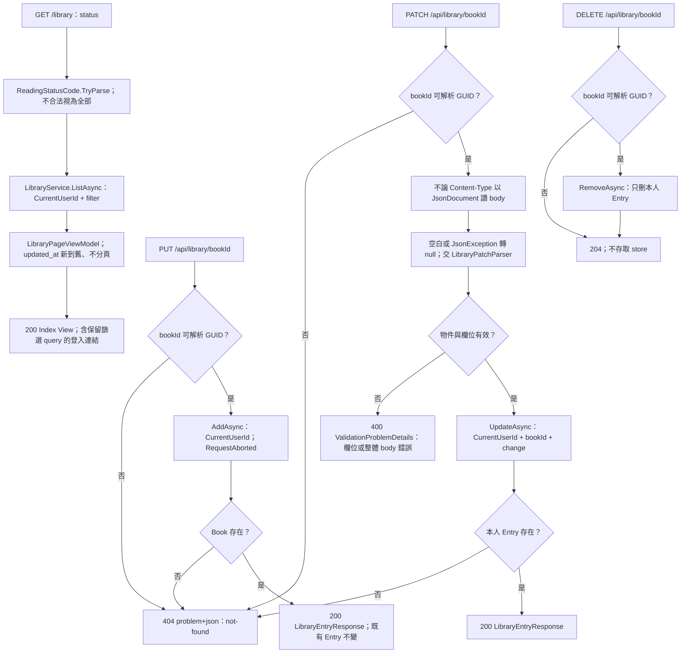
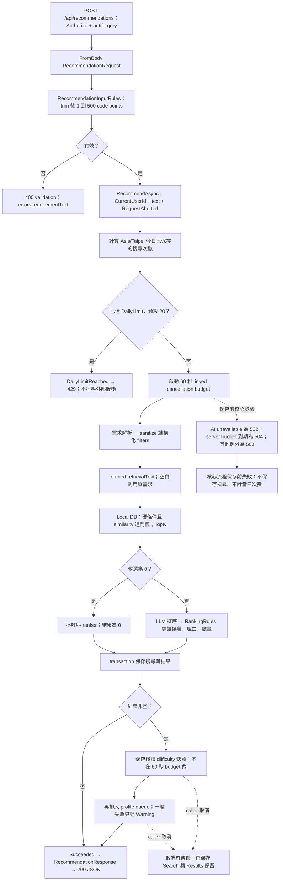
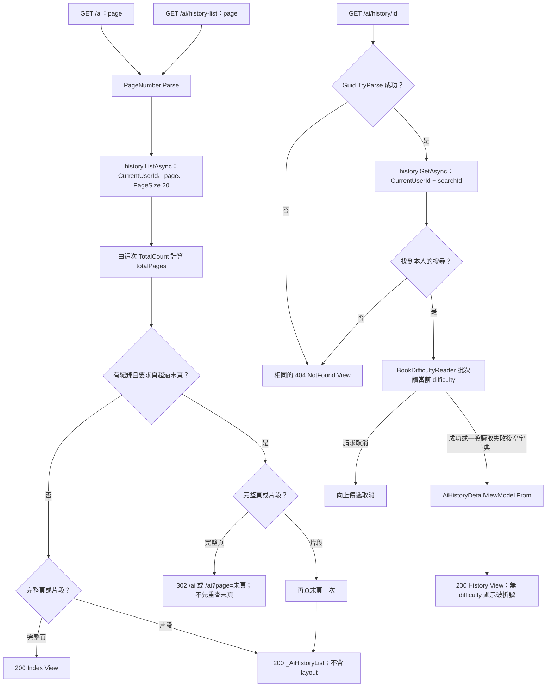

# Controllers 詳細流程

本文件依 2026-10-24 工作樹（基準 commit `91333c3`）整理現有流程。實線表示目前實作；明確標示的缺口不是已完成功能。Controller 只負責 HTTP 與 Application 結果映射，圖中的 SQL、外部呼叫與 transaction 均由下層負責。

規格入口：[UI 路由](../../Docs/ui/ui-flow.md)、[API contract](../../Docs/api/api-spec.md)、[系統分層](../../Docs/architecture/system-architecture.md)。架構對照見 [architecture.md](architecture.md)，案例編號見 [test-suite.md](test-suite.md)。

## 1. 共用請求管線與失敗出口

來源：`Program.cs`、`Infrastructure/Identity/AuthServiceCollectionExtensions.cs`、`AntiforgeryProblemDetailsFilter.cs`、`ApiExceptionProblemDetailsFilter.cs`。

```mermaid
flowchart TD
    R[HTTP request] --> F[UseForwardedHeaders]
    F --> E{Development 環境？}
    E -->|否| EH[註冊 ExceptionHandler 與 HSTS]
    E -->|是| H[UseHttpsRedirection]
    EH --> H
    H -->|HTTP| HTTPS[重導 HTTPS]
    H -->|HTTPS| ROUTE[UseRouting]
    ROUTE --> AUTH[UseAuthentication：只讀 JWT cookie]
    AUTH --> AZ{端點需 Authorize 且未登入？}
    AZ -->|是| KIND{路徑為 /api segment？}
    KIND -->|是| UNAUTH[401 problem+json：unauthenticated]
    KIND -->|否| METHOD{GET 或 HEAD？}
    METHOD -->|是| LOGIN[302 登入頁；returnUrl 含原 path 與 query]
    METHOD -->|否| LOGIN2[302 登入頁；不帶 returnUrl]
    AZ -->|否| CSRF{MVC unsafe method 的 antiforgery 有效？}
    CSRF -->|否，API| A400[400 problem+json：antiforgery]
    CSRF -->|否，頁面| P400[框架 400]
    CSRF -->|是，或 GET/HEAD 等安全方法| BIND[Model binding / action]
    BIND --> OK[View / PartialView / Redirect / JSON / 204]
    BIND -->|未處理的 action 例外| EX{API request？}
    EX -->|否，非 Development| PAGEERR[ExceptionHandler 重執行 /Home/Error]
    EX -->|否，Development| DEVERR[開發環境錯誤處理]
    EX -->|是| CANCEL{RequestAborted 已取消？}
    CANCEL -->|是| PROP[不由 API filter 轉成錯誤回應]
    CANCEL -->|否| TYPE{例外種類}
    TYPE -->|AiUnavailableException| E502[502 problem+json：ai-unavailable]
    TYPE -->|AiTimeoutException| E504[504 problem+json：ai-timeout]
    TYPE -->|其他| E500[記 Error；500 problem+json：internal]
```

驗證順序不能混淆：未登入的受保護 API 先在 authorization 被擋下；已登入但沒有 CSRF token 才測 antiforgery 400。登入／註冊表單可用 hidden antiforgery 欄位；JSON 呼叫帶 `RequestVerificationToken` header。API exception filter 並不保證涵蓋 middleware、路由未命中或 View 渲染階段的所有錯誤。

## 2. HomeController、書庫與 BestsellersController

來源：[HomeController.cs](../HomeController.cs)、[BooksController.cs](../BooksController.cs)、[BestsellersController.cs](../BestsellersController.cs)；規格：[book-catalog.md §3](../../Docs/modules/book-catalog.md)、[ui-flow.md](../../Docs/ui/ui-flow.md)、[bestseller.md](../../Docs/modules/bestseller.md)（榜單 Web 已不顯示）。

`/` 對應 Home.Index，`/books` 對應 Books.Index（GET），`/bestsellers` 對應 Bestsellers.Index 並只回 301。Bestseller 後端（BestsellerService、快取與 reader）保留但沒有 Web 呼叫端。書庫與首頁樣本只查 Local DB，不依 rank 排序，也不讀 AI profile。Error action 本身回 View，非 Development exception handler 處理原始例外時通常保留 500；直接請求 `/Home/Error` 不應當作發生原始 500 的證據。

## 3. SearchController

來源：[SearchController.cs](../SearchController.cs)；規格：[book-catalog.md §3](../../Docs/modules/book-catalog.md)。

任何分支均不呼叫 Google Books、embedding 或 LLM；查無結果也不啟動 fallback。

## 4. BooksController

來源：[BooksController.cs](../BooksController.cs)；規格：[book-catalog.md §4–5](../../Docs/modules/book-catalog.md)、[user-library.md §5](../../Docs/modules/user-library.md)。

Library 狀態逐次讀取且不進入書目快取；description、table of contents 不進入公開 ViewModel。匿名加入書單的登入連結帶 `pendingAction=add-to-library`，與編輯控制項的過期登入連結用途不同。

## 5. AccountController

來源：[AccountController.cs](../AccountController.cs)、`Application/Identity/AccountService.cs`、`Application/Library/LibraryService.cs`；規格：[identity-auth.md](../../Docs/modules/identity-auth.md)。

待辦只接受大小寫相符的 `add-to-library` 與精確 `/books/{D 格式 GUID}`，不含 query、fragment、尾斜線。SafeReturnUrl 的本站路徑規則較廣，不能拿來代替待辦格式驗證。註冊成功直接登入；登出刪 cookie，不撤銷已簽發 JWT。Rate limiting 目前暫緩。

## 6. LibraryController、LibraryApiController

來源：[LibraryController.cs](../LibraryController.cs)、[LibraryApiController.cs](../LibraryApiController.cs)；規格：[user-library.md](../../Docs/modules/user-library.md)、[api-spec.md §4](../../Docs/api/api-spec.md)。以下入口皆先經 Authorize。

PATCH 的 `{}` 是 no-op，保留 `updatedAt`；省略 rating 保留原值，`rating:null` 清除，`readingStatus:null` 回 400。指定相同有效值仍更新 `updatedAt`。DELETE 對未知／他人／非法 GUID 均為 204；PUT、PATCH 對非法 GUID 為 404。這些差異是 contract，不能統一成同一錯誤策略。

## 7. RecommendationsController 與 Application 協作

來源：[RecommendationsController.cs](../RecommendationsController.cs)、`Application/Recommendation/RecommendationService.cs`；規格：[recommendation.md §3–13](../../Docs/modules/recommendation.md)。

**保存邊界**：quota、parse、embed、retrieve、rank 在保存前失敗不進入保存；store 交易失敗不留下 Search／Results 半成品。Search 保存後的 difficulty snapshot／profile scheduling 是 post-save enrichment，改用 caller token；一般失敗 Warning 降級，caller cancellation 可傳遞但不回滾已保存資料。不能由失敗／取消 response 推定 DB 沒有 Search；commit × cancellation 競態仍待 CTL-07 補證。

**現況缺口**：目前候選檢索後直接進入排序／保存，尚無 Google Books adapter 與 fallback 分支，`RecommendationResponse.FallbackUsed` 固定 `false`。規格要求候選 `< 5` 才允許 fallback，且必須 normalize、寫入、補 embedding、重跑相同檢索後才成為候選；此處不將目標流程畫成已實作。見 [backlog.md 的 CTL-01](backlog.md)。

## 8. AiController 的完整頁、片段與詳情

來源：[AiController.cs](../AiController.cs)；規格：[ui-flow.md §3.4](../../Docs/ui/ui-flow.md)、[recommendation.md §12](../../Docs/modules/recommendation.md)。三個入口皆需登入。

紀錄的 rank、reason、relevance 使用已保存快照；書名、作者、封面讀目前 Book 資料，difficulty 即時讀取。首頁需求文字的 `sessionStorage` 傳遞、成功後刷新片段、loading 與 401 導向屬 `wwwroot/js/ai.js` 的瀏覽器流程，非 Controller 讀取 query 中的需求文字。
