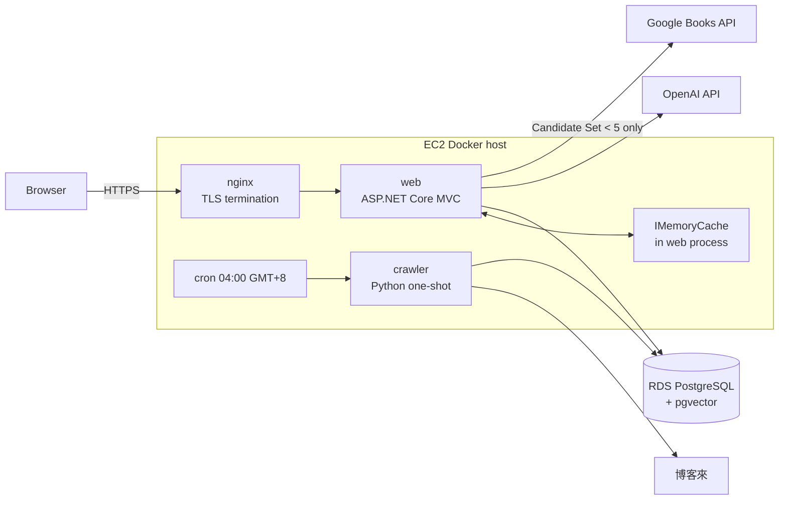
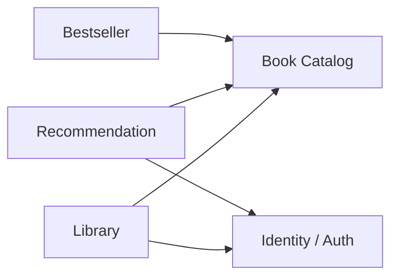

# System Architecture

> Path: `Docs/architecture/system-architecture.md`
> Authority: 系統拓樸、deployable 邊界、模組邊界與依賴方向、降級策略
> 決策理由見 `Docs/architecture/architecture-decisions.md`（ADR-001～005）。
> 不在本文件：schema（`data/data-model.md`）、端點（`api/api-spec.md`）、部署步驟（`deployment/deployment.md`）。

---

## 1. 架構風格

**Modular Monolith（ADR-001）+ ASP.NET Core MVC + 每日 one-shot Python crawler（ADR-002）**

| 項目 | 選擇 |
|---|---|
| Web | C# / ASP.NET Core MVC，Razor View + 少量 JavaScript |
| ORM | EF Core + Npgsql + Pgvector.EntityFrameworkCore |
| Database | PostgreSQL + pgvector（唯一 source of truth） |
| Crawler | Python，排程啟動的 one-shot container；以 curl_cffi Chrome fingerprint 取得頁面（`crawler.md` §15） |
| AI | OpenAI API，只由 C# 呼叫（ADR-003） |
| 外部書目 | Google Books API，只用於 AI 推薦 fallback |
| Cache | process-local `IMemoryCache`（ADR-005） |
| Auth | JWT 存於 HttpOnly cookie（ADR-004） |
| Runtime | Docker on AWS EC2，RDS PostgreSQL，nginx reverse proxy |

MVP 不使用 S3；書籍封面轉存列為延後功能，需要時再加入。

---

## 2. 系統拓樸



---

## 3. Deployables

| Deployable | 職責 | 不負責 |
|---|---|---|
| `web` | HTTP、Razor 渲染、認證、所有 use case、OpenAI / Google Books 整合、embedding 與 Book AI Profile 背景補齊 | 爬取博客來 |
| `crawler` | 以 curl_cffi 取得博客來排行榜與新書 metadata、寫入 Catalog 與 Bestseller 資料表 | OpenAI、Google Books、embedding、DDL、使用者資料 |
| `nginx` | TLS 終止、轉發至 `web` | 任何應用邏輯 |
| migration bundle | 套用 EF Core migration；部署時獨立執行 | 啟動時自動 migrate |

`web` 與 `crawler` 獨立 build，共享的契約只有 `Docs/data/data-model.md` 定義的 schema；schema 只由 EF Core migration 演化。

---

## 4. Web 內部結構

### 4.1 分層

```text
Presentation   Controllers、Razor Views、JSON endpoints
    ↓
Application    use case orchestration、transaction boundary
    ↓
Domain         Entities、商業規則（不依賴 UI、EF、外部 API）
    ↑
Infrastructure EF Core、OpenAI / Google Books adapter、cache、background services
```

- Controller 不寫 SQL、不呼叫外部 API、不實作推薦規則。
- Razor View 不存取 `DbContext`。
- 外部服務（OpenAI、Google Books）以 Application 層介面隔離，測試以 fake 取代。

### 4.2 模組



| 模組 | 責任 | 規格 |
|---|---|---|
| Identity / Auth | 註冊、登入、登出、目前使用者、JWT cookie | `modules/identity-auth.md` |
| Book Catalog | Book 讀取、一般搜尋、書庫瀏覽、Book 詳細頁、Google Books 書目正規化寫入 | `modules/book-catalog.md` |
| Bestseller | 讀取目前 Bestseller | `modules/bestseller.md` |
| Recommendation | 需求解析、候選檢索、fallback、排序、Recommendation Search、embedding / AI Profile 補齊、每日上限 | `modules/recommendation.md` |
| Library | Library Entry、Reading Status、評分 | `modules/user-library.md` |

模組間透過 Application 層介面互動，不直接讀寫其他模組擁有的資料表（資料表擁有權見 `data/data-model.md`）。例外：唯讀的顯示查詢（例如 `bestsellers JOIN books`，見 `modules/bestseller.md` §2）可直接讀取 Book Catalog 擁有的 `books` 及其子表；寫入一律經由擁有該表的模組。

---

## 5. 關鍵流程

### 5.1 AI 推薦

```text
需求文字
→ OpenAI：解析為 filter JSON + 檢索文字 + Google Books 關鍵字
→ PostgreSQL：硬條件過濾 → 向量相似度 ≥ T → Top-30 = Candidate Set
→ Candidate Set < 5？
     是 → Google Books → 正規化寫入 → 同步 embedding → 重跑檢索
→ OpenAI：只對 Candidate Set 排序（≤ 10）
→ 驗證 book_id ∈ Candidate Set → 保存 Recommendation Search
```

細節見 `modules/recommendation.md`。

### 5.2 每日爬取

```text
cron → crawler → 排行榜 100 筆 → 新書抓詳細頁（重試，失敗跳過）
→ 未連續 21 本一般錯誤：transaction 替換 Bestseller；連續第 21 本：失敗，保留舊榜單；累計錯誤無上限
```

細節見 `modules/crawler.md`。

### 5.3 背景補齊（web 內 BackgroundService）

- 啟動時與之後每 10 分鐘（`Embedding:Interval`），為缺少 embedding 或內容 hash 不符的 Book 產生 embedding（`recommendation.md` §10）。
- 消化 Book AI Profile 產生佇列（in-process queue）。

---

## 6. 降級策略

| 故障 | 行為 |
|---|---|
| PostgreSQL 不可用 | 所有功能失敗，回傳一致的 5xx；cache 不當作資料來源 |
| OpenAI 不可用 | AI 推薦失敗並告知；書庫、搜尋、Library 不受影響 |
| Google Books 不可用 | 以現有本地候選繼續推薦，記 log |
| 博客來爬取失敗 | 保留上一份 Bestseller |
| `web` 重啟 | cache 清空、AI Profile 佇列遺失（下次出現在推薦結果時重新排入），功能正確性不受影響 |

---

## 7. 已知限制

- 單一 EC2、單一 `web` instance：無 Web 層高可用，EC2 故障即服務中斷。
- 未定義流量、延遲 SLO、RTO / RPO；不虛構數字。
- 水平擴充前必須先處理：分散式 cache（ADR-005）、AI Profile 佇列改為持久化。

---

## 8. 可觀測性

- 所有 log 輸出至 container stdout；MVP 不接 CloudWatch。
- Request 帶 correlation id。
- Crawler 每次 run 記錄統計（見 `modules/crawler.md`）。
- AI 推薦記錄：硬條件、候選數、similarity 分布、是否 fallback、結果數、被丟棄的非候選 `book_id`。
- 不記錄 secrets、密碼、JWT。
