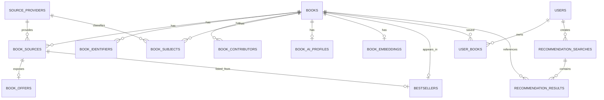

# 「好想找書」Data Model

> Path: `Docs/data/data-model.md`
> Authority: schema、relation、constraint、index、pgvector data contract
> Database: PostgreSQL + pgvector
> Migration owner: ASP.NET Core / EF Core

## 1. Scope

本文件定義「好想找書」的持久化資料模型。實作不得另建與此文件不相容的 Book schema。

核心原則：

- PostgreSQL + pgvector 為唯一 source of truth。
- `Book` 表示一本可被使用者加入書單、搜尋、推薦的 **canonical edition**。
- 書商、書目 API、圖書館等外部系統不是 `Book` 本身，而是 Book 的 **Source Provider / Book Source**。
- 同一本 Book 可以同時存在於多個外部來源。
- 商業資訊（價格、庫存）屬於來源，不屬於 canonical `Book`。
- Bestseller 是 Catalog 的一種 discovery / presentation projection，不是 Book 的 identity，也不是 Catalog 的主要資料來源模型。
- 一般搜尋只查 Local Database，不使用 Google Books 或 embedding（§10）。
- Google Books 僅於 AI Candidate `< 5` 時使用，結果 normalize 後才能進入 Candidate Set。
- Python crawler 可以新增 Catalog、Source 與 Offer 資料，但不得自行演化 schema。
- OpenAI / embedding 只由 C# Web Application 處理；Python crawler 不寫 AI 資料。
- 成功的 Recommendation Search 必須持久化，且一定屬於某位使用者（AI 推薦需登入）。

目前 MVP 已實作的主要來源為博客來；Google Books 由 Recommendation fallback 使用。此 schema 不得假設來源永遠只有這兩個：新增書商不應再需要修改資料庫的來源 enum / check constraint。

> **實作狀態**：本文件描述 multi-source 的目標 contract（#113）。現行程式仍使用 closed `SourceType` enum 與 `ISBN_10`／`ISBN_13` identifier，要經過 PR2（migration 010、Web）、PR3（crawler）、PR4（migration 011、cutover）才會一致，見 §14。

---

## 2. Domain terminology

| Term | 定義 |
|---|---|
| `Book` | 系統內 canonical edition；搜尋、推薦、Library 都引用它 |
| `Source Provider` | 外部資料提供者，例如博客來、Google Books、未來其他書商或圖書館；以 `source_providers.code` 識別 |
| `Book Source` | 某個 Provider 上對應到這本 Book 的一筆來源紀錄／商品頁 |
| `Book Offer` | Retailer Book Source 當下可觀察到的價格與供貨狀態 |
| `Bestseller` | 目前產品要顯示的博客來中文書 7 日暢銷總榜 projection；不決定 Book identity |

詞彙與 _Avoid_ 用語以 `CONTEXT.md` 為準。

關係：

```text
Book
 ├─ Book Source (博客來商品 A)
 │    └─ Book Offer (目前價格 / 庫存)
 ├─ Book Source (誠品商品 B，未來)
 │    └─ Book Offer (目前價格 / 庫存)
 └─ Book Source (Google Books Volume)
      └─ no offer
```

價格比較只能比較指向**同一個 canonical Book edition** 的 retailer offers；不同 ISBN / 不同 edition 不自動視為可直接比價的同一商品。

---

## 3. Source field contract

Canonical `books` 只保存產品與 AI 需要的共通書籍 metadata；來源 identity 與商業狀態分開保存。

| Canonical field | 博客來 | Google Books | Rule |
|---|---|---|---|
| `title` | 書名 | `volumeInfo.title` | required |
| `subtitle` | 無穩定獨立欄位 | `volumeInfo.subtitle` | nullable；不得由博客來標題字串自行拆解 |
| `contributors` | 作者、原文作者、譯者等 | `volumeInfo.authors[]` | `book_contributors` |
| `publisher` | 出版社 | `volumeInfo.publisher` | nullable |
| `published_date` | 出版日期 | `volumeInfo.publishedDate` | nullable；搭配 `published_date_precision` |
| `language` | 語言 | `volumeInfo.language` | nullable；正規化為 BCP 47（§3.1） |
| `description` | 內容簡介 | `volumeInfo.description` | nullable；僅供 AI |
| ISBN | 詳細資料 ISBN | `industryIdentifiers[]` | `book_identifiers`（§6.5、§7.1） |
| `page_count` | 規格中的頁數，若存在 | `volumeInfo.pageCount` | nullable |
| categories | 本書分類 | `volumeInfo.categories[]` | `book_subjects` |
| `thumbnail_url` | 封面圖片 | `imageLinks.*` | nullable |
| `table_of_contents` | 目錄，若頁面存在 | 無標準 `VolumeInfo` 欄位 | nullable；僅供 AI |
| source identity | 商品 URL | Volume ID / URL | `book_sources` |
| current price | 商品頁公開售價 | n/a | `book_offers` |

- 未來書商 adapter 應 normalize 成同一 contract；無法可靠取得的 optional field 寫 `NULL`，不得猜測。
- 來源 parser 不得假設所有詳細頁都有頁數、目錄或相同 DOM 結構；**必要欄位解析失敗時應 fail loudly**，不得大量寫入空值。
- Google Books `authors[]` 在無角色資訊時一律 normalize 為 `AUTHOR`。

### 3.1 Language normalization

`books.language` 一律保存 BCP 47 形式的語言代碼：主語言小寫，地區大寫（`zh-TW`、`zh-CN`、`en`、`ja`）。來源的顯示文字不得直接寫入。

博客來「語言」欄位對照：

| 博客來 | `language` |
|---|---|
| 繁體中文 | `zh-TW` |
| 簡體中文 | `zh-CN` |
| 英文 | `en` |
| 日文 | `ja` |
| 韓文 | `ko` |
| 其他 / 無法對照 | `NULL` |

不在對照表中的值寫 `NULL` 並記 log，不得猜測；需要時擴充此表。

Google Books `volumeInfo.language`：已是語言代碼，只做大小寫正規化（`zh-tw` → `zh-TW`）；沒有地區的值（`zh`）保持原樣，不補地區。

查詢比對：沒有地區的條件值匹配該語言所有地區（`zh` 匹配 `zh`、`zh-TW`、`zh-CN`）；有地區的條件值只精確匹配。

---

## 4. Entity set

```text
source_providers
books
book_sources
book_offers
book_identifiers
book_contributors
book_subjects
book_ai_profiles
book_embeddings
bestsellers
users
user_books
recommendation_searches
recommendation_results
```

`Book` 代表一個 edition；MVP 不建立 Work / Edition 雙層模型。`source_providers` 與 `book_offers` 由 migration 010 新增（§11.2）。

---

## 5. ERD



---

## 6. Tables

### 6.1 `source_providers`

外部資料來源 registry。新增書商或資料來源時新增 row，不新增 DB enum value。

| Column | Type | Null | Constraint |
|---|---|---:|---|
| `code` | `varchar(64)` | no | PK |
| `display_name` | `varchar(100)` | no | |
| `provider_kind` | `varchar(24)` | no | `RETAILER`, `BIBLIOGRAPHIC` |
| `base_url` | `text` | yes | |
| `enabled` | `boolean` | no | default true |
| `created_at` | `timestamptz` | no | |

Initial rows（migration 010 seed）：

| `code` | `display_name` | `provider_kind` | `enabled` |
|---|---|---|---|
| `BOOKS_COM_TW` | 博客來 | `RETAILER` | true |
| `GOOGLE_BOOKS` | Google Books | `BIBLIOGRAPHIC` | true |
| `KINGSTONE` | 金石堂 | `RETAILER` | false |
| `ESLITE` | 誠品 | `RETAILER` | false |

`enabled` 的語意：

- **只控制這個 provider 是否允許主動 acquisition**，也就是 crawler job 能不能對它執行。crawler 對 disabled provider 啟動 job 時，以設定錯誤拒絕執行（exit 2，`Docs/modules/crawler.md` §3.1）。
- **不影響既有 Catalog 資料的讀取或顯示**：disabled provider 已有的 Book Source 仍正常出現在 Book 詳細頁與其他讀取路徑（Search、Bestseller）。讀取端 JOIN `source_providers` 時不得以 `enabled` 過濾。
- 在 migration 011 之前，不得寫入 `KINGSTONE`、`ESLITE` 的資料（§11.2 限制）。

新增 provider 時 schema 不需要新增 enum / check migration；仍需要對應 adapter 與應用顯示規則。`source_providers` 由 EF Core migration / seed 管理；crawler 只讀，不自行建立 provider。

---

### 6.2 `books`

Canonical book metadata。

| Column | PostgreSQL type | Null | Constraint |
|---|---|---:|---|
| `id` | `uuid` | no | PK |
| `title` | `varchar(500)` | no | |
| `subtitle` | `varchar(500)` | yes | |
| `publisher` | `varchar(255)` | yes | |
| `published_date` | `date` | yes | |
| `published_date_precision` | `varchar(8)` | yes | `YEAR`, `MONTH`, `DAY` |
| `language` | `varchar(16)` | yes | |
| `description` | `text` | yes | source-derived；僅供 AI，不顯示 |
| `table_of_contents` | `text` | yes | source-derived only；僅供 AI，不顯示 |
| `page_count` | `integer` | yes | `> 0` |
| `thumbnail_url` | `text` | yes | |
| `created_at` | `timestamptz` | no | |
| `updated_at` | `timestamptz` | no | |

`description` 與 `table_of_contents` 不論來源都只供 Recommendation（LLM）讀取，不得出現在任何頁面或 API 回應中（product-requirements BOOK-05）。

只有年份或年月的日期必須搭配 `published_date_precision`，不得在 UI / API 中把補值日期當成來源確定日期。

Canonical metadata 不保存價格、庫存、書商名稱。這些資料隨來源與時間改變，放在 `book_sources` / `book_offers`。

#### Canonical merge rule

跨來源命中既有 Book 時（identity resolution 見 §7）：

1. 永遠先保留 canonical Book identity。
2. 新來源一定可建立 `book_sources`。
3. 不以新來源覆寫既有非 NULL canonical metadata；不存在「某來源優先」的覆寫順序。
4. 經正規化的來源只能依 §7.4 補 canonical `NULL` 欄位。
5. 若未來要做 metadata reconciliation / provider priority，另立明確規則；不得讓任一 adapter 私自決定覆寫優先權。

這個規則讓「新增書商」不會因來源順序不同而靜默改寫既有 Catalog。

---

### 6.3 `book_sources`

某個 Provider 上對應到 canonical Book 的來源紀錄。Retailer 通常是一個商品頁；Bibliographic provider 則可能是一筆 API record。

| Column | Type | Null | Constraint |
|---|---|---:|---|
| `id` | `uuid` | no | PK |
| `book_id` | `uuid` | no | FK → `books.id`, CASCADE |
| `source_code` | `varchar(64)` | no | FK → `source_providers.code`, RESTRICT |
| `external_id` | `varchar(255)` | yes | provider-specific ID（例如 Google Volume ID） |
| `source_url` | `text` | no | |
| `first_seen_at` | `timestamptz` | no | |
| `last_seen_at` | `timestamptz` | no | |

Constraints：

```text
UNIQUE(source_code, source_url)
UNIQUE(source_code, external_id) WHERE external_id IS NOT NULL
INDEX(book_id, source_code)
```

過渡期（010 之後、011 之前）此表另有 database-only 的 `source_type` 欄位與舊 constraint，見 §11.4。

`first_seen_at` / `last_seen_at` 語意（`Docs/modules/crawler.md` §6.1）：

- `last_seen_at` = 任何 discovery job 最後一次**實際觀察到**這個來源的時間，不綁定 Bestseller snapshot 是否成功。
- Existing Source 在 discovery 看到時立即以獨立 transaction 更新 `last_seen_at`；之後即使該項目被判為榜內重複、snapshot 失敗或 run 中止，都不回滾。
- New Source 只有在 detail 解析成功且 Source transaction 成功時，才寫入 `first_seen_at = last_seen_at = now`。
- 這是來源紀錄的 metadata；Book 本身的欄位不因此改變。

同一本 `Book` 可以有多個 `book_sources`，包括同一 provider 的多個商品頁，以及不同 provider 的來源。

---

### 6.4 `book_offers`

Retailer Book Source 當下可比較的商業資訊。MVP 只保存 current snapshot，不保存歷史價格。

| Column | Type | Null | Constraint |
|---|---|---:|---|
| `source_id` | `uuid` | no | PK, FK → `book_sources.id`, CASCADE |
| `currency` | `char(3)` | yes | ISO 4217，例如 `TWD` |
| `price` | `numeric(12,2)` | yes | `> 0` |
| `list_price` | `numeric(12,2)` | yes | `> 0` |
| `availability` | `varchar(24)` | no | enum below |
| `captured_at` | `timestamptz` | no | |

Availability：

```text
IN_STOCK
OUT_OF_STOCK
PREORDER
UNKNOWN
```

價格規則：

- `price` = 該商品頁當下對一般使用者公開、可直接理解的目前售價。
- 個人化會員價、需輸入 coupon 才成立的價格、運費不納入 `price`。
- 無法可靠判斷價格時 `price = NULL`，不得猜測。
- 非 retailer provider 不建立 `book_offers`。
- 比價只比較同一 `book_id` 下、相同 currency、可用的 retailer offers（§8）。
- `captured_at` 必須顯示資料新鮮度；價格不是永久 metadata。

目前只建表；沒有任何 writer 寫入（crawler log 的 `offer_updated_count` 固定為 0）。未來若要做價格趨勢，再新增 append-only `book_offer_history`；不要把歷史塞進本表。

---

### 6.5 `book_identifiers`

| Column | Type | Null |
|---|---|---:|
| `book_id` | `uuid` | no |
| `identifier_type` | `varchar(16)` | no |
| `identifier_value` | `varchar(64)` | no |

Allowed types：

| Type | 狀態 | 說明 |
|---|---|---|
| `ISBN` | 目標 | 新 writer 只寫這個類型；值依 §7.1 正規化，不區分 10／13 碼 |
| `ISBN_10`、`ISBN_13` | legacy，過渡至 011 | v0.0.4 以前寫入的資料；010 起不再新增，011 轉成 `ISBN` 後移除（§11.3） |
| `OTHER` | 目標 | 其他識別碼；不參與 ISBN 比對與搜尋 |

Primary key：

```text
(book_id, identifier_type, identifier_value)
```

Uniqueness：

- `ISBN` 類型**不要求跨 Book 唯一**：不同 Book 可以有相同的 ISBN 值（例如來源資料錯誤或同 ISBN 的不同商品）。跨來源去重由 §7.2 的 distinct Book 數量判斷，不依賴 DB unique。
- 過渡期保留 legacy 的 partial unique `UNIQUE(identifier_type, identifier_value) WHERE identifier_type IN ('ISBN_10','ISBN_13')`，它只約束 legacy 類型；011 DROP。

寫入前的正規化見 §7.1（不驗證長度與 checksum）。

---

### 6.6 `book_contributors`

保存來源可確認的顯示名稱，不建立全域 Person / Author identity。

| Column | Type | Null |
|---|---|---:|
| `book_id` | `uuid` | no |
| `contributor_order` | `smallint` | no |
| `name` | `varchar(255)` | no |
| `role` | `varchar(32)` | no |

Allowed roles：

```text
AUTHOR
ORIGINAL_AUTHOR
TRANSLATOR
EDITOR
ILLUSTRATOR
OTHER
```

Primary key：

```text
(book_id, contributor_order)
```

Google Books `authors[]` 在無角色資訊時一律 normalize 為 `AUTHOR`。

---

### 6.7 `book_subjects`

不同 Provider 的分類 taxonomy 不共用、不強制對應。

| Column | Type | Null |
|---|---|---:|
| `book_id` | `uuid` | no |
| `subject` | `varchar(255)` | no |
| `source_code` | `varchar(64)` | no |

Key：

```text
目標（011 之後）：PRIMARY KEY(book_id, subject, source_code)
過渡（010 期間）：實體 PRIMARY KEY 仍為 (book_id, subject, source_type)，
                  另有 UNIQUE(book_id, subject, source_code)；見 §11.4
```

`source_code` FK → `source_providers.code`（RESTRICT）。

Recommendation embedding 可以合併各來源 subject 後去重；來源 taxonomy 本身仍保持可追溯。

---

### 6.8 `book_ai_profiles`

使用 source-derived metadata 產生的快速理解資料，不得覆寫 `books.description` 或 `books.table_of_contents`。

| Column | Type | Null | Constraint |
|---|---|---:|---|
| `book_id` | `uuid` | no | PK, FK → `books.id`, CASCADE |
| `summary` | `text` | yes | |
| `framework` | `jsonb` | yes | structured overview |
| `key_topics` | `text[]` | yes | |
| `target_audience` | `text` | yes | |
| `difficulty` | `smallint` | yes | 1–5 |
| `source_content_hash` | `char(64)` | no | |
| `model_name` | `varchar(100)` | no | |
| `prompt_version` | `varchar(32)` | no | |
| `updated_at` | `timestamptz` | no | |

AI Profile input 只允許既有 Book metadata，例如 title、contributors、publisher、subjects、description、table of contents。

若沒有真實目錄，`framework` 可以是 inferred overview，但不得聲稱為正式章節目錄。

`framework` 的 JSON 格式：`{ "is_official_toc": bool, "sections": [{ "title": "…", "summary": "…" }] }`，最多 10 個 section；沒有真實目錄時 `is_official_toc` 為 `false`。`source_content_hash` 的輸入見 `Docs/modules/recommendation.md` §9.2。

MVP 用途：僅供 Recommendation 內部使用，提供推薦結果顯示的 `difficulty`。Profile 只在 Book 第一次出現於 Recommendation Result 後非同步產生；推薦排序不讀取 profile。產生時機與 prompt 見 `Docs/modules/recommendation.md`。

---

### 6.9 `book_embeddings`

每本 Book 在 MVP 只保留目前 retrieval embedding。

| Column | Type | Null |
|---|---|---:|
| `book_id` | `uuid` | no |
| `embedding` | `vector(1536)` | no |
| `model_name` | `varchar(100)` | no |
| `source_content_hash` | `char(64)` | no |
| `updated_at` | `timestamptz` | no |

Primary key：`book_id`。

Foreign key：`book_id` → `books.id`，`ON DELETE CASCADE`（同 `book_ai_profiles`）。

Embedding model 為 OpenAI `text-embedding-3-small`（1536 維）。更換 model 代表新 migration 與全部向量重建，不只是改設定。

沒有 `book_embeddings` row 的 Book 不會進入 Candidate Set。

MVP 可先使用 exact vector search。只有量測證明需要 ANN 時再新增 HNSW index。

---

### 6.10 `bestsellers`

本表是目前產品「博客來中文書 7 日暢銷總榜」的 current projection，不是 Catalog acquisition 的基礎模型。

| Column | Type | Null | Constraint |
|---|---|---:|---|
| `rank` | `smallint` | no | PK, 1–100 |
| `book_id` | `uuid` | no | FK → `books.id`, UNIQUE |
| `source_id` | `uuid` | no | FK → `book_sources.id` |
| `captured_at` | `timestamptz` | no | |

- 只保存目前有效的一份榜單：最多 100 筆。
- `rank` 保留博客來原始排名；爬取時被跳過的排名缺號（例如 1..36、38..100），不重新編號。
- 新榜單在 replace 的同一 transaction 內驗證後才寫入（`Docs/modules/crawler.md` §14.4）；任何驗證或寫入失敗都 rollback，crawler failure 不得清空上一版有效榜單。
- Catalog / Source / Offer 已成功寫入的資料（含 `last_seen_at`）不依賴 Bestseller replacement 才成立。

未來若產品需要多來源、多種榜單歷史，再新增 generic collection model；不要讓 Catalog core 依賴 `bestsellers`。

---

### 6.11 `users`

| Column | Type | Null |
|---|---|---:|
| `id` | `uuid` | no |
| `email` | `varchar(320)` | no |
| `password_hash` | `text` | no |
| `display_name` | `varchar(100)` | no |
| `created_at` | `timestamptz` | no |
| `updated_at` | `timestamptz` | no |

Constraints：

```text
PRIMARY KEY(id)
UNIQUE(lower(email))
```

---

### 6.12 `user_books`

| Column | Type | Null | Constraint |
|---|---|---:|---|
| `user_id` | `uuid` | no | FK → `users.id`, CASCADE |
| `book_id` | `uuid` | no | FK → `books.id`, CASCADE |
| `reading_status` | `varchar(20)` | no | enum below |
| `rating` | `smallint` | yes | 1–5 |
| `added_at` | `timestamptz` | no | |
| `updated_at` | `timestamptz` | no | |

Primary key：`(user_id, book_id)`。

Reading status：

```text
WANT_TO_READ
READING
FINISHED
```

---

### 6.13 `recommendation_searches`

Recommendation Search（AI 搜尋紀錄）。只保存成功的推薦（含 0 本結果）。

| Column | Type | Null |
|---|---|---:|
| `id` | `uuid` | no |
| `user_id` | `uuid` | no |
| `requirement_text` | `text` | no |
| `fallback_used` | `boolean` | no |
| `created_at` | `timestamptz` | no |

`user_id` FK → `users.id`, CASCADE。AI 推薦需登入，因此不存在匿名紀錄。

每日上限以該使用者 Asia/Taipei 當日的 row 數計算，使用 `(user_id, created_at DESC)` index。

---

### 6.14 `recommendation_results`

| Column | Type | Null | Constraint |
|---|---|---:|---|
| `search_id` | `uuid` | no | FK → `recommendation_searches.id`, CASCADE |
| `book_id` | `uuid` | no | FK → `books.id`, RESTRICT |
| `rank` | `smallint` | no | 1–10 |
| `relevance_score` | `numeric(6,5)` | yes | |
| `reason` | `text` | no | |

Constraints：

```text
PRIMARY KEY(search_id, rank)
UNIQUE(search_id, book_id)
```

所有 result `book_id` 必須來自該次 Recommendation Candidate Set；此 invariant 由 Application / tests 驗證。

---

## 7. Cross-source identity resolution

任何 Catalog writer（crawler 或 Google Books）寫入前都使用本節同一套規則；排行榜與否不影響 identity resolution。

### 7.1 ISBN 正規化 protocol

C# 與 Python 必須對同一輸入得到**逐 byte 相同**的結果（之後 advisory lock 的 key 也會用到它，§7.5）：

```text
1. Unicode 15.1 NFKC
2. 刪除 U+002D HYPHEN-MINUS，以及所有具有 Unicode 15.1 White_Space 屬性的字元
3. 只把 ASCII a–z 轉成大寫（與 locale 無關）
```

NFKC 與 White_Space 都固定在 **Unicode 15.1**。runtime 內建的 Unicode database 版本不同時（例如 .NET 或 Python 升級），以 fixture 為準，實作要自行補足差異。要升級 Unicode 版本，必須先改本節與 fixture，並且同時更新 C# 與 Python 兩邊的實作。

- 不驗證長度、不驗證 checksum；正規化結果為空字串時不寫入 identifier。
- 儲存的類型為 `ISBN`（§6.5）；不做 ISBN-10 ↔ 13 互轉。
- 不能直接把 `str.isspace()`、`\s` 或 `char.IsWhiteSpace()` 當成 `White_Space`；實作方式不限（例如自行定義明確的 code point 集合），只要通過共用 fixture。

**跨語言 protocol fixture**：中立位置 `tests/Fixtures/isbn-normalization.json`（PR2 建立），C# unit test 與 crawler pytest 讀同一份，每一組輸出必須逐 byte 相同。內容至少包含：

- **完整覆蓋**：Unicode `White_Space` property 的每一個 code point（以 Unicode 15.1 為準），每個都有對應的 vector。
- **反例**：程式語言 runtime 會當成空白、但不屬於 `White_Space` 的字元，必須保留。例如 U+001C～U+001F（Python 的 `isspace()` 判為空白）、U+180E、U+200B。
- **其他情況**：全形數字與全形 X、全形連字號（NFKC 後變成 U+002D，因此被刪除）、不在刪除範圍內的其他 dash（例如 U+2010、U+2013，要保留）、小寫 `x`。

一般搜尋判斷輸入是不是 ISBN 的規則（長度 10 或 13，`Docs/modules/book-catalog.md` §3.1）**刻意與本節分開**：寫入端不驗證長度，搜尋端只在輸入看起來像 ISBN 時才走 ISBN 比對。

### 7.2 Identity matching

```text
1. 同一個來源：
   (source_code, external_id)   -- external_id 存在時
   → (source_code, source_url)
   命中 → Existing Source（不做 ISBN 比對）

2. 用 draft 的「所有」正規化 ISBN 一起查 distinct book_id：
   SELECT DISTINCT book_id FROM book_identifiers
   WHERE identifier_value = ANY(:values)
     AND identifier_type IN ('ISBN','ISBN_10','ISBN_13')
   （PR4 / migration 011 之後只查 'ISBN'）

3. 依 distinct Book 數量：
   = 0 → 建立新 Book
   = 1 → 附加新 Book Source 到該 Book，並依 §7.4 補 NULL
         （同一家或不同書商的新來源都附加）
   ≥ 2 → ambiguous：建立新 Book，記一筆 INFO log
         （draft 的兩個 ISBN 各對到不同 Book 也屬此類）
```

- 無 ISBN 時（或正規化後沒有任何值），不得只因 title / author 相似就自動跨來源 merge，直接建立新 Book。
- 舊的 `ISBN_13` 資料與新 draft 的 `ISBN` 值相同時，對到同一本 Book（步驟 2 同時查三種類型）。

### 7.3 Source identity 衝突與 URL 漂移

discovery item 同時帶了 `external_id`（E）和 `source_url`（U）時，兩個都要查（同一個 `source_code` 內）。完整矩陣如下：

| E 的查詢結果 | U 的查詢結果 | 處理 |
|---|---|---|
| Source A | Source A | Existing Source A |
| Source A | Source B（≠ A） | `source_identity_conflict` |
| Source A | 沒有命中 | URL 漂移：本 release **保留 A 的既有 URL**，記 WARNING，照常 touch A |
| 沒有命中 | Source A，且 `A.external_id` 是 NULL | 視為 Existing Source A，照常 touch。本 release **不 backfill** `A.external_id`，只記 INFO |
| 沒有命中 | Source A，且 `A.external_id` 是不同的非 NULL 值 | `source_identity_conflict`。URL 相同但 provider record 不同，不可以靜默合併 |
| 沒有命中 | 沒有命中 | New Source |

- `source_identity_conflict` 的處理：直接報錯，不 touch、不補 NULL、不修改任何 Source；Catalog 端記為 FAILED，不重試。
- discovery item 沒有帶 E 時，只查 U：命中就是 Existing Source，不論 `A.external_id` 是不是 NULL；沒有命中就是 New Source。
- 是否支援自動更新 URL、要不要 backfill `external_id`，留到之後書商 adapter 或 Google Books writer 真的提供 `external_id` 時再決定，並且要先修改本節。目前博客來 adapter 不提供 `external_id`；Google Books 有 Volume ID。

### 7.4 補 NULL（只在 distinct Book 恰好 1 本時）

附加新 Source 到既有 Book 時，在同一個 transaction 內：

- **books 欄位**：只補既有值為 NULL 的欄位，不覆寫非 NULL 值。`published_date` 與 `published_date_precision` 必須成對補（兩者皆 NULL 才補，且一起寫入）。`subtitle` 不從博客來推測。books 欄位真的補了值，`books.updated_at` 才改成觀察時間；沒有補任何值時不改。
- **作者**：Book 沒有任何 `role = AUTHOR` 的資料時，才補 draft 裡的 AUTHOR，`contributor_order` 接在現有最大值之後。其他角色不補。
- **identifiers**：寫入 draft 的 identifiers，`ON CONFLICT DO NOTHING`。
- **subjects**：寫入新來源自己的 `source_code` 的 subjects（`ON CONFLICT DO NOTHING`）；不改其他來源的 subjects。
- Writer 不碰 embedding 與 AI Profile；這些由 Web 既有的 stale 偵測（`source_content_hash`）處理。補了 AUTHOR、subject 或 description 會使 embedding 與 profile 都判定為 stale；補 publisher 或 table_of_contents 只使 profile stale；只補 published_date、page_count、thumbnail 或 ISBN 不要求任何 AI 資料 stale（依 `Infrastructure/Persistence/BookMetadata.cs` 現有 hash 輸入）。

ambiguous（≥ 2）或新建 Book 時不補任何既有 Book。

### 7.5 並行：single writer

- **在跨 process 的序列化完成之前**，Catalog identity resolution 只允許**一個 writer**。這條限制和 migration 的進度無關，PR4 和 011 都不會解除它。
- 目前唯一的 writer 是 crawler（host 的 `flock` 已經保證 crawler 不會並行執行，見 `Docs/deployment/deployment.md` §8）。
- Google Books（#14）或其他 writer 要開始使用本節規則之前，必須先加入跨 process 的序列化：依 §7.1 正規化後的 ISBN 取得 transaction 範圍的 PostgreSQL advisory lock，然後在 lock 內重新查詢 distinct Book 數量（§7.2）。
- 因為 `ISBN` 不是 unique（§6.5），沒有序列化時兩個 writer 可能各自建立同一本書。

---

## 8. Price comparison contract

取得一本書可比較的來源：

```text
books
→ book_sources
→ source_providers (provider_kind = RETAILER)
→ book_offers
```

比較條件：

- 所有 row 必須屬於同一 `book_id`。
- 價格 currency 必須相同；MVP 不做匯率換算。
- `price IS NOT NULL`。
- `availability` 為 `IN_STOCK` 或 `PREORDER` 才視為可購買；`UNKNOWN` 可顯示但不宣稱為可立即購買。
- 顯示 `captured_at`，避免把舊價格當成即時價格。
- 不將 shipping、會員個人價、coupon 後價格混入簡單價格排序。

此 contract 讓資料層可以支援「同一本書各書商價格列表」；是否在 UI 顯示仍由 product requirements 決定（目前比價列為延後功能）。

---

## 9. Write ownership

### ASP.NET Core Web Application

可讀寫：

```text
users
user_books
books
book_sources
book_offers
book_identifiers
book_contributors
book_subjects
book_ai_profiles
book_embeddings
recommendation_searches
recommendation_results
```

可讀 `source_providers`；provider rows 由 migration / seed 管理。Google Books fallback 的 Book normalization / persistence 由 Web Application 負責（Catalog 擁有規則，`Docs/modules/book-catalog.md` §6），且受 §7.5 的 single-writer 限制。

### Python Crawler

只允許寫：

```text
books
book_sources
book_offers
book_identifiers
book_contributors
book_subjects
bestsellers
```

只讀：

```text
source_providers
```

不得寫：

```text
users
user_books
book_ai_profiles
book_embeddings
recommendation_*
```

Schema migration 只能由 EF Core migration 管理；crawler 不執行 DDL。

---

## 10. Required indexes

除 PK / UNIQUE 自動索引外，至少建立：

```text
book_sources(book_id, source_code)
book_contributors(lower(name))
books(publisher)
books(published_date)
recommendation_searches(user_id, created_at DESC)
```

`book_offers.source_id` 為 PK；比價由 `book_id → book_sources → book_offers` 查詢，不需要預先建立全域 price index。

一般搜尋 MVP 查詢（規則見 `Docs/modules/book-catalog.md` §3）：

```text
ISBN 格式輸入 → book_identifiers 精確比對
               identifier_type IN ('ISBN','ISBN_10','ISBN_13')（011 之後只有 'ISBN'）
其他輸入     → books.title ILIKE '%q%' OR book_contributors.name ILIKE '%q%'
```

一般搜尋不得依賴 Google Books 或 embedding。

任意 keyword query 效能不足時，再評估 `pg_trgm` / GIN；不要預先增加搜尋基礎設施。

---

## 11. Migration order

### 11.1 既有 migration

```text
001_enable_pgvector
002_catalog
003_identity_user_library
004_bestseller
005_recommendation_history
006_ai_profile
007_indexes
008_require_recommendation_user
009_embedding
```

以上 9 個 migration 建立 12 張表與非向量索引（EF migration：`EnablePgvector`、`Catalog`、`IdentityUserLibrary`、`Bestseller`、`RecommendationHistory`、`AiProfile`、`Indexes`、`RequireRecommendationUser`、`Embedding`）。

- `008_require_recommendation_user`：`recommendation_searches.user_id` 改為 NOT NULL（§6.13）。不含資料步驟：既有 `user_id IS NULL` 的 row 會使 migration 失敗，需先處理。
- `009_embedding`：建立 `book_embeddings`（`vector(1536)`，見 §6.9）。

新的 schema 變更一律新增 migration，不回寫已套用的 migration。

FK 刪除規則：Catalog 子表 `book_identifiers`、`book_contributors`、`book_subjects`（以及 010 新增的 `book_sources` → `books`、`book_offers` → `book_sources`）的 FK 刪除採 CASCADE；`bestsellers` 的 Book / BookSource FK 採 RESTRICT；指向 `source_providers` 的 FK 採 RESTRICT。其餘 FK 刪除規則依各表定義。

Multi-source 變更採 **expand（010）→ contract（011）** 兩階段。理由：host 狀態機先跑 forward migration 才切換 web，因此每次 migration 都必須讓「目前正在服務的版本」也能在新 schema 上執行（§11.5）。

### 11.2 `010_multi_source_catalog`（expand，PR2）

- **`source_providers`**：建表，寫入 §6.1 的四筆。
- **`book_sources`**：
  - 保留 `source_type` 的 NOT NULL、check 與舊 unique（`(source_type, source_url)`、partial `(source_type, external_id)`）。
  - 新增 `source_code`：回填既有資料，加上 NOT NULL 與 FK（RESTRICT）。
  - 新增 unique `(source_code, source_url)`、partial unique `(source_code, external_id) WHERE external_id IS NOT NULL`，以及 index `(book_id, source_code)`。
- **`book_subjects`**：保留 `source_type` 與舊 PK；新增 `source_code`：回填、NOT NULL、FK，以及 UNIQUE `(book_id, subject, source_code)`。
- **trigger**：兩張表各加一個 BEFORE INSERT/UPDATE 的雙向同步 trigger（§11.4）。EF 與新 crawler 的 INSERT 都不帶 `source_type`，由 BEFORE trigger 補值；NOT NULL 在 trigger 之後才檢查。
- **`book_identifiers`**：check 加入 `ISBN`。`ISBN_10`／`ISBN_13` 的 partial unique **保留**，既有資料不改。
- **`book_offers`**：建表。
- **限制**：011 之前不能寫入 `KINGSTONE`、`ESLITE` 的資料，因為 trigger 補不出合法的 `source_type`。
- CD seed：`deploy/migration-test/seeds/<010-id>.sql`。

### 11.3 `011`（contract，PR4，必須通過 gate）

- **`book_identifiers`**：
  1. 把 `ISBN_10`／`ISBN_13` 的值以 `ISBN` 類型 INSERT，`ON CONFLICT DO NOTHING`（同一本 Book 已有相同值的 `ISBN` 時去重）。
  2. DELETE 原本的 `ISBN_10`／`ISBN_13` 資料。
  3. check 收斂成 `ISBN`、`OTHER`。
  4. DROP 原本的 partial unique。
- **`book_sources` 與 `book_subjects`**：DROP trigger；DROP `source_type` 及其 check 與 index；`book_subjects` 的 PK 換成 `(book_id, subject, source_code)`。
- CD seed：`deploy/migration-test/seeds/<011-id>.sql`。規則：每個會成為已發布 schema head 的 migration 都要有 seed。
- 部署屬 L4，需使用者明確授權，並逐項確認下列 gate。

**011 gate**（全部通過才可套用）：

1. 新版 Web 穩定。
2. 新版 crawler 已驗證。
3. 所有 writer 都寫入 `source_code`。
4. `source_code` 沒有 NULL。
5. `source_code` 與 `source_type` 不一致的筆數為 0。
6. 使用者明確關閉 v0.0.4 的 rollback window。
7. **ISBN conversion preflight**（dry-run SELECT）通過：
   - 只有 `ISBN_10` 與 `ISBN_13` 兩種類型參與轉換。
   - 預估轉換後，每個 `(book_id, 'ISBN', value)` 最多一筆。
   - 因 `ON CONFLICT DO NOTHING` 而消失的資料，只能是同一本 Book、同一個值的預期去重。
   - 預估的 row 數與 migration 後實際的 row 數一致。
   - 不同 Book 有相同的 ISBN 是允許的，只做統計並記 INFO，**不算失敗**。
8. compat 通過，並確認 backup 與 recovery 都可用。
9. PR3 runtime 在 011 上的相容性驗證通過（PR3 Web：Search、Detail 含去重、health；PR3 crawler：Existing Source 查詢與 touch、ISBN 查詢、寫入新 Source、Bestseller 驗證與替換），以及 manual recovery compatibility（011 的 DB 搭配上一個 release 的 Web 與 crawler，手動恢復所需的 smoke 全部通過）。CD compat 的 runtime smoke 依 ADR-006 I5 仍只供參考，這項由 PR4 另外以測試證明（`Docs/testing/test-plan.md` §7）。

### 11.4 010 phase 的 database-only compatibility artifacts

010 期間的實體 schema 刻意比 EF runtime model 多出一些只為舊版程式存在的物件（ADR-007）：

- **`source_type`**：只存在於 PostgreSQL 的實體 schema。**EF runtime model 不 mapping 這個欄位**，不 SELECT、不 INSERT、也不 UPDATE。新 crawler 同樣不讀寫它。
- **trigger 負責兩個方向的同步**：
  - 舊 writer（v0.0.4）只寫 `source_type` → trigger 補上 `source_code`。
  - 新 writer 只寫 `source_code` → trigger 補上 `source_type`。
  - 兩個值都有且不一致時報錯。
- **`book_subjects` 的 key**：EF 的邏輯 key 是 `(BookId, Subject, SourceCode)`，由 DB 的 UNIQUE `(book_id, subject, source_code)` 保證；010 時實體 PK 仍是 `(book_id, subject, source_type)`。
- **EF snapshot 與實體 schema**：
  - `AppDbContextModelSnapshot` 描述 runtime 目標 model，不是過渡期完整的實體 schema。
  - `has-pending-model-changes` 只比對 model 與 snapshot，**無法**證明實體 schema 正確。
  - 因此 010 與 011 的 migration 都要手寫或手改，人工 review 每一個 operation。
  - 實體 schema 改以 DB integration 查 `pg_constraint`、`pg_indexes`、`information_schema` 驗證。

### 11.5 相容層級

| 層級 | 何時結束 |
|---|---|
| v0.0.4 schema／binary 相容 | 011 |
| v0.0.4 語意完全相容 | 新版第一次寫入 `ISBN` 類型資料時 |
| PR2/PR3 runtime（Web 與 crawler）在 010 與 011 上都能運作 | 一直成立 |

- 新版開始寫入 `ISBN` 之後，若 web 回退到 v0.0.4，ISBN 搜尋與顯示會降級（v0.0.4 只認 `ISBN_10`／`ISBN_13`）；舊版 crawler 必須保持停用。
- **schema 向後相容不等於 CD 會自動 rollback**。操作面的恢復程序見 `Docs/deployment/deployment.md` §6.1。

---

## 12. Required data invariants

1. `Book` 使用內部 UUID；外部 ID 不得作為 Book PK。
2. Source Provider 使用 stable `code`；新增 Provider 不要求修改 DB enum / check constraint。
3. `(source_code, source_url)` 唯一。
4. `(source_code, external_id)` 在 `external_id` 非 NULL 時唯一（Google Volume ID 在 `GOOGLE_BOOKS` 來源中唯一）。
5. `ISBN` 類型不要求跨 Book 唯一；跨來源去重依 §7.2 的 distinct Book 數量（=1 才附加）。
6. 正規化 ISBN 恰好命中 1 本既有 Book 時，新來源附加到該 Book，不建立 duplicate Book。
7. 無 ISBN 不得以 title / author heuristic 自動 merge。
8. 一個 Book 可以有多個 Book Source（同一或不同 Provider）。
9. 價格與庫存只屬於 Book Source / Offer，不得寫入 canonical `books`。
10. 一個 Book Source 最多一個 current `book_offers` row。
11. 跨來源附加只補 NULL，不覆寫既有非 NULL canonical metadata。
12. `table_of_contents` 只能保存來源實際提供的目錄。
13. AI Profile 不得覆寫 source-derived metadata。
14. Python crawler 不得寫 embedding / AI Profile。
15. Bestseller rank 只能為 1–100、可缺號、不得重複，且同一 Book 只能出現一次。
16. Bestseller replacement 必須保持 transaction completeness：不會出現新舊榜單混合；其成功與否不決定已完成的 Catalog ingestion（含 `last_seen_at`）是否有效。
17. `rating` 只能為 `NULL` 或 1–5。
18. `reading_status` 只能為定義值。
19. Recommendation result 最多 10 本，且不得包含 Candidate Set 外的 Book。
20. `vector(1536)` 必須與 embedding model 維度一致。
21. `recommendation_searches.user_id` 不得為 `NULL`。

---

## 13. Source verification and current boundary

### 博客來

目前博客來中文書商品頁可觀察到：書名；作者，且部分書籍另列原文作者、譯者；出版社；出版日期；語言；內容簡介；ISBN；規格，常包含頁數；本書分類；封面圖片；部分書籍提供目錄；以及商品頁上的公開售價資訊。

因此博客來 canonical mapping 僅依上述可觀察欄位設計；`subtitle`、`page_count`、`table_of_contents` 均允許 `NULL`，adapter 不得假設所有 detail page DOM 完全一致，也不得自行推測缺失資料。

### Google Books

`VolumeInfo` 提供 title、subtitle、authors、publisher、publishedDate、description、industryIdentifiers、categories、pageCount、imageLinks、language，可 normalize 至同一 Book model。

### Future providers

新增書商時：

```text
Source Provider row
+ provider-specific adapter
+ fixtures / contract tests
```

不應再因「來源種類增加」而改 `books` schema 或資料庫 enum。

External verification references：

- Google Books API `VolumeInfo`: https://developers.google.com/books/docs/v1/reference/volumes
- 博客來商品頁範例：
  - https://www.books.com.tw/products/0011032989
  - https://www.books.com.tw/products/0010854417

---

## 14. Implementation compatibility note

本文件描述 multi-source 的目標 contract（#113）。查核基準 `a448b82` 時的程式仍是：

- C# `SourceType` enum（BooksComTw / GoogleBooks）與 `book_sources.source_type`、`book_subjects.source_type` 的 check constraint；Python crawler 也有 `SourceType.BOOKS_COM_TW`。
- `IdentifierType` 只有 `Isbn10`／`Isbn13`／`Other`；ISBN 以 partial unique 跨 Book 唯一；crawler 寫入前驗證格式與 checksum（`crawler/books_crawler/normalize.py`），不合格的值被丟棄。
- crawler 依 ISBN-13 → ISBN-10 逐一比對；ISBN 命中時只附加 Source、不補 NULL；榜內重複的新 Source 不寫入；`last_seen_at` 只在 Bestseller 替換 transaction 中更新。

收斂順序（每個 PR 合併後下一個才從最新 main 建立）：

| PR | 範圍 | 讓哪些規則成立 |
|---|---|---|
| PR2 | migration 010（§11.2、§11.4）、Domain／Infrastructure／Web 改用 `source_code`、`IdentifierType.Isbn`、Search／Detail 讀三種 ISBN 類型 | §6.1、§6.3、§6.4、§6.7、§10、Web 端 §7.1 fixture |
| PR3 | crawler：ISBN 正規化與 distinct 比對、補 NULL、touch、兩層 outcome 與計數 | §6.3 `last_seen_at`、§7.2～§7.4、`Docs/modules/crawler.md` 全部新規則 |
| PR4 | migration 011（§11.3）、刪除 `Isbn10`／`Isbn13`、只查 `ISBN` | §6.5 目標狀態、§6.7 目標 PK |

在 010 完成前，不得只修改 crawler 寫入新 `source_code`，以免與現有 schema 不相容。PR2 與 PR3 以同一個 release tag 部署；穩定且通過 §11.3 gate 後才做 PR4。
