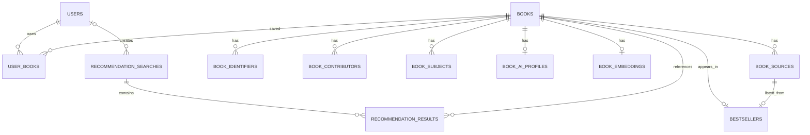

# 「好想找書」Data Model

> Path: `Docs/data/data-model.md`
> Authority: schema、relation、constraint、index、pgvector data contract
> Database: PostgreSQL + pgvector
> Migration owner: ASP.NET Core / EF Core

## 1. Scope

本文件定義 MVP 的持久化資料模型。實作不得另建與此文件不相容的 Book schema。

必須遵守上位架構：

- PostgreSQL + pgvector 為 source of truth。
- 一般搜尋只查 Local Database。
- 博客來 crawler 寫入 Book / Bestseller。
- Google Books 僅於 AI Candidate `< 5` 時使用，結果 normalize 後才能進入 Candidate Set。
- OpenAI / embedding 由 C# Web Application 處理；Python crawler 不寫 AI 資料。
- Bestseller 只保存最新 TOP 100。
- 成功的 Recommendation Search 必須持久化，且一定屬於某位使用者（AI 推薦需登入）。

---

## 2. Source Field Contract

Canonical `Book` 僅保存產品需要的共通資料；來源 identity 另存於 `book_sources`。


| Canonical field     | 博客來                 | Google Books               | Rule                                   |
| ------------------- | ---------------------- | -------------------------- | -------------------------------------- |
| `title`             | 商品標題               | `volumeInfo.title`         | required                               |
| `subtitle`          | 無穩定獨立欄位         | `volumeInfo.subtitle`      | nullable；不得由博客來標題字串自行拆解 |
| `contributors`      | 作者、原文作者、譯者等 | `volumeInfo.authors[]`     | `book_contributors`                    |
| `publisher`         | 出版社                 | `volumeInfo.publisher`     | nullable                               |
| `published_date`    | 出版日期               | `volumeInfo.publishedDate` | nullable                               |
| `language`          | 語言                   | `volumeInfo.language`      | nullable；正規化為語言代碼（§2.1）     |
| `description`       | 內容簡介               | `volumeInfo.description`   | nullable                               |
| `ISBN`              | 詳細資料 ISBN          | `industryIdentifiers[]`    | `book_identifiers`                     |
| `page_count`        | 規格中的頁數，若存在   | `volumeInfo.pageCount`     | nullable                               |
| `categories`        | 本書分類               | `volumeInfo.categories[]`  | `book_subjects`                        |
| `thumbnail_url`     | 商品封面圖片           | `imageLinks.*`             | nullable                               |
| `table_of_contents` | 目錄，若頁面存在       | 無標準`VolumeInfo` 欄位    | nullable                               |
| `source identity`   | 商品 URL               | Volume ID                  | `book_sources`                         |

博客來 parser 不得假設所有商品都有頁數、目錄或相同 DOM 結構；必要欄位解析失敗時應 fail loudly，不得大量寫入空值。

### 2.1 Language normalization

`books.language` 一律保存 BCP 47 形式的語言代碼：主語言小寫，地區大寫（`zh-TW`、`zh-CN`、`en`、`ja`）。來源的顯示文字不得直接寫入。

博客來「語言」欄位對照：

| 博客來 | `language` |
| ------ | ---------- |
| 繁體中文 | `zh-TW` |
| 簡體中文 | `zh-CN` |
| 英文 | `en` |
| 日文 | `ja` |
| 韓文 | `ko` |
| 其他 / 無法對照 | `NULL` |

不在對照表中的值寫 `NULL` 並記 log，不得猜測；需要時擴充此表。

Google Books `volumeInfo.language`：已是語言代碼，只做大小寫正規化（`zh-tw` → `zh-TW`）；沒有地區的值（`zh`）保持原樣，不補地區。

查詢比對：沒有地區的條件值匹配該語言所有地區（`zh` 匹配 `zh`、`zh-TW`、`zh-CN`）；有地區的條件值只精確匹配。

---

## 3. Entity Set

```text
users
books
book_sources
book_identifiers
book_contributors
book_subjects
book_ai_profiles
book_embeddings
bestsellers
user_books
recommendation_searches
recommendation_results
```

`Book` 代表一個 edition。MVP 不建立 Work / Edition 雙層模型。

---

## 4. ERD



---

## 5. Tables

### 5.1 `books`

Canonical book metadata。


| Column                     | PostgreSQL type | Null | Constraint             |
| -------------------------- | --------------- | ---: | ---------------------- |
| `id`                       | `uuid`          |   no | PK                     |
| `title`                    | `varchar(500)`  |   no |                        |
| `subtitle`                 | `varchar(500)`  |  yes |                        |
| `publisher`                | `varchar(255)`  |  yes |                        |
| `published_date`           | `date`          |  yes |                        |
| `published_date_precision` | `varchar(8)`    |  yes | `YEAR`, `MONTH`, `DAY` |
| `language`                 | `varchar(16)`   |  yes |                        |
| `description`              | `text`          |  yes | source-derived         |
| `table_of_contents`        | `text`          |  yes | source-derived only    |
| `page_count`               | `integer`       |  yes | `> 0`                  |
| `thumbnail_url`            | `text`          |  yes |                        |
| `created_at`               | `timestamptz`   |   no |                        |
| `updated_at`               | `timestamptz`   |   no |                        |

Google Books 的年份或年月日期必須搭配 `published_date_precision`，不得在 UI / API 中把補值日期當成來源確定日期。

Canonical merge priority for MVP:

```text
BOOKS_COM_TW non-null value
> GOOGLE_BOOKS non-null value
> NULL
```

`subtitle` 例外：博客來沒有可靠獨立欄位時不得自行推導。

---

### 5.2 `book_sources`

外部來源 identity。


| Column          | Type           | Null | Constraint                     |
| --------------- | -------------- | ---: | ------------------------------ |
| `id`            | `uuid`         |   no | PK                             |
| `book_id`       | `uuid`         |   no | FK →`books.id`, CASCADE       |
| `source_type`   | `varchar(32)`  |   no | `BOOKS_COM_TW`, `GOOGLE_BOOKS` |
| `external_id`   | `varchar(255)` |  yes | Google Volume ID 等            |
| `source_url`    | `text`         |   no |                                |
| `first_seen_at` | `timestamptz`  |   no |                                |
| `last_seen_at`  | `timestamptz`  |   no |                                |

Constraints:

```text
UNIQUE(source_type, source_url)
UNIQUE(source_type, external_id) WHERE external_id IS NOT NULL
```

博客來 crawler 仍以商品 URL 判斷同一來源紀錄是否已存在。

`last_seen_at`：博客來 crawler 在每次成功 run 的榜單替換 transaction 中，將榜上所有 BOOKS_COM_TW 來源的 `last_seen_at` 設為該次 run 的 captured_at（既有與新寫入者皆然）。這是來源紀錄的 metadata；Book 本身的欄位不因此改變。失敗的 run 不更新任何 `last_seen_at`。

---

### 5.3 `book_identifiers`


| Column             | Type          | Null |
| ------------------ | ------------- | ---: |
| `book_id`          | `uuid`        |   no |
| `identifier_type`  | `varchar(16)` |   no |
| `identifier_value` | `varchar(64)` |   no |

Allowed types:

```text
ISBN_10
ISBN_13
OTHER
```

Primary key:

```text
(book_id, identifier_type, identifier_value)
```

ISBN-10 / ISBN-13 必須跨 Book unique。

寫入前正規化 ISBN：移除 `-` 與空白、轉大寫、驗證格式與可驗證的 checksum。

---

### 5.4 `book_contributors`

保存來源顯示名稱，不建立全域 Person / Author identity。


| Column              | Type           | Null |
| ------------------- | -------------- | ---: |
| `book_id`           | `uuid`         |   no |
| `contributor_order` | `smallint`     |   no |
| `name`              | `varchar(255)` |   no |
| `role`              | `varchar(32)`  |   no |

Allowed roles:

```text
AUTHOR
ORIGINAL_AUTHOR
TRANSLATOR
EDITOR
ILLUSTRATOR
OTHER
```

Primary key:

```text
(book_id, contributor_order)
```

Google Books `authors[]` 在無角色資訊時一律 normalize 為 `AUTHOR`。

---

### 5.5 `book_subjects`

博客來分類與 Google Books categories 不共用 taxonomy，不做強制對應。


| Column        | Type           | Null |
| ------------- | -------------- | ---: |
| `book_id`     | `uuid`         |   no |
| `subject`     | `varchar(255)` |   no |
| `source_type` | `varchar(32)`  |   no |

Primary key:

```text
(book_id, subject, source_type)
```

---

### 5.6 `book_ai_profiles`

使用 source-derived metadata 產生的快速理解資料，不得覆寫 `books.description` 或 `books.table_of_contents`。


| Column                | Type           | Null | Constraint                   |
| --------------------- | -------------- | ---: | ---------------------------- |
| `book_id`             | `uuid`         |   no | PK, FK →`books.id`, CASCADE |
| `summary`             | `text`         |  yes |                              |
| `framework`           | `jsonb`        |  yes | structured overview          |
| `key_topics`          | `text[]`       |  yes |                              |
| `target_audience`     | `text`         |  yes |                              |
| `difficulty`          | `smallint`     |  yes | 1–5                         |
| `source_content_hash` | `char(64)`     |   no |                              |
| `model_name`          | `varchar(100)` |   no |                              |
| `prompt_version`      | `varchar(32)`  |   no |                              |
| `updated_at`          | `timestamptz`  |   no |                              |

AI Profile input 只允許既有 Book metadata，例如 title、contributors、publisher、subjects、description、table of contents。

若沒有真實目錄，`framework` 可以是 inferred overview，但不得聲稱為正式章節目錄。

MVP 用途：僅供 Recommendation 內部使用，提供推薦結果顯示的 `difficulty`。Profile 只在 Book 第一次出現於 Recommendation Result 後非同步產生；推薦排序不讀取 profile。產生時機與 prompt 見 `Docs/modules/recommendation.md`。

---

### 5.7 `book_embeddings`

每本 Book 在 MVP 只保留目前 retrieval embedding。


| Column                | Type           | Null |
| --------------------- | -------------- | ---: |
| `book_id`             | `uuid`         |   no |
| `embedding`           | `vector(1536)` |   no |
| `model_name`          | `varchar(100)` |   no |
| `source_content_hash` | `char(64)`     |   no |
| `updated_at`          | `timestamptz`  |   no |

Primary key:

```text
book_id
```

Foreign key：`book_id` → `books.id`，`ON DELETE CASCADE`（同 `book_ai_profiles`）。

Embedding model 為 OpenAI `text-embedding-3-small`（1536 維）。更換 model 代表新 migration 與全部向量重建，不只是改設定。

沒有 `book_embeddings` row 的 Book 不會進入 Candidate Set。

MVP 可先使用 exact vector search。只有量測證明需要 ANN 時再新增 HNSW index。

---

### 5.8 `bestsellers`

只保存目前有效的一份榜單：最多 100 筆，`rank` 保留博客來原始排名。爬取時被跳過的書使該排名缺號（例如 1..36、38..100），不重新編號。


| Column        | Type          | Null | Constraint              |
| ------------- | ------------- | ---: | ----------------------- |
| `rank`        | `smallint`    |   no | PK, 1–100              |
| `book_id`     | `uuid`        |   no | FK →`books.id`, UNIQUE |
| `source_id`   | `uuid`        |   no | FK →`book_sources.id`  |
| `captured_at` | `timestamptz` |   no |                         |

新榜單通過 crawler 驗證（見 `Docs/modules/crawler.md`）後才能 transaction replace；crawler failure 不得先清空上一版有效榜單。

---

### 5.9 `users`


| Column          | Type           | Null |
| --------------- | -------------- | ---: |
| `id`            | `uuid`         |   no |
| `email`         | `varchar(320)` |   no |
| `password_hash` | `text`         |   no |
| `display_name`  | `varchar(100)` |   no |
| `created_at`    | `timestamptz`  |   no |
| `updated_at`    | `timestamptz`  |   no |

Constraints:

```text
PRIMARY KEY(id)
UNIQUE(lower(email))
```

---

### 5.10 `user_books`


| Column           | Type          | Null | Constraint               |
| ---------------- | ------------- | ---: | ------------------------ |
| `user_id`        | `uuid`        |   no | FK →`users.id`, CASCADE |
| `book_id`        | `uuid`        |   no | FK →`books.id`, CASCADE |
| `reading_status` | `varchar(20)` |   no | enum below               |
| `rating`         | `smallint`    |  yes | 1–5                     |
| `added_at`       | `timestamptz` |   no |                          |
| `updated_at`     | `timestamptz` |   no |                          |

Primary key:

```text
(user_id, book_id)
```

Reading status:

```text
WANT_TO_READ
READING
FINISHED
```

---

### 5.11 `recommendation_searches`

Recommendation Search（AI 搜尋紀錄）。只保存成功的推薦（含 0 本結果）。


| Column             | Type          | Null |
| ------------------ | ------------- | ---: |
| `id`               | `uuid`        |   no |
| `user_id`          | `uuid`        |   no |
| `requirement_text` | `text`        |   no |
| `fallback_used`    | `boolean`     |   no |
| `created_at`       | `timestamptz` |   no |

`user_id` FK → `users.id`, CASCADE。AI 推薦需登入，因此不存在匿名紀錄。

每日上限以該使用者 Asia/Taipei 當日的 row 數計算，使用 `(user_id, created_at DESC)` index。

---

### 5.12 `recommendation_results`


| Column            | Type           | Null | Constraint                                 |
| ----------------- | -------------- | ---: | ------------------------------------------ |
| `search_id`       | `uuid`         |   no | FK →`recommendation_searches.id`, CASCADE |
| `book_id`         | `uuid`         |   no | FK →`books.id`, RESTRICT                  |
| `rank`            | `smallint`     |   no | 1–10                                      |
| `relevance_score` | `numeric(6,5)` |  yes |                                            |
| `reason`          | `text`         |   no |                                            |

Constraints:

```text
PRIMARY KEY(search_id, rank)
UNIQUE(search_id, book_id)
```

所有 result `book_id` 必須來自該次 Recommendation Candidate Set；此 invariant 由 Application / tests 驗證。

---

## 6. Cross-source Identity Resolution

Google Books record 寫入前依序判斷：

```text
1. ISBN-13 exact match
2. ISBN-10 exact match
3. same source identity
4. otherwise create new Book
```

無 ISBN 時，不得只因 title / author 相似就自動跨來源 merge。

命中既有 ISBN：

```text
existing Book
    + new BookSource
    + canonical merge
```

不得建立 duplicate Book。

博客來 crawler 對新商品（其 BOOKS_COM_TW `source_url` 尚未存在）套用相同的 ISBN-13 → ISBN-10 比對，但**不做 canonical merge**：
命中既有 Book 時只新增一筆 BOOKS_COM_TW `book_sources` 指向該 Book，不修改該 Book 的 metadata、identifiers、contributors 或 subjects。
同一 Book 不得在同一份榜單中出現兩次（`bestsellers.book_id` UNIQUE）。**暫定（temporary）**：目前此情況使本次 run 失敗；將於 #7 重新檢討（較可能的方向：跳過後一個排名，與 PARTIAL_SUCCESS 一致）。
（決策：Crawler ISBN 比對與附加來源，依使用者決定採用此方式。）

---

## 7. Write Ownership

### ASP.NET Core Web Application

可讀寫：

```text
users
user_books
books
book_sources
book_identifiers
book_contributors
book_subjects
book_ai_profiles
book_embeddings
recommendation_searches
recommendation_results
```

Google Books fallback 的 Book normalization / persistence 由 Web Application 負責。

### Python Crawler

只允許寫：

```text
books
book_sources
book_identifiers
book_contributors
book_subjects
bestsellers
```

不得寫：

```text
users
user_books
book_ai_profiles
book_embeddings
recommendation_*
```

Schema migration 只能由 EF Core migration 管理；crawler 不執行 DDL。

---

## 8. Required Indexes

除 PK / UNIQUE 自動索引外，至少建立：

```text
book_contributors(lower(name))
books(publisher)
books(published_date)
recommendation_searches(user_id, created_at DESC)
```

一般搜尋 MVP 查詢（規則見 `Docs/modules/book-catalog.md`）：

```text
ISBN 格式輸入 → book_identifiers 精確比對
其他輸入     → books.title ILIKE '%q%' OR book_contributors.name ILIKE '%q%'
```

一般搜尋不得依賴 Google Books 或 embedding。

任意 keyword query 效能不足時，再評估 `pg_trgm` / GIN；不要預先增加搜尋基礎設施。

---

## 9. Migration Order

```text
001_enable_pgvector
002_catalog
003_identity_user_library
004_bestseller
005_recommendation_history
006_ai_profile
007_indexes
008_require_recommendation_user
009_embedding
```

以上 9 個 migration 建立 12 張表與非向量索引（EF migration：`EnablePgvector`、`Catalog`、
`IdentityUserLibrary`、`Bestseller`、`RecommendationHistory`、`AiProfile`、`Indexes`、
`RequireRecommendationUser`、`Embedding`）。

- `008_require_recommendation_user`：`recommendation_searches.user_id` 改為 NOT NULL（§5.11）。不含資料步驟：既有 `user_id IS NULL` 的 row 會使 migration 失敗，需先處理。
- `009_embedding`：建立 `book_embeddings`（`vector(1536)`，見 §5.7）。

新的 schema 變更一律新增 migration，不回寫已套用的 migration。

Catalog 子表 `book_identifiers`、`book_contributors`、`book_subjects` 的 `book_id`
均為 FK → `books.id`，刪除採 CASCADE；`bestsellers` 的 Book / BookSource FK 採 RESTRICT。
這些規則補齊 ERD 關聯的刪除行為，其餘 FK 刪除規則依各表定義。

---

## 10. Required Data Invariants

1. `Book` 使用內部 UUID；外部 ID 不得作為 Book PK。
2. `(source_type, source_url)` 唯一。
3. Google Volume ID 在 `GOOGLE_BOOKS` 來源中唯一。
4. ISBN-10 / ISBN-13 不得屬於兩個 Book。
5. Google Books 命中既有 ISBN 時不得建立 duplicate Book。
6. 無 ISBN 不得只以 title / author heuristic 自動 merge。
7. `table_of_contents` 只能保存來源實際提供的目錄。
8. AI Profile 不得覆寫 source-derived metadata。
9. Python crawler 不得寫 embedding / AI Profile。
10. Bestseller rank 只能為 1–100、可缺號、不得重複，且同一 Book 只能出現一次。
11. Bestseller replacement 必須保持 transaction completeness：不會出現新舊榜單混合。
12. `rating` 只能為 `NULL` 或 1–5。
13. `reading_status` 只能為定義值。
14. Recommendation result 最多 10 本，且不得包含 Candidate Set 外的 Book。
15. `vector(1536)` 必須與 embedding model 維度一致。
16. `recommendation_searches.user_id` 不得為 `NULL`。

---

## 11. Source Verification

目前博客來中文書商品頁可觀察到：

- 商品標題；
- 作者，且部分商品另列原文作者、譯者；
- 出版社；
- 出版日期；
- 語言；
- 內容簡介；
- ISBN；
- 規格，常包含頁數；
- 本書分類；
- 封面圖片；
- 部分書籍提供目錄。

因此本文件的博客來 canonical mapping 僅依上述可觀察欄位設計；`subtitle`、`page_count`、`table_of_contents` 均允許 `NULL`，crawler 不得自行推測缺失資料。

Google Books `VolumeInfo` 提供 title、subtitle、authors、publisher、publishedDate、description、industryIdentifiers、categories、pageCount、imageLinks、language，可 normalize 至同一 Book model。

External verification references:

- Google Books API `VolumeInfo`: https://developers.google.com/books/docs/v1/reference/volumes
- 博客來商品頁範例：
  - https://www.books.com.tw/products/0011032989
  - https://www.books.com.tw/products/0010854417
