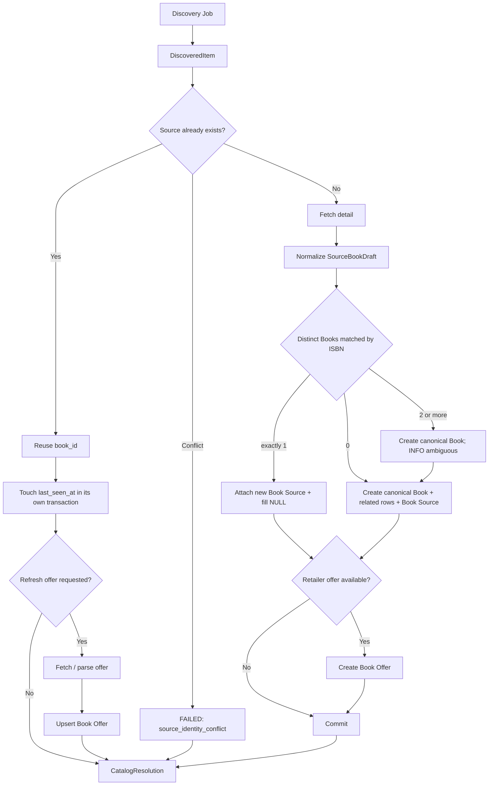
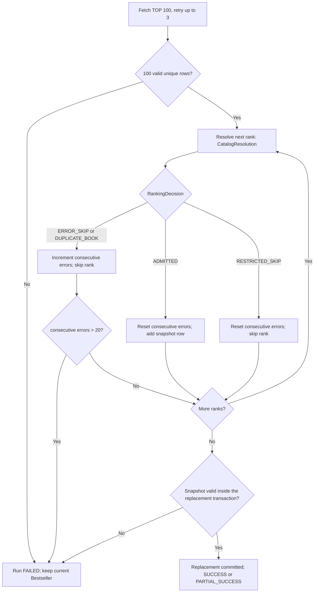

# Crawler Module

> Path: `Docs/modules/crawler.md`
> Authority: 外部書籍來源 discovery、Catalog ingestion、Book Source / Offer 寫入，以及目前博客來 Bestseller projection
> Runtime: Python one-shot batch（ADR-002），每日 04:00 (GMT+8) 由 cron 啟動
> Fetcher: curl_cffi Chrome fingerprint（見 §12）
> Container / scheduling: `crawler/Dockerfile`、`crawler/deploy/README.md`；每日總榜與每三天分類補書分別由 EC2 host cron 啟動，詳見 `Docs/deployment/deployment.md` §8。
> Data contract: `Docs/data/data-model.md`
> Requirements: CRAWL-01～06

## 1. Purpose

Crawler 的主要目標是：

> **持續擴充與維護本地 Book Catalog，讓真實書籍資料可以被 Search / Recommendation 使用。**

排行榜只是 discovery strategy 的其中一種。目前選擇博客來暢銷榜，是因為熱門書較可能符合更多使用者需求，適合作為第一批 Catalog seed；這不代表 crawler 架構只能抓排行榜，也不代表 Bestseller 是 Catalog 的核心模型。

Crawler 必須能逐步擴充：

- 博客來暢銷榜（§14）；
- 博客來分類頁（§15）；
- 新書頁 / 新書上市頁；
- 其他可合法且穩定取得的 discovery page；
- 未來其他書商 adapter；
- retailer 商品價格 / availability refresh。

不負責 Google Books、OpenAI、Embedding、Recommendation、Search、User、API、DDL。

目前的入口：

| 入口 | Discovery job | 規格 |
|---|---|---|
| `python -m books_crawler` | 每日中文書 7 日暢銷總榜 TOP 100（Catalog ingestion + Bestseller projection） | §14 |
| `python -m books_crawler.pages` | 分類榜補書（只做 Catalog ingestion） | §15 |
| `python -m books_crawler.first_book` | 只匯入排行榜第一名（診斷） | §16 |

---

## 2. Current implementation vs target contract

本文件描述 multi-source 的目標 contract（#113）。以下表格標示 crawler 目前的實作狀態（#116 phase A 與 phase B，2026-10-25）。查核基準 `a448b82` 之後，crawler 已實作：每日總榜 TOP 100、分類榜 pages mode、first-book diagnostic mode、curl_cffi / optional Playwright fetcher，以及下表標為「已實作」的規則。尚未完成者只剩下表中標示的 migration 011 與 `book_offers`：

| 規則 | 現行程式 | 由誰完成 |
|---|---|---|
| provider code（`source_code`）取代 `SourceType` enum | 已實作：crawler 只讀寫 `source_code`，migration 010 的 trigger 補 `source_type`（#116 phase B） | 已實作 |
| ISBN 正規化（data-model §7.1）與 distinct Book 比對（§6.3） | 已實作：§7.1 正規化（共用 fixture），寫入型別 `ISBN`，比對三種類型的 distinct Book。PR4（011）後只查 `ISBN` | 已實作；011 待完成 |
| 附加 Source 時補 NULL（§6.4） | 已實作：與附加同一 transaction，只補 NULL 欄位，日期成對，AUTHOR 條件式 | 已實作 |
| `last_seen_at` 看到就更新（§6.1） | 已實作：Existing Source 在獨立 transaction touch，三種模式共用重試與 policy；`replace_bestsellers` 不再更新 | 已實作 |
| 榜內重複時 Catalog 照常 commit（§14.2） | 已實作（phase A）：`RunLedger` 決定 DUPLICATE_BOOK，Catalog 側先 commit | 已實作 |
| 兩層 outcome 與計數（§10.2、§14.2） | 已實作（phase A）：`CatalogResolution`、`RankingDecision`，新 log 欄位 | 已實作 |
| disabled provider 拒絕執行（§3.1） | 已實作：cli 讀 `source_providers.enabled`，停用或未登錄時 exit 2，且不建立 fetcher | 已實作 |
| `book_offers` 寫入（§8） | 未實作；本系列也不實作，`offer_updated_count` 固定 0 | 未排程 |

程式碼 docstring 內的 `crawler.md §…` 引用已改為本文件的現行編號（phase A）。

本文件把 crawler 分成 generic core 與 provider adapter：

```text
Crawler Core
  ├─ Source Adapter: BOOKS_COM_TW (current)
  ├─ Source Adapter: future retailer A
  ├─ Source Adapter: future retailer B
  └─ Discovery Jobs
       ├─ bestseller
       ├─ categories
       ├─ new releases
       ├─ configured pages
       └─ offer refresh
```

既有博客來行為保留為 provider-specific rules（§11 起）；generic core 不得把「rank 1..100」當成所有來源都必須具備的欄位。

---

## 3. Core concepts

### 3.1 Source Provider

由 `source_providers.code` 識別（`Docs/data/data-model.md` §6.1）：

```text
BOOKS_COM_TW   enabled
GOOGLE_BOOKS   enabled（由 Web Recommendation fallback 使用，crawler 不處理）
KINGSTONE      disabled（future）
ESLITE         disabled（future）
```

- Crawler 只處理有 crawler adapter 的 provider。
- `enabled = false` 只代表不允許主動 acquisition：crawler 對 disabled provider 啟動 job 時，以設定錯誤拒絕執行（**exit 2**），不建立 fetcher、不發出請求。它不影響既有資料的讀取。
- 未登錄（查無 `source_providers` row）與 disabled 同樣是設定錯誤（**exit 2**）。
- 讀取 `source_providers` 的資料庫錯誤**不是**設定錯誤：run 以 FAILED 結束（**exit 1**），記一行 ERROR `could not read source_providers: <redacted>`，同樣不建立 fetcher、不發出請求。

### 3.2 Source Adapter

Provider-specific 的網路、HTML/API parsing 與 normalize 邏輯。

概念介面：

```text
provider_code
validate_discovery_target(...)
discover(...) -> DiscoveredItem[]
fetch_detail(item) -> SourceBookDraft
extract_offer(detail) -> OfferDraft | null
classify_restricted_or_terminal_page(...)
```

Adapter 不決定：canonical Book identity 的跨來源規則、DB schema、AI embedding、Recommendation ranking。

### 3.3 Discovery Job

回答「去哪裡找到值得匯入的 source listing」。Discovery 可以來自 bestseller / ranking page、category page、new release page、sitemap、curated configured URLs、provider-specific search / feed。

Discovery item 最少需要：

```text
provider_code
source_url
external_id?       # 若 discovery 已取得
context?           # rank/category/job metadata，不參與 Book identity
```

`rank` 只是一種 context，不是 core 欄位。

### 3.4 Book Source / Offer

- `Book Source` = provider 上的一個來源／商品 listing。
- `Book Offer` = retailer source 當下價格與 availability。

價格屬於 Source，不寫入 canonical `Book`。

### 3.5 兩層 outcome

每個 discovery item 先得到一個 Catalog 端的結果，排行榜 job 再對它做一次榜單端的決定：

| 層 | 值 | 誰使用 |
|---|---|---|
| `CatalogResolution` | `EXISTING`、`IMPORTED`、`ISBN_ATTACHED`、`AMBIGUOUS_CREATED`、`RESTRICTED`、`FAILED` | 所有 discovery job（§6.5） |
| `RankingDecision` | `ADMITTED`、`DUPLICATE_BOOK`、`RESTRICTED_SKIP`、`ERROR_SKIP` | 只有排行榜 job（§14.2；first_book 共用） |

`CatalogResolution` 只影響 Catalog 軸計數（§10.2）；連續錯誤計數只由 `RankingDecision` 決定（§14.3）。

---

## 4. Core invariants

1. Crawler 的核心目標是 Catalog acquisition，不是維護排行榜。
2. Provider identity 使用 `source_providers.code`；新增 provider 不得要求新增 DB enum value。
3. Source identity = `(source_code, external_id)`（若有）或 `(source_code, source_url)`；博客來 = `BOOKS_COM_TW + source_url`。
4. Canonical Book 跨來源去重依 data-model §7.2：正規化 ISBN 對到的 distinct Book 恰好 1 本才附加；0 本或 ≥ 2 本建立新 Book。無 ISBN 不以 title / author heuristic 自動 merge。
5. Existing Source 的 routine discovery 不重抓 detail、不覆寫 canonical Book metadata。
6. New Source 附加到既有 Book 時，只補 NULL（§6.4），不覆寫非 NULL 值。
7. Retailer Source 可建立／更新 current `book_offers`（目前未實作）。
8. `last_seen_at` 表示最後一次實際觀察到 Source 的時間，不依賴 Bestseller replacement 成功才更新（§6.1）。
9. Discovery job 可以沒有 ranking，也可以不是 100 筆。
10. Bestseller 僅是目前 `BOOKS_COM_TW` 的一個 specialized projection；榜內重複只讓該排名不進 projection，不撤銷已 commit 的 Catalog 寫入。
11. Crawler 只寫 Catalog / Source / Offer / provider-specific projection，不寫 AI、使用者資料或 schema。
12. 一個 provider / job 的失敗不得破壞其他 provider 已成功寫入的 Catalog 資料；job 失敗時不修改現有 Bestseller。

---

## 5. Generic ingestion flow



Catalog ingestion 成功後即成立，不需要等待某個 Bestseller snapshot commit。

---

## 6. Source resolution

### 6.1 Existing Source 與 `last_seen_at`

是否為 Existing Source **只能由 §6.2 判定**（data-model §7.3 是唯一的規則來源）。§6.2 會查完所有 identity key，回傳 Existing、Conflict 或 New Source 其中一種。本節只描述 §6.2 回傳 Existing Source **之後**要做的事：

```text
reuse source_id / book_id
do not fetch detail
touch: UPDATE book_sources SET last_seen_at = now（獨立 transaction，立即 commit）
canonical Book metadata unchanged
optionally refresh offer
→ CatalogResolution = EXISTING
```

`last_seen_at` 規則（每日榜單、分類榜、first_book 都適用）：

- **Existing Source**：discovery 看到時立即更新，使用獨立 transaction。之後即使判為榜內重複、snapshot 失敗或 run 中止，都不回滾。
- **New Source**：detail 解析成功且 Source 的 transaction 成功，才寫入 `first_seen_at = last_seen_at = now`；失敗時不寫任何資料。
- `last_seen_at` 只更新來源紀錄；Book 的 metadata 不因此改變。

**touch 失敗**：沿用該 item 既有的 DB 暫時性錯誤重試規則（§13：最多 3 次，含第一次；不重新抓 detail）。最後仍然失敗時：

- `CatalogResolution = FAILED`，`error_type = database_error`，`attempts` 記實際嘗試次數；
- `existing_source_count` 不加 1，`last_seen_at` 維持原值；
- touch 失敗只產生 `CatalogResolution.FAILED`，**整個 job 的最終狀態由各 discovery job 原本的 failure policy 決定**：

| 模式 | touch 最後仍然失敗 |
|---|---|
| 每日榜單 | 記為 `ERROR_SKIP`，繼續處理；除非因此觸發連續 21 本錯誤而中止（§14.3） |
| 分類榜 | 這一筆失敗，其他 item 與分類頁照常處理；最後 PARTIAL_SUCCESS 或 FAILED 依 §15.6、§15.7 |
| first_book | FAILED，exit 1（上限 0，§16） |

查詢既有 Source 本身（touch 之前的 SELECT）的資料庫錯誤維持現行行為：不在 §13 重試範圍內，例外逸出使 run FAILED（§15.6）。連線在這個 SELECT 中斷時也一樣：不做重連，run FAILED；重連規則只適用於 §13.1 的重試（touch、ISBN 查詢與寫入、寫入後的重新解析）。這是刻意的取捨：讀取失敗不會產生寫入，直接失敗比在這裡重連更簡單，而且保留既有的 run 失敗語意。

**Touch 的重連**：touch 的每次嘗試使用同一個 session，連線斷開時於下一次嘗試重連（同 §13.1）；最後仍失敗時依 §6.1 的模式 policy 處理。

### 6.2 Source identity 衝突與 URL 漂移

依 data-model §7.3 的完整矩陣：

- 下列兩種情況都視為 `source_identity_conflict`，結果是 `CatalogResolution = FAILED`、`error_type = source_identity_conflict`，不重試、不 touch、不補 NULL、不修改任何 Source：
  - `external_id` 和 `source_url` 分別對到不同的 Source。
  - `external_id` 沒有命中，但 URL 命中的 Source A 有另一個不是 NULL 的 `external_id`。
- `external_id` 對到 Source A，但 URL 沒有命中（URL 漂移）：保留 A 原本的 URL，記 WARNING，照常 touch A，結果是 `EXISTING`。
- `external_id` 沒有命中，URL 命中 Source A，而且 `A.external_id` 是 NULL：當成 Existing Source A，照常 touch。這個 release **不 backfill** `external_id`，只記 INFO。

博客來 adapter 不提供 `external_id`，只用 URL 查詢，所以目前不會遇到上面這些情況。這些規則是給之後的 adapter 和 Google Books writer 使用的。

### 6.3 New Source：ISBN 比對

```text
fetch detail（retry；§13）
normalize（§7）
用 draft 的所有正規化 ISBN 查 distinct book_id（data-model §7.2）
  = 0       → 建立新 Book + identifiers + contributors + subjects + Book Source   → IMPORTED
  = 1       → 附加 Book Source 到該 Book，並補 NULL（§6.4）                         → ISBN_ATTACHED
  ≥ 2       → 建立新 Book（同 = 0），記 INFO（rank/url、ISBN、命中的 book_id 們）  → AMBIGUOUS_CREATED
無 ISBN      → 建立新 Book                                                           → IMPORTED
（不得依書名／作者相似度合併）
```

- 同一家（例如兩個博客來商品頁）或不同書商的新來源，只要恰好對到 1 本就附加。
- 附加時記錄 INFO log：rank（或頁上排名）、url、命中的 ISBN、book_id。
- 每個新 Source 的寫入是一個 transaction（§9）。

### 6.4 補 NULL

只在 distinct Book 恰好 1 本時，與附加 Source 同一個 transaction，規則見 data-model §7.4（books 欄位只補 NULL、日期與精度成對、`subtitle` 不推測、真的補了才改 `updated_at`；Book 沒有 AUTHOR 才補 AUTHOR；identifiers 與本來源 subjects `ON CONFLICT DO NOTHING`）。Crawler 不碰 embedding 與 AI profile。

### 6.5 CatalogResolution

| `CatalogResolution` | 條件 |
|---|---|
| `EXISTING` | Source 已存在且 touch 成功 |
| `IMPORTED` | 0 本命中（或無 ISBN），新 Book 與 Source commit |
| `ISBN_ATTACHED` | 恰好 1 本命中，Source 附加並補 NULL，commit |
| `AMBIGUOUS_CREATED` | ≥ 2 本命中，新 Book 與 Source commit |
| `RESTRICTED` | 博客來限制級會員頁（§13.2） |
| `FAILED` | 重試用盡的 fetch / parse / database 錯誤、touch 失敗、`source_identity_conflict` |

---

## 7. SourceBookDraft contract

Generic normalized draft 至少包含：

```text
title                    required
subtitle                 optional
contributors             optional
publisher                optional
published_date           optional
published_date_precision optional
language                 optional
description              optional
table_of_contents        optional
page_count               optional
thumbnail_url            optional
identifiers              optional
subjects                 optional
external_id              optional
source_url               required
offer                    optional
```

Optional field 無法可靠取得時保持 NULL / empty，不建立 related row；不得推測。Required field（`title`）無法解析時 fail loudly（`ParseError`），不寫入空值。

### 7.1 Contributor role

```text
AUTHOR
ORIGINAL_AUTHOR
TRANSLATOR
EDITOR
ILLUSTRATOR
OTHER
```

博客來的對照見 §11.1。

### 7.2 ISBN

依 data-model §7.1 的正規化 protocol（Unicode 15.1 NFKC → 刪除 U+002D 與 Unicode 15.1 White_Space → ASCII-only 大寫），儲存為 `ISBN` 類型；不驗證長度與 checksum，正規化後為空字串時不寫入。Python 實作必須通過共用 fixture `tests/Fixtures/isbn-normalization.json`。

### 7.3 Publication date

依 data-model §6.2 保存實際精度（`YEAR`／`MONTH`／`DAY`）；不得把只有年份的日期偽裝成完整日，不得捏造缺失日期。

### 7.4 Language

依 data-model §3.1 對照表轉為語言代碼（「繁體中文」→ `zh-TW`）；不在表中 → `NULL` 並記 log。

---

## 8. Offer / price ingestion

> 目前未實作；本節是 adapter 必須允許的 contract。`offer_updated_count` 固定為 0。

Retailer adapter 可以從 detail page 或專用 offer-refresh job 產生：

```text
OfferDraft:
  currency
  price
  list_price
  availability
  captured_at
```

規則：

- 只保存來源明確可觀察到的公開價格。
- 會員個人價、coupon、運費不直接當成 `price`。
- 無法可靠判斷 → `price = NULL`。
- `book_offers` 是 current snapshot；新值以 upsert 取代舊值。
- Offer 更新不修改 canonical Book metadata。
- Source 已存在時可以只 refresh offer，不重新做 Book identity resolution。

### 8.1 Refresh strategy

```text
catalog discovery       -> new Source 才抓完整 detail
bestseller discovery    -> 對 existing Source 只 touch last_seen_at
new-release discovery   -> 同 catalog discovery
offer refresh           -> 對既有 retailer Source 重抓 offer fields
```

MVP 不要求對所有商品做高頻率價格更新；但 schema 與 adapter contract 必須允許未來加入排程。

---

## 9. Transactions 與 database writes

Crawler 只允許寫：

```text
books
book_sources
book_offers
book_identifiers
book_contributors
book_subjects
bestsellers
```

只讀 `source_providers`。不得寫 `users`、`user_books`、`book_ai_profiles`、`book_embeddings`、`recommendation_*`。Crawler 不執行 DDL；不讀寫 010 期間的 database-only `source_type` 欄位（data-model §11.4）。

每個 item 各自一個 transaction：

| 情境 | 同一 transaction 內 |
|---|---|
| New Book（`IMPORTED`、`AMBIGUOUS_CREATED`） | Book + identifiers + contributors + subjects + Book Source（+ optional Book Offer） |
| Attach Source to existing Book（`ISBN_ATTACHED`） | Book Source + 補 NULL（books 欄位、AUTHOR、identifiers、本來源 subjects）（+ optional Book Offer） |
| Existing Source touch（`EXISTING`） | `UPDATE book_sources.last_seen_at`（+ 未來的 upsert `book_offers`） |
| Bestseller replacement | 見 §14.4 |

失敗則 rollback 該 item，依 §13 重試 / 跳過；不得留下半套 Book / Source / Offer。

**Single writer**：在跨 process 的序列化完成以前，Catalog identity resolution 只允許一個 writer。PR4 不會解除這個限制。目前唯一的 writer 是 crawler（data-model §7.5）。所有連到 production DB 的 crawler 呼叫都必須經過 `run-crawler.sh` 的 `run.lock`，production 上不可以直接執行 container 或 module。目前 runner 只序列化 `daily` 和 `pages`；PR3 在 first_book 套用新的 identity resolution 之前，必須先讓 runner 支援 `first_book`（data-model §7.5）。crawler 目前不取 advisory lock。

---

## 10. Generic failure policy 與計數

### 10.1 Failure policy

不同 provider / discovery job 可以有自己的 retry 與 run-abort policy；generic core 只要求：

- 暫時性 fetch error 可以 retry。
- Deterministic parse / validation error 不應無限 retry。
- DB transaction error 必須 rollback。
- Item failure 不得留下半套 Book / Source / Offer。
- Job failure 不得刪除既有 Catalog。
- Provider-specific snapshot（例如 Bestseller）替換失敗時保留上一份 snapshot。

### 10.2 Catalog 軸計數

每個 item 依 `CatalogResolution` 累加（所有 job 相同）：

| CatalogResolution | `existing_book_count` | `new_book_count` | `attached_source_count` | `existing_source_count` | `new_source_count` | `ambiguous_isbn_count` |
|---|---|---|---|---|---|---|
| `EXISTING` | +1 | 0 | 0 | +1 | 0 | 0 |
| `IMPORTED` | 0 | +1 | 0 | 0 | +1 | 0 |
| `ISBN_ATTACHED` | +1 | 0 | +1 | 0 | +1 | 0 |
| `AMBIGUOUS_CREATED` | 0 | +1 | 0 | 0 | +1 | +1 |
| `RESTRICTED` / `FAILED` | 0 | 0 | 0 | 0 | 0 | 0 |

- 原有欄位的名稱與語意都保留：`existing_book_count` 含以 ISBN 附加到既有 Book 的新來源；`attached_source_count` 是其中以 ISBN 附加者。
- `items_seen`：實際送進 resolution 的 item 數。
- `offer_updated_count`：固定為 0（§8）。
- `skipped_count`、`restricted_book_count`、`error_count`：每日榜單與 first_book 依 `RankingDecision`（§14.2）；分類榜依 `CatalogResolution`（`RESTRICTED` → skipped +1、restricted +1；`FAILED` → skipped +1、error +1，§15.5）。

所有錯誤訊息經 `redact` 遮罩（§19.3）。

---

# Books.com.tw Adapter

以下規則只屬於目前 `BOOKS_COM_TW` adapter；未來其他書商不需要遵守博客來 DOM、排行榜筆數或限制級頁面規則。

## 11. Provider-specific normalization

| Target | 博客來資料 | Required |
|---|---|---:|
| `books.title` | 書名 | yes |
| `books.publisher` | 出版社 | no |
| `books.published_date` | 出版日期 | no |
| `books.language` | 語言 | no |
| `books.description` | 內容簡介 | no |
| `books.table_of_contents` | 目錄 | no |
| `books.page_count` | 規格頁數 | no |
| `books.thumbnail_url` | 封面 | no |
| `book_identifiers` | ISBN | no |
| `book_contributors` | 作者 / 原文作者 / 譯者等 | no |
| `book_subjects` | 本書分類 | no |
| `book_sources.source_url` | 商品 URL | yes |
| `book_offers` | 公開售價 / availability（可取得時；未實作） | no |

本書分類（`book_subjects.source_code = BOOKS_COM_TW`）的規則：

- 商品頁上**每一個** `本書分類` 群組中的**每一層**分類都保存為一筆 subject（例如 `人文社科`、`政治`、`政治人物`）。
- 去重後保存，依頁面出現順序。
- 規格只說「本書分類」，未規定層級；此為 2026-10-11 的產品決策。

博客來無可靠獨立 subtitle 欄位：`books.subtitle = NULL`，不得由書名字串自行拆解。

Optional field 無法可靠解析時保存 `NULL` / 不建立 related row；不得推測。

### 11.1 Contributor role 對照

```text
作者 → AUTHOR
原文作者 → ORIGINAL_AUTHOR
譯者 → TRANSLATOR
編者 → EDITOR
繪者 → ILLUSTRATOR
其他/無法可靠判斷 → OTHER
```

---

## 12. Books.com.tw fetcher

正式預設 fetcher 為 `curl_cffi==0.16.3` 的 Chrome fingerprint（使用者於 2026-10-11 明確核准），`CRAWLER_FETCHER=curl`。

- 介面（`fetcher.Fetcher`）：`get(url) -> str` 與 `close()`。`get` 的錯誤只有兩種：`FetchError`（該頁抓取失敗，交給 §13 重試或跳過）與 `BrowserUnavailableError`（環境無法使用瀏覽器，整次 run FAILED）。fetcher 由 `fetcher.create_fetcher(kind)` 依 `CRAWLER_FETCHER` 建立；其他值 → 設定錯誤，exit 2。一次 run 共用同一 session，結束時含失敗一定關閉。
- 循序執行；每次請求獨立以 uniform(3, 30) 取樣等待目標（秒），含第一次與重試；前次請求完成後的解析、DB 工作與重試 backoff 計入間隔，不重複加等。若這些工作已超過目標，就直接發出下一次請求；實際間隔可能因此超過 30 秒。
- 不自動跟隨 redirect，3xx 視為非 200 的抓取失敗，避免未經節流的隱藏請求。
- 使用 curl_cffi 內建 `impersonate="chrome"` 與 `Accept-Language: zh-TW,zh;q=0.9`，保持 TLS 憑證驗證；request timeout 為 30 秒。
- 回應分類（`fetcher.classify_page`，curl 與 browser 共用），依序判斷：Cloudflare challenge（`cf-mitigated: challenge` header，或 challenge 標題且沒有主要內容容器）→ 無書籍內容的「您的連線暫時異常」頁（即使 HTTP 200）→ 非 200。任一成立或 request error 即包成 `FetchError`，訊息文字兩個 adapter 相同；沿用 §13、§14.1 的重試與跳過政策，不自動切換 fingerprint 或 fetcher。
- 分類為失敗的頁面保存原始 HTML 與選定診斷 JSON（無 cookie／request headers）；curl 不產生 PNG。保存失敗不取代抓取失敗。
- `browser` 保留為手動選擇的診斷入口（2026-10-11 起不再提供 `http`）。curl_cffi 不執行 JavaScript，無法保證通過所有詳細頁的 Cloudflare 規則。
- 抓取政策（#108，使用者決定）：browser stealth、`navigator.webdriver` 修補、CAPTCHA 代解與代理 IP 輪替也可以使用（以 `AGENTS.md` §1.3 為準）；目前實作沒有這些功能。
- 單元／整合測試不連線博客來；真實網站抓取須有當前任務的使用者授權，成果另外記錄。

### 12.1 可選的 browser fetcher

博客來對一般 HTTP client 可能回傳 Cloudflare challenge；可選的 browser fetcher（`books_crawler/browser.py`）以 Playwright 驅動 headless Chromium，正式預設仍為 §12 的 curl fetcher。只有選擇 `browser` 時才載入 Playwright，curl 模式不需要安裝它。

- 介面同 §12（`get` 與 `close`）：`get` 回傳頁面載入完成後的 HTML；解析器與 DB 邏輯不依賴 fetcher 的實作。
- 一次 run 共用同一個瀏覽器 context，結束時（含失敗）一定關閉瀏覽器。
- 循序請求，每次請求使用 3～30 秒隨機間隔（同 §12）；只抓排行榜頁與資料庫尚未有的新來源詳細頁。
- 頁面經 §12 的共用回應分類判定為失敗（challenge、連線異常頁、HTTP 非 200）、逾時，或瀏覽器在頁面載入中崩潰（任何 Playwright 錯誤），一律包成 `FetchError`，視為該頁抓取失敗，交給 §13 的重試與跳過處理。
- 分類為失敗時，在關閉分頁前保存當下 PNG、HTML 與選定的診斷資訊至 `crawler/artifacts/challenges/`，並記錄檔案位置；每次嘗試使用不同檔名，不保存 cookie 或 request headers。輸出失敗不取代原本的 `FetchError`。單頁診斷入口與使用方式見 `crawler/README.md`，不存取 DB、不重試、不解驗證。
- 排行榜頁抓取失敗：套用 §14.1 的重試政策；3 次仍失敗則整次 FAILED，不跳過（分類頁例外，見 §15.4）。
- 無法啟動瀏覽器（Chromium 未安裝、缺少系統函式庫、driver 無法啟動）拋出 `BrowserUnavailableError`。它不是 `FetchError`：不重試、不跳過單本書，整次 run FAILED。
- 導覽逾時可由環境變數 `CRAWLER_NAV_TIMEOUT_MS` 設定（毫秒，1～300000，預設 30000；空值為預設；不合法 → 設定錯誤，exit code 2）。見 `crawler/README.md`。
- 瀏覽器 context 的 User-Agent 與語系：使用一般桌面 Chrome User-Agent 與 `zh-TW` 語系（使用者於 2026-10-11 核准）。
- 測試只用 HTML fixtures 與 fake fetcher，**測試中不啟動瀏覽器連線博客來**。瀏覽器 fetcher 本身只以本機假頁面（例如 Playwright 開啟本機 HTML 檔或 `data:` URL）驗證行為，除非使用者明確授權。

---

## 13. Books.com.tw retry / restricted rule

### 13.1 新來源詳細頁的重試

單一新 Source 最多 3 次嘗試（含第一次）。下列失敗可重試：

| 失敗 | 來源 | `error_type` | 下一次嘗試的範圍 |
|---|---|---|---|
| detail request 失敗（網路錯誤、逾時、非 200、challenge 頁、瀏覽器在頁面載入中崩潰） | `FetchError` | `fetch_error` | 重新 request 詳細頁 |
| required field（`title`）無法解析、product container 不存在等 | `ParseError`（或 draft 驗證失敗，皆為 `ValueError`） | `parse_error` | 重新 request 詳細頁 |
| 該來源的 ISBN 查詢、Source transaction 或 Existing Source touch 的資料庫錯誤 | `psycopg.Error`；transaction 已 rollback | `database_error` | **只重試寫入，沿用已解析的 draft，不重新 request 詳細頁** |

規則（決策：使用者，2026-10-11；D4）：

```text
最多 3 次嘗試（含第一次），所有失敗共用同一個計數
第 2 次嘗試前等待 1s，第 3 次嘗試前等待 2s（指數加倍；sleep 可注入，測試不實際等待）
3 次仍失敗 → CatalogResolution = FAILED，記錄 rank / url / error_type / error_message / attempts（= 3）
```

- 「只重試寫入」的理由：詳細頁已成功取得且解析完成，資料庫暫時失敗時重抓只會增加對博客來的請求量，對結果沒有幫助。
- **連線中斷（重連規則，#119）**：run 持有的資料庫連線若已被伺服器關閉或網路中斷（psycopg 的 `closed` 或 `broken` 為真；不以例外類別判斷），下一次嘗試前先丟棄舊連線（關閉時忽略錯誤）並透過注入的 connect 建立新連線，再於同一個 3 次預算內、同樣的 backoff 下重試；沿用已解析的 draft，不重新 request 詳細頁。之後 run 的所有資料庫操作（剩餘排名、榜單替換）都使用新連線。連線由 run 持有的 session 物件管理，不是模組層級狀態。
- **寫入重試前先重新解析身分**：若上一次寫入失敗發生在 Source 寫入的交易（persist）之後，該交易可能已在伺服器端 commit，而 client 沒有收到結果。因此下一次嘗試寫入前，先依 §7.3 重新解析該 URL 的 Source：
  - 若 Source 已存在（前一次嘗試已 commit）：不再插入。以該 Source 的 `book_id` 作為結果，`CatalogResolution` 報告為 `EXISTING`（原本的 `IMPORTED`／`ISBN_ATTACHED`／`AMBIGUOUS_CREATED` 未保存，無法還原）。§7.4 的補 NULL 與原交易同一個 transaction，不重複執行。touch 是冪等的，依一般規則處理。
  - 若 Source 不存在：照常寫入。
  - 重新解析本身失敗（連線錯誤）計為該次嘗試的 `database_error`，預算照常計算。
- `source_identity_conflict` 是確定性的，不重試。
- 失敗的新來源不建立任何資料列，也沒有失敗佇列。隔天若仍在榜上，它依然是新來源，會自然再嘗試一次。
- 排行榜頁使用同一個 retry 迴圈，但它的失敗永遠不是「跳過」，見 §14.1（分類頁例外，見 §15.4）。

### 13.2 限制級會員頁

**限制級例外（使用者，2026-10-11）**：來源回應明確包含「限制級商品」與「登入會員」，且沒有書籍內容容器時：

```text
CatalogResolution = RESTRICTED
error_type = restricted_book
no retry、不寫入資料
attempts 保留實際嘗試次數
不算一般錯誤（每日榜單為 RESTRICTED_SKIP，重設連續錯誤計數）
```

- 只有明確的會員限制頁適用；Cloudflare、HTTP 484、網站連線異常頁與一般解析／資料庫錯誤仍屬一般錯誤。
- 被排除的排名保留缺號；`restricted_book_count` 沒有上限。
- 實測（2026-10-11，使用者授權的本機 curl 抓取）：未登入時，限制級書籍回傳 **HTTP 200** 的會員限制頁，以 JavaScript `alert` 與 `location.href` 導向登入頁，不是 HTTP 3xx redirect，因此會由 fetcher 原樣交給 parser 判定（fixture：`crawler/tests/fixtures/restricted_gate_0011063006.html`）。登入後的同一本書是帶「限制級商品」標章的完整頁面，不屬於會員限制頁。

此規則是博客來 adapter-specific，不成為 generic crawler 規則。

---

## 14. Discovery job: daily bestseller

每日 04:00 (Asia/Taipei) 執行中文書 7 日暢銷總榜 TOP 100（`python -m books_crawler`，`job_name = daily-bestseller`）。

這個 job 同時做兩件事：

1. 使用榜單發現 / 確認 Catalog Sources（主要的 Catalog ingestion）。
2. 在 ingestion 完成後建立目前 `bestsellers` projection（Bestseller feature 的 specialized projection）。



Catalog 寫入（含 `last_seen_at` touch）在每個 item 處理時各自 commit；圖中任何 FAILED 都不撤銷它們。

### 14.1 Ranking contract

每筆必須取得 `rank` 與 `product_url`。整批必須滿足：

```text
row_count = 100
rank = 1..100
rank unique
product_url non-empty
product_url unique
```

- 任一驗證失敗：整次 run FAILED，不處理任何 item，現有 Bestseller 不變。排行榜頁不適用「跳過」規則。
- 排行榜頁 request 失敗（`FetchError`）時套用與 §13.1 相同的重試政策（最多 3 次，第 2 次前等 1s、第 3 次前等 2s；決策：使用者，2026-10-11；D2）；3 次仍失敗即整次 FAILED。
- 解析失敗（`ParseError`，例如不是 7 日暢銷榜頁）與筆數、rank、URL 驗證失敗是確定性的，不重試，在開 DB 連線前失敗。

### 14.2 Per-item processing 與 RankingDecision

依 rank 由小到大，每個排名先依 §6 得到 `CatalogResolution`，再決定 `RankingDecision`：

```text
CatalogResolution = RESTRICTED → RESTRICTED_SKIP
CatalogResolution = FAILED     → ERROR_SKIP
其他（EXISTING / IMPORTED / ISBN_ATTACHED / AMBIGUOUS_CREATED）：
    該 Book 已被較前面（rank 較小）的排名使用 → DUPLICATE_BOOK
    否則                                      → ADMITTED
```

| RankingDecision | `skipped_count` | `error_count` | `restricted_book_count` | `consecutive_error_count` |
|---|---|---|---|---|
| `ADMITTED` | 0 | 0 | 0 | reset |
| `DUPLICATE_BOOK` | +1 | +1 | 0 | +1 |
| `RESTRICTED_SKIP` | +1 | 0 | +1 | reset |
| `ERROR_SKIP` | +1 | +1 | 0 | +1 |

同一 Book 只能出現在榜單一次（`bestsellers.book_id` UNIQUE）。`DUPLICATE_BOOK`（決策：使用者，2026-10-11，#7；#113 修訂 Catalog 端行為）：

- 較前面的排名保留該 Book；較後面的排名不進 snapshot；
- skipped 項目記 `error_type = duplicate_book_in_ranking`，不重試（結果是確定的）；
- `attempts` 記錄實際嘗試次數：Existing Source 的重複不抓詳細頁，為 `0`；新來源的重複在詳細頁讀取後才發現，為該次嘗試的編號（通常為 `1`；若前面有暫時性失敗，則為 `2` 或 `3`）；
- **Catalog 這一側照常 commit**：Existing Source 的 `last_seen_at` touch、新 Source、補 NULL 都會寫入，Catalog 軸照 §10.2 計數；只有這個排名的 projection 失敗。

計數範例：

- 新來源以 ISBN 附加到既有 Book 之後，才發現該 Book 已在較前面的排名：`existing_book_count`、`attached_source_count`、`new_source_count`、`skipped_count`、`error_count` 各 +1，連續錯誤 +1。
- Existing Source 同榜重複：`existing_book_count`、`existing_source_count`、`skipped_count`、`error_count` 各 +1，連續錯誤 +1，**不會** reset。

### 14.3 Consecutive error rule

連續錯誤計數只由 `RankingDecision` 決定（使用者，2026-10-11）：

- 按原始 rank 順序處理。新來源最多三次嘗試後仍失敗（`ERROR_SKIP`），或榜內重複（`DUPLICATE_BOOK`），該排名計為一次一般錯誤；單次 request／parse／write 的重試失敗不各自累加。
- `ADMITTED` 與 `RESTRICTED_SKIP` 將 `consecutive_error_count` 歸零。`CatalogResolution` 本身（例如 `EXISTING`）不會改動計數。
- 連續 20 本一般錯誤仍繼續；第 21 本時立刻中止，run = FAILED、記錄 `aborted_at_rank`，不再處理後續排名。
- 例：連續 10 個 `ERROR_SKIP`，接著 1 個 `RESTRICTED_SKIP`，再接 1 個 `ERROR_SKIP` → 最後 `consecutive_error_count = 1`。
- `error_count` 僅為整次累計統計，沒有上限。只要沒有連續 21 本錯誤，處理完 100 個排名且 snapshot 有效，就替換榜單；有任何跳過時為 PARTIAL_SUCCESS。
- 中止前已各自 commit 的 Catalog 寫入（新 Book、新 Source、補 NULL、`last_seen_at` touch）保留，但不屬於新榜單；上一份榜單不變。排行榜不完整、環境或 snapshot 交易失敗仍使整次 FAILED，此規則不放寬其他失敗條件。

此規則只屬於此 discovery job，不套用分類榜。

### 14.4 Bestseller replacement

Snapshot row：

```text
rank, book_id, source_id, captured_at
```

成功走完整榜單後，Replace 在單一 transaction 內完成；任一失敗 → ROLLBACK，run FAILED，上一份榜單不變（`db.replace_bestsellers`）：

```text
BEGIN
檢查每列 source_id 為該列 Book 的 BOOKS_COM_TW 來源
       （查詢 source_id → book_id、source_code；不符即 SnapshotValidationError，尚未刪除現有榜單）
DELETE current bestsellers
INSERT snapshot rows
COMMIT
```

- **這個 transaction 不更新 `book_sources.last_seen_at`**。Source 的 observation 已在 per-item 處理時成立（§6.1），因此 snapshot 失敗不會抹消已成功確認／新增的 Catalog Source。
- 排行榜是 projection，不控制 Catalog freshness semantics。

### 14.5 Run status

| Status | 條件 | 榜單 | Exit code |
|---|---|---|---:|
| `SUCCESS` | 0 個排名被跳過 | 替換 | 0 |
| `PARTIAL_SUCCESS` | 有排名被跳過（含限制級、重複），完整處理 100 個排名，且未連續 21 本一般錯誤 | 替換 | 0 |
| `FAILED` | 排行榜不完整、連續一般錯誤 > 20、snapshot 驗證或替換失敗、`BrowserUnavailableError`、其他逸出的例外 | 不變 | 1 |
| 設定錯誤 | fetcher 設定不合法、provider disabled（§3.1） | 不執行 | 2 |

本節為每日完整榜單 run 的規則；分類榜（§15）與 first_book（§16）的狀態規則不同。

### 14.6 RunLedger 的分工

- `run.py` 的 resolver 負責重試、§6 的 Source resolution 與 touch，產生每個排名的 `CatalogResolution`。
- `crawler/books_crawler/ledger.py` 的 `RunLedger` 負責：由 `CatalogResolution` 與「Book 是否已在榜單」決定 `RankingDecision`；依 §10.2 與 §14.2 兩張表計數；§14.3 的連續錯誤與中止；§14.5 的狀態判定；run log 的計數欄位。每日 run 的上限為 20；first_book 用上限 0。
- 中止時 `error=` 為 `run aborted at rank <rank> after <n> consecutive error(s) (limit <limit>): <error_type>: <error_message>`。
- 每次 FAILED（含中止）只記一行 ERROR：每日 run 為 `run failed: <error>`，first_book 為 `first-book import failed: <error>`；被跳過的排名另由 ledger 記 WARNING（限制級為 INFO）。

Snapshot 的其他條件由誰保證（不在 replace 時重複檢查）：

- rank 在 1..100 且不重複：排行榜驗證（§14.1）只產生 rank 1..100 各一次；schema（`ck_bestsellers_rank`、rank 主鍵）再擋一次，違反即 rollback。
- `book_id` 不重複：`RunLedger` 以 `DUPLICATE_BOOK` 排除重複的 Book（§14.2）；schema 的 `book_id` unique index 再擋一次。
- 不重新編號；被跳過、重複與限制級的排名不進 snapshot，因此筆數 ≤ 100 − 被跳過數：`RunLedger` 只把 `ADMITTED` 的排名依原始 rank 放進 snapshot。
- 沒有最低筆數：`RunLedger` 與 replace 都不以累計錯誤數設下限；空 snapshot 也會替換（清空）榜單。

---

## 15. Discovery job: configured category pages

### 15.1 定位

- 目的：以博客來各分類的 7 日暢銷榜頁面取得更多 Book Sources（`job_name = category-pages`）。此 job 以抓新來源為主要目標；是否為排行榜頁只是目前頁面來源，不保存分類排名。
- **不是 Bestseller**：不寫入 `bestsellers`；不做 100 筆驗證與 snapshot 替換（§14.1、§14.4）；不套用榜內重複 Book 規則；沒有 `RankingDecision`，也沒有連續錯誤 streak。
- **會更新 `last_seen_at`**：Existing Source 看到即 touch；新 Source 寫入 `first_seen_at = last_seen_at = now`（§6.1）。
- `rank`、排名缺號與「上一份有效榜單」等概念不適用。log 中的 `rank` 僅指該分類頁上的排名。
- 本模式只寫 Catalog 相關資料表（§9）。未來 `new-release-pages` 或其他 provider 的 discovery config 可以用相同 core pattern 擴充。

### 15.2 入口

```bash
cd crawler
python -m books_crawler.pages
```

`books_crawler.pages` 以 `pages` 模式呼叫 `cli.main`（與 `books_crawler`、`books_crawler.first_book` 並列）。

### 15.3 分類頁清單（設定檔）

- 預設檔案：`crawler/category-pages.txt`，以套件位置為基準，不依工作目錄。
- 環境變數 `CRAWLER_PAGES_FILE`（非機密）：有值時改讀該路徑；相對路徑以執行時的工作目錄解析；空字串或只有空白視為未設定。
- 格式：每行一個 URL；以 `#` 開頭的行為註解；空行忽略；前後空白去除；同一 URL 重複時只保留第一次（重複的行記 INFO log）。
- 每個 URL 必須通過 `urls.is_category_ranking_url`（Books.com.tw adapter-specific）：
  - scheme 為 `https`，host 為 `www.books.com.tw`；
  - path 為 `/web/sys_saletopb/books/<兩位數分類>/`；
  - query 必須含 `attribute=7`，且 query 只能有 `attribute` 與 `loc` 兩個 key；`loc` 的值不驗證（僅為追蹤參數）。
- 驗證在任何 request 之前完成。檔案無法讀取（含非 UTF-8）、任一行不合格、或清單沒有任何 URL 時：記一行 ERROR（含檔案路徑與行號，但不回顯該行內容，因其可能含憑證；訊息經 `redact`），**exit code 2**，不建立 fetcher、不發出任何請求。

### 15.4 每個分類頁的流程

```text
依清單順序處理每個 URL：
  fetch（§12；最多 3 次，第 2 次前等 1s、第 3 次前等 2s，同 §14.1）
    └ 3 次仍 FetchError → 跳過此頁（fetch_error，attempts = 3）
  parse（parse_ranking）
    └ ParseError 或其他 ValueError → 跳過此頁（parse_error，attempts = 1，不重試）
  成功 → 依頁面順序逐列處理（見 §15.5）
```

- 單一分類頁被跳過後繼續下一頁，不影響其他頁。
- 不要求頁面必須為 100 筆；列數依頁面而定。

### 15.5 每列的規則

- 每一列套用 §6（Source resolution、touch、ISBN 比對、補 NULL）與 §7、§9、§11（normalize、每個 item 一個 transaction）。
- 單一新來源的重試與跳過依 §13：最多 3 次嘗試；限制級會員頁直接跳過、不重試、不算錯誤。
- 計數只依 `CatalogResolution`：Catalog 軸依 §10.2；`RESTRICTED` → `skipped_count`、`restricted_book_count` 各 +1；`FAILED` → `skipped_count`、`error_count` 各 +1。
- **不套用榜內重複 Book 規則**：同一 Book 出現在多頁時不跳過。Source 已存在者 touch 並重用（`EXISTING`）；新 URL 依 ISBN 比對附加或建立。
- **不套用連續錯誤中止**：單列失敗只計入跳過與 `error_count`，所有列都會處理。
- 已 commit 的 Catalog 寫入保留（§9，每個 item 各自一個 transaction）。

### 15.6 跳過與 FAILED 的界線

單一分類頁或單列的失敗（含 touch 最後仍失敗，§6.1）都不會使整次 run FAILED，只有下列情況才使 run FAILED（無法繼續）：

| 情況 | 說明 |
|---|---|
| 列處理中有例外逸出 | 例如查詢既有 Source 的資料庫錯誤（`db.find_source`，不在 §13 重試範圍內）或其他未預期例外。寫入新來源（ISBN 查詢、Source transaction）與 touch 的資料庫錯誤依 §13 重試，最後是該列 FAILED，不是 run FAILED。 |
| `BrowserUnavailableError` | browser fetcher 無法啟動（§12.1）。 |
| 全部分類頁都被跳過 | 訊息為 `all <N> category page(s) failed`。 |

### 15.7 Run status 與 exit code

| Status | 條件 | Exit code |
|---|---|---:|
| `SUCCESS` | 無任何頁或列被跳過 | 0 |
| `PARTIAL_SUCCESS` | 有分類頁或列被跳過（含限制級），且未 FAILED | 0 |
| `FAILED` | §15.6 任一條件 | 1 |
| 設定錯誤 | 分類頁清單不合法、fetcher 設定不合法（§12、§12.1）、provider disabled（§3.1） | 2 |

### 15.8 Log

- 每個分類頁開始：INFO `importing page: <url>`。
- 分類頁被跳過：WARNING `category page skipped after <n> attempt(s) (<error_type>): <url>: <error_message>`。
- 列被跳過：限制級為 INFO，其他為 WARNING `page rank <rank> (<url>) skipped after <n> attempt(s) (<error_type>): <error_message>`。
- 每次 run 結束，一行 INFO `mode=pages` 加上 `key=value` 欄位，順序為：
  `run_id`、`provider_code`、`job_name`、`started_at`、`finished_at`、`status`、`pages_total`（處理過的分類頁數，含跳過）、`pages_skipped`、`rows_seen`、`items_seen`、`existing_book_count`、`new_book_count`、`attached_source_count`、`existing_source_count`、`new_source_count`、`ambiguous_isbn_count`、`offer_updated_count`、`skipped_count`、`restricted_book_count`、`error_count`、`exit_code`，之後為 `skipped=[{rank, url, error_type, error_message, attempts}]`、`skipped_pages=[{url, error_type, error_message, attempts}]`；run 失敗時再加 `error=`。
  - 不包含 `ranking_count`、`consecutive_error_count`、`aborted_at_rank`（本模式沒有這些概念）。
- FAILED 時只記一行 ERROR：`pages import failed: <error>`。
- 所有 log 文字經 `redact` 遮罩（§19.3）。

### 15.9 不寫入的資料

- `bestsellers`（任何列都不寫）。
- 既有 Book 的非 NULL metadata（§6.4 只補 NULL）。
- 分類排名或分類榜快照（本模式不保存）。
- §9 列出的使用者、推薦相關資料表。

---

## 16. Diagnostic job: first book

使用者於 2026-10-11 要求新增只抓排行榜第一名的腳本：`python -m books_crawler.first_book`（`job_name = first-book`）。它不是產品 acquisition strategy，只用來驗證 discovery、detail parsing、Source resolution 與 DB transaction；每日完整榜單流程不受影響。

- 排行榜仍須通過 §14.1 的完整 100 筆驗證，僅對 rank 1 執行 §6 的 Source resolution，其餘排名不處理。
- 正規化、ISBN 比對、補 NULL、每個 item 一個 transaction 與 §13 的最多 3 次嘗試政策不變。
- Existing Source 依 §6.1 touch `last_seen_at`；新 Source 寫入 `first_seen_at = last_seen_at = now`。
- 不替換 `bestsellers`。
- 使用 `RunLedger` 上限 0（§14.6）。只有一個排名，因此不會出現 `DUPLICATE_BOOK`。
- Status 與 exit code：

| 結果 | Status | Exit code |
|---|---|---:|
| `EXISTING`、`IMPORTED`、`ISBN_ATTACHED`、`AMBIGUOUS_CREATED` | `SUCCESS` | 0 |
| 第一名為限制級（`RESTRICTED`） | `PARTIAL_SUCCESS` | 0 |
| 第一名一般失敗（`FAILED`，含 touch 失敗）、排行榜不完整、其他逸出例外 | `FAILED` | 1 |
| 設定錯誤（fetcher、provider disabled） | — | 2 |

- 使用相同 fetcher 設定與失敗診斷輸出；成功時記錄 INFO `rank=1 url=<url> book_id=<id> source_id=<id>`；summary 行以 `mode=first-book` 開頭，欄位同 §19.2。

---

## 17. Future provider contract

新增一個書商 adapter 時，最低工作單位：

```text
1. source_providers seed row（或把既有 disabled row 設為 enabled）
2. provider adapter
3. discovery job/config
4. HTML/API fixtures
5. normalization contract tests
6. Source identity tests（含 data-model §7.3 的衝突與 URL 漂移）
7. ISBN cross-source dedupe tests
8. Offer parsing tests（若為 RETAILER）
```

新增 provider 不應要求：修改 `books` table；增加 DB `SourceType` enum / check value；複製另一套 Book schema；把新 provider 寫進 generic crawler if/else tree 的所有層級。Provider-specific 差異應集中於 adapter。

`KINGSTONE`、`ESLITE` 在 migration 011 之前不能寫入（data-model §11.2）。

---

## 18. Validation

Crawler change 最低驗證：pytest + 存下來的博客來 HTML fixtures + 拋棄式 PostgreSQL（EF 產生的 schema），不打真實網站。

### 18.1 Generic core

1. Existing Source 不建立 duplicate Book / Source，不重抓、不覆寫 metadata。
2. ISBN 對到 0 本 → 新 Book；1 本 → 附加並補 NULL（日期成對、AUTHOR 條件、`updated_at` 只在真的補了值時更新）；≥ 2 本或 draft 的兩個 ISBN 各對到不同 Book → 新 Book，`new_book`、`new_source`、`ambiguous_isbn` 各 +1。
3. 既有 `ISBN_13` 資料與新 draft 的 `ISBN` 對到同一本 Book。
4. 無 ISBN 不以 title/author heuristic merge。
5. New Source transaction failure 不留下半套資料。
6. `last_seen_at`：Existing Source 在 abort 或 snapshot 失敗後仍保留更新；New Source 失敗時不寫任何資料；分類榜與 first_book 也會更新。
7. touch 失敗：暫時性錯誤重試後成功；最後仍失敗時，每日榜單為 `ERROR_SKIP` + `database_error` 且 run 繼續、分類榜只有該筆失敗、first_book FAILED exit 1；三種模式 `existing_source_count` 都不加 1、`last_seen_at` 維持原值。
8. Source identity 衝突：回報 `source_identity_conflict` 且沒有寫入；URL 漂移時保留既有 URL、記 WARNING、照常 touch。
9. ISBN 正規化讀共用 fixture `tests/Fixtures/isbn-normalization.json`，結果與 C# 逐 byte 一致。
10. disabled provider 的 job 以 exit 2 拒絕執行。
11. Retailer Offer / 新 provider 不依賴 DB closed enum（Offer 實作時再補 create / refresh 測試）。

### 18.2 Books.com.tw adapter

1. Ranking fixture 可解析 100 筆 rank + URL；少於 100 筆時 run FAILED。
2. URL identity 去重正確。
3. Detail optional field 缺失不產生推測資料；required field 缺失 fail loudly。
4. 限制級會員頁直接跳過、不重試。
5. Detail 失敗會重試 3 次後跳過，保留其他書原始排名。
6. 連續一般錯誤 20 本仍繼續、21 本立即 FAILED 且榜單不變；50 本交錯錯誤仍 PARTIAL_SUCCESS 並替換。`ADMITTED` 與 `RESTRICTED_SKIP` 重設計數；單本重試不重複計數；10 個 `ERROR_SKIP` + 1 個 `RESTRICTED_SKIP` + 1 個 `ERROR_SKIP` → 1。
7. 附加之後才發現同榜重複：計數完全符合 §14.2 範例；Existing Source 同榜重複：`existing_source`、skipped、error、consecutive 各 +1，不 reset。
8. Snapshot replacement 為 atomic transaction，且不更新 `last_seen_at`。
9. 分類榜單頁／單列 failure 不使其他頁中止；分類榜不寫 Bestseller。
10. Provider-specific parsing 不洩漏到 generic core tests。

PR3 前的現行測試位置與案例見 `crawler/docs/test-suite.md`；跨模組的 #113 驗證清單見 `Docs/testing/test-plan.md` §7。

---

## 19. Logging

### 19.1 每次嘗試與跳過

- 每次嘗試失敗記一筆 WARNING（rank、第幾次、error_type、error_message）。
- 限制級直接跳過記 INFO；其餘被跳過的排名另記一筆 WARNING。
- ISBN 附加與 ambiguous 各記 INFO（§6.3）；URL 漂移記 WARNING（§6.2）。
- run 失敗時記一行 ERROR（§14.6、§15.8、§16）。

### 19.2 Summary 行

每次 run 一行 `key=value` 的 INFO log（stdout），`skipped=` 為 JSON 陣列（無跳過時 `[]`）。每日 run 沒有前綴；first_book 前綴 `mode=first-book`；分類榜前綴 `mode=pages`，欄位見 §15.8。

每日 run 與 first_book 的欄位順序：

```text
run_id
provider_code             （BOOKS_COM_TW；每次 run 寫一次）
job_name                  （daily-bestseller / first-book；每次 run 寫一次）
started_at
finished_at
status
ranking_count
items_seen                （實際送進 resolution 的 item 數）
existing_book_count       （含以 ISBN 附加到既有 Book 的新來源）
new_book_count
attached_source_count     （existing_book_count 中以 ISBN 附加者）
existing_source_count
new_source_count
ambiguous_isbn_count
offer_updated_count       （固定 0）
skipped_count            （所有跳過，含限制級與榜內重複）
restricted_book_count    （限制級，不算錯誤）
error_count              （skipped_count - restricted_book_count；統計用，無累計上限）
consecutive_error_count  （目前連續一般錯誤數；ADMITTED / RESTRICTED_SKIP 歸零）
aborted_at_rank           （連續一般錯誤超過上限而中止時為該排名；否則 none。每日 run 上限 20，即第 21 本；first_book 上限 0，即 rank 1 一般失敗時為 1）
exit_code
skipped: [{rank, url, error_type, error_message, attempts}]
error                     （run 失敗時）
```

原有欄位的名稱與語意保留；新欄位（`provider_code`、`job_name`、`items_seen`、`existing_source_count`、`new_source_count`、`ambiguous_isbn_count`、`offer_updated_count`）由 PR3 加入。

### 19.3 Redact

不得記錄 secrets。所有寫入 log 的文字（上述每一行，包括 WARNING、ERROR，以及 `skipped` 內的 `error_message`）都先經過遮罩（`books_crawler/redact.py`）：

- `postgres://`、`postgresql://`、`postgresql+driver://` 開頭的連線字串一律改為 `postgresql://<redacted>`；
- `password=` / `pwd=` 的值改為 `<redacted>`；
- `DATABASE_URL` 的值永不輸出；錯誤訊息即使來自 psycopg 或 Playwright 並含有連線字串，也會被遮罩後才儲存與記錄。

---

## 20. Boundary and implementation impact

若變更涉及 Entity、column、constraint、index：

```text
Docs/data/data-model.md
→ EF Core migration（multi-source 的 010 / 011 須手寫或手改，data-model §11.4）
→ C# entities / persistence
→ Python crawler models / SQL
→ fixtures / tests
```

不得在 crawler 內自行建立或演化另一套 schema。Crawler 只能在 migration 010 部署之後才開始寫 `source_code`（data-model §14）；PR2 與 PR3 以同一個 release tag 部署。

Book detail 已由 `source_code` + `source_providers.display_name` 產生連結文字（PR2，#115 完成；`Docs/modules/book-catalog.md` §4）。未來 price comparison UI 再由 `book_offers` 產生價格列表。

---

## 21. Product boundary

這次設計調整代表：

- **現在就讓資料層與 crawler 架構可擴充多書商與價格。**
- **不代表 MVP 立刻實作所有書商 adapter 或價格比較 UI。**

Product Requirements 繼續把「其他書商實際 crawler」、「比價 UI」列為延後功能；但新的底層設計不得再把它們鎖死為需要重做 schema / crawler core 才能加入的功能。
