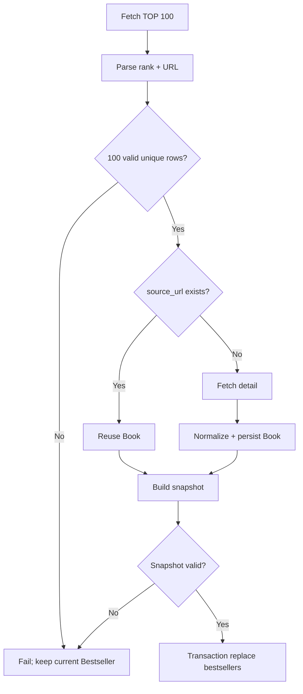

# Crawler Module

> Path: `Docs/modules/crawler.md`  
> Authority: 博客來 crawler 行為與資料寫入  
> Runtime: Python one-shot batch  
> Data contract: `Docs/data/data-model.md`

## 1. Scope

每日執行：

```text
博客來中文書 7 日暢銷總榜 TOP 100
→ parse rank + product URL
→ resolve existing Book
→ fetch/normalize new Book
→ validate 100-row snapshot
→ transaction replace bestsellers
```

不負責 Google Books、OpenAI、Embedding、Recommendation、Search、User、API、DDL。

## 2. Invariants

1. 目標固定為中文書 7 日暢銷總榜 TOP 100。
2. 博客來來源 identity = `BOOKS_COM_TW + source_url`。
3. Existing `source_url` 不重抓商品 detail、不覆寫 Book metadata。
4. New Book 才抓商品 detail 並依 `data-model.md` normalize。
5. Bestseller 只保存最新有效 TOP 100。
6. 新 snapshot 完整驗證前不得修改現有榜單。
7. Crawler 只寫 Catalog / Bestseller tables。
8. Crawler 不執行 schema migration。

## 3. Flow



## 4. Ranking Contract

每筆必須取得：

```text
rank
product_url
```

整批必須滿足：

```text
row_count = 100
rank = 1..100
rank unique
product_url non-empty
product_url unique
```

任一失敗：整次 run failed，現有 Bestseller 不變。

## 5. Book Resolution

查詢：

```text
book_sources.source_type = BOOKS_COM_TW
book_sources.source_url = product_url
```

Existing:

```text
reuse book_id
do not fetch detail
do not update Book metadata
```

New:

```text
fetch detail
normalize
persist Book + related source rows
```

## 6. Product Detail Contract

| Target | 博客來資料 | Required |
|---|---|---:|
| `books.title` | 商品標題 | yes |
| `books.publisher` | 出版社 | no |
| `books.published_date` | 出版日期 | no |
| `books.language` | 語言 | no |
| `books.description` | 內容簡介 | no |
| `books.table_of_contents` | 目錄 | no |
| `books.page_count` | 規格頁數 | no |
| `books.thumbnail_url` | 封面 | no |
| `book_identifiers` | ISBN | no |
| `book_contributors` | 作者/原文作者/譯者等 | no |
| `book_subjects` | 本書分類 | no |
| `book_sources.source_url` | 商品 URL | yes |

博客來無可靠獨立 subtitle 欄位：

```text
books.subtitle = NULL
```

不得由商品標題自行拆解。

Optional field 無法可靠解析時保存 `NULL` / 不建立 related row；不得推測。

## 7. Normalization

Contributor role：

```text
作者 → AUTHOR
原文作者 → ORIGINAL_AUTHOR
譯者 → TRANSLATOR
編者 → EDITOR
繪者 → ILLUSTRATOR
其他/無法可靠判斷 → OTHER
```

ISBN：

```text
remove "-" / whitespace
uppercase
validate format
validate checksum when possible
```

Publication date 必須依 `data-model.md` 保存實際精度，不得捏造缺失日期。

## 8. Database Writes

Crawler 只允許寫：

```text
books
book_sources
book_identifiers
book_contributors
book_subjects
bestsellers
```

New Book 核心寫入使用同一 transaction：

```text
Book
+ BookSource
+ identifiers
+ contributors
+ subjects
```

失敗則 rollback。

Crawler 不得寫：

```text
users
user_books
book_ai_profiles
book_embeddings
recommendation_*
```

## 9. Bestseller Replacement

Snapshot row：

```text
rank
book_id
source_id
captured_at
```

Replace 前必須驗證：

```text
100 rows
rank 1..100 and unique
book_id unique
source_id = same Book's BOOKS_COM_TW source
```

更新：

```text
BEGIN
DELETE current bestsellers
INSERT 100 new rows
COMMIT
```

任一 SQL 失敗：`ROLLBACK`；上一份有效榜單保留。

## 10. Failure Contract

以下任一情況 run failed：

- ranking request failed；
- 無法解析完整 100 筆；
- rank / URL 非法或重複；
- new Book detail request failed；
- required field 無法解析；
- parser/DOM 異常；
- Book transaction failed；
- snapshot validation / replacement failed。

失敗時：

```text
do not replace Bestseller
non-zero exit code
log failure
```

Parser 不得以大量 `NULL` 靜默通過 DOM breakage。

## 11. Logging

每次 run 至少記錄：

```text
run_id
started_at
finished_at
status
ranking_count
existing_book_count
new_book_count
failed_book_count
error_type
error_url
error_message
```

不得記錄 secrets。

## 12. Validation

Crawler change 最低驗證：

1. Ranking fixture 可解析 100 筆 rank + URL。
2. URL identity 去重正確。
3. Existing Book 不重抓、不覆寫 metadata。
4. New Book 符合 `data-model.md`。
5. Optional field 缺失不產生推測資料。
6. Required parse failure 會 fail loudly。
7. Bestseller rank / Book 唯一。
8. Snapshot replacement 為 atomic transaction。
9. Failure 不清空上一版有效榜單。

## 13. Boundary

若變更涉及 Entity、column、constraint、index：

```text
review/update Docs/data/data-model.md
→ EF Core migration
```

不得在 crawler 內自行建立或演化另一套 schema。
