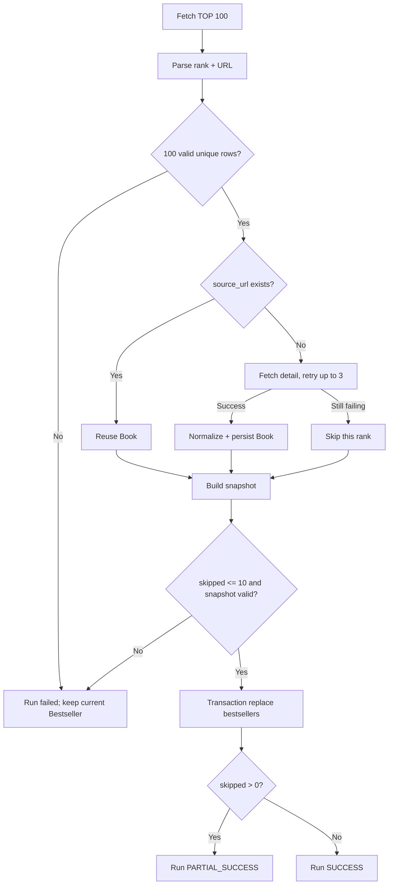

# Crawler Module

> Path: `Docs/modules/crawler.md`
> Authority: 博客來 crawler 行為與資料寫入
> Runtime: Python one-shot batch（ADR-002），每日 04:00 (GMT+8) 由 cron 啟動
> Data contract: `Docs/data/data-model.md`
> Requirements: CRAWL-01～06

## 1. Scope

```text
博客來中文書 7 日暢銷總榜 TOP 100
→ parse rank + product URL（必須完整 100 筆）
→ resolve existing Book
→ fetch / normalize new Book（重試；仍失敗則跳過）
→ 跳過數 ≤ 10 → transaction replace bestsellers
```

不負責 Google Books、OpenAI、Embedding、Recommendation、Search、User、API、DDL。

## 2. Invariants

1. 目標固定為中文書 7 日暢銷總榜 TOP 100。
2. 博客來來源 identity = `BOOKS_COM_TW + source_url`。
3. Existing `source_url` 不重抓商品 detail、不覆寫 Book metadata。
4. New Book 才抓商品 detail 並依 `data-model.md` normalize。
5. Bestseller 只保存最新一份；rank 保留博客來原始排名，被跳過的排名缺號，不重新編號。
6. 排行榜頁必須完整解析 100 筆；否則整次失敗。
7. 單次跳過的 Book 超過 10 本時整次失敗。
8. 失敗時不修改現有榜單。
9. Crawler 只寫 Catalog / Bestseller tables，不執行 schema migration。

## 3. Flow



## 4. Ranking Contract

每筆必須取得：

```text
rank
product_url
```

整批必須滿足：

```text
row_count = 100
rank = 1..100
rank unique
product_url non-empty
product_url unique
```

任一失敗：整次 run failed，現有 Bestseller 不變。排行榜頁不適用「跳過」規則。

## 5. Book Resolution

查詢：

```text
book_sources.source_type = BOOKS_COM_TW
book_sources.source_url = product_url
```

Existing：

```text
reuse book_id
do not fetch detail
do not update Book metadata
```

New：

```text
fetch detail（retry）
normalize
persist Book + related source rows
```

## 6. Retry 與 Skip

單一新書的下列失敗可重試並跳過：

- detail request 失敗（網路錯誤、逾時、5xx）；
- required field（`title`）無法解析；
- 該書的 Book transaction 失敗。

規則：

```text
最多 3 次嘗試，間隔逐次加長（例：1s、2s、4s）
3 次仍失敗 → 跳過該 rank，記錄 error_url / error_type
```

被跳過的書不建立任何資料列，也沒有失敗佇列。隔天若仍在榜上，它依然是新書，會自然再嘗試一次。

跳過上限：

```text
skipped_count ≤ 10 → 繼續替換榜單，run = PARTIAL_SUCCESS
skipped_count > 10 → run = FAILED，不替換榜單
```

上限的目的是偵測博客來改版：大量新書解析失敗應大聲失敗，而不是靜默產生殘缺榜單。

## 7. Product Detail Contract

| Target | 博客來資料 | Required |
|---|---|---:|
| `books.title` | 商品標題 | yes |
| `books.publisher` | 出版社 | no |
| `books.published_date` | 出版日期 | no |
| `books.language` | 語言 | no |
| `books.description` | 內容簡介 | no |
| `books.table_of_contents` | 目錄 | no |
| `books.page_count` | 規格頁數 | no |
| `books.thumbnail_url` | 封面 | no |
| `book_identifiers` | ISBN | no |
| `book_contributors` | 作者/原文作者/譯者等 | no |
| `book_subjects` | 本書分類 | no |
| `book_sources.source_url` | 商品 URL | yes |

博客來無可靠獨立 subtitle 欄位：`books.subtitle = NULL`，不得由商品標題自行拆解。

Optional field 無法可靠解析時保存 `NULL` / 不建立 related row；不得推測。

## 8. Normalization

Contributor role：

```text
作者 → AUTHOR
原文作者 → ORIGINAL_AUTHOR
譯者 → TRANSLATOR
編者 → EDITOR
繪者 → ILLUSTRATOR
其他/無法可靠判斷 → OTHER
```

ISBN：

```text
remove "-" / whitespace
uppercase
validate format
validate checksum when possible
```

Language：依 `data-model.md` §2.1 對照表轉為語言代碼（「繁體中文」→ `zh-TW`）；不在表中 → `NULL` 並記 log。

Publication date 必須依 `data-model.md` 保存實際精度，不得捏造缺失日期。

## 9. Database Writes

Crawler 只允許寫：

```text
books
book_sources
book_identifiers
book_contributors
book_subjects
bestsellers
```

New Book 核心寫入使用同一 transaction（每本書各自一個 transaction）：

```text
Book + BookSource + identifiers + contributors + subjects
```

失敗則 rollback 該書，並依 §6 重試 / 跳過。

Crawler 不得寫 `users`、`user_books`、`book_ai_profiles`、`book_embeddings`、`recommendation_*`。

## 10. Bestseller Replacement

Snapshot row：

```text
rank, book_id, source_id, captured_at
```

Replace 前必須驗證：

```text
90 ≤ row_count ≤ 100
rank ⊆ 1..100 and unique
book_id unique
source_id = same Book's BOOKS_COM_TW source
```

更新：

```text
BEGIN
DELETE current bestsellers
INSERT snapshot rows
COMMIT
```

任一 SQL 失敗：`ROLLBACK`；上一份有效榜單保留，run = FAILED。

## 11. Run Status

| Status | 條件 | 榜單 | Exit code |
|---|---|---|---:|
| `SUCCESS` | 0 本跳過 | 替換 | 0 |
| `PARTIAL_SUCCESS` | 1～10 本跳過 | 替換 | 0 |
| `FAILED` | 排行榜不完整、跳過 > 10、snapshot 驗證或替換失敗 | 不變 | 非 0 |

## 12. Logging

每次 run 至少記錄（stdout）：

```text
run_id
started_at
finished_at
status
ranking_count
existing_book_count
new_book_count
skipped_count
skipped: [{rank, url, error_type, error_message, attempts}]
```

不得記錄 secrets。

## 13. Validation

Crawler change 最低驗證（pytest + 存下來的博客來 HTML fixtures，不打真實網站）：

1. Ranking fixture 可解析 100 筆 rank + URL；少於 100 筆時 run FAILED。
2. URL identity 去重正確。
3. Existing Book 不重抓、不覆寫 metadata。
4. New Book 符合 `data-model.md`。
5. Optional field 缺失不產生推測資料。
6. Detail 失敗會重試 3 次後跳過，保留其他書原始排名。
7. 跳過 10 本 → PARTIAL_SUCCESS 並替換；跳過 11 本 → FAILED 且榜單不變。
8. Snapshot replacement 為 atomic transaction。

## 14. Boundary

若變更涉及 Entity、column、constraint、index：

```text
review/update Docs/data/data-model.md
→ EF Core migration
```

不得在 crawler 內自行建立或演化另一套 schema。
