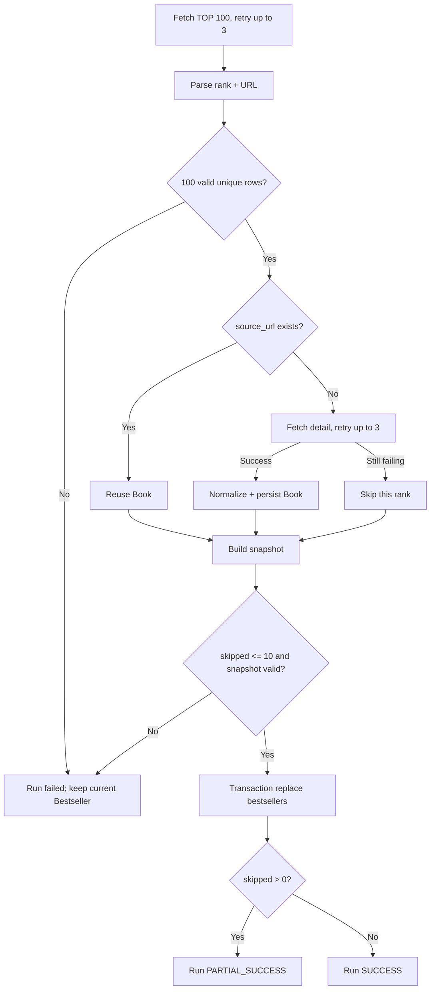

# Crawler Module

> Path: `Docs/modules/crawler.md`
> Authority: 博客來 crawler 行為與資料寫入
> Runtime: Python one-shot batch（ADR-002），每日 04:00 (GMT+8) 由 cron 啟動
> Fetcher: Playwright headless Chromium（ADR-006，見 §15）
> Data contract: `Docs/data/data-model.md`
> Requirements: CRAWL-01～06

## 1. Scope

```text
博客來中文書 7 日暢銷總榜 TOP 100
→ parse rank + product URL（必須完整 100 筆）
→ resolve existing Book
→ fetch / normalize new Book（重試；仍失敗則跳過）
→ 跳過數 ≤ 10 → transaction replace bestsellers
```

不負責 Google Books、OpenAI、Embedding、Recommendation、Search、User、API、DDL。

## 2. Invariants

1. 目標固定為中文書 7 日暢銷總榜 TOP 100。
2. 博客來來源 identity = `BOOKS_COM_TW + source_url`。
3. Existing `source_url` 不重抓商品 detail、不覆寫 Book metadata。
4. New Book 才抓商品 detail 並依 `data-model.md` normalize。
5. Bestseller 只保存最新一份；rank 保留博客來原始排名，被跳過的排名缺號，不重新編號。
6. 排行榜頁必須完整解析 100 筆；否則整次失敗。
7. 單次跳過的 Book 超過 10 本時整次失敗。
8. 失敗時不修改現有榜單。
9. Crawler 只寫 Catalog / Bestseller tables，不執行 schema migration。

## 3. Flow



## 4. Ranking Contract

每筆必須取得：

```text
rank
product_url
```

整批必須滿足：

```text
row_count = 100
rank = 1..100
rank unique
product_url non-empty
product_url unique
```

任一驗證失敗：整次 run failed，現有 Bestseller 不變。排行榜頁不適用「跳過」規則。

排行榜頁 request 失敗（`FetchError`）時套用與 §6 相同的重試政策（最多 3 次，第 2 次前等 1s、第 3 次前等 2s）；3 次仍失敗即整次 FAILED。解析失敗（`ParseError`，例如不是 7 日暢銷榜頁）與筆數、rank、URL 驗證失敗是確定性的，不重試。

## 5. Book Resolution

查詢：

```text
book_sources.source_type = BOOKS_COM_TW
book_sources.source_url = product_url
```

Existing：

```text
reuse book_id
do not fetch detail
do not update Book metadata
mark Book Source last_seen_at（僅於本次成功 run 的榜單替換 transaction 中，見 §10）
```

New（`source_url` 尚未存在）：

```text
fetch detail（retry）
normalize
ISBN 比對（僅依序：ISBN-13 → ISBN-10；data-model §6）：
  命中既有 Book
    → 只新增一筆 BOOKS_COM_TW book_sources，指向該既有 Book
    → 不新增 Book；不修改該 Book 的 metadata、identifiers、contributors、subjects（不做 canonical merge）
    → 此商品的 bestseller row 使用既有 book_id 與新的 source id
  未命中（或商品沒有 ISBN）
    → persist Book + related source rows
  （不得依書名／作者相似度合併）
單次 transaction 完成上述寫入（每個商品一個 transaction）
```

同一 Book 只能出現在榜單一次（`bestsellers.book_id` UNIQUE）。排名依 rank 由小到大處理；若某個排名列解析到的 Book 已被**較前面（rank 較小）**的排名使用（例如較前的是既有商品、較後的是新商品且 ISBN 命中同一 Book；或兩個新商品共用一個 ISBN），則**跳過較後面的排名**（決策：2026-10-11，#7）：

- 計入 skipped，`error_type = duplicate_book_in_ranking`，`attempts = 1`；確定性的結果，不重試；
- 不建立該商品的 `book_sources`，也不新增或修改任何 Book；
- 較前面的排名保留該 Book；
- 與其他跳過一樣計入 §11 的門檻（1～10 為 PARTIAL_SUCCESS，超過 10 為 FAILED）。

命中既有 Book 時記錄 INFO log：rank、url、命中的 ISBN、book_id。

## 6. Retry 與 Skip

單一新書的一次「嘗試」= detail request + parse + ISBN 比對 + 該書的 Book transaction。下列失敗屬於可重試的嘗試失敗：

| 失敗 | 來源 | `error_type` |
|---|---|---|
| detail request 失敗（網路錯誤、逾時、非 200、challenge 頁） | `FetchError` | `fetch_error` |
| required field（`title`）無法解析、product container 不存在等 | `ParseError`（或 `BookDraft` 驗證失敗，皆為 `ValueError`） | `parse_error` |
| 該書的 Book transaction（或 ISBN 查詢）資料庫錯誤 | `psycopg.Error`；transaction 已 rollback | `database_error` |

規則（決策：#7）：

```text
最多 3 次嘗試（含第一次）
第 2 次嘗試前等待 1s，第 3 次嘗試前等待 2s（指數加倍；sleep 可注入，測試不實際等待）
3 次仍失敗 → 跳過該 rank，記錄 rank / url / error_type / error_message / attempts（= 3）
```

被跳過的書不建立任何資料列，也沒有失敗佇列。隔天若仍在榜上，它依然是新書，會自然再嘗試一次。

跳過上限：

```text
skipped_count ≤ 10 → 繼續替換榜單，run = PARTIAL_SUCCESS
skipped_count > 10 → run = FAILED，不替換榜單
```

上限的目的是偵測博客來改版：大量新書解析失敗應大聲失敗，而不是靜默產生殘缺榜單。跳過數一旦超過 10，run 立即中止、不再處理之後的排名，以免改版時每一列都白白重試 3 次。中止前已各自 commit 的新 Book 保留（§9，每本書各自一個 transaction），但不屬於任何榜單，榜單與所有 `last_seen_at` 不變。

## 7. Product Detail Contract

| Target | 博客來資料 | Required |
|---|---|---:|
| `books.title` | 商品標題 | yes |
| `books.publisher` | 出版社 | no |
| `books.published_date` | 出版日期 | no |
| `books.language` | 語言 | no |
| `books.description` | 內容簡介 | no |
| `books.table_of_contents` | 目錄 | no |
| `books.page_count` | 規格頁數 | no |
| `books.thumbnail_url` | 封面 | no |
| `book_identifiers` | ISBN | no |
| `book_contributors` | 作者/原文作者/譯者等 | no |
| `book_subjects` | 本書分類 | no |
| `book_sources.source_url` | 商品 URL | yes |

本書分類（`book_subjects`，source_type `BOOKS_COM_TW`）的規則：

- 商品頁上**每一個** `本書分類` 群組中的**每一層**分類都保存為一筆 subject（例如 `人文社科`、`政治`、`政治人物`）。
- 去重後保存（PK 為 `(book_id, subject, source_type)`），依頁面出現順序。
- 規格只說「本書分類」，未規定層級；此為 2026-10-11 的產品決策。

博客來無可靠獨立 subtitle 欄位：`books.subtitle = NULL`，不得由商品標題自行拆解。

Optional field 無法可靠解析時保存 `NULL` / 不建立 related row；不得推測。

## 8. Normalization

Contributor role：

```text
作者 → AUTHOR
原文作者 → ORIGINAL_AUTHOR
譯者 → TRANSLATOR
編者 → EDITOR
繪者 → ILLUSTRATOR
其他/無法可靠判斷 → OTHER
```

ISBN：

```text
remove "-" / whitespace
uppercase
validate format
validate checksum when possible
```

Language：依 `data-model.md` §2.1 對照表轉為語言代碼（「繁體中文」→ `zh-TW`）；不在表中 → `NULL` 並記 log。

Publication date 必須依 `data-model.md` 保存實際精度，不得捏造缺失日期。

## 9. Database Writes

Crawler 只允許寫：

```text
books
book_sources
book_identifiers
book_contributors
book_subjects
bestsellers
```

New Book 核心寫入使用同一 transaction（每本書各自一個 transaction）：

```text
Book + BookSource + identifiers + contributors + subjects
```

失敗則 rollback 該書，並依 §6 重試 / 跳過。

Crawler 不得寫 `users`、`user_books`、`book_ai_profiles`、`book_embeddings`、`recommendation_*`。

## 10. Bestseller Replacement

Snapshot row：

```text
rank, book_id, source_id, captured_at
```

Replace 前必須驗證（任一失敗 → run FAILED，榜單不變）：

```text
90 ≤ row_count ≤ 100                      （跳過上限 10，故下限 90）
rank ⊆ 1..100 and unique                  （允許缺號，不得重新編號）
book_id unique
source_id = same Book's BOOKS_COM_TW source
    （以資料庫查詢 source_id → book_id，須為 source_type = BOOKS_COM_TW 且 book_id 相同）
```

更新：

```text
BEGIN
DELETE current bestsellers
INSERT snapshot rows
UPDATE book_sources SET last_seen_at = captured_at
       WHERE id IN (snapshot source_ids)   -- 所有榜上的 Book Source，既有與新寫入者皆然
COMMIT
```

- `last_seen_at` 只更新 Book Source 的來源紀錄；Book 的 metadata 永不因此改變。
- 與榜單替換同一 transaction：失敗的 run 不更新任何 `last_seen_at`。
- 任一 SQL 失敗：`ROLLBACK`；上一份有效榜單與 `last_seen_at` 保留，run = FAILED。

## 11. Run Status

| Status | 條件 | 榜單 | Exit code |
|---|---|---|---:|
| `SUCCESS` | 0 本跳過 | 替換 | 0 |
| `PARTIAL_SUCCESS` | 1～10 本跳過 | 替換 | 0 |
| `FAILED` | 排行榜不完整、跳過 > 10、snapshot 驗證或替換失敗 | 不變 | 非 0 |

## 12. Logging

每次 run 至少記錄（stdout）：

```text
run_id
started_at
finished_at
status
ranking_count
existing_book_count       （含以 ISBN 附加到既有 Book 的新商品）
new_book_count
attached_source_count     （existing_book_count 中以 ISBN 附加者）
skipped_count
skipped: [{rank, url, error_type, error_message, attempts}]
```

實作格式（#7）：每次 run 一行 `key=value` 的 INFO log，`skipped=` 為 JSON 陣列（無跳過時 `[]`）。每次嘗試失敗記一筆 WARNING（rank、第幾次、error_type），每本被跳過的書另記一筆 WARNING。run 失敗時記 ERROR（`error=`）。

不得記錄 secrets：`DATABASE_URL`（含帳密的 `postgres://` / `postgresql://` 字串）一律遮罩為 `postgresql://<redacted>`；錯誤訊息中出現的 URL 同樣遮罩。

## 13. Validation

Crawler change 最低驗證（pytest + 存下來的博客來 HTML fixtures，不打真實網站）：

1. Ranking fixture 可解析 100 筆 rank + URL；少於 100 筆時 run FAILED。
2. URL identity 去重正確。
3. Existing Book 不重抓、不覆寫 metadata。
4. New Book 符合 `data-model.md`。
5. Optional field 缺失不產生推測資料。
6. Detail 失敗會重試 3 次後跳過，保留其他書原始排名。
7. 跳過 10 本 → PARTIAL_SUCCESS 並替換；跳過 11 本 → FAILED 且榜單不變。
8. Snapshot replacement 為 atomic transaction。

## 14. Boundary

若變更涉及 Entity、column、constraint、index：

```text
review/update Docs/data/data-model.md
→ EF Core migration
```

不得在 crawler 內自行建立或演化另一套 schema。

## 15. Fetcher（取得頁面）

博客來對一般 HTTP client 回傳 Cloudflare challenge，因此 production fetcher 以 Playwright 驅動 headless Chromium（ADR-006）。

- 介面不變：`get(url) -> str`，回傳頁面載入完成後的 HTML；解析器與 DB 邏輯不依賴 fetcher 的實作。
- 一次 run 共用同一個瀏覽器 context，結束時（含失敗）一定關閉瀏覽器。
- 循序請求，每頁之間至少間隔 1 秒；只抓排行榜頁與資料庫尚未有的新書詳細頁。
- 頁面仍是 challenge 頁、HTTP 非 200 或逾時，視為該頁抓取失敗，交給 §6 的重試與跳過處理；排行榜頁失敗則整次失敗。（頁面結構不符屬於解析失敗，由解析器報錯。）
- 不使用反偵測或 stealth 外掛、CAPTCHA 代解服務或代理 IP 輪替。
- 測試仍只用 HTML fixtures 與 fake fetcher，**測試中不啟動瀏覽器連線博客來**。瀏覽器 fetcher 本身只以本機假頁面（例如 Playwright 開啟本機 HTML 檔或 `data:` URL）驗證行為。
