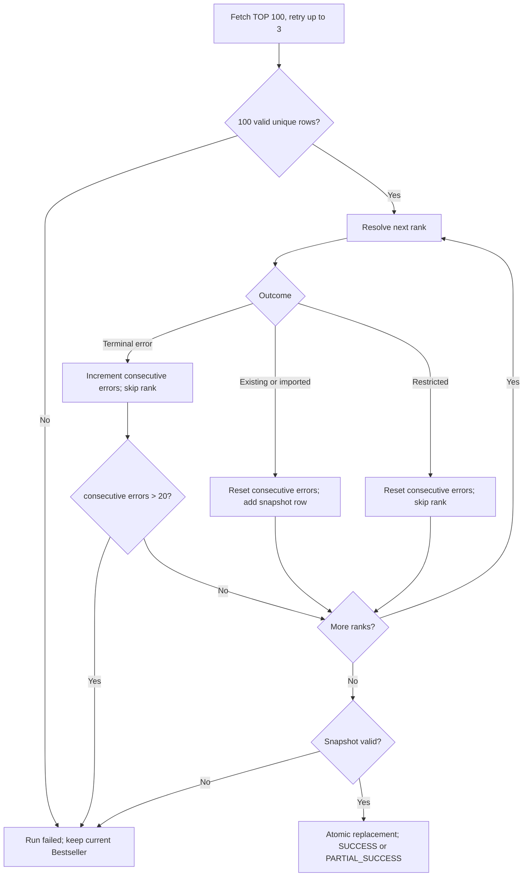

# Crawler Module

> Path: `Docs/modules/crawler.md`
> Authority: 博客來 crawler 行為與資料寫入
> Runtime: Python one-shot batch（ADR-002），每日 04:00 (GMT+8) 由 cron 啟動
> Fetcher: curl_cffi Chrome fingerprint（見 §15）
> Data contract: `Docs/data/data-model.md`
> Requirements: CRAWL-01～06

## 1. Scope

```text
博客來中文書 7 日暢銷總榜 TOP 100
→ parse rank + product URL（必須完整 100 筆）
→ resolve existing Book
→ fetch / normalize new Book（重試；仍失敗則跳過）
→ 未出現連續 21 本非限制級錯誤 → transaction replace bestsellers
```

不負責 Google Books、OpenAI、Embedding、Recommendation、Search、User、API、DDL。

## 2. Invariants

1. 目標固定為中文書 7 日暢銷總榜 TOP 100。
2. 博客來來源 identity = `BOOKS_COM_TW + source_url`。
3. Existing `source_url` 不重抓 detail 頁、不覆寫 Book metadata。
4. New Book 才抓 detail 頁 並依 `data-model.md` normalize。
5. Bestseller 只保存最新一份；rank 保留博客來原始排名，被跳過的排名缺號，不重新編號。
6. 排行榜頁必須完整解析 100 筆；否則整次失敗。
7. 限制級會員頁直接跳過且不重試；只有連續非限制級錯誤超過 20 本時整次失敗；非連續錯誤沒有累計上限。
8. 失敗時不修改現有榜單。
9. Crawler 只寫 Catalog / Bestseller tables，不執行 schema migration。

## 3. Flow



## 4. Ranking Contract

每筆必須取得：

```text
rank
product_url
```

整批必須滿足：

```text
row_count = 100
rank = 1..100
rank unique
product_url non-empty
product_url unique
```

任一驗證失敗：整次 run failed，現有 Bestseller 不變。排行榜頁不適用「跳過」規則。

排行榜頁 request 失敗（`FetchError`）時套用與 §6 相同的重試政策（最多 3 次，第 2 次前等 1s、第 3 次前等 2s）；3 次仍失敗即整次 FAILED。解析失敗（`ParseError`，例如不是 7 日暢銷榜頁）與筆數、rank、URL 驗證失敗是確定性的，不重試。

## 5. Book Resolution

查詢：

```text
book_sources.source_type = BOOKS_COM_TW
book_sources.source_url = product_url
```

Existing：

```text
reuse book_id
do not fetch detail
do not update Book metadata
mark Book Source last_seen_at（僅於本次成功 run 的榜單替換 transaction 中，見 §10）
```

New（`source_url` 尚未存在）：

```text
fetch detail（retry；見 §6）
normalize
ISBN 比對（僅依序：ISBN-13 → ISBN-10；data-model §6）：
  命中既有 Book
    → 只新增一筆 BOOKS_COM_TW book_sources，指向該既有 Book
    → 不新增 Book；不修改該 Book 的 metadata、identifiers、contributors、subjects（不做 canonical merge）
    → 此排名的 bestseller row 使用既有 book_id 與新的 source id
  未命中（或沒有 ISBN）
    → persist Book + related source rows
  （不得依書名／作者相似度合併）
單次 transaction 完成上述寫入（每本新 Book 一個 transaction）
```

同一 Book 只能出現在榜單一次（`bestsellers.book_id` UNIQUE）。排名依 rank 由小到大處理；若某個排名列解析到的 Book 已被**較前面（rank 較小）**的排名使用（例如較前的是既有 BOOKS_COM_TW source、較後的是新 source 且 ISBN 命中同一 Book；或兩個新 source 共用一個 ISBN），則**跳過較後面的排名**（決策：使用者，2026-10-11，#7）：

- 計入 skipped，`error_type = duplicate_book_in_ranking`，不重試（結果是確定的）；
- `attempts` 記錄實際嘗試次數：既有 URL 的重複不抓詳細頁，為 `0`；ISBN 命中的重複在詳細頁讀取後才發現，為該次嘗試的編號（通常為 `1`；若前面有暫時性失敗，則為 `2` 或 `3`）；
- 不建立該排名的 `book_sources`，也不新增或修改任何 Book；
- 較前面的排名保留該 Book；
- 計為一次一般錯誤，累加 §6 的連續錯誤計數；只有連續第 21 本才中止，不設累計上限。

命中既有 Book 時記錄 INFO log：rank、url、命中的 ISBN、book_id。

## 6. Retry 與 Skip

**限制級例外（使用者，2026-10-11）**：來源回應明確包含「限制級商品」與「登入會員」，且沒有書籍內容容器時，直接跳過，`error_type=restricted_book`，不重試、不寫入資料、不累加連續錯誤並將連續錯誤計數歸零；`attempts` 保留實際嘗試次數。只有明確的會員限制頁適用；Cloudflare、HTTP 484、網站連線異常頁與一般解析／資料庫錯誤仍屬一般錯誤，單本最終失敗才累加一次連續錯誤。被排除的排名保留缺號；`restricted_book_count` 與累計 `error_count` 都沒有中止上限。

單一新書最多 3 次嘗試（含第一次）。下列失敗可重試：

| 失敗 | 來源 | `error_type` | 下一次嘗試的範圍 |
|---|---|---|---|
| detail request 失敗（網路錯誤、逾時、非 200、challenge 頁、瀏覽器在頁面載入中崩潰） | `FetchError` | `fetch_error` | 重新 request 詳細頁 |
| required field（`title`）無法解析、product container 不存在等 | `ParseError`（或 `BookDraft` 驗證失敗，皆為 `ValueError`） | `parse_error` | 重新 request 詳細頁 |
| 該書的 ISBN 查詢或 Book transaction 資料庫錯誤 | `psycopg.Error`；transaction 已 rollback | `database_error` | **只重試寫入，沿用已解析的 draft，不重新 request 詳細頁** |

規則（決策：使用者，2026-10-11；D4）：

```text
最多 3 次嘗試（含第一次），兩種失敗共用同一個計數
第 2 次嘗試前等待 1s，第 3 次嘗試前等待 2s（指數加倍；sleep 可注入，測試不實際等待）
3 次仍失敗 → 跳過該 rank，記錄 rank / url / error_type / error_message / attempts（= 3）
```

「只重試寫入」的理由：詳細頁已成功取得且解析完成，資料庫暫時失敗時重抓只會增加對博客來的請求量，對結果沒有幫助。

被跳過的書不建立任何資料列，也沒有失敗佇列。隔天若仍在榜上，它依然是新書，會自然再嘗試一次。

排行榜頁（§4）的重試使用同一個 retry 迴圈，但它的失敗永遠不是「跳過」，見 §4 與 §15。

連續錯誤中止規則（使用者，2026-10-11）：

- 按原始 rank 順序處理。新書最多三次嘗試後仍失敗，或確定性的重複 Book 跳過，該本計為一次一般錯誤；單次 request／parse／write 的重試失敗不各自累加。
- 成功匯入、附加來源或重用既有 URL：`consecutive_error_count = 0`。
- 明確的限制級會員頁：直接跳過、不重試，`consecutive_error_count = 0`。
- 連續 20 本一般錯誤仍繼續；第 21 本時立刻中止，run = FAILED、記錄 `aborted_at_rank`，不再處理後續排名。
- `error_count` 僅為整次累計統計，沒有上限。只要沒有連續 21 本錯誤，處理完 100 個排名且 snapshot 有效，就替換榜單；有任何跳過時為 PARTIAL_SUCCESS。

中止前已各自 commit 的新 Book 保留（§9，每本書各自一個 transaction），但不屬於新榜單；上一份榜單與所有既有來源的 `last_seen_at` 不變。排行榜不完整、環境或 snapshot 交易失敗仍使整次 FAILED，此規則不放寬其他失敗條件。

## 7. Product Detail Contract

| Target | 博客來資料 | Required |
|---|---|---:|
| `books.title` | 書名 | yes |
| `books.publisher` | 出版社 | no |
| `books.published_date` | 出版日期 | no |
| `books.language` | 語言 | no |
| `books.description` | 內容簡介 | no |
| `books.table_of_contents` | 目錄 | no |
| `books.page_count` | 規格頁數 | no |
| `books.thumbnail_url` | 封面 | no |
| `book_identifiers` | ISBN | no |
| `book_contributors` | 作者/原文作者/譯者等 | no |
| `book_subjects` | 本書分類 | no |
| `book_sources.source_url` | 商品 URL | yes |

本書分類（`book_subjects`，source_type `BOOKS_COM_TW`）的規則：

- 商品頁上**每一個** `本書分類` 群組中的**每一層**分類都保存為一筆 subject（例如 `人文社科`、`政治`、`政治人物`）。
- 去重後保存（PK 為 `(book_id, subject, source_type)`），依頁面出現順序。
- 規格只說「本書分類」，未規定層級；此為 2026-10-11 的產品決策。

博客來無可靠獨立 subtitle 欄位：`books.subtitle = NULL`，不得由書名字串自行拆解。

Optional field 無法可靠解析時保存 `NULL` / 不建立 related row；不得推測。

## 8. Normalization

Contributor role：

```text
作者 → AUTHOR
原文作者 → ORIGINAL_AUTHOR
譯者 → TRANSLATOR
編者 → EDITOR
繪者 → ILLUSTRATOR
其他/無法可靠判斷 → OTHER
```

ISBN：

```text
remove "-" / whitespace
uppercase
validate format
validate checksum when possible
```

Language：依 `data-model.md` §2.1 對照表轉為語言代碼（「繁體中文」→ `zh-TW`）；不在表中 → `NULL` 並記 log。

Publication date 必須依 `data-model.md` 保存實際精度，不得捏造缺失日期。

## 9. Database Writes

Crawler 只允許寫：

```text
books
book_sources
book_identifiers
book_contributors
book_subjects
bestsellers
```

New Book 核心寫入使用同一 transaction（每本書各自一個 transaction）：

```text
Book + BookSource + identifiers + contributors + subjects
```

失敗則 rollback 該書，並依 §6 重試 / 跳過。

Crawler 不得寫 `users`、`user_books`、`book_ai_profiles`、`book_embeddings`、`recommendation_*`。

## 10. Bestseller Replacement

Snapshot row：

```text
rank, book_id, source_id, captured_at
```

Replace 前必須驗證（任一失敗 → run FAILED，榜單不變）：

```text
0 ≤ row_count ≤ 100 - restricted_book_count （不以累計錯誤數設定最低筆數）
restricted_ranks 與 snapshot ranks 不重疊；restricted_ranks 必須在 1..100 且 unique
rank ⊆ 1..100 and unique                  （允許缺號，不得重新編號）
book_id unique
source_id = same Book's BOOKS_COM_TW source
    （以資料庫查詢 source_id → book_id，須為 source_type = BOOKS_COM_TW 且 book_id 相同）
```

更新：

```text
BEGIN
DELETE current bestsellers
INSERT snapshot rows
UPDATE book_sources SET last_seen_at = captured_at
       WHERE id IN (snapshot source_ids)   -- 所有榜上的 Book Source，既有與新寫入者皆然
COMMIT
```

- `last_seen_at` 只更新 Book Source 的來源紀錄；Book 的 metadata 永不因此改變。
- 與榜單替換同一 transaction：失敗的 run 不更新任何 `last_seen_at`。
- 任一 SQL 失敗：`ROLLBACK`；上一份有效榜單與 `last_seen_at` 保留，run = FAILED。

## 11. Run Status

| Status | 條件 | 榜單 | Exit code |
|---|---|---|---:|
| `SUCCESS` | 0 本跳過 | 替換 | 0 |
| `PARTIAL_SUCCESS` | 有書跳過，完整處理 100 個排名，且未連續 21 本一般錯誤 | 替換 | 0 |
| `FAILED` | 排行榜不完整、連續一般錯誤 > 20、snapshot 驗證或替換失敗 | 不變 | 非 0 |

## 12. Logging

每次 run 至少記錄（stdout）：

```text
run_id
started_at
finished_at
status
ranking_count
existing_book_count       （含以 ISBN 附加到既有 Book 的新來源）
new_book_count
attached_source_count     （existing_book_count 中以 ISBN 附加者）
skipped_count            （所有跳過，含限制級）
restricted_book_count    （限制級，不算錯誤）
error_count              （skipped_count - restricted_book_count；統計用，無累計上限）
consecutive_error_count  （目前連續一般錯誤數；非錯誤列歸零）
aborted_at_rank           （連續一般錯誤達 21 而中止時為該排名；否則 none）
skipped: [{rank, url, error_type, error_message, attempts}]
```

實作格式（#7）：每次 run 一行 `key=value` 的 INFO log，`skipped=` 為 JSON 陣列（無跳過時 `[]`）。每次嘗試失敗記一筆 WARNING（rank、第幾次、error_type、error_message），限制級直接跳過記 INFO；其餘被跳過的書另記一筆 WARNING。run 失敗時記 ERROR（`error=`）。

不得記錄 secrets。所有寫入 log 的文字（上述每一行，包括 WARNING、ERROR，以及 `skipped` 內的 `error_message`）都先經過遮罩（`books_crawler/redact.py`）：

- `postgres://`、`postgresql://`、`postgresql+driver://` 開頭的連線字串一律改為 `postgresql://<redacted>`；
- `password=` / `pwd=` 的值改為 `<redacted>`；
- `DATABASE_URL` 的值永不輸出；錯誤訊息即使來自 psycopg 或 Playwright 並含有連線字串，也會被遮罩後才儲存與記錄。

## 13. Validation

Crawler change 最低驗證（pytest + 存下來的博客來 HTML fixtures，不打真實網站）：

1. Ranking fixture 可解析 100 筆 rank + URL；少於 100 筆時 run FAILED。
2. URL identity 去重正確。
3. Existing Book 不重抓、不覆寫 metadata。
4. New Book 符合 `data-model.md`。
5. Optional field 缺失不產生推測資料。
6. Detail 失敗會重試 3 次後跳過，保留其他書原始排名。
7. 連續一般錯誤 20 本仍繼續、21 本立即 FAILED 且榜單／既有 last_seen_at 不變；50 本交錯錯誤仍 PARTIAL_SUCCESS 並替換。成功、重用與限制級均重設計數；單本重試不重複計數。
8. Snapshot replacement 為 atomic transaction。

## 13.1 單書匯入入口

使用者於 2026-10-11 要求新增只抓排行榜第一名的腳本：`python -m books_crawler.first_book`。此為獨立的 Catalog 匯入模式，每日完整榜單流程不變。

- 排行榜仍須通過 §4 的完整 100 筆驗證，僅對 rank 1 執行 §5 的 Book resolution，其餘排名不處理。
- 正規化、ISBN identity、每本書 transaction 與 §6 的最多 3 次嘗試政策不變。
- 只寫入新 Book／新來源及相關 Catalog 資料，不替換 `bestsellers`，不更新既有來源的 `last_seen_at`。
- 成功匯入或來源已存在：SUCCESS / exit 0；第一名為限制級則直接跳過：PARTIAL_SUCCESS / exit 0；第一名一般失敗：FAILED / exit 1；設定錯誤：exit 2。
- 使用相同 fetcher 設定與失敗診斷輸出，成功時記錄 URL、book_id、source_id；summary 標註 `mode=first-book`。

## 14. Boundary

若變更涉及 Entity、column、constraint、index：

```text
review/update Docs/data/data-model.md
→ EF Core migration
```

不得在 crawler 內自行建立或演化另一套 schema。

## 15. Fetcher（取得頁面）

正式預設 fetcher 改為 `curl_cffi==0.16.3` 的 Chrome fingerprint（使用者於 2026-10-11 明確核准），`CRAWLER_FETCHER=curl`。

- 介面仍為 `get(url) -> str`；一次 run 共用同一 session，結束時含失敗一定關閉。
- 循序執行；每次請求獨立以 uniform(3, 30) 取樣等待目標（秒），含第一次與重試；前次請求完成後的解析、DB 工作與重試 backoff 計入間隔，不重複加等。若這些工作已超過目標，就直接發出下一次請求；實際間隔可能因此超過 30 秒。不自動跟隨 redirect，3xx 視為非 200 的抓取失敗，避免未經節流的隱藏請求。
- 使用 curl_cffi 內建 `impersonate="chrome"` 與 `Accept-Language: zh-TW,zh;q=0.9`，保持 TLS 憑證驗證；request timeout 為 30 秒。
- 非 200、Cloudflare challenge、無書籍內容的「您的連線暫時異常」頁（即使 HTTP 200）或 request error 包成 `FetchError`，沿用 §4／§6 的重試與跳過政策，不自動切換 fingerprint 或 fetcher。
- 非 200 或 challenge 保存原始 HTML 與選定診斷 JSON（無 cookie／request headers），不產生 PNG；保存失敗不取代抓取失敗。
- Existing Book 不重抓、完整 100 筆 ranking 驗證、連續一般錯誤超過 20 本才中止與 atomic snapshot replacement 均維持；限制級跳過另計。
- `browser` 與 `http` 保留為手動選擇的診斷入口。curl_cffi 不執行 JavaScript，無法保證通過所有詳細頁的 Cloudflare 規則。
- 單元／整合測試不連線博客來；本次使用者授權的真實網站匯入另外記錄成果。

### 15.1 可選的 browser fetcher

博客來對一般 HTTP client 回傳 Cloudflare challenge，可選的 browser fetcher 以 Playwright 驅動 headless Chromium；正式預設為 §15 的 curl fetcher。

- 介面不變：`get(url) -> str`，回傳頁面載入完成後的 HTML；解析器與 DB 邏輯不依賴 fetcher 的實作。
- 一次 run 共用同一個瀏覽器 context，結束時（含失敗）一定關閉瀏覽器。
- 循序請求，預設每次請求使用 3～30 秒隨機間隔（同 §15）；只抓排行榜頁與資料庫尚未有的新書詳細頁。
- 頁面仍是 challenge 頁、HTTP 非 200、逾時，或瀏覽器在頁面載入中崩潰（任何 Playwright 錯誤），一律包成 `FetchError`，視為該頁抓取失敗，交給 §6 的重試與跳過處理。
- 偵測到 challenge 時，在關閉分頁前保存當下 PNG、HTML 與選定的診斷資訊至 `crawler/artifacts/challenges/`，並記錄檔案位置；每次嘗試使用不同檔名，不保存 cookie 或 request headers。輸出失敗不取代原本的 `FetchError`。單頁診斷入口與使用方式見 `crawler/README.md`，不存取 DB、不重試、不解驗證。
- 排行榜頁抓取失敗：與 §4 一致，套用相同的重試政策（最多 3 次，第 2 次前等 1s、第 3 次前等 2s；決策：使用者，2026-10-11；D2）。3 次仍失敗則整次 FAILED，不跳過。排行榜頁的解析失敗（頁面結構不符，`ParseError`）與筆數、rank、URL 驗證失敗是確定性的，不重試，直接 FAILED。
- 無法啟動瀏覽器（Chromium 未安裝、缺少系統函式庫、driver 無法啟動）拋出 `BrowserUnavailableError`。它不是 `FetchError`：不重試、不跳過單本書，整次 run FAILED。
- 導覽逾時可由環境變數 `CRAWLER_NAV_TIMEOUT_MS` 設定（毫秒，1～300000，預設 30000；空值為預設；不合法 → 設定錯誤，exit code 2）。見 `crawler/README.md`。
- 瀏覽器 context 的 User-Agent 與語系：使用一般桌面 Chrome User-Agent 與 `zh-TW` 語系（使用者於 2026-10-11 核准）。
- 不使用反偵測或 stealth 外掛、`navigator.webdriver` 或 fingerprint 修補、CAPTCHA 代解服務或代理 IP 輪替。
- 測試仍只用 HTML fixtures 與 fake fetcher，**測試中不啟動瀏覽器連線博客來**。瀏覽器 fetcher 本身只以本機假頁面（例如 Playwright 開啟本機 HTML 檔或 `data:` URL）驗證行為。
