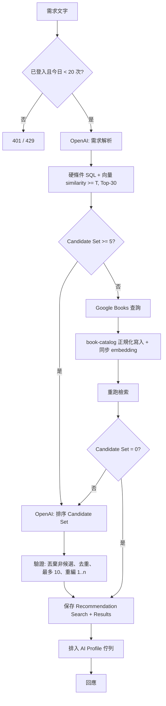

# Recommendation Module

> Path: `Docs/modules/recommendation.md`
> Authority: AI 推薦流程、Candidate Set、Google Books fallback、embedding 與 Book AI Profile 生成、AI 搜尋紀錄、每日上限
> Requirements: REC-01～11
> 相關 ADR：ADR-003（OpenAI 只在 C#）
> Data contract: `Docs/data/data-model.md`

## 1. Scope

- 解析自然語言需求、檢索 Candidate Set、Google Books fallback、LLM 排序、保存 Recommendation Search。
- 背景補齊 Book embedding 與 Book AI Profile。
- AI 搜尋紀錄查看、每日使用上限。

不負責：一般搜尋（book-catalog）、Google Books 書目正規化規則（book-catalog §6，本模組呼叫它）。

## 2. Invariants

1. 必須登入（REC-01）；未登入不呼叫任何外部服務。
2. 硬條件只來自使用者**明確提到**的條件；不確定就不加（REC-04）。
3. Candidate Set = 通過硬條件 **且** similarity ≥ T 的 Top-30（REC-05）。
4. 只有 Candidate Set < 5 才呼叫 Google Books（REC-03）。
5. Google Books 的書必須先寫入本地資料庫、有 embedding，並通過同樣的硬條件與門檻，才能成為候選。
6. LLM 只能從 Candidate Set 推薦；不在其中的結果一律丟棄（REC-06）。
7. 每次最多 10 本，可少於 10 本或 0 本。
8. Bestseller 排名不參與任何檢索或排序（REC-08）。
9. LLM 不產生、不執行 SQL；只輸出結構化 filter JSON，由系統翻譯成查詢。
10. 推薦排序只使用 Book 原始 metadata，不讀 Book AI Profile。

## 3. Flow



## 4. Step 1 — 需求解析

一次 OpenAI chat 呼叫，使用 structured output（JSON schema），輸出：

```json
{
  "filters": {
    "language": "string | null",
    "published_year_from": "int | null",
    "published_year_to": "int | null",
    "page_count_min": "int | null",
    "page_count_max": "int | null",
    "contributor": "string | null",
    "publisher": "string | null"
  },
  "retrieval_text": "用於 embedding 的需求描述",
  "google_queries": ["1～3 組 Google Books 關鍵字"]
}
```

### 4.1 硬條件規則

| Filter | 對應 | 比對 |
|---|---|---|
| `language` | `books.language` | 語言代碼（`data-model.md` §2.1）；`zh` 匹配所有 `zh-*`，`zh-TW` 只精確匹配 |
| `published_year_from/to` | `books.published_date` 的年份 | 範圍（含端點） |
| `page_count_min/max` | `books.page_count` | 範圍（含端點） |
| `contributor` | 任一 `book_contributors.name` | `ILIKE '%v%'` |
| `publisher` | `books.publisher` | `ILIKE '%v%'` |

- 只開放上表 5 類；分類（`book_subjects`）不作為硬條件，交給向量相似度。
- Prompt 必須要求：使用者沒有明確提到的條件一律 `null`；語意模糊時（例：「不要太厚」沒有數字）可轉為範圍，但無法判斷時寫 `null`。
- 系統端再檢查一次：值不合理（年份範圍顛倒、頁數 ≤ 0）時丟棄該條件並記 log，不回錯誤。
- 套用範圍條件時，該欄位為 `NULL` 的 Book 視為不符合。

## 5. Step 2 — 檢索

```text
query_vector = embed(retrieval_text)

SELECT book_id, 1 - (embedding <=> query_vector) AS similarity
FROM book_embeddings JOIN books ...
WHERE <硬條件>
  AND 1 - (embedding <=> query_vector) >= T
ORDER BY embedding <=> query_vector
LIMIT 30
```

- `T` 預設 0.30，放設定檔；依 log 中的 similarity 分布調整。
- 沒有 embedding 的 Book 不會被檢索到。
- MVP 使用 exact search，不建 HNSW index（`data-model.md` §5.7）。

## 6. Step 3 — Google Books fallback

只在 Candidate Set < 5 時執行，`fallback_used = true`。

```text
for q in google_queries（1～3 組）:
    Google Books volumes.list(q, maxResults=20, langRestrict=zh)
→ 每筆交給 book-catalog §6 正規化寫入（ISBN 去重）
→ 對新寫入或缺 embedding 的 Book 同步產生 embedding
→ 重跑 Step 2
```

- 重跑後 1～4 本：用這些候選排序。
- 重跑後 0 本：不呼叫排序，保存 0 本結果的 Recommendation Search，回應「找不到符合的書」。
- Google Books 呼叫失敗或逾時：以現有本地候選繼續，記 log；不視為推薦失敗。
- Google Books 寫入的 Book 即使最後沒有被推薦，也保留在本地資料庫。

## 7. Step 4 — 排序

一次 OpenAI chat 呼叫，structured output。

輸入：需求文字 + 每本候選的 metadata（title、subtitle、contributors、publisher、published date、subjects、description 截斷）。候選以 1..n 的短編號提供給 LLM，系統再對應回 `book_id`。

輸出：

```json
[{ "candidate_no": 3, "relevance": 0.82, "reason": "繁體中文推薦理由" }]
```

驗證（不重試 LLM）：

1. `candidate_no` 不在 1..n → 丟棄並記 log。
2. 重複的 `candidate_no` → 保留第一次出現。
3. `relevance` 超出 0–1 → clamp。
4. 取前 10 筆，依 LLM 回傳順序重新編號為 rank 1..n。
5. LLM 可以因不相關而回傳少於 10 本或 0 本。

## 8. Step 5 — 保存

同一 transaction 寫入 `recommendation_searches` 與 `recommendation_results`（`rank`、`relevance_score`、`reason`）。

- 只有走到這一步才保存；Step 1～4 任一 OpenAI 失敗或整體逾時 → 不保存，回錯誤（REC-09）。
- Google Books fallback 已寫入的 Book 不因推薦失敗而 rollback。

## 9. Book AI Profile

用途：提供推薦結果與紀錄詳情顯示的 `difficulty`（1–5）。

- 觸發：保存 Recommendation Results 後，將其中沒有 profile（或 `source_content_hash` 不符）的 `book_id` 排入 in-process queue（`Channel`）。
- BackgroundService 消化佇列，每本一次 OpenAI 呼叫，輸入只限 Book metadata（`data-model.md` §5.6）。
- `web` 重啟遺失佇列為可接受行為；該書下次出現在推薦結果時重新排入。
- 顯示時即時讀取 `book_ai_profiles.difficulty`；沒有時顯示「—」。difficulty 不寫入 Recommendation Result 快照。
- MVP 只使用 `difficulty`；其他欄位（summary、framework 等）照 schema 產生並保存，但不顯示。

## 10. Embedding 補齊

Embedding model：`text-embedding-3-small`（1536 維）。

Book embedding 輸入文字：

```text
title + subtitle + contributors + subjects + description（截斷）
```

`source_content_hash` = 上述文字的 SHA-256。

| 時機 | 對象 |
|---|---|
| Fallback 流程中（同步） | Google Books 新寫入、或缺 embedding 的 Book |
| BackgroundService，每 10 分鐘 | 沒有 embedding 或 hash 不符的 Book（主要為 crawler 新書），每批上限 100 本 |

## 11. 每日上限

- 每位使用者每日（Asia/Taipei 00:00 起算）最多 20 次，數值放設定檔。
- 計數 = 該使用者當日 `recommendation_searches` 筆數；失敗的推薦不計入。
- 在 Step 1 之前檢查；已達上限 → 429，不呼叫任何外部服務。
- 同時送出多個請求時可能超出 1～2 次，可接受，不加鎖。

## 12. AI 搜尋紀錄

| 功能 | 規則 |
|---|---|
| 列表 | 只列自己的；`created_at` 新到舊；每頁 20 筆；顯示需求文字、時間、結果數 |
| 詳情 | 當時的 rank、Book、reason、relevance（快照）；difficulty 即時讀取 |
| 他人紀錄 | 回 404（不透露存在） |
| 刪除 | MVP 不提供 |

## 13. 逾時與設定

- 整個推薦請求伺服器端逾時 60 秒；逾時視為失敗（不保存）。
- 設定項（`appsettings` / 環境變數）：chat model 名稱、embedding model 名稱、`T`、Top-K（30）、Candidate 下限（5）、結果上限（10）、每日上限（20）、Google Books `maxResults`（20）與 `langRestrict`（zh）、backfill 間隔（10 分鐘）。
- Chat model 型號只放設定檔，不寫死在程式。

## 14. Logging

每次推薦記錄：`search_id`（若有）、套用的硬條件、Candidate Set 大小、similarity 最高 / 最低值、是否 fallback、Google Books 寫入數、被丟棄的 `candidate_no`、結果數、各外部呼叫耗時。不記錄 API key。

## 15. Validation

全部使用 fake OpenAI / Google Books adapter，不呼叫真實 API。

1. 未登入、已達上限 → 不呼叫任何 fake adapter。
2. Filter JSON 中 `null` 欄位不產生 SQL 條件；不合理值被丟棄。
3. 通過硬條件但 similarity < T 的 Book 不進入 Candidate Set。
4. Candidate Set ≥ 5 → Google Books fake 未被呼叫。
5. Candidate Set < 5 → 呼叫 Google Books，寫入後重跑檢索；ISBN 命中既有 Book 時不建立 duplicate。
6. Google Books 失敗 → 以本地候選繼續。
7. 排序結果含非候選編號 → 被丟棄；超過 10 筆 → 截斷；重新編號。
8. 0 本候選 → 保存 0 本結果的紀錄，不呼叫排序。
9. 排序 OpenAI 失敗 → 沒有新的 Recommendation Search。
10. 他人紀錄 → 404。
