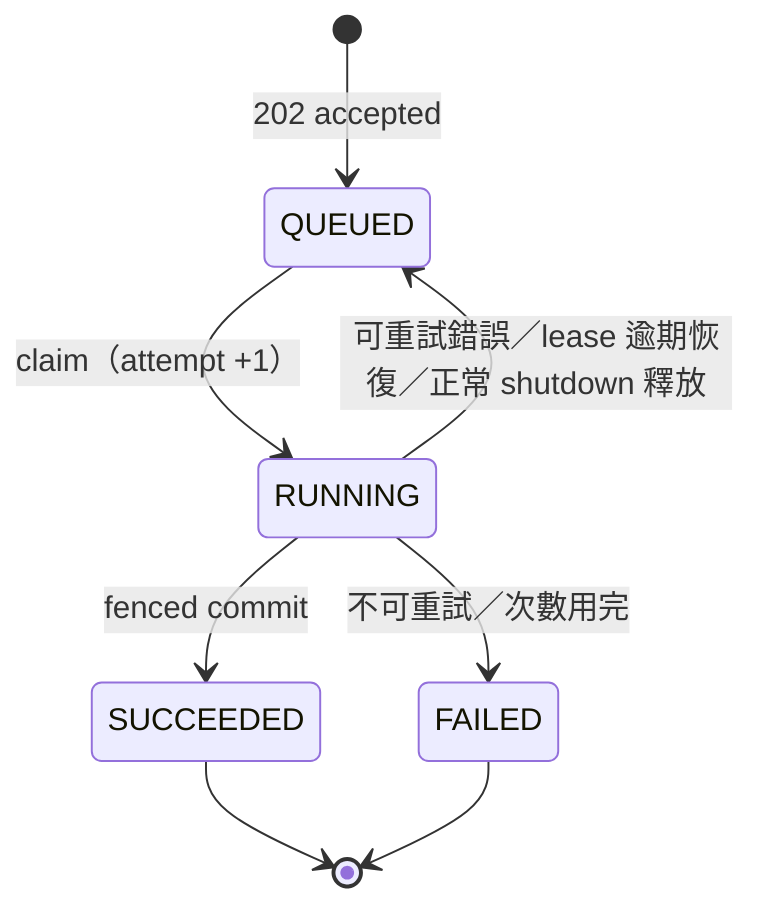

# 非同步 AI 推薦 Job（Recommendation Job）— v1.1 實作計畫

> Baseline：`origin/main @ 80f558b`（2026-11-14）。
>
> 來源：使用者提供的「Book-Finder 非同步 AI 推薦工作系統：實作規劃 v1.0（Proposed）」，經 repo 現況核對與使用者決定（下表）整理成本版。
>
> **狀態：M1～M3 已實作，PR 審核中（2026-11-14）**：M1 新增 `recommendation_jobs` 與 migration `20261114032619_AddRecommendationJobs`（#193）；M2 用量計數納入 Job；M3 抽出 `RecommendationPipeline`（#194）。兩者都還沒部署；其餘模組未實作。
>
> 本文件是實作計畫，不代表功能已實作、測試已通過或取得 production 授權。技術 authority 仍是各模組的 `docs/`（`AGENTS.md` §3.2）；實作時把定案的 contract 寫進 owning module 的 docs，不只寫在這裡。變更記在文末「設計變更紀錄」。

## Context

目前 `/ai` 送出需求後，瀏覽器要等 `POST /api/recommendations` 跑完整條 AI 流程（最長 60 秒）才拿到結果。使用者關掉分頁、網路中斷或登出，這次搜尋就沒了。

本計畫把推薦改成**背景 Job**：

- Web API 只驗證輸入、預約額度、在 PostgreSQL 建立 **Recommendation Job**，立即回 `202 Accepted` 與 `jobId`；
- 同一個 web process 內的 `BackgroundService` 從資料表領取 Job，執行**既有的** Parse → Embed → Candidate Search → Rank → Validate；
- 成功時在同一筆交易寫入 Recommendation Search、Results 與 Job 的 `SUCCEEDED`；
- 使用者之後回來，從 Job 狀態頁連到既有的 `/ai/history/{searchId}`。

不改模型、Prompt、相似度門檻、TopK、Ranking 規則與 Candidate Set 規則；不新增 Redis／SQS／RabbitMQ 或獨立服務。

### 核對 repo 現況的結果

- [RecommendationService.RecommendAsync](../../Application/Recommendation/RecommendationService.cs)：
  1. 額度檢查（`IRecommendationUsage.CountSinceAsync`，台北日界）；
  2. 60 秒預算（`RecommendationOptions.RequestTimeout`）內依序 parse、embed、candidate search、rank、`RankingRules.Validate`、**save**；
  3. 預算外讀 difficulty（`BookDifficultyReader`）並排程 Profile（`BookProfileScheduler`）。
  - 額度檢查與保存沒有鎖在一起，程式註解明說並行請求可超出一兩筆。
- [EfRecommendationStore](../../Infrastructure/Persistence/EfRecommendationStore.cs)：一次 `SaveChangesAsync` 寫 Search＋Results；只保存成功搜尋（含 0 結果）。
- [EfRecommendationUsage](../../Infrastructure/Persistence/EfRecommendationUsage.cs)：只數 `recommendation_searches`。
- 錯誤對應：[ApiExceptionProblemDetailsFilter](../../Infrastructure/Identity/ApiExceptionProblemDetailsFilter.cs)（`AiUnavailableException`→502、`AiTimeoutException`→504、其他→500）；[ApiProblemResults](../../Infrastructure/Identity/ApiProblemResults.cs)（每日上限→429）。
- 背景工作 pattern：[BookProfileWorker](../../Infrastructure/BackgroundJobs/BookProfileWorker.cs)、[EmbeddingBackfillWorker](../../Infrastructure/BackgroundJobs/EmbeddingBackfillWorker.cs)——flag 停用就 return、每輪 `IServiceScopeFactory.CreateScope()`、吞例外避免拖垮 host、只把 host shutdown 的取消當正常結束。Book Profile 的 queue 是 process-local `Channel`，重啟會遺失，**不能**拿來當 Recommendation Job queue。
- [AiController](../../Controllers/AiController.cs)：`/ai`（表單＋紀錄列表）、`/ai/history-list`（partial）、`/ai/history/{id}`（非 GUID、不存在、別人的一律同一個 404 頁）。
- [wwwroot/js/ai.js](../../wwwroot/js/ai.js)：首頁以 sessionStorage 把需求交給 `/ai`（文字不進 URL）；POST 同步 API 後換 history partial。
- Enum 存成 UPPER_SNAKE 字串，CHECK 由 [StoredEnum](../../Infrastructure/Persistence/StoredEnum.cs) 產生。
- 測試替身在 `tests/Shared/`（`FakeRequirementParser`、`FakeEmbeddingGenerator`、`FakeRecommendationRanker`、`CallGate`）。
- 部署：新 migration 上線必須在 `deploy/migration-test/seeds/` 補一份以新 head 命名的 seed（deploy backlog DEP-B25；#192 就是補 `20261114003848_AddCanonicalCategories.sql`）。
- Google Books fallback（#14、APP-B01）仍未接入，本計畫維持現況。

## 使用者決定（2026-11-14）

| # | 決定 |
|---|---|
| 1 | **（D-01）提交時預約額度**：額度歸屬 Job `created_at` 的台北日；`QUEUED`、`RUNNING`、`SUCCEEDED` 佔用，`FAILED` 釋放，重試不重扣。新路徑在提交交易內以 `SELECT … FOR UPDATE` 鎖 `users` 那一列後再計數，並行提交不會超額。**這是產品規格變更**，實作時寫進 Application docs。 |
| 2 | **（D-02）新舊路徑共用額度計數**：舊 `POST /api/recommendations` 暫時保留，兩條路徑用同一個 usage 公式（§3.4）。production 驗收新流程後，以最後一個模組（M9）移除舊 endpoint 與舊前端分支。 |
| 3 | **（D-03）最多執行 2 次**：`AI_UNAVAILABLE`、`AI_TIMEOUT`、暫時性 DB 錯誤與 lease 逾期恢復可以重排一次（5 秒後）；其他錯誤直接 `FAILED`。最壞情況一筆 Job 花兩次 AI 費用。 |
| 4 | **單一 flag `RecommendationJobs:Enabled`** 同時控制 Worker 是否執行，以及 `/ai` 前端走哪條 API（View 輸出 data 屬性給 ai.js）。回退＝改設定後重啟。預設 `false`。 |

其餘沿用原稿建議值：PostgreSQL 當 queue（D-05）、Worker 併行度 1（D-06）、MVP 不自動刪除 Job（D-07）、本次不做 Google Books（D-08）、每次執行沿用 60 秒預算、排隊時間不計入（D-04 時間契約）。

## 1. 範圍

**In scope**：

- `recommendation_jobs` 資料表、Entity、Configuration、migration 與 compat seed；
- 新的 usage 公式（新舊路徑共用）；
- 把既有推薦流程切成「計算」與「保存」，Job 與舊路徑共用計算；
- Job 的提交、列表、查詢（Application＋EF store）；
- Lease：領取、續租、fenced 提交、重排、失敗、釋放、逾期恢復；
- `RecommendationJobRunner`（錯誤分類與重試）與 `RecommendationJobWorker`（BackgroundService）；
- `RecommendationJobsController`、DTO、`/ai/jobs/{id}` 狀態頁、`/ai` 的「推薦工作」列表、ai.js polling；
- 測試、受影響模組的 `docs/`、`CONTEXT.md` 詞彙、上線手冊與實作報告。

**Out of scope**：

- 取消 Job、修改執行中的需求；
- WebSocket／SSE／Email 通知；
- 排隊優先權、公平性、多 instance／多 Worker；
- Job 保留與刪除政策；
- 獨立的推薦 Worker 服務；
- Google Books fallback；
- 新的 metrics 系統（指標先以 structured log 欄位輸出，見 §3.8）。

## 2. 推薦不變條件（實作不得改變）

- 只有登入使用者能建立 Job；使用者查不到別人的 Job 與 Search（一律 404）。
- 推薦結果的 `book_id` 必須屬於 Candidate Set；最多 10 本；0 本也算成功。
- 沿用既有 hard filter、Embedding model、`SimilarityThreshold`、`TopK`、Ranker、推薦理由與 `RankingRules.Validate`。
- Bestseller 排名不影響 AI relevance ranking。
- 只有成功的流程才產生 Recommendation Search；失敗的 Job 本身保留，讓使用者看得到狀態。
- `description`、`table_of_contents` 不出現在公開 API。
- 需求文字不進 URL、query string、log 或例外訊息。

## 3. 設計

### 3.1 Job 狀態機

| Status | 含義 | 終態 |
|---|---|---|
| `QUEUED` | 已寫入資料庫，等待領取（包含等待重試） | 否 |
| `RUNNING` | Worker 持有有效 lease，正在執行 | 否 |
| `SUCCEEDED` | Search、Results 與 Job 狀態已在同一筆交易提交 | 是 |
| `FAILED` | 不可重試，或嘗試次數用完 | 是 |



規則：

- `SUCCEEDED` 必有且只有一筆對應的 Search；`FAILED` 沒有 Search。
- `attempt_count` 在 claim 時 +1；續租不加。
- 終態不能回退。
- 執行保證是 **at-least-once**（OpenAI 可能被呼叫兩次），資料庫結果是 **logical exactly-once**（一個 Job 最多一筆 Search）。

### 3.2 資料表 `recommendation_jobs`（M1）

| 欄位 | 類型 | 說明 |
|---|---|---|
| `id` | uuid, PK | `Guid.CreateVersion7` |
| `user_id` | uuid, NOT NULL, FK → `users` | |
| `requirement_text` | text, NOT NULL | 已由 `RecommendationInputRules` 驗證與 trim |
| `status` | varchar(20), NOT NULL | CHECK 由 `StoredEnum.InSql` 產生 |
| `search_id` | uuid, NULL, UNIQUE, FK → `recommendation_searches` | |
| `attempt_count` | int, NOT NULL DEFAULT 0, CHECK ≥ 0 | |
| `run_after` | timestamptz, NOT NULL | 最早可領取時間 |
| `lease_token` | uuid, NULL | 這次 claim 的 fencing token |
| `lease_expires_at` | timestamptz, NULL | |
| `idempotency_key` | varchar(128), NULL | |
| `request_hash` | char(64), NOT NULL | 正規化需求 UTF-8 的 SHA-256 hex |
| `error_code` | varchar(64), NULL | 固定代碼（§3.7） |
| `created_at` | timestamptz, NOT NULL | 額度歸屬日依此 |
| `started_at` | timestamptz, NULL | 最近一次執行開始 |
| `completed_at` | timestamptz, NULL | |

Index 與 CHECK：

- `(status, run_after, created_at)`：領取；
- `(status, lease_expires_at)`：逾期恢復；
- `(user_id, created_at DESC)`：本人列表與額度計數；
- `UNIQUE (user_id, idempotency_key) WHERE idempotency_key IS NOT NULL`；
- CHECK：`SUCCEEDED` ⇒ `search_id`、`completed_at` 非 null；`FAILED` ⇒ `completed_at` 非 null 且 `search_id` 為 null；`RUNNING` ⇔ `lease_token`、`lease_expires_at` 非 null。

Migration `AddRecommendationJobs` 只新增表、index、FK（expand），不動既有欄位。舊 release 不讀這張表，所以 compat 是「舊 release 跑在新 schema 上」。同一個 PR 要補 `deploy/migration-test/seeds/<migration id>_AddRecommendationJobs.sql`（DEP-B25）。

Search 與 Job 的 `user_id` 必須一致：由 fenced commit 在同一交易內寫入同一個 `user_id` 保證，DB integration 測試驗證。

### 3.3 推薦流程切分（M3）

從 `RecommendationService` 抽出 `RecommendationPipeline.RunAsync(requirementText, save, ct)`（v1.1 改版，見設計變更紀錄）：

- 內容：60 秒預算內的 parse → sanitize → embed → candidate search → rank → validate → **save**，以及現有的 summary log；
- `save` 是呼叫端傳入的保存步驟（`Func<IReadOnlyList<RankedCandidate>, CancellationToken, Task<SavedRecommendationSearch>>`），在預算內以預算 token 執行；
- **不含**額度檢查與 difficulty／Profile；
- 回傳 `RecommendationPipelineResult(Saved, Results)`。

使用方式：

- 舊路徑 `RecommendAsync` = 額度檢查 → `RunAsync`（`save` = `IRecommendationStore.SaveAsync`）→ difficulty／Profile。**對外行為不變**：既有 `RecommendationServiceTests` 的斷言全部未改、全綠。
- Job 路徑 = `RunAsync`（`save` = fenced commit，§3.5）→ best-effort Profile 排程。commit 和舊路徑一樣在 60 秒預算內，所以兩條路徑的逾時語意相同：逾時不會留下已保存的 Search；失去 lease 時 fenced commit 會拋出例外，原樣往外傳。

逾時判斷沿用現有規則：只有計時器的取消才是 `AiTimeoutException`；外部 token 取消原樣往外傳。

### 3.4 額度（M2、M4）

新 usage 公式（`EfRecommendationUsage` 改寫，新舊路徑共用）：

```text
count(recommendation_searches s
      WHERE s.user_id = @user AND s.created_at >= @since
        AND NOT EXISTS (SELECT 1 FROM recommendation_jobs j WHERE j.search_id = s.id))
+ count(recommendation_jobs j
      WHERE j.user_id = @user AND j.created_at >= @since AND j.status <> 'FAILED')
```

- Job 產生的 Search 只透過 Job 計一次，不會重複計數；
- 舊同步路徑仍不加鎖，維持既有「並行可超出一兩筆」的語意；
- 新路徑的提交交易依序：鎖 `users` 列 → idempotency 重送判斷 → 計數 → 比上限 → INSERT Job → COMMIT。

### 3.5 Lease 與 fencing（M5）

- **領取**：短交易，`… WHERE status='QUEUED' AND run_after <= now() ORDER BY run_after, created_at, id FOR UPDATE SKIP LOCKED LIMIT 1`，更新為 `RUNNING`、`attempt_count+1`、新 `lease_token`、`lease_expires_at = now() + LeaseDuration`。不在交易內等 OpenAI。
- **時鐘**：lease 是否有效一律用 DB 的 `now()` 判斷，不用應用程式時間。
- **續租**：`UPDATE … WHERE id AND lease_token AND status='RUNNING' AND lease_expires_at > now()`；0 rows ⇒ lease lost，取消這次執行，不寫任何東西。
- **成功提交**：一筆交易內 `SELECT … FOR UPDATE` 該 Job（id＋token＋`RUNNING`＋未逾期）→ 新增 Search 與 Results → Job 設 `SUCCEEDED`、`search_id`、`completed_at`、清 lease。找不到 ⇒ rollback，視為 lease lost。
- **重排／失敗**：都帶 token CAS。重排設 `QUEUED`、`run_after = now() + RetryDelay`、記 `error_code`；失敗設 `FAILED`、`completed_at`。
- **正常 shutdown 釋放**：以 token CAS 放回 `QUEUED`、`run_after = now()`、`attempt_count - 1`，部署重啟不消耗嘗試次數（本計畫的假設）。
- **逾期恢復**：`RUNNING` 且 `lease_expires_at <= now()`：`attempt_count < MaxAttempts` ⇒ 回 `QUEUED`；否則 `FAILED`（`WORKER_INTERRUPTED`）。Worker 啟動時與每輪 poll 前各執行一次。

### 3.6 Worker 與 Runner（M6）

`RecommendationJobWorker`（`Infrastructure/BackgroundJobs/`）沿用現有 worker 的 pattern：

```text
if !Enabled: log 並 return
RecoverExpired
loop until stoppingToken:
  job = TryClaimNext；沒有就等 PollInterval（TimeProvider）
  每個 Job 一個 scope；heartbeat 用另一個 scope（DbContext 不能並行使用）
  jobCts = link(stoppingToken, lease-lost)
  Runner.RunAsync(job, jobCts.Token)
```

`RecommendationJobRunner`（`Application/Recommendation/`，商業規則在這裡）：

| 情況 | 處理 |
|---|---|
| 成功 | fenced commit；之後 best-effort Profile 排程，失敗只記 log，不改 Job 狀態 |
| `AiUnavailableException` | 可重試，`AI_UNAVAILABLE` |
| `AiTimeoutException` | 可重試，`AI_TIMEOUT` |
| 暫時性 DB 錯誤（`NpgsqlException.IsTransient`） | 可重試，`INTERNAL_ERROR` |
| lease lost | 不寫任何東西（新的持有者或 recovery 會處理） |
| host shutdown（`stoppingToken` 取消） | 釋放 lease（§3.5） |
| 其他例外 | 直接 `FAILED`，`INTERNAL_ERROR` |

「可重試」= `attempt_count < MaxAttempts` 時重排，否則 `FAILED`。

`RecommendationJobOptions`（section `RecommendationJobs`，啟動時驗證，比照 `RecommendationOptions`）：

| 設定 | 初值 |
|---|---:|
| `Enabled` | `false` |
| `PollInterval` | 2 秒 |
| `LeaseDuration` | 45 秒 |
| `HeartbeatInterval` | 10 秒（必須小於 `LeaseDuration`） |
| `MaxAttempts` | 2 |
| `RetryDelay` | 5 秒 |

併行度固定 1，不做成設定（D-06）。這些是工程初值，不是效能保證。

### 3.7 HTTP contract（M7）

**`POST /api/recommendations/jobs`**：`[Authorize]`、antiforgery header、body `{ "requirementText": "…" }`、選填 header `Idempotency-Key`。

| 狀態 | 情況 |
|---|---|
| 202 | Job 已 commit；`Location: /api/recommendations/jobs/{jobId}`；body `{ jobId, status, statusUrl }` |
| 400 | 需求文字不合規則（沿用 `RecommendationInputRules`）、Idempotency-Key 格式錯、缺 antiforgery |
| 401 | 未登入 |
| 409 | 同 key、不同 `request_hash`；新 ProblemDetails type `/errors/idempotency-conflict` |
| 429 | 每日上限（沿用 `ApiProblemResults.DailyLimitExceeded`） |

- Idempotency-Key：1～128 字元，只允許 `[A-Za-z0-9_-]`；同 key 同 hash ⇒ 回原 Job 的 202，不重扣額度。
- Flag 為 `false` 時這個 endpoint 回 404（Worker 沒在跑，不收 Job）。
- 只要回 202，Job 一定已 commit；Worker 的成敗不影響提交結果。

**`GET /api/recommendations/jobs?page=N`**：本人的 Job，每頁 20 筆，`created_at DESC, id DESC`。

**`GET /api/recommendations/jobs/{jobId}`**：200；非 GUID、不存在、別人的一律 404。四種狀態同一結構：

```json
{
  "jobId": "…",
  "status": "SUCCEEDED",
  "createdAt": "…",
  "completedAt": "…",
  "searchId": "…",
  "resultUrl": "/ai/history/…",
  "errorCode": null
}
```

- `QUEUED`／`RUNNING`：`searchId`、`resultUrl`、`completedAt` 為 null。
- `FAILED`：`errorCode` ∈ `AI_UNAVAILABLE`、`AI_TIMEOUT`、`WORKER_INTERRUPTED`、`INTERNAL_ERROR`。
- 結果本身不在這裡回傳，由 `/ai/history/{searchId}` 顯示（沿用既有授權檢查）。

舊 `POST /api/recommendations` 在 M9 之前不變。

### 3.8 前端與記錄

- `/ai` 的 View 輸出 `data-recommendation-jobs="true|false"`；ai.js 依此決定走舊同步流程或 Job 流程。
- Job 流程：每次送出產生一個 Idempotency-Key（`crypto.randomUUID()`），同一次送出重試時沿用；收到 202 後導到 `/ai/jobs/{jobId}`。
- `/ai/jobs/{id}`（`AiController`）：顯示「已加入工作佇列，可以離開網站」；前景每 3 秒 polling，`visibilitychange` 隱藏時停止、回到前景立即查一次；成功顯示「查看推薦結果」連到 `/ai/history/{searchId}`；失敗依 `errorCode` 顯示固定文案。非本人／不存在用既有 `NotFound` 頁。
- `/ai` 新增「推薦工作」partial `_AiJobList`，分頁方式比照 `_AiHistoryList`；既有的成功搜尋紀錄列表照舊。
- 首頁 sessionStorage 傳需求的方式不變；所有文字以 `textContent` 渲染。
- 記錄：Worker 以 structured log 輸出 `jobId`、`searchId`、`attempt`、`status`、`queueWaitMs`、`executionMs`、`errorCode`、lease recovery 次數；不輸出需求文字與 secret。repo 目前沒有 metrics 基礎設施，本計畫不新增。

## 4. 模組（每模組一分支一 PR）

一律照 [README §3](README.md) 的流程：每個模組一個 worktree `~/Documents/vs_repos/Book-Finder-wt/rec-jobs-m<k>`，分支 `rec-jobs-m<k>-<name>`。依賴鏈上的模組一層疊一層；彼此無依賴的模組（M1 與 M3）從同一個 commit 並行開發，後面的模組再把兩條分支 merge 進來（不 rebase），PR base 一律 `main`；Haiku subagent 以 TDD 寫程式；主 agent 驗收（build 0 warning、受影響測試、L3 模組做 mutation 抽查）並寫該模組的五份 `docs/`。

| 模組 | 內容 | 風險 | 主要檔案 | 依賴 |
|---|---|---|---|---|
| M1 Schema | Entity、`RecommendationJobStatus`、Configuration、migration、compat seed、schema 測試 | L3 | `Domain/Entities/RecommendationJob.cs`、`Infrastructure/Persistence/Configurations/`、`Migrations/`、`deploy/migration-test/seeds/` | — |
| M2 Usage | §3.4 公式；舊路徑回歸 | L3 | `EfRecommendationUsage.cs` | M1 |
| M3 Pipeline 切分 | 抽 `RecommendationPipeline`，舊行為不變 | L2 | `RecommendationService.cs`、`RecommendationPipeline.cs` | — |
| M4 Submit／Query | `IRecommendationJobStore`（submit／list／get）、`RecommendationJobService`（驗證、idempotency、額度預約） | L3 | `Application/Recommendation/`、`Infrastructure/Persistence/EfRecommendationJobStore.cs` | M1、M2 |
| M5 Lease store | claim、heartbeat、fenced commit、重排、失敗、釋放、逾期恢復 | L3 | `EfRecommendationJobStore.cs` | M4 |
| M6 Runner＋Worker | `RecommendationJobRunner`、`RecommendationJobWorker`、`RecommendationJobOptions`、DI 與啟動驗證 | L3 | `Application/Recommendation/`、`Infrastructure/BackgroundJobs/`、`Program.cs` | M3、M5 |
| M7 Web | Controller、DTO、`/ai/jobs/{id}`、`_AiJobList`、ai.js flag 分支與 polling | L2／L3 | `Controllers/`、`Models/`、`Views/Ai/`、`wwwroot/js/ai.js` | M4、M6 |
| M8 Report | 完整 gate、瀏覽器檢查、故障注入紀錄、兩軸 code review、實作報告、上線手冊 | — | `Docs/Implementation-Report/async-recommendation-jobs.md` | M1～M7 |
| M9 移除舊路徑 | production 驗收後：移除舊 `POST /api/recommendations`、flag=false 的前端分支，評估是否移除 flag | L2 | Controllers、ai.js、Views、相關 docs | 使用者確認驗收 |

第一個可 demo 的切片：M1～M7 完成後，在本機以 fake AI 跑「登入 → 提交 → 202 → Worker 執行 → `SUCCEEDED` → 重新整理看到結果」。

## 5. 測試

| 類別 | 案例 | 層級 | 模組 |
|---|---|---|---|
| Schema | CHECK（狀態、終態欄位、lease 欄位）、UNIQUE（search_id、user＋key 部分索引）、FK | DatabaseIntegration | M1 |
| Usage | 舊 Search＋非 FAILED Job；Job 產生的 Search 不重複計；FAILED 不計；台北午夜前後 | DatabaseIntegration | M2 |
| Pipeline 回歸 | 現有 `RecommendationServiceTests` 不改全綠：候選合法、最多 10、0 結果成功、失敗不保存、逾時語意 | UnitTests | M3 |
| 提交 | 不呼叫任何 AI；第 21 次 429；同 key 同內容回同一 Job 且不重扣；同 key 不同內容 409；併發提交不超額 | Unit＋DatabaseIntegration | M4 |
| Claim | 兩個並行 claim 只有一個拿到 | DatabaseIntegration（PostgreSQL） | M5 |
| Fencing | 舊 token 不能續租、提交、重排、失敗；逾期 lease 不能提交 | DatabaseIntegration | M5 |
| Atomicity | 提交途中失敗（例如 Book 不存在）⇒ Search、Results、Job 狀態全部 rollback | DatabaseIntegration | M5 |
| Recovery | 逾期 → QUEUED；次數用完 → FAILED（`WORKER_INTERRUPTED`）；shutdown 釋放不扣次數 | DatabaseIntegration | M5 |
| Runner | 錯誤分類表（§3.6）每一列；Profile 排程失敗 Job 仍 SUCCEEDED | UnitTests（fake store／`FakeTimeProvider`） | M6 |
| Worker | flag false 不執行；heartbeat 0 rows 取消執行；shutdown 正常結束；例外不拖垮 host | UnitTests | M6 |
| HTTP | 202＋Location；401；別人的／不存在的 404；缺 antiforgery 400 且無 Job；409；429；flag false 時 404 | WebIntegration | M7 |
| 頁面 | `/ai/jobs/{id}` 四種狀態；`_AiJobList` 分頁；`data-recommendation-jobs` | WebIntegration | M7 |
| 瀏覽器 | 送出後關分頁、重新登入回來看到狀態並打開結果 | 一次性本機 Playwright（TEST-B03 仍暫緩） | M8 |
| 故障注入 | Worker 強制中止後恢復、lease fencing、commit 邊界 | 本機手動＋紀錄 | M8 |
| 效能 | 提交 API P95 ≤ 1 秒（工程目標） | production 上線後量測 | 上線 |

自動測試一律用 fake AI，不呼叫真實 OpenAI；真實試跑需使用者當下授權。

## 6. 上線與回復

上線（L4 步驟需使用者明確授權）：

1. 合併 M1～M8 後打 tag，CD 部署：migration（expand）＋compat seed；`RecommendationJobs:Enabled=false`，網站行為與現在相同。
2. Smoke：`/ai` 照舊可用、`/api/recommendations/jobs` 回 404。
3. 使用者把 production 設定改成 `true` 並重啟。
4. 觀察 log：claim、`queueWaitMs`、`executionMs`、`errorCode`、lease recovery；用一個測試帳號跑完整流程。
5. 驗收後做 M9。

回復：

- **改 flag 為 `false`**：前端回到同步流程；已排隊的 Job 停在 `QUEUED` 不會遺失，flag 打開後繼續執行。
- **退回上一個 release**：資料表留著（expand），舊程式不讀它；舊程式只數 Search，所以 Job 佔的額度在回退期間不計入。可接受，上線手冊寫明。

## 7. Definition of Done

- §5 的自動測試都存在且通過；`dotnet build` 0 warning；三個測試專案全套通過。
- Migration 在拋棄式 PostgreSQL 套用並驗證 schema；compat seed 已補。
- 實際做過至少一次 Worker 強制中止後恢復、lease fencing、commit 邊界故障注入，結果寫進實作報告。
- Log 不含需求文字與憑證；所有 GET 的使用者隔離一致。
- 各模組 `docs/`、`CONTEXT.md` 與程式對同一份狀態機、交易邊界、額度規則一致。
- 兩軸 code review 的每項發現都親自確認並處理。

## 8. 文件同步

| 模組 docs | 要寫的內容 |
|---|---|
| `Domain/docs` | `RecommendationJob` 與狀態轉移 |
| `Application/docs` | Job 狀態機、額度規則（D-01，產品規格變更）、重試政策、Pipeline 切分、Runner |
| `Infrastructure/docs` | `recommendation_jobs` schema、claim／lease／fencing SQL、usage 公式、Worker |
| `Controllers/docs`、`Models/docs` | Job API contract、409／404 規則、DTO |
| `Views/docs`、`wwwroot/docs` | `/ai/jobs/{id}`、`_AiJobList`、ai.js flag 分支與 polling |
| `tests/docs` | 新增的測試與故障注入紀錄位置 |
| `deploy/docs` | 新 seed、flag 上線與回復步驟 |
| `CONTEXT.md` | 新增「Recommendation Job」 |

## 9. 待決策事項

目前沒有阻擋 M1 開工的決策。以下在實作中確認，必要時再問使用者：

- Job 與需求文字的保存期限（D-07，MVP 不刪）。
- M9 是否連同 flag 一起移除。
- 提交 API P95 若超過 1 秒時的處理方式（等上線量測）。

## 設計變更紀錄

| 版本 | 日期 | 變更 |
|---|---|---|
| v1.0 | 2026-11-14 | 由使用者原稿 v1.0（Proposed）整理；記錄決定 #1～#4；補充本計畫的工程假設：Pipeline 切分、usage 公式、DB 時鐘 fencing、shutdown 釋放不扣次數、固定 error_code、Idempotency-Key 格式、flag 關閉時 Job API 回 404、指標以 log 輸出。 |
| v1.1 | 2026-11-14 | §3.3：Pipeline 改為接受呼叫端的 `save` 步驟、保存仍在 60 秒預算內（原為不含保存的 `ComputeAsync`），讓 Job 的 fenced commit 與舊路徑逾時語意相同（M3）。M1 的 compat seed 在新增 migration 的同一個 PR 提供（deploy DEP-B25 方向 (b)）；129 字元的 idempotency key 先被 varchar(128) 拒絕（22001），CHECK 是第二層。M1 與 M3 並行開發。 |
