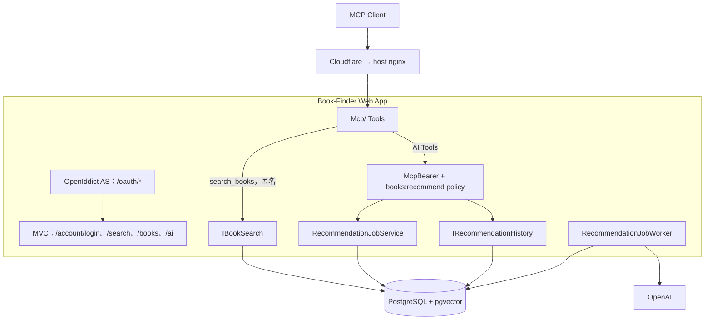
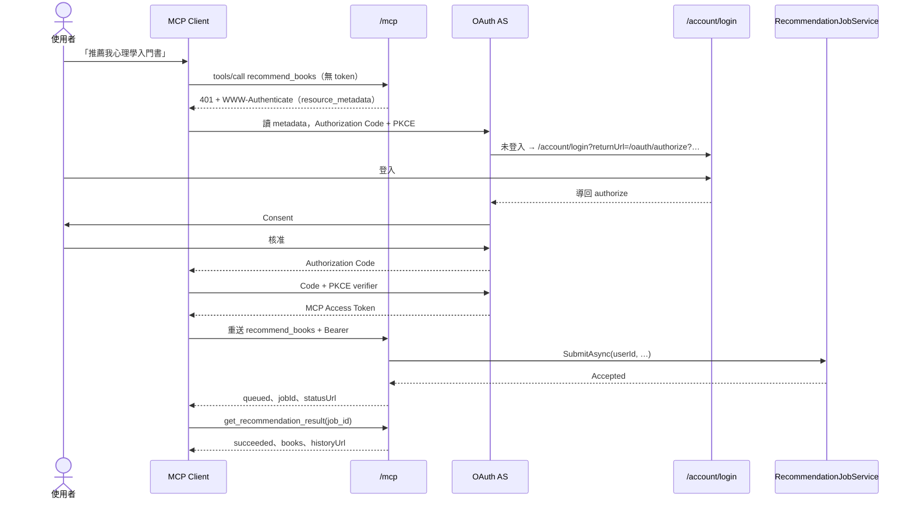
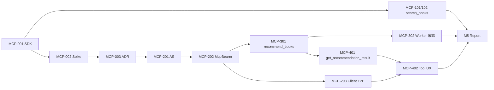

# Book-Finder MCP Server — v1.6 實作計畫

> Baseline：`origin/main @ 8c8e3ab`（2026-11-14）。
>
> 來源：使用者提供的「Book-Finder MCP Server 實作規劃（Proposed）」，經 repo 現況核對後整理成本版。核對時找到的差異列在「核對 repo 現況的結果」與文末「設計變更紀錄」。
>
> **狀態：實作中（M0～M4 完成，M5 進行中）**。使用者已決定 D-01～D-12（2026-11-14）。三支 Tool、OAuth 授權伺服器與 `/mcp` 驗證都已完成並有測試；剩 M5（code review 修正、實作報告、上線準備）與 MCP-203（production 上的真實 Client 實測，需使用者授權）。
>
> 本文件是實作計畫，不代表功能已實作、測試已通過或取得 production 授權。技術 authority 仍是各模組的 `docs/`（`AGENTS.md` §3.2）；實作時把定案的 contract 寫進 owning module 的 docs（新模組 `Mcp/docs/` 與受影響模組），不只寫在這裡。文中的 Tool JSON 都是格式示意，不是實際查詢結果；SLO 是目標，尚未量測。

## Context

Book-Finder 目前只能透過網站使用。支援 MCP（Model Context Protocol）的 AI Client（ChatGPT、Claude、IDE 等）無法直接查書或請求 AI 推薦。

本計畫在**既有 ASP.NET Core Web App 內**新增一個遠端 MCP Server（`/mcp`，Streamable HTTP、Stateless），提供三支 Tool：

| Tool | 權限 | 做什麼 |
|---|---|---|
| `search_books` | 公開 | 只查本地 Book Catalog，最多回 50 本、總筆數與網站搜尋頁連結 |
| `recommend_books` | OAuth，scope `books:recommend` | 以登入使用者身分建立 **Recommendation Job**，立即回 `jobId` |
| `get_recommendation_result` | OAuth，scope `books:recommend` | 查自己的 Job；成功時回推薦書籍連結、理由與 AI Search History 連結 |

未登入的使用者呼叫 AI Tool 時，MCP Client 應收到 HTTP `401` 與 OAuth challenge，啟動授權流程、顯示 Book-Finder 既有登入頁，授權後重送原本的請求。

MCP 層只做協定轉換：搜尋重用 `IBookSearch`，推薦重用已上線的 `RecommendationJobService`、Worker 與 `IRecommendationHistory`。不重寫搜尋 SQL、推薦流程或網站 UI。

### 核對 repo 現況的結果

**一般搜尋**

- [BookSearchService](../../Application/Catalog/BookSearchService.cs)：`PageSize = 20` 是 const；空輸入由 service 自己回空頁，不碰 DB。
- [IBookSearch](../../Application/Catalog/IBookSearch.cs)：`SearchAsync(SearchQuery, page, pageSize, ct)`，註明**不得**收到 `SearchQuery.Empty`。實作 [EfBookSearch](../../Infrastructure/Persistence/EfBookSearch.cs) 只查本地 DB。
- [SearchQuery.Parse](../../Application/Catalog/SearchQuery.cs)：trim 後分成 `Empty`／`Isbn`（NFKC 後判斷）／`Keyword`。
- [BookSearchPage／BookSearchHit](../../Application/Catalog/BookSearchPage.cs)：`TotalCount` 是全部符合筆數；Hit 只含 id、書名、作者、出版社、出版日、縮圖，不含 description。
- 結論：MCP 搜尋自己判斷 `Empty`（回 `VALIDATION_FAILED`、不碰 DB），非空時呼叫 `IBookSearch.SearchAsync(q, 1, 50, ct)`。網站每頁 20 本不變。

**AI 推薦 Job（已上線）**

- 非同步 Job 已隨 v0.0.11 上線、使用者已驗收（[async-recommendation-jobs.md](async-recommendation-jobs.md)）。
  - [appsettings.json](../../appsettings.json) 的 `RecommendationJobs:Enabled` 預設仍是 `false`，但 [compose.prod.yaml](../../deploy/release/compose.prod.yaml) 已設 `RecommendationJobs__Enabled: "true"`。
  - **草稿說「上線前要啟用 Worker」已不成立**；MCP-302 改成確認既有 Worker 狀態。
- [RecommendationJobService.SubmitAsync](../../Application/Recommendation/RecommendationJobService.cs)：
  - `requirementText` **必須由呼叫端先**以 [RecommendationInputRules.ValidateRequirementText](../../Application/Recommendation/RecommendationInputRules.cs) 驗證並 trim（500 code points）；
  - service 只驗 idempotency key（[IdempotencyKeyRules](../../Application/Recommendation/IdempotencyKeyRules.cs)），並在 store 交易內處理每日額度；
  - 回傳 [RecommendationJobSubmission](../../Application/Recommendation/RecommendationJobSubmission.cs)：`Accepted(Job, Created)`、`InvalidIdempotencyKey`、`IdempotencyConflict`、`DailyLimitReached`。
- `GetAsync(userId, jobId)` 回 [RecommendationJobView](../../Application/Recommendation/RecommendationJobReadModels.cs)；不存在與別人的 Job 都回 `null`。`SearchId` 只在 `SUCCEEDED` 有值，`ErrorCode` 只在 `FAILED` 有值，值來自 [RecommendationJobErrorCodes](../../Application/Recommendation/RecommendationJobErrorCodes.cs)（`AI_UNAVAILABLE`、`AI_TIMEOUT`、`WORKER_INTERRUPTED`、`INTERNAL_ERROR`）。
- [IRecommendationHistory.GetAsync(userId, searchId)](../../Application/Recommendation/IRecommendationHistory.cs) 回 [RecommendationSearchDetail](../../Application/Recommendation/RecommendationSearchReadModels.cs)，結果含 rank、bookId、title、authors、reason；不存在與別人的一律 `null`。
- [RecommendationJobsController](../../Controllers/RecommendationJobsController.cs)：`[Authorize]`；`Enabled = false` 時三個 endpoint 都回 404；`Idempotency-Key` 從 header 讀。MCP 改從 Tool argument 取 key，直接呼叫同一個 service，不在伺服器內再發 HTTP request。
- 舊同步 API `POST /api/recommendations` 已排定在 async 計畫 M9 移除（Application backlog APP-B06）。**MCP 不依賴同步 API**，也不得阻擋 M9。

**認證**

- [AuthServiceCollectionExtensions](../../Infrastructure/Identity/AuthServiceCollectionExtensions.cs)：預設 scheme 是 JwtBearer，但 `OnMessageReceived` **只讀 `bf_auth` cookie**，不讀 `Authorization` header；`aud` 為網站自己。
- 同檔的 `OnChallenge`：只有 `/api/*`（[ApiRequest.IsApi](../../Infrastructure/Identity/ApiRequest.cs)）回 401 ProblemDetails，**其他路徑一律 302 轉址到 `/account/login`**。`/mcp` 不在 `/api` 下，若沿用預設 scheme，未授權會得到 302 而不是 OAuth 需要的 `401 + WWW-Authenticate`。所以 `/mcp` 必須用獨立 scheme（`McpBearer`）並在 policy 明確指定。
- [CurrentUser.CurrentUserId](../../Infrastructure/Identity/CurrentUser.cs) 讀 `sub` claim（`MapInboundClaims = false`）。MCP token 的 `sub` 也要是 Book-Finder User ID。
- [AccountController](../../Controllers/AccountController.cs)：`GET /account/login?returnUrl=…`，經 [SafeReturnUrl](../../Infrastructure/Identity/SafeReturnUrl.cs)（`IUrlHelper.IsLocalUrl`）只放行本地路徑。OpenIddict 的 `/oauth/authorize` 可以把自己當 returnUrl 導回。
- 全域 `AutoValidateAntiforgeryTokenAttribute` 只套在 MVC action。`MapMcp` 是 endpoint routing，不受影響；若 OAuth token endpoint 以 MVC controller 實作，需要明確處理 antiforgery（L3 審查點）。

**部署**

- [Program.cs](../../Program.cs) 使用 `AddControllersWithViews`、`UseForwardedHeaders`、`UseAuthentication`／`UseAuthorization`，沒有其他 endpoint mapping。
- host nginx 不在 repo（[deploy architecture](../../deploy/docs/architecture.md)，runbook §7.2 #7 待確認），前方有 Cloudflare。實測前由使用者在 host 確認 `/mcp`、`/.well-known/*`、`/oauth/*` 都轉到 web container（整站轉發時不需新增路由）、`Authorization` header 原樣轉發、回應不被緩衝。
- 非 secret 設定只能隨 release 改變（deploy backlog DEP-B26）；`Mcp:Enabled` 也一樣。
- 新 migration 上線需在同一個 PR 提供 `deploy/migration-test/seeds/<head>.sql`（DEP-B25）。
- Data Protection keys 已持久化在 `/data-protection-keys` volume。

**既有缺口（本計畫不處理）**

- Google Books fallback 仍未接入（#14、APP-B01）。MCP 對外不得宣稱用了 fallback。

## 使用者決定（2026-11-14）

| # | 決定 | 對計畫的影響 |
|---|---|---|
| D-01 | **ChatGPT、Claude 與 IDE Client 都要支援** | MCP-203 與 DoD 要有三類 Client 各自的完整 OAuth E2E 紀錄（ChatGPT、Claude、至少一個 IDE Client）；Tool 描述不得依賴單一 Client 的行為 |
| D-02 | **同站 OpenIddict** | AS 與網站同 process、同網域；需要 OpenIddict 資料表（migration + DEP-B25 compat seed）、簽章／加密金鑰方案、Consent 頁；全部 L3 |
| D-03 | **先用預註冊；某個 Client 不支援預註冊時，改用 CIMD** | MCP-003 逐一確認三類 Client 能否填入預先發給的 `client_id`（與 redirect URI）；需要 CIMD 的 Client，要另外確認 OpenIddict 能否支援（不假設原生支援，可能需要自訂 client 解析），結果寫進 ADR。不實作 DCR |
| D-04 | **先試單一 `/mcp`；不行就接受雙 endpoint**（`/mcp/public` 匿名 + `/mcp/user` 全部需授權） | MCP-002 的結果直接決定採用哪個方案，不必再等使用者決定；改用雙 endpoint 時寫 ADR，並更新 Tool 契約與 Client 設定說明 |
| D-05 | **正式網域是 `khwebsc.com`** | `Mcp:PublicBaseUrl = https://khwebsc.com`；MCP resource `https://khwebsc.com/mcp`；OpenIddict issuer `https://khwebsc.com/`；nginx 與 Cloudflare 的路由仍由使用者在 host 確認 |
| D-06 | **公開搜尋比照網站搜尋現有的上限** | 見下方說明 |
| D-07 | **AI Tool 呼叫不限頻率**；只有 AI 推薦受既有每日額度限制，與網站共用 | 不新增 MCP 專用的速率限制；額度一律由 `RecommendationJobService` 計算 |
| D-08 | **真實 Client 實測直接在 production（`https://khwebsc.com/mcp`）進行** | 沒有 staging；計畫中原寫 staging 的驗證改在 production canary；每次發布前需使用者明確授權 |
| D-09 | **Access Token 1 小時、Refresh Token 30 天**（使用時滾動延長） | OpenIddict 設定；Client 自動換新，約一個月不用重新登入 |
| D-10 | **Consent 記住到撤銷**：同一使用者對同一 Client 只問一次 | OpenIddict permanent authorization；撤銷管理頁列 backlog，本期不做 |
| D-11 | **production 憑證放 host volume 檔案**（比照 `dp-keys`），container 唯讀掛載；密碼走既有 SSM → env 注入 | EC2 操作屬 L4，上線前用 `wizard` 帶使用者操作 |
| D-12 | **憑證不設密碼**：OpenIddict 的簽章／加密憑證存成不設密碼的 PKCS#12，放在 root-only 權限的 host volume、container 唯讀掛載（與 Data Protection keys 相同保護方式）；取代 D-11「密碼走 SSM」的部分 | host 不需改動（host 只從 SSM 讀 DB、OpenAI、JWT 三個 secret）；`OAuth:CertificatePassword` 留空 |

**D-06 的現況**：網站一般搜尋（`SearchController` → `BookSearchService` → `EfBookSearch`）目前**沒有**輸入長度上限、沒有應用層 rate limit，程式碼也沒有另外設定查詢 timeout（只剩 Npgsql 與 Kestrel 的預設值；production 連線字串在 SSM，本計畫未查看是否覆寫）。因此 `search_books` 也不另加這三項限制，與網站行為一致。公開搜尋沒有節流這件事，記為已知缺口寫進 `Mcp/docs/backlog.md`（若之後要加，網站與 MCP 一起加）。

仍待 M0 確認的事項（不需要使用者再決定，但結果要回報）：

- MCP-002：單一 `/mcp` 的 per-tool 401 是否可行（決定 D-04 採哪個方案）。
- MCP-003：三類 Client 各自支援預註冊或 CIMD；OpenIddict 對 CIMD 的支援程度。

## 1. 範圍

**In scope**：

- `Mcp/` 新模組：Tool、DTO、MCP adapter service、URL builder、options、DI 擴充方法、`Mcp/docs/` 五文件；
- `/mcp` Streamable HTTP（Stateless），受 `Mcp:Enabled` 控制；
- `search_books`、`recommend_books`、`get_recommendation_result`；
- OAuth：Protected Resource Metadata、`McpBearer` scheme、`books:recommend` scope policy、同站 OpenIddict Authorization Server（D-02）、預註冊 Client（必要時 CIMD，D-03）；
- 測試、受影響模組的 `docs/`、`CONTEXT.md` 詞彙、上線手冊與實作報告。

**Out of scope**：

- 改寫搜尋 SQL、推薦流程、Prompt、門檻或網站 UI；
- MCP Client 直接連 PostgreSQL 或執行任意 SQL；
- Google Books fallback、推薦品質或效能優化；
- 取消 Job、刪除紀錄、書單管理、個人化偏好、管理工具；
- 保證 AI 推薦 3 秒內完成（只保證 Job 提交快速且可追蹤）；
- 獨立的 MCP／推薦服務、額外 queue；
- 新的 metrics 系統（先以 structured log 欄位輸出，同 async 計畫 §3.8）；
- 修改 `RecommendationJobs:Enabled` 或依賴同步 `/api/recommendations`。

## 2. 不變條件（實作不得改變）

- `Mcp/` 只做協定、參數、DTO 與錯誤對應；不得使用 `AppDbContext`、自己下 SQL 或呼叫 OpenAI。
- 一般搜尋只查本地 DB，沿用 `EfBookSearch` 的排序；網站每頁 20 本不變。
- 推薦結果只能來自 Candidate Set，最多 10 本，0 本也算成功；60 秒預算、retry、lease、fencing 規則不變。
- 每日額度與 idempotency 一律由 `RecommendationJobService` 與 store 處理；MCP 不自己算額度。同一帳號跨網站與不同 MCP Client 共用額度。
- **未授權、token 無效或 scope 不足時：0 個 Job、0 額度**。
- 使用者只能看到自己的 Job 與 Search；不存在與別人的一律 `NOT_FOUND`。
- MCP Access Token 與 `bf_auth` cookie 互不通用：網站 JWT 不能當 MCP token；MCP token 不能登入網站。
- 對外連結只從 `Mcp:PublicBaseUrl` 產生，不讀 Host header；連結中的 GUID 都是伺服器實際取得的。
- 不記錄需求原文、idempotency key、`Authorization` header、cookie、token、密碼或 prompt。

## 3. 設計

### 3.1 架構決策

| 類別 | 選擇 | 理由 |
|---|---|---|
| Runtime | 既有 .NET 10／ASP.NET Core | 不增加技術棧 |
| SDK | 官方 `ModelContextProtocol.AspNetCore`，版本在 MCP-001 釘死 | 協定由 SDK 實作 |
| Transport | Streamable HTTP、Stateless；優先 JSON response | 不存 MCP session；Job ID 跨呼叫追蹤；避免依賴 SSE 長連線穿過 Cloudflare |
| 部署 | 與網站同 process、同 host 的 `/mcp` | Modular monolith，共用 Application service 與 Worker |
| 一般搜尋 | `SearchQuery.Parse` + `IBookSearch` | 查詢與排序只有一份 |
| AI 推薦 | `RecommendationJobService` + `IRecommendationHistory` | 已上線、持久化、有 retry 與擁有者檢查 |
| MCP 認證 | OAuth 2.1 Resource Server + 獨立 `McpBearer` scheme | 與網站 cookie 分離 |
| Authorization Server | 同站 OpenIddict（D-02） | 不自製 OAuth 核心協定；沿用既有帳號與登入頁 |
| Client Registration | 預註冊，不支援者改 CIMD（D-03） | 不開放 DCR，減少攻擊面 |
| 網域 | `https://khwebsc.com`（D-05） | 網站、MCP resource、issuer 同網域 |



### 3.2 對外連結（`McpUrlBuilder`）

`Mcp:PublicBaseUrl` 是唯一來源；啟動時驗證必須是 `https://`（Development 可用 localhost）。

| 連結 | 格式 |
|---|---|
| 搜尋頁 | `{base}/search?q={Uri.EscapeDataString(query.Trim())}` |
| 書籍頁 | `{base}/books/{bookId}` |
| Job 頁 | `{base}/ai/jobs/{jobId}` |
| 紀錄詳情 | `{base}/ai/history/{searchId}` |
| 紀錄列表 | `{base}/ai` |

Job 頁與紀錄頁都受網站 `[Authorize]` 保護，使用者需在瀏覽器以本人登入才看得到。

### 3.3 Tool 契約

第一版 public contract：Tool 名稱與 argument 用 snake_case，輸出欄位用 lowerCamelCase。錯誤以 Tool `isError = true` 加結構化 `errorCode` 回傳；**認證錯誤（未授權、token 無效、scope 不足）在 HTTP 層處理，不進 Tool handler**（§3.5）。

#### `search_books`（公開）

輸入：`query`（必填）。

```json
{
  "status": "success",
  "query": "心理學",
  "totalCount": 73,
  "returnedCount": 50,
  "hasMore": true,
  "searchUrl": "https://<base>/search?q=%E5%BF%83%E7%90%86%E5%AD%B8",
  "books": [
    { "id": "<book-guid>", "title": "<title>", "authors": ["<author>"], "bookUrl": "https://<base>/books/<book-guid>" }
  ]
}
```

規則：

- `SearchQuery.Parse` 結果為 `Empty` → `VALIDATION_FAILED`，不碰 DB。不另設輸入長度上限，比照網站搜尋（D-06）。
- 其他 → `IBookSearch.SearchAsync(q, 1, 50, ct)`。
- `totalCount` = `BookSearchPage.TotalCount`；`returnedCount = books.Count`；`hasMore = totalCount > 50`。
- 0 本：`books = []`、`hasMore = false`，仍回 `searchUrl`。
- 只回 id、書名、作者、書籍頁連結。

#### `recommend_books`（`books:recommend`）

輸入：`requirement_text`（必填）、`idempotency_key`（選填）。

處理順序：

1. HTTP 層已驗證 token、scope，`userId` 取自 `sub`。
2. 讀 `RecommendationJobOptions.Enabled`；`false` → `SERVICE_UNAVAILABLE`，不建立 Job。
3. `RecommendationInputRules.ValidateRequirementText` → 失敗回 `VALIDATION_FAILED`。
4. `RecommendationJobService.SubmitAsync(userId, text, idempotencyKey, ct)`。
5. 對應結果：

| `RecommendationJobSubmission` | Tool 回應 |
|---|---|
| `Accepted` | `status`（Job 實際狀態，通常 `queued`）、`jobId`、`statusUrl`、`historyListUrl`、提示「用 `get_recommendation_result` 查詢」 |
| `InvalidIdempotencyKey` | `VALIDATION_FAILED`（欄位 `idempotency_key`） |
| `IdempotencyConflict` | `IDEMPOTENCY_CONFLICT` |
| `DailyLimitReached` | `DAILY_LIMIT_REACHED` |

提交時不回 `searchId`，也不宣稱已有推薦結果。

#### `get_recommendation_result`（`books:recommend`）

輸入：`job_id`（必填，GUID）。

處理順序：

1. `Enabled = false` → `SERVICE_UNAVAILABLE`。
2. 非 GUID → `NOT_FOUND`（同 controller：不透露是否存在）。
3. `RecommendationJobService.GetAsync(userId, jobId)`；`null` → `NOT_FOUND`。
4. 依狀態：

| 狀態 | 回應 |
|---|---|
| `queued`／`running` | `jobId`、`status`、`statusUrl`；不含結果 |
| `succeeded` | 以 `SearchId` 呼叫 `IRecommendationHistory.GetAsync`；回 `searchId`、`historyUrl`、`historyListUrl`、`books[]`（依 rank 排序，含 `reason`、`bookUrl`）；0 本時 `books = []` |
| `succeeded` 但 History 為 `null` | 記錄一致性錯誤，回 `INTERNAL_ERROR`；不產生 `historyUrl` |
| `failed` | `errorCode`（`RecommendationJobErrorCodes` 原值）、對應的安全訊息、`statusUrl`；無 `historyUrl` |

`queued`／`running` 時由 Client 稍後重呼叫；Tool 本身不輪詢。建議退避 2 → 3 → 5 秒並設總上限，超過時讓使用者開 `statusUrl`。

#### Tool 描述（`tools/list`）

- 有書名、作者、ISBN 或關鍵字 → `search_books`。
- 「推薦我…」這類自然語言 → `recommend_books`，回 `queued` 後接著用 `get_recommendation_result`。
- `job_id` 只能用本服務回傳的值。
- 未登入時走 OAuth；不得要求使用者把帳密或 token 放進 Tool 參數。

Tool 名稱、描述、JSON Schema、各 status 與 URL 形式納入契約測試，避免升級 SDK 時形狀悄悄改變。

### 3.4 認證與 OAuth

**兩套認證並存**：

| | 網站 | MCP |
|---|---|---|
| 載體 | `bf_auth` HttpOnly cookie | `Authorization: Bearer <mcp-access-token>` |
| Scheme | 既有預設 JwtBearer（只讀 cookie） | 新 `McpBearer`（只讀 header） |
| Audience | 網站 | MCP resource（例如 `https://<base>/mcp`） |
| 未授權 | `/api/*` 401，其他 302 到登入頁 | 401 + `WWW-Authenticate: Bearer resource_metadata=…`；scope 不足 403 `insufficient_scope` |

- `/mcp` 的 policy 明確指定 `AuthenticationSchemes = McpBearer`，**不得**落到預設 scheme 的 302 challenge。
- `userId` 只取自已驗證 token 的 `sub`，不接受 Client 傳入的 user id。
- 驗證 issuer、audience、簽章、有效期、scope；token 期限短，refresh token 依 AS 政策。

**OAuth 流程**：



- 只回登入頁網址，或瀏覽器拿到 `bf_auth` cookie，都**不等於** Client 已取得 MCP token。原請求由 Client 保留並在授權後重送；這個行為要對 ChatGPT、Claude 與 IDE Client 各自實測（D-01）。
- `/oauth/authorize` 未登入就以自己為 returnUrl 導到 `/account/login`（MCP-201 確認 `SafeReturnUrl` 接受帶 query 的本地路徑、登入後 query 完整保留）。
- AS 與 Resource Server 即使同 process，責任也分開；Tool handler 不處理 OAuth。

**路由（設計目標，實際路徑依 SDK 與 OpenIddict 設定）**：

| 路由 | 用途 |
|---|---|
| `GET /.well-known/oauth-protected-resource/mcp` | Protected Resource Metadata：resource、authorization server、支援的 scope |
| `GET /.well-known/oauth-authorization-server`（及／或 `openid-configuration`） | OpenIddict metadata：issuer `https://khwebsc.com/`、authorize、token、PKCE（S256）、支援的 Client 識別方式 |
| `GET /oauth/authorize`、`POST /oauth/token` | OpenIddict endpoint；authorize 的登入沿用 `/account/login` |
| `/mcp` | MCP Resource Server |

**Client Registration 與 Consent**（D-03）：

- 預設預註冊：每個 Client 一筆 OpenIddict application（`client_id`、精確的 redirect URI、允許的 scope 只有 `books:recommend`、public client + PKCE）。預註冊資料以設定或 seed 管理，不寫入 secret。
- 某個 Client 只支援 CIMD 時才加 CIMD：`client_id` 是 HTTPS URL，AS 抓取並驗證 metadata document（只允許 HTTPS、限制大小與逾時、redirect URI 必須在文件內）。不假設 OpenIddict 原生支援 CIMD；MCP-003 確認後寫進 ADR。
- 不實作 DCR。
- PKCE 只接受 S256；驗證 `state`；authorization code 一次性；redirect URI 精確比對。
- Consent 顯示 Client 名稱與 scope；提供撤銷方式。
- OpenIddict 會新增資料表與 migration（附 DEP-B25 compat seed），以及簽章／加密金鑰：金鑰需要獨立的持久化、輪替與備份方案，不寫進 repo，不能未經評估就借用 Data Protection volume。這些都是 L3。

### 3.5 單一 endpoint 的授權關卡（P0 Spike）

需求是「匿名可用 `search_books`，呼叫 AI Tool 時才要求登入」，與「整個 `/mcp` 都要登入」不同。

已知風險：C# SDK 的 `[Authorize]`／`AddAuthorizationFilters()` 對未授權 Tool call 可能回 JSON-RPC `Access forbidden`，`tools/list` 也可能隱藏未授權 Tool。這不是 Client 會自動處理的 HTTP 401。

MCP-002 必須以真實 HTTP transport 證明：

1. 匿名 `tools/list` 列出三支 Tool。
2. 匿名 `search_books` 成功，不需要 cookie 或 token。
3. 匿名 `recommend_books` 得到 **HTTP 401 + 正確的 `WWW-Authenticate`**（不是 302、不是 JSON-RPC forbidden、不是 `isError`），且 0 Job。
4. token 有效但缺 scope → 403 `insufficient_scope`；未知、過期、audience 不符 → 401。
5. 正確 token 進到 handler，`userId` 正確。
6. `get_recommendation_result` 與協定控制訊息（initialize、不同協定版本）回歸。

實作選項（依序評估）：

1. SDK 原生的 HTTP auth／scope 機制。
2. `MapMcp` 前的受控 middleware：body 有大小上限、只解析 JSON-RPC `method` 與 tool name、驗證後重置 body；不得無限 buffering，失敗的請求不得建立 Job；對不同協定版本做契約測試。
3. 都不行 → 改雙 endpoint（D-04 已接受）：`/mcp/public` 只有 `search_books`、匿名；`/mcp/user` 整個 endpoint 需要 `McpBearer`，含三支 Tool。寫 ADR，更新 Tool 契約與各 Client 的設定說明後實作。

## 4. 模組（每模組一分支一 PR）

沿用 [README §3](README.md) 的流程：每模組一個 worktree 與分支、base 一律 `main`、Haiku subagent 以 TDD 撰寫、主 agent 親自驗收、不 rebase、不 force push、合併由使用者處理。

| 模組 | 票 | 內容 | 風險 | 依賴 |
|---|---|---|---|---|
| M0 | MCP-001 | 釘 SDK 版本；`Mcp/` 骨架、`McpOptions`（`Enabled`、`PublicBaseUrl`）、`AddBookFinderMcp`；`Program.cs` 加註冊與受 `Mcp:Enabled` 控制的 `MapMcp`；匿名 `tools/list` 測試 | L2 | — |
| M0 | MCP-002 | §3.5 Spike，產出結果與建議（Go/No-Go） | L3 | MCP-001 |
| M0 | MCP-003 | OpenIddict 與 Client Registration ADR：三類 Client 各自支援預註冊或 CIMD、OpenIddict 對 CIMD 的支援、metadata 範例、migration 與金鑰影響；記錄 MCP-002 選定的 endpoint 方案 | 文件 | MCP-002 |
| M1 | MCP-101／102 | MCP 搜尋 service（50 本）、`search_books`、`McpUrlBuilder`、錯誤對應 | L2 | MCP-001 |
| M2 | MCP-201 | OpenIddict 整合：登入、Consent、PKCE、預註冊（必要時 CIMD）、issuer／audience／scope、migration + compat seed | L3 | MCP-003 |
| M2 | MCP-202 | `McpBearer` scheme、`books:recommend` policy、與 `bf_auth` 互不通用 | L3 | MCP-201 |
| M2 | MCP-203 | ChatGPT、Claude、至少一個 IDE Client 各自實測：匿名呼叫 → 登入 → Consent → 重送，只產生 1 個 Job | L3 | MCP-202 |
| M3 | MCP-301 | `recommend_books`（§3.3） | L3 | MCP-202 |
| M3 | MCP-302 | 確認 Worker：production canary 走完 queued → running → succeeded／failed、中斷恢復；**不改開關** | L3 | MCP-301 |
| M4 | MCP-401 | `get_recommendation_result`（§3.3） | L3 | MCP-301 |
| M4 | MCP-402 | Tool 描述與跨呼叫流程；真實 Client 不靠 cookie／密碼取得完成結果 | L2 | MCP-401、MCP-203 |
| M5 | MCP-501～503 | 完整測試、兩軸 `code-review`、structured log 欄位、rate limit、`Mcp/docs/` 五文件與受影響模組 docs、`CONTEXT.md`、實作報告、上線手冊 | L3 | 全部 |



M1 只依賴 MCP-001，可以和 MCP-002／003 並行。

## 5. 測試

測試環境：拋棄式 PostgreSQL、`WebApplicationFactory`、`tests/Shared/` 的 AI 替身、可以真的跑 OAuth 的測試 Client。認證測試必須走 HTTP，不能直接呼叫 Tool handler 代替。自動測試不呼叫真實 OpenAI。基準：UnitTests 984、DatabaseIntegration 249、WebIntegration 337 全數通過。

| # | 層級 | 案例 | 預期 |
|---|---|---|---|
| T01 | Unit | `search_books` 空字串／全空白 | `VALIDATION_FAILED`，`IBookSearch` 未被呼叫 |
| T02 | DB | 0 本 | `books = []`，仍有正確 `searchUrl` |
| T03 | DB | 1／49／50 本 | 回傳筆數相同 |
| T04 | DB | 51／100 本 | 只回前 50；`totalCount` 正確；`hasMore = true` |
| T05 | DB | 書名完全相符、ISBN、作者 | 排序與網站搜尋一致 |
| T06 | Unit | 中文、空格、`&`、`?`、`#`、`%` | `searchUrl` 正確 percent-encode |
| T07 | HTTP | 匿名 `tools/list` | 三支 Tool |
| T08 | HTTP | 匿名 `search_books` | 成功 |
| T09 | HTTP | 匿名 `recommend_books` | 401 + `WWW-Authenticate`（含 resource metadata）；**不是 302**；0 Job |
| T10 | HTTP | 過期、錯 issuer、錯 audience、網站 `bf_auth` JWT 當 Bearer | 401；0 Job |
| T11 | HTTP | token 有效但缺 scope | 403 `insufficient_scope`；0 Job |
| T12 | OAuth | PKCE、state、redirect URI、Consent | 只接受合法流程 |
| T13 | OAuth | 登入後重送 | `userId` 正確，需求完整，只有 1 個 Job |
| T14 | HTTP | 需求超過 500 code points | `VALIDATION_FAILED`；0 Job |
| T15 | DB | 額度已滿 | `DAILY_LIMIT_REACHED`；0 Job |
| T16 | DB | 相同 key + 相同需求 | 回原 `jobId`，不重複扣額度 |
| T17 | DB | 相同 key + 不同需求 | `IDEMPOTENCY_CONFLICT` |
| T18 | DB | Job queued／running | 實際狀態，無 `searchId` |
| T19 | DB | succeeded，1～10 本 | 書籍連結、`historyUrl`、保存的理由都正確，依 rank 排序 |
| T20 | DB | succeeded，0 本 | `books = []`，`historyUrl` 有效 |
| T21 | Security | 別人的 Job、非 GUID、不存在 | 一律 `NOT_FOUND` |
| T22 | DB | failed（各 `ErrorCode`）、Worker 重啟 | 狀態與 retry／lease 規則一致；無 `historyUrl` |
| T23 | Regression | 網站 cookie、CSRF、`/search`、`/ai`、`/api/recommendations/jobs` | 行為與狀態碼不變 |
| T24 | Performance | 搜尋與 Job 提交負載 | 量測 p50／p95／p99（production canary，低流量） |
| T25 | Deployment | `Mcp:Enabled` 開／關、`RecommendationJobs:Enabled = false` 時 AI Tool | 關閉時 `/mcp` 不存在、網站不受影響；Job 關閉時 AI Tool 回 `SERVICE_UNAVAILABLE` 且 0 Job |

另外：`McpBearer` 與 scope policy 做 mutation 抽查（L3）；Tool 契約（名稱、描述、schema）做 snapshot 測試。

### 建議 SLO（目標，尚未量測）

| 指標 | 目標 |
|---|---|
| `search_books` p95 | < 1,000 ms（含 HTTP／MCP 轉換與 DB） |
| `recommend_books` 提交 p95 | < 1,000 ms（不含登入與推論） |
| `get_recommendation_result` p95 | < 1,000 ms |
| AI 完成時間 | 先建 baseline，不保證 |
| 有效 token 被錯拒 | 0 |
| 重複的 idempotent Job | 0 |

### 記錄欄位（structured log）

`tool`、`status`／`errorCode`、`durationMs`、`jobId`、auth challenge／forbidden 次數、搜尋結果筆數、`hasMore`。不記錄 token、header、cookie、需求原文、idempotency key。

### 資源限制

- 公開搜尋：比照網站搜尋，不另加輸入長度、rate limit 或查詢 timeout（D-06）；沒有節流列為已知缺口（`Mcp/docs/backlog.md`）。
- AI：Tool 呼叫本身不限頻率；只有 AI 推薦受既有每日額度限制，與網站共用同一份額度（D-07）。
- MCP request body 有大小上限；middleware 不得無限 buffering。
- OAuth endpoint 防暴力嘗試、CSRF、open redirect 與 log 洩漏。

## 6. 上線與回復

上線（主 agent 準備 release；host 與 production 操作由使用者執行，`wizard` skill 帶步驟）：

1. MCP-002 通過（或改採雙 endpoint）、MCP-003 ADR 定案。
2. 發布含 MCP 程式但不含 `Mcp__Enabled` 的 release，確認網站不受影響。
3. 部署 OpenIddict migration（含 compat seed）、金鑰與預註冊 Client；以測試 Client 走完 metadata、PKCE、token。
4. 確認 Recommendation Job Worker 正常（已上線，不改開關）。
5. 使用者在 host 確認 nginx／Cloudflare 把 `/mcp`、`/.well-known/*`、`/oauth/*` 轉到 web container，`Authorization` header 原樣轉發、不緩衝回應；`ForwardedHeaders` 設定不變。
6. 發布在 `compose.prod.yaml` 加上 `Mcp__Enabled: "true"` 與 `Mcp__PublicBaseUrl` 的 release（同 DEP-B26 限制：只能隨 release 改）。
7. 在 `https://khwebsc.com/mcp` 直接做真實 Client 實測（D-08；沒有 staging）：ChatGPT、Claude、IDE Client 各走一次匿名搜尋、OAuth、AI Job、書籍與紀錄連結。這一步是 production 變更，發布前需使用者明確授權。
8. 觀察 401 次數、錯誤率、Job queue 等待時間，再擴大使用。

回復：

- 發布不含 `Mcp__Enabled` 的 release，或以 CD dispatch 重新部署前一版；也可先在 nginx 單獨關閉 `/mcp`。網站與推薦 Job 照常運作。
- 不因回復刪除 Job、Search History 或 OAuth 資料；migration 採 expand-first，舊版可以共存。
- 撤銷 OAuth 金鑰或 token 需要獨立程序與使用者授權。

## 7. Definition of Done

**Go**：

- 匿名 `search_books` 成功，結果最多 50 本、連結正確；
- 匿名呼叫 AI Tool 得到 HTTP 401 challenge，目標 Client 能走完 OAuth；
- 授權後只建立一個屬於該使用者的 Job；完成後拿到真實的書籍與紀錄連結；
- T01～T25 與安全負向測試通過；`dotnet build --no-incremental` 0 warning；三個測試專案全數通過；
- 網站 cookie、CSRF、`/search`、`/ai`、job API 無回歸；不阻擋 async 計畫 M9；
- ChatGPT、Claude、至少一個 IDE Client 各自的完整 OAuth E2E 紀錄；
- `Mcp/docs/` 與受影響模組 docs 與程式一致；
- OAuth、token、migration、production 部署都取得使用者明確授權。

**No-Go**：

- 授權只能以 Tool 字串、JSON-RPC forbidden 或 302 回應，Client 無法啟動 OAuth；
- token 的 audience 或 scope 沒有驗證；網站 JWT 可以冒用 MCP token；
- 未授權呼叫會建立 Job 或扣額度；
- 可以讀到別人的 Job 或 History。

## 8. 文件同步

| 文件 | 內容 | 時機 |
|---|---|---|
| `Mcp/docs/architecture.md` | 模組邊界、依賴方向（只依賴 Application port）、`McpBearer`、URL builder | M0 起建、每模組更新 |
| `Mcp/docs/workflow-diagram.md` | 三支 Tool 與 OAuth 流程 | M1～M4 |
| `Mcp/docs/test-suite.md` | §5 測試與已知缺口 | 每模組 |
| `Mcp/docs/backlog.md` | 未做的項目（取消 Job、rate limit 調整等） | 每模組 |
| `Mcp/docs/update-history.md` | commit 紀錄 | 每模組 |
| `Infrastructure/docs/*` | 新 scheme、OAuth AS、migration（同站時） | M2 |
| `Application/docs/*` | MCP 成為 `RecommendationJobService`／`IBookSearch` 的新 caller | M1、M3 |
| `tests/docs/*` | 新測試類別與替身 | 每模組 |
| `deploy/docs/*` | `Mcp__*` 設定、nginx 需求、migration seed | M5 |
| `CONTEXT.md` | MCP Tool、MCP Access Token、`books:recommend` scope | M2 |
| `Docs/plans/README.md` | 狀態更新 | 每模組合併後 |
| `Docs/Implementation-Report/book-finder-mcp-server.md` | 驗證、review、上線手冊 | M5 |

## 9. ADR 一覽

| ID | 決策 | 狀態 |
|---|---|---|
| MCP-ADR-001 | MCP 內嵌既有 Web App，不拆服務 | Proposed |
| MCP-ADR-002 | 官方 C# SDK、Streamable HTTP、Stateless | Proposed；MCP-001 釘版 |
| MCP-ADR-003 | `search_books` 重用 `IBookSearch`，最多 50 本 | Proposed |
| MCP-ADR-004 | AI Tool 走已上線的 Recommendation Job，不同步呼叫 OpenAI | Proposed |
| MCP-ADR-005 | MCP token 與 `bf_auth` 分離（`McpBearer`） | Proposed，高安全優先 |
| MCP-ADR-006 | 單一 `/mcp`，AI Tool per-tool 401 challenge；不可行時雙 endpoint | Accepted（D-04）；採哪個方案由 MCP-002 決定 |
| MCP-ADR-007 | 同站 OpenIddict；預註冊，不支援者改 CIMD；不做 DCR | Accepted（D-02、D-03）；CIMD 可行性待 MCP-003 |
| MCP-ADR-009 | 正式網域 `khwebsc.com`；公開搜尋比照網站搜尋的上限 | Accepted（D-05、D-06） |
| MCP-ADR-008 | 對外連結只用 `Mcp:PublicBaseUrl` | Proposed |

## 設計變更紀錄

### v1.0（2026-11-14）：使用者草稿經 repo 核對後的修正

1. **Recommendation Job 已上線**：草稿以為 `RecommendationJobs:Enabled` 仍為 false、要先啟用 Worker；實際 production 已由 v0.0.11 開啟。MCP-302 改成確認，上線步驟刪掉啟用開關；AI Tool 在開關關閉時回 `SERVICE_UNAVAILABLE`。
2. **不依賴同步 API**：草稿要求 `/api/recommendations` 保持相容；該 API 已排定 M9 移除，改為「不阻擋 M9」。
3. **輸入驗證由 MCP 呼叫端負責**：`SubmitAsync` 不驗證需求文字，MCP 先呼叫 `RecommendationInputRules`。
4. **必須用獨立 scheme**：預設 scheme 對非 `/api` 路徑回 302，`/mcp` 若沿用會破壞 OAuth challenge；T09 加「不是 302」。
5. **反向代理不在 repo**：nginx 與 Cloudflare 由使用者在 host 設定；Transport 優先 JSON response。
6. **Migration 與金鑰**：OpenIddict 的 migration 要附 DEP-B25 compat seed；簽章金鑰要獨立方案。
7. **登入整合**：利用既有 `returnUrl` 與 `SafeReturnUrl`；token endpoint 的 antiforgery 列為審查點。
8. **模組位置**：`Mcp/` 頂層模組，`Program.cs` 只加註冊與 `MapMcp`；測試放既有測試專案。
9. **空輸入**：`IBookSearch` 不接受 `Empty`，由 MCP 端回 `VALIDATION_FAILED`。
10. **失敗碼**：`failed` 回 `RecommendationJobErrorCodes` 原值。
11. **依賴圖**：`search_books` 只依賴 MCP-001；`recommend_books` 依賴 `McpBearer` 而非 Client E2E，讓 MCP-203 與 M3 並行。

### v1.1（2026-11-14）：記錄使用者決定 D-01～D-06

1. 支援 ChatGPT、Claude 與 IDE Client；MCP-203 與 DoD 改成三類 Client 各自的 E2E 紀錄。
2. Authorization Server 定為同站 OpenIddict；架構圖、路由表與上線步驟改寫，不再保留外部 IdP 分支。
3. Client Registration 先預註冊、必要時 CIMD，不做 DCR；OpenIddict 的 CIMD 支援列為 MCP-003 待確認。
4. 雙 endpoint 備援已被接受；MCP-002 的結果直接決定方案，MCP-201 不再等使用者決定。
5. 正式網域 `khwebsc.com`。
6. 公開搜尋比照網站搜尋現有上限：查證後網站目前沒有輸入長度、rate limit 與查詢 timeout 設定，`search_books` 一致；沒有節流列為已知缺口。

### v1.2（2026-11-14）：D-07、D-08

1. AI Tool 不另加頻率限制，刪除「每 Client／User 速率保護」；額度與網站共用。
2. 專案沒有 staging：真實 Client 實測、Worker 確認與效能量測改在 `https://khwebsc.com/mcp` 的 production canary；nginx 若整站轉發則不需新增路由，只確認 header 轉發與不緩衝。

### v1.3（2026-11-14）：MCP-001、MCP-002 的結果

1. SDK 釘在 `ModelContextProtocol.AspNetCore` 2.3.1。SDK 回應一律是 SSE，沒有 JSON response 選項（§3.1 的「優先 JSON response」做不到）；回應自帶 `X-Accel-Buffering: no`。
2. **D-04 結果：採單一 `/mcp`**。§3.5 選項 2（受控閘門）在 2025-11-25 與 2026-07-28 都能回 HTTP 401 + `resource_metadata`，不需要雙 endpoint。
3. 閘門改為 fail closed：無法解析的 body、大小寫不同的 method、`Mcp-Name` header 都視為受保護。
4. Protected Resource Metadata 由 app 自行 map（SDK 自動服務時 URI 取自 request host，違反 §3.2）。
5. 2026-07-28 需要 `Mcp-Method`、`Mcp-Name` header 與 `params._meta`；Tool 以 `JsonRpcRequest.Context.User` 取得使用者。

### v1.4（2026-11-14）：MCP-003 ADR 與 M1

1. MCP-003 定案於 [Mcp/docs/architecture.md §6](../../Mcp/docs/architecture.md)：OpenIddict 7.8.0；Claude、VS Code 預註冊；ChatGPT 先試預註冊，找不到介面就用 allowlist 版 CIMD；不做 DCR。
2. 新增 OpenIddict 的 metadata 要求（ChatGPT 文件）：S256、RFC 9207 `iss`、RFC 8707 `resource`、`token_endpoint_auth_methods_supported` 含 `none`。
3. 新風險：ChatGPT 對部分 Tool 需登入另有 Tool 層機制（`securitySchemes` + `_meta["mcp/www_authenticate"]`）。維持 HTTP 401 閘門，AI Tool 描述加 `securitySchemes`，MCP-203 實測後再決定。
4. M1 `search_books` 完成；Tool 輸出以手動 structured content 提供，不宣告 outputSchema。

### v1.5（2026-11-14）：D-09～D-11

1. Token 期限：Access 1 小時、Refresh 30 天（滾動）。
2. Consent 記住到撤銷；撤銷管理頁不在本期。
3. production 憑證放 host volume 檔案，container 唯讀掛載。
4. MCP-201 拆成 201a（OpenIddict 基礎：資料表、migration、seed、Client 同步、metadata、憑證）與 201b（authorize／consent／token endpoint 與端到端測試），各一個 PR。

### v1.6（2026-11-14）：D-12

1. 憑證不設密碼，root-only 檔案權限放在 host volume；host 不需新增 SSM secret。
