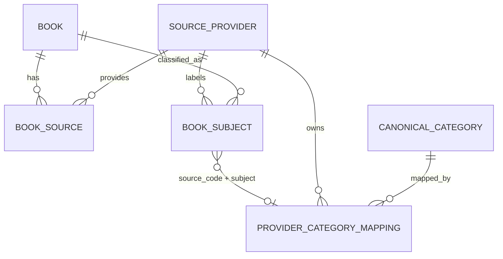

# Canonical Category 分類瀏覽 — v2.3 實作計畫

> Baseline：`origin/main @ 6ef2cd6`（2026-11-14）。
>
> 來源：使用者提供的 v2.0 提案（Proposed），經 repo 現況核對與使用者決定（下表）整理成本版。
>
> **狀態：P0 完成；P1（EF Schema）、P2（Python 工具）已實作，PR 審核中（2026-11-14）**：production 盤點結果與使用者審核過的分類集合見 §5「P0 結果」；工具用法見 [scripts/categories/README.md](../../scripts/categories/README.md)。
>
> 本文件是實作計畫，不代表功能已實作、測試已通過或取得 production 授權。變更記在文末「設計變更紀錄」。

## Context

書庫（`/books`）目前只依出版日期排序與翻頁，不能依主題瀏覽。三家來源（博客來、金石堂、誠品）的分類名稱與層級各不相同，不能直接當網站導覽。

本計畫新增：

- 全站共用的 **Canonical Category**；
- 把來源分類對應過去的 **Provider Category Mapping**；
- 維護 Mapping 的 Python 工具；
- 有側邊欄、來源篩選與分頁的 `/categories` 頁。

### 核對 repo 現況的結果

- `book_subjects`（PK `book_id, subject, source_code`）只存攤平的名稱，**不保存層級**：
  - 博客來（`crawler/books_crawler/parsers.py::_subjects`）：保留「本書分類」每一組、每一層，所以頂層名稱也會存進去。
  - 金石堂（`crawler/kingstone/parse_detail.py::_subjects`）：保留 breadcrumb，但去掉根節點「中文書」，第一層名稱同樣會存進去。
  - 誠品（`crawler/eslite/parse_detail.py::_subjects`）：**只存第 3 層名稱**。第 2 層名稱含促銷字樣，而且會變動（例如「📌心理勵志79折起」）。第 2 層與第 3 層的關係可以從 `crawler/eslite-pages.txt` 的註解，或 `eslite_category_pages.py` 讀取的分類樹得到。
- 目前沒有 `/categories` 路由，也沒有分類相關的資料表。新 Schema 只做 expand：新增資料表和 index，不改動既有欄位。
- Python 端只依賴 `psycopg`，沒有 PyYAML。
- `crawler/tests/conftest.py` 用 `dotnet ef migrations script --idempotent` 在 testcontainers PostgreSQL 上建出 EF Schema，新工具的整合測試可以照這個方式做。

## 使用者決定（2026-11-14）

| # | 決定 |
|---|---|
| 1 | **Mapping 粒度依來源而定**：<br>- 博客來、金石堂：只對應頂層 Subject。書本身就帶有頂層名稱，這樣已足以分類。<br>- 誠品：以第 2 層 id 為單位決定 Canonical Category，再由工具展開成底下所有第 3 層名稱。同一個第 3 層名稱出現在不同第 2 層、而且對應到不同 Canonical Category 時，標為 `AMBIGUOUS`，不寫入。 |
| 2 | **Python `init` 只驗證、不套用 Migration**：Schema 只由 EF Core Migration 負責。開發環境用 `dotnet ef database update`，正式環境用 CD／efbundle 和 migration lock。 |
| 3 | **P0 先交付唯讀盤點 SQL**：使用者在 production 執行並貼回結果，agent 再依結果擬定 Canonical 分類集合與規則檔草案。**使用者審核通過後才進入 P1。** |
| 4 | （P0 審核）採用 §5「P0 結果」的 18 類 Canonical Category 與各來源頂層對照。 |
| 5 | （P0 審核）誠品第 2 層「簡體書」獨立成一類 `simplified-chinese`，不拆到各主題。 |
| 6 | （P0 審核）誠品第 2 層 id 從**分類樹存檔**取得（`eslite_category_pages.py` 讀的同一份 API 回應），不從 `eslite-pages.txt` 的註解推，也不用第 2 層名稱當 key。 |
| 7 | （P2）誠品「繪本／插畫／漫畫」「語言考用」同時在「青少年」與「簡體書」下，**都歸簡體書**，以 `subject_mappings.toml` 的 MANUAL 規則寫入。 |

## 1. 範圍

**In scope**：

- 兩張新資料表的 EF Core Migration、Entity 與 Configuration；
- `scripts/categories/` Python 工具：`audit`、`init`（只驗證）、`sync`（預設 dry-run）、`verify`；
- 三家來源的規則檔；
- Application／Infrastructure 的分類查詢；
- `/categories` Controller 與 Razor 頁：可收合的側邊欄、手機版抽屜、來源篩選、分頁；
- 測試與受影響模組的 `docs/`；
- 上線步驟與回復方式。

**Out of scope**：

- 修改 crawler 的寫入契約（例如保存完整分類路徑）；
- 文字相似度或 LLM 自動分類；
- 分類頁快取（先量 baseline）；
- 子分類（第二層 Canonical Category）導覽；
- 管理後台 UI；
- 自動刪除規則檔已移除的 Mapping。

## 2. Database Schema（P1）

Schema 由 EF Core Migration `AddCanonicalCategories` 建立。這次只新增資料表和 index，舊版 web 與 crawler 都不讀這兩張表。

### 2.1 `canonical_categories`

| 欄位 | 類型 | 說明 |
|---|---|---|
| `id` | uuid, PK | |
| `slug` | varchar(100), UNIQUE | 穩定代碼，URL 與規則檔都用它；CHECK `^[a-z0-9]+(-[a-z0-9]+)*$` |
| `display_name` | varchar(100) | 顯示名稱，可以改，不影響 URL |
| `sort_order` | int | 側邊欄順序 |
| `is_active` | boolean | `false` 時不顯示，查詢時視為不存在 |
| `created_at`、`updated_at` | timestamptz | |

### 2.2 `provider_category_mappings`

| 欄位 | 類型 | 說明 |
|---|---|---|
| `source_code` | varchar(64) | FK → `source_providers.code`，RESTRICT |
| `subject` | varchar(255) | 與 `book_subjects.subject` 完全相同的字串 |
| `provider_root_subject` | varchar(255) | 這筆 Mapping 從哪個來源頂層推出來：<br>- 博客來、金石堂：頂層 Subject 本身；<br>- 誠品：`eslite-l2:<第 2 層 id>`，不存會變動的促銷名稱。 |
| `canonical_category_id` | uuid | FK → `canonical_categories.id`，RESTRICT |
| `mapping_method` | varchar(24) | CHECK IN (`MANUAL`, `VERIFIED_RULE`) |
| `updated_at` | timestamptz | |

約束與 index：

- PK `(source_code, subject)`；
- index `(canonical_category_id, source_code, subject)`；
- 另外在 `book_subjects` 加 index `(source_code, subject)`，讓查詢可以從 Mapping 反查書。

同一個 `(source_code, subject)` 只能對應一個 Canonical Category。不同來源的同名 Subject 各自獨立。一本書可以透過不同 Subject 屬於多個 Canonical Category。

### 2.3 關聯



`BOOK_SUBJECT` 與 Mapping 之間沒有 FK，用 `(source_code, subject)` 這兩個欄位 JOIN。還沒有 Mapping 的 Subject 照樣保留。

## 3. Python 分類工具（P2）

工具獨立放在 `scripts/categories/`，不放進 crawler runtime，避免分類維護和爬取互相耦合。這是新模組，附有自己的 `docs/` 五份文件和 README。

```text
scripts/categories/
├── manage_categories.py        # argparse 入口：audit / init / sync / verify
├── category_config.py          # 讀 TOML，驗證 slug、規則不重複、引用存在
├── category_mapper.py          # 純函式：(DB 中的 subjects, 規則) → 新增／更新／不變／未對應／AMBIGUOUS
├── category_repository.py      # psycopg：讀 subjects、在交易內 UPSERT
├── config/
│   ├── canonical_categories.toml   # slug、display_name、sort_order、is_active
│   ├── provider_roots.toml         # 各來源頂層（誠品為第 2 層 id）→ slug
│   └── subject_mappings.toml       # 個別 Subject 的例外對應（MANUAL）
├── sql/audit-subjects.sql      # P0 唯讀盤點（已交付）
└── tests/
```

- 規則檔用 **TOML**（Python 3.11 以上內建 `tomllib`），不新增 PyYAML 依賴。
- DSN 從環境變數 `DATABASE_URL` 讀取。工具不讀 `.env`，log 和錯誤訊息裡的連線字串一律遮蔽。
- `audit`：輸出 `sql/audit-subjects.sql` 的指標，再加上 Mapping 覆蓋率：
  - 各來源已對應／未對應的 Subject 數；
  - 有至少一個有效 Canonical Category 的書數、沒有任何分類的書數、有多個分類的書數。
- `init`：只驗證。檢查項目：
  - 連線；
  - `__EFMigrationsHistory` 是否包含 `AddCanonicalCategories`；
  - 兩張表、FK、UNIQUE、index 是否存在。

  不符合時以 exit 2 結束，並印出需要執行的 `dotnet ef database update`。
- `sync`：預設 `--dry-run`，`--apply` 才寫入。步驟：
  1. 驗證規則檔：slug 存在且不重複；同一個 `(source, subject)` 不能有兩條互相衝突的規則。
  2. 讀取 DB 實際存在的 `(source_code, subject)`。
  3. 依決定 #1 推出每個 Subject 對應的 Canonical Category：
     - 博客來、金石堂：只處理頂層 Subject。
     - 誠品：讀分類樹存檔（決定 #6），把第 2 層 id 展開成第 3 層名稱。走訪規則沿用 `crawler/deploy/local/eslite_category_pages.py` 的 `select()`（同一份 top id 與排除規則），不另寫一套。展開結果寫成可 review 的小檔 `config/eslite_level3.tsv`（`level2_id`、`level2_name`、`level3_name`）並 commit，之後的 `sync` 只讀這個檔，所以不需要原始存檔也能重現。**工具不連真站**；存檔由使用者取得。
     - `subject_mappings.toml` 的 `MANUAL` 規則優先於推導出的 `VERIFIED_RULE`。
  4. 產生新增、更新、不變、未對應、`AMBIGUOUS` 清單。只要有 `AMBIGUOUS` 或規則錯誤，就不允許 `--apply`。
  5. `--apply`：在單一 transaction 中 UPSERT categories 和 mappings。`ON CONFLICT ... DO UPDATE ... WHERE` 只在值真的改變時寫入，所以重複執行時變更數是 0。失敗就整批 rollback。
- 工具不刪除 `book_subjects`。規則檔已移除、但 DB 仍存在的 Mapping 列為「孤兒 Mapping」報告，不自動刪除；是否需要 `--prune` 記在 backlog。
- `verify`：重新讀 DB，確認 Mapping 與規則檔推導結果一致（不寫入）。
- 新出現、還沒有對應的 Subject 會出現在 `sync` 和 `audit` 報告裡，補上規則後重新執行 `sync`。不在規則內的 Subject 不會被猜測分類。

## 4. Web 查詢與頁面（P4、P5）

### 4.1 Application／Infrastructure

- `Application/Catalog/ICategoryBrowse.cs`、`CategoryBrowseService.cs`、`CategoryBrowsePage.cs`（重用 `BookBrowseItem`）、`CategoryFilter.cs`；在 `Program.cs` 註冊。
- 每頁 20 本（同 `BookBrowseService.PageSize`）。頁碼小於 1 時視為第 1 頁。
- 排序沿用 `EfBookBrowse.ListAsync`：有日期的書在前，依出版日期由新到舊，再依 Id 排序。
- `Infrastructure/Persistence/EfCategoryBrowse.cs`：
  - 分類清單：只列 `is_active` 的分類，依 `sort_order` 排序。書數用 `COUNT(DISTINCT book_id)` 計算，經 `(source_code, subject)` 複合 JOIN。有指定來源時再加上 `book_subjects.source_code = @source`。
  - 分類書籍：`books WHERE EXISTS (book_subjects JOIN provider_category_mappings ...)`。同一本書在多個來源或多個 Subject 出現時，只會列出一次。
  - 全部書籍：與 `/books` 相同，包含沒有分類的書。指定來源時以 `EXISTS book_sources` 篩選。
  - 可篩選的來源：至少有一筆 Mapping 的 `source_providers`。
  - 作者用 `BookAuthors.ByBookAsync` 讀取；不讀 Description、TableOfContents。
- 只查 Local Database，不呼叫外部 API。

### 4.2 HTTP contract

`GET /categories[?category=<slug>][&source=<SourceProvider.Code>][&page=<n>]`，不需要登入。

| 條件 | 回應 |
|---|---|
| 沒有 `category` | 全部書籍（可搭配 `source`） |
| 未知或 inactive 的 slug | 404（比照 `BooksController.NotFoundPage`） |
| 未知、或不在可篩選清單中的 `source` | 404 |
| 合法條件但沒有書 | 200，顯示空清單 |
| `page` 不合法 | 依 `PageNumber.Parse` 處理 |
| `page` 超過最後一頁 | redirect 到最後一頁（同 `/books`） |

切換分類或來源時頁碼重置。分頁連結保留 `category` 與 `source`。

### 4.3 Razor 頁

- 新增：
  - `Controllers/CategoriesController.cs`
  - `Models/CategoryBrowseViewModel.cs`：URL 產生方式比照 `BookBrowseViewModel.UrlFor`，分頁使用 `PagerViewModel.For`。
  - `Views/Categories/Index.cshtml`、`Views/Categories/_CategorySidebar.cshtml`
  - `wwwroot/js/category-sidebar.js`、`wwwroot/css/category-browser.css`
- 修改：`Views/Shared/_Layout.cshtml`，導覽列加入「分類」。
- 重用 `_BookList.cshtml`、`_Pager.cshtml`、`BookListItemViewModel`。分類結果不顯示 Description、TableOfContents。
- 分類與來源都是一般的 GET 連結，沒有 JavaScript 也能瀏覽。目前選取的項目加 `aria-current`。
- 桌面版：側邊欄可以收合，切換按鈕帶 `aria-expanded`／`aria-controls`。收合偏好存在 `localStorage`，讀寫都包在 try/catch 中，失敗時不影響導覽。
- 手機版：改用 Bootstrap 5 offcanvas 抽屜（`wwwroot/lib/bootstrap` 已有），由它處理 Escape、背景遮罩與焦點。點分類就是導覽到新頁。

## 5. 里程碑

每個階段一個 worktree、一個 PR，base `main`。

| 階段 | 工作 | 完成標準 |
|---|---|---|
| **P0** | 唯讀盤點 SQL（`scripts/categories/sql/audit-subjects.sql`）；使用者在 production 執行；agent 擬定 Canonical 分類集合與三家頂層對應草案 | 使用者審核通過分類集合與對應策略 |
| P1 | EF Migration、Entity、Configuration、`CONTEXT.md` 術語 | Schema、constraint、snapshot、deploy compat 測試通過 |
| P2 | Python 工具（`audit`／`init`／`sync`／`verify`）、CI job | unit 與 disposable PG integration 測試通過 |
| P3 | 依盤點結果定稿規則檔；`sync --dry-run` 報告 | 沒有無聲衝突；未對應清單經使用者審核 |
| P4 | Application／EF 查詢 | 分類、來源篩選、去重、書數、分頁測試通過 |
| P5 | Controller、Razor、側邊欄 | WebIntegration 測試與瀏覽器檢查通過 |
| P6 | 完整回歸 | `dotnet test`、crawler、`scripts/categories`、deploy compat 全數通過 |
| P7 | 上線 | 依 §7 順序完成，寫實作報告 |

### P0 操作

1. 以唯讀帳號或 read-only 連線執行：

   ```bash
   psql -X -v csv=category-audit-subjects.csv -f scripts/categories/sql/audit-subjects.sql
   ```

   如果沿用誠品 canary 的 `run-sql.sh read <版本> ...`，就以 `csv=<路徑>` 傳入 psql 變數。
2. 貼回畫面上第 1～4 段的輸出，並提供 CSV：完整的 `(source_code, subject, books, parent_candidate, parent_books)`。
3. agent 依結果擬出：
   - Canonical 分類集合；
   - 博客來與金石堂的頂層 Subject → slug 對照；
   - 誠品第 2 層 id → slug 對照；
   - 會變成 `AMBIGUOUS` 的名稱清單，以及未分類書的比例。

   以上交給使用者審核。

「上層候選」是用共同出現推測出來的：如果另一個 Subject 出現在這個 Subject 的每一本書上，而且書數更多，就把它當成上層候選。它只是盤點線索，不能當 Mapping 規則。兩個 Subject 書數完全相同時，兩者都會被列為頂層候選。

### P0 結果（2026-11-14，production，唯讀）

`audit-subjects.sql` 的 CSV 共 2508 列；另外跑了一次性的覆蓋率查詢（主頂層清單寫死在 SQL 中，只在 scratchpad，沒有 commit）。

| 來源 | 有 Subject 的書 | 不同 Subject | 頂層候選 | 結論 |
|---|---:|---:|---:|---|
| 博客來 | 2879 | 895 | 48 | 21 個真正的頂層，與 `crawler/category-pages.txt` 的 21 個分類榜一致，每個都超過 120 本。其餘 27 個是假頂層：同時掛在 2 個以上頂層下的下層名稱，例如語文、國文、日本、BL。**每本書都至少有一個頂層（0 本缺）**。 |
| 金石堂 | 16970 | 1384 | 43 | 22 個真正的頂層，其中包含「羅曼史」，以及全形斜線的「教育／親子教養」。覆蓋率查詢漏列了這兩個，所以顯示有 183 本缺頂層；這 183 本都來自這兩個頂層（173 + 10），補上後預期 0 本缺。P3 由 `audit` 確認。 |
| 誠品 | — | 229 | 229 | 每本書只有第 3 層名稱。229 個都能在 254 頁清單的分類路徑中找到所屬的第 2 層（共 21 組）。 |

- 一書多類是常態：博客來有 388 本（13%）有 2 個以上頂層，例如「漫畫/圖文書 + 生活風格」；金石堂有 36 本（「人文歷史 + 漫畫」）。這符合計畫「不強制一本書只屬於一類」的設計。
- 假頂層只會出現在已有主頂層的書上，所以 root-only 的 Mapping（決定 #1）已足以分類，不需要對應下層。

**Canonical Category（決定 #4、#5）**：

| sort | slug | 名稱 | 博客來頂層 | 金石堂頂層 | 誠品第 2 層 |
|---:|---|---|---|---|---|
| 1 | `literature` | 文學小說 | 文學小說 | 文學、羅曼史 | 📌文學館79折起 |
| 2 | `comics-light-novels` | 漫畫與輕小說 | 漫畫/圖文書、輕小說 | 漫畫、輕小說 | 動漫畫／圖文、輕小說 |
| 3 | `business` | 商業理財 | 商業理財 | 財經企管 | 📌商業財經79折起 |
| 4 | `psychology` | 心理勵志 | 心理勵志 | 心理勵志 | 📌心理勵志79折起 |
| 5 | `humanities` | 人文社科 | 人文社科 | 社會哲思、人文歷史 | 📌社科79折起、人文史哲 |
| 6 | `religion` | 宗教命理 | 宗教命理 | 宗教命理 | — |
| 7 | `art-design` | 藝術設計 | 藝術設計、影視偶像 | 藝術設計 | 美術、藝術設計 |
| 8 | `language` | 語言學習 | 語言學習 | 語言/字辭典 | 語言學習 |
| 9 | `exams` | 考試與教科書 | 考試用書、國中小參考書、專業/教科書/政府出版品 | 參考書、考試書/政府出版品 | 考試用書、國高中技職考用 |
| 10 | `science` | 自然科普 | 自然科普 | 自然科普 | 自然科普 |
| 11 | `computers` | 電腦資訊 | 電腦資訊 | 電腦資訊 | 電腦 |
| 12 | `health` | 醫療保健 | 醫療保健 | 醫療保健 | 醫學保健 |
| 13 | `food` | 飲食 | 飲食 | 飲食料理 | 飲食 |
| 14 | `lifestyle` | 生活風格 | 生活風格 | 生活風格 | 生活風格 |
| 15 | `travel` | 旅遊 | 旅遊 | 旅遊 | 旅遊 |
| 16 | `parenting` | 親子教養 | 親子教養 | 教育/親子教養、教育／親子教養 | 親子教養 |
| 17 | `children-teens` | 童書與青少年 | 童書/青少年文學 | 童書/青少年 | 青少年 |
| 18 | `simplified-chinese` | 簡體書 | — | — | 簡體書 |

誠品第 2 層在表中以名稱列出，規則檔實際用 id（決定 #6）。

**誠品重複名稱**：

- 12 個第 3 層名稱同時在「動漫畫／圖文」與「輕小說」下，例如日系BL、華文GL、日系奇幻魔法／科幻冒險。兩組都對應到 `comics-light-novels`，所以不算歧義。
- 「繪本／插畫／漫畫」（40 本）、「語言考用」（47 本）同時在「青少年」（`children-teens`）與「簡體書」（`simplified-chinese`）下，對應結果不同，推導時為 `AMBIGUOUS`。P2 時使用者決定兩者都歸簡體書（決定 #7），以 MANUAL 規則解決。

## 6. 測試

- **Python unit**：
  - 讀取規則檔；
  - 同名 Subject 在不同來源各自對應；
  - 多個來源分類可以對應到同一個 Canonical；
  - 會拒絕重複規則與不存在的 slug；
  - `AMBIGUOUS` 不寫入；
  - dry-run 不寫入；
  - 第二次 sync 的變更數為 0。
- **DB integration**（disposable PostgreSQL）：
  - migration 可以套用；
  - PK、FK、CHECK、index 正確，model snapshot 一致；
  - Python 寫入的資料 EF 讀得到；
  - 同一本書有多個 Subject 時不重複；
  - 一個來源的 Mapping 不會套用到另一個來源；
  - rollback 與重跑正常；
  - crawler 的既有寫入不受影響。
- **ASP.NET Core**：
  - 各分類回傳正確的書；
  - 來源篩選正確；
  - 跨來源的同一本書只出現一次；
  - 書數正確；
  - 分頁順序與 URL 參數正確；
  - 404 與空結果；
  - `/books`、`/search`、書籍詳情、導覽列都不受影響。
- **瀏覽器**：
  - 側邊欄收合與展開；
  - 桌面與手機版；
  - 鍵盤操作與焦點；
  - 沒有 JavaScript 時可以導覽；
  - 返回上一頁時選取狀態正確。

## 7. 上線、資料一致性與回復

上線依 Expand → Backfill → Read Cutover 的順序進行：

1. P1 migration 經 CD 套用（efbundle 與 migration lock，不和 crawler 同時改 Schema）。
2. 使用者執行 `init`，接著先跑 `sync --dry-run`，審核後再跑 `sync --apply`。
3. 使用者執行 `audit`，確認覆蓋率。
4. 發布分類頁（P5）。
5. 觀察查詢錯誤、未對應比例與效能。

在 production 套用 migration 和執行 `sync --apply`，都需要使用者明確授權（AGENTS.md §2.3）。

失敗時的處理：

| 失敗情況 | 處理方式 |
|---|---|
| migration 失敗 | 交由 PostgreSQL transaction 與既有 migration 流程處理 |
| `sync` 失敗 | 整批 rollback，保留既有資料 |
| 分類頁查詢失敗 | 回 5xx 並記錄 trace ID |
| 需要回復 web | 退回上一版程式，保留新表（舊版不讀這些表） |

## 8. Definition of Done

1. Canonical Category 與 Provider Mapping 都可以追溯到版本化的規則檔，來源頂層的對應規則已經審核。
2. 未對應的 Subject 有報告；在乾淨的開發 DB 上可以重現初始化與 Mapping，重複執行不會產生重複資料或錯誤覆寫。
3. 跨來源的同一本書只顯示一次；分類頁可以依 Canonical Category 和 Source Provider 篩選。
4. 側邊欄可以收合，也支援手機版；既有的書庫、搜尋、推薦、書單行為都不受影響。
5. 相關測試通過，並已更新受影響模組的 `docs/` 與 `CONTEXT.md`。

## 9. 文件同步

| 階段 | 要更新的文件 |
|---|---|
| P1 | `CONTEXT.md`、`Domain/docs`、`Infrastructure/docs`、`deploy/docs` |
| P2 | `scripts/categories/docs`（新增）、README |
| P4 | `Application/docs`、`Infrastructure/docs`、`tests/docs` |
| P5 | `Controllers/docs`、`Models/docs`、`Views/docs`、`tests/docs` |

crawler 的寫入契約沒有改變，`crawler/docs` 不需要更新。

## 10. 待決策事項

- P3：production `sync --dry-run` 報告由使用者審核後，再執行 `--apply`（需授權，且在 migration 經 CD 套用之後）。
- 本計畫自行決定、可以推翻的事項：
  - 規則檔用 TOML；
  - 誠品的 `provider_root_subject` 用第 2 層 id；
  - 「全部書籍」的來源篩選用 `book_sources`；
  - 手機版用 Bootstrap offcanvas。

## 設計變更紀錄

| 日期 | 版本 | 變更 |
|---|---|---|
| 2026-11-14 | v2.3 | P2 完成：<br>- 誠品兩個同名第 3 層歸簡體書（決定 #7）；<br>- 分類樹存檔由使用者以既有清單工具取得，不需要新增 crawler 選項；<br>- 工具另有 `eslite-import`（產生 `config/eslite_level3.tsv`）與 `--config-dir`；`--apply` 先鎖表再計算計畫；orphan 只回報不刪除。 |
| 2026-11-14 | v2.2 | P0 完成：<br>- 記錄 production 盤點結果；<br>- 18 類 Canonical Category 與各來源頂層對照（決定 #4）；<br>- 誠品「簡體書」獨立成一類（決定 #5）；<br>- 誠品第 2 層 id 改從分類樹存檔取得，展開結果 commit 為 `config/eslite_level3.tsv`（決定 #6）。 |
| 2026-11-14 | v2.1 | 由 v2.0 提案整理：<br>- Mapping 粒度依來源而定（決定 #1）；<br>- `init` 改為只驗證（決定 #2）；<br>- P0 改為唯讀 SQL 加上使用者審核（決定 #3）；<br>- YAML 改為 TOML；<br>- 新增 `book_subjects (source_code, subject)` index。 |
