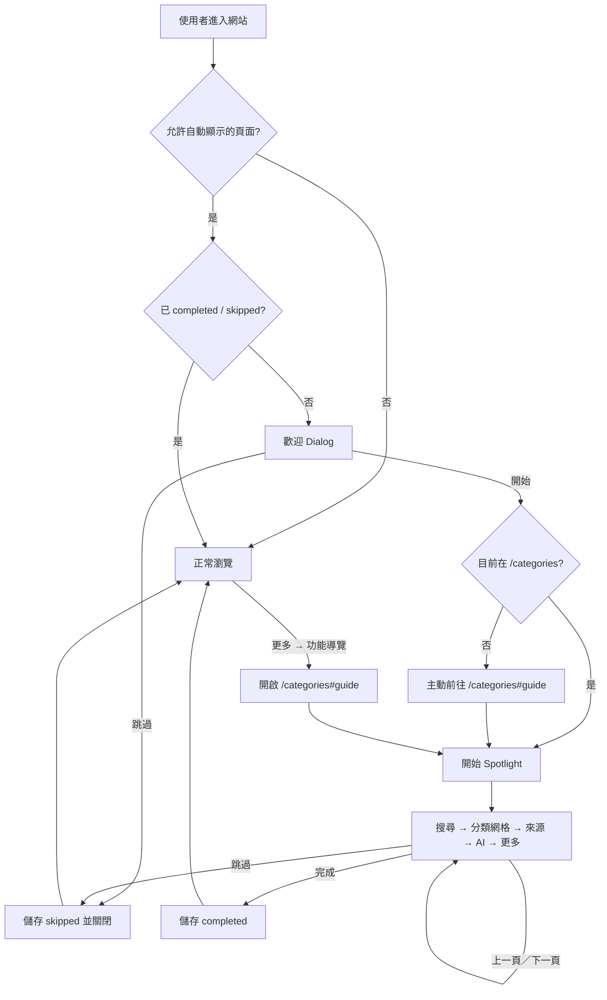
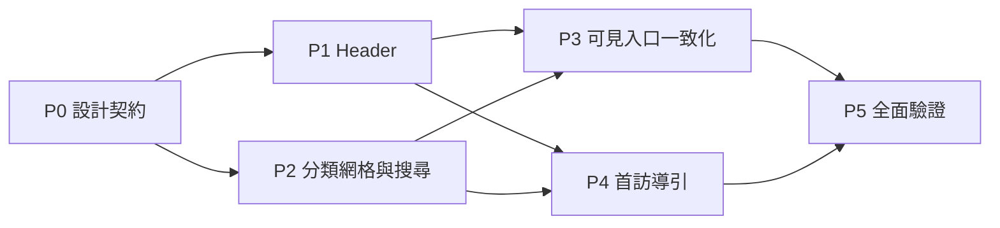

# Book-Finder：Header、分類頁與首次造訪導引完整實作規劃

> **文件狀態**：2026-11-15 使用者核准；P0～P5 實作完成，報告見 [Implementation-Report](../Implementation-Report/header-category-onboarding.md)。本檔是**實作計畫**，不是規格；current contract 以各模組 `docs/` 為準。
>
> **核准時的決定**：§11 D1～D7 採預設方案；登出移入「更多」下拉（2026-11-15 使用者修改）；D8 採最低方案（一次性本機 Playwright 驗收並把證據寫進報告，不把 Browser E2E 加進 CI）。
>
> **Repository**：[Arthur801/Book-Finder](https://github.com/Arthur801/Book-Finder)  
> **查核基準**：`main@127e7440e3357b0c558687fb6eae3dd260159a34`（2026-11-15）  
> **信心**：已直接讀取的程式碼與目前規劃文件為高；交互設計、斷點與測試策略為建議方案（中）；實際瀏覽器呈現和執行效率尚無本次驗證。  
> **任務性質**：UI/UX + 輕量原生 JavaScript；預期不需要 DB Migration、Application Service 變更或新增外部服務。

---

## 1. 摘要與目標

本次整合三項使用者提出的需求，對同一套新介面進行規劃：

1. **Header**：移除主導覽的「書庫」，保留「分類」「AI 推薦」；將「個人書單」（使用者稱「個人書庫」，以現有 UI 名稱為準）和「MCP 說明」移入「更多」下拉選單；額外加入「功能導覽」作為首訪導引的重播入口。已登入時，「登出」也移入「更多」選單的最後一項。
2. **分類頁 `/categories`**：加入一般搜尋欄；把目前左側／手機抽屜式分類清單移至頁面標題「全部書籍」（或目前選定分類標題）的下方、書籍來源篩選的上方，改成固定間距的 CSS Grid；大桌面版每列 6 格、目前設定 19 個項目可排成 4 行；手機與平板自適應。
3. **首次造訪功能導引**：依照重構後的 `/categories` 與 Header，提供可跳過、可重播、可鍵盤操作的 Spotlight 導覽，無須登入且不會觸發搜尋或 AI 請求。

### 1.1 設計約束

- 維持 ASP.NET Core MVC + Razor、Bootstrap、原生 JavaScript 和現有 Query/URL contract。
- 只移除**導覽入口**的 `/books` 連結，**保留** `GET /books`、`GET /books/{id}`、書籍詳情與既有服務，避免破壞書籍頁、舊連結、MCP 與搜尋結果。
- 分類頁新搜尋欄採既有共用 `_SearchForm`，提交 `GET /search?q=...`。**搜尋全站書庫**；在目前選取分類或書商內搜尋屬後續獨立需求，不擅自新增篩選語意。
- 分類與來源仍可互相組合篩選，切換任一維度時保留另一維度並把分頁重置為 1。
- 個人書單目前正式入口為 `/account#library`，匿名訪客不顯示此受保護功能項目；會員名稱仍連到 `/account`。登出移入「更多」下拉的最後一項（前面加分隔線），仍是帶 CSRF token 的 POST 表單，不改成 GET 連結。
- 首訪導引保留 localStorage 小型前端狀態，不收集個資、不新增第三方追蹤，也不增加 AI 付費呼叫。

### 1.2 對此前實作計畫的更新

`Docs/plans/member-center-email-verification.md` 已註明 A–D 功能於 2026-11-15 合併。**本次應以最新 code 的會員中心為基礎**；不得再按舊計畫建立 `/account`，或把 `/library` 當作正式新入口。

前一版《首次造訪網站功能導引實作規劃》設定導覽主場景在首頁、示範書庫 Header；本版更新為**以分類頁作為完整導覽承載頁**，介紹分類頁搜尋、分類網格、來源篩選、Header AI 推薦與「更多」選單。

---

## 2. 最新版本查核與影響範圍

### 2.1 原始碼現況（截至上方 SHA）

| 範圍 | 已確認現況 | 本次變更 |
|---|---|---|
| `Views/Shared/_Layout.cshtml` | 左側 `/books`、`/categories`、`/ai`；登入後右側 `/account#library`、會員名稱、登出；所有訪客皆有 `/mcp-guide` | 新的 Header 階層與「更多」下拉（含登入後的個人書單與登出），並預留導引錨點 |
| `Views/Categories/Index.cshtml` | desktop 左側 `category-sidebar`、手機 offcanvas、桌面收合按鈕與 `<noscript>`；中間 heading、來源篩選、書單 | 改成全寬單欄：搜尋→標題→分類網格→來源→書單 |
| `_CategorySidebar.cshtml` | 目前 sidebar 與無 JS 清單共用的分類連結 | 改為 `_CategoryGrid.cshtml`，一次渲染分類清單 |
| `category-browser.css` | >=992px 側邊欄 14rem，為桌面雙欄排版 | 改 CSS Grid；移除側欄專屬規則 |
| `category-sidebar.js` | 控制桌面收合、`localStorage` 偏好與 JS-only 按鈕 | 移除引用，清理不再使用的檔案／邏輯 |
| `_SearchForm.cshtml` | `GET /search`、`q`、`id="search-q"` | 在分類頁直接重用，不重寫 SearchController |
| `CategoryBrowseViewModel` | `Categories` 首項「全部書籍」，後續由啟用分類組成；`Sources` 首項「全部來源」 | 沿用現有資料；調整顯示容器即可 |
| `CategoryBrowseService` / `EfCategoryBrowse` | `source` 優先驗證；分類依 sort_order；分類數量依來源改變；書籍列表分頁 | 原則上不變；必要時只補 UI/contract 測試 |
| `Views/Member/Index.cshtml` | `/account` 有 `#library`、`#ai-history`、`#account-security` | Header「個人書單」需指向 `#library` |
| `Views/Home/Index.cshtml` | 首頁仍有「查看完整書庫」→ `/books` | 導覽文案／CTA 建議改為「瀏覽全部分類」→ `/categories` |
| `Views/Shared/_LibraryContent.cshtml` | 空書單提示「去書庫逛逛」→ `/books` | 建議改為「前往分類找書」→ `/categories` |
| `wwwroot/js/site.js` | 目前僅模板說明 | 保持獨立；新建 `onboarding.js` |

### 2.2 分類數量與「六欄四列」的正確解讀

[`scripts/categories/config/canonical_categories.toml`](https://github.com/Arthur801/Book-Finder/blob/127e7440e3357b0c558687fb6eae3dd260159a34/scripts/categories/config/canonical_categories.toml) 定義 **18 個網站分類**。`CategoryBrowseViewModel.From` 還會把「全部書籍」作為第一個分類選項。因此**設定基準共 19 格**，以 6 欄呈現是：

- 第 1 行 6 格
- 第 2 行 6 格
- 第 3 行 6 格
- 第 4 行 1 格，剩下空欄**不建立假的分類卡**

> 19 是目前規則檔推得的數量，非即時正式資料庫數值。EF 查詢只列出 `IsActive` 分類；後續停用／新增分類會改變行數。**不使用 `Take(24)`、固定 4 列截斷或硬編 18 個名稱**。需求若明確要求「任何時候都恰好 4 行／24 個實項」，則與目前資料基準不同，屬需另行核准的產品決策。

### 2.3 現行功能 contract 必須保持

- `/categories?category=<slug>&source=<code>&page=N`；未知或停用分類和未知來源仍回 404。
- 切換分類保留來源，切換來源保留分類，兩者重設 `page`；分頁保留兩個篩選。
- `#library` 保留會員頁定位；`/library?status=...` 的既有重導仍有效。
- `/ai` 登入限制與推薦 Job 流程不受影響。
- `/mcp-guide` 不要求登入；MCP API、工具路由和 OAuth 流程不受影響。
- 書籍簡介／目錄等不允許輸出到新頁面的既有資料隔離規則不變。

---

## 3. Header：資訊架構與操作規格

### 3.1 桌面版資訊層級

**匿名**

```text
[好想找書]    [分類] [AI 推薦]             [更多 ▾]  [登入] [註冊]
                                              ├ MCP 說明
                                              └ 功能導覽
```

**已登入**

```text
[好想找書]    [分類] [AI 推薦]          [更多 ▾]  [會員名稱]
                                           ├ 個人書單
                                           ├ MCP 說明
                                           ├ 功能導覽
                                           ├ ──────────
                                           └ 登出（POST 表單）
```

「更多」下拉顯示於身份資訊左側；會員名稱仍可連 `/account`。未登入不顯示 `個人書單`，避免向使用者暗示可直接存取私有內容。若日後希望讓匿名可點並進入登入流程，需另決定可見性，不屬本次默認設計。登出放在最後並用 `dropdown-divider` 隔開，避免和一般導覽項目混在一起而被誤點。

### 3.2 連結與授權矩陣

| 項目 | 匿名 | 已登入 | 目的地 | 備註 |
|---|---|---|---|---|
| Logo | 顯示 | 顯示 | `/` | 原有功能 |
| 分類 | 顯示 | 顯示 | `/categories` | 主導覽保留 |
| AI 推薦 | 顯示 | 顯示 | `/ai` | 由既有身份驗證決定登入流程 |
| 書庫（Header） | 移除 | 移除 | — | `/books` 後端頁面仍存在 |
| 更多→個人書單 | 隱藏 | 顯示 | `/account#library` | 保留會員資料隔離 |
| 更多→MCP 說明 | 顯示 | 顯示 | `/mcp-guide` | 公開路由 |
| 更多→功能導覽 | 顯示 | 顯示 | `/categories#guide` | 重播導引 |
| 更多→登出 | 隱藏 | 顯示 | POST `/account/logout` | 放在 dropdown 最後、分隔線之後；不改成 GET |
| 會員名稱 | — | 顯示 | `/account` | 維持目前會員中心入口 |
| 登入／註冊 | 顯示 | 隱藏 | `/account/login`、`/account/register` | 原有路由 |

「更多」選單內的順序固定為：個人書單 → MCP 說明 → 功能導覽 → 分隔線 → 登出（匿名時只有 MCP 說明與功能導覽）。

### 3.3 元件與行為

- 使用現有 Bootstrap 5 `dropdown`，按鈕使用 `type="button"`、`data-bs-toggle="dropdown"`、`aria-expanded`，列表使用 `dropdown-menu` 與 `dropdown-item`；不引入另一套 dropdown 框架。
- `button` 可用 Enter／Space 開啟，選單可用鍵盤與 Escape 關閉；focus ring 清楚可見。
- 手機版沿用既有 navbar 折疊鈕；「更多」放在展開後的清單內，不另建立另一份 DOM 內容。
- 導覽使用穩定定位屬性：例如 `data-tour="nav-categories"`、`data-tour="nav-ai"`、`data-tour="nav-more"`，避免依文案或 CSS 排列取元素。
- CSS 只調整適當間距與定位；避免 dropdown 被父層 `overflow:hidden` 裁切，Overlay 的 z-index 層次須與導引元件協調。
- 登出寫成 `<li><form method="post" asp-controller="Account" asp-action="Logout"><button type="submit" class="dropdown-item">登出</button></form></li>`，`asp-*` tag helper 照常產生 antiforgery token；用 button 才能以鍵盤送出，不用 `<a>` 加 JS 送表單。
- 若 JS 未載入，保留原有分類、AI、登入等純 HTML 連結；「更多」下拉使用 Bootstrap 需要 JS，可加入 `<noscript>` fallback，使 MCP 說明、個人書單與登出仍可使用。
- `<noscript>` fallback 的登出同樣是 POST 表單，否則停用 JS 的已登入使用者無法登出。由於 noscript 裡的表單也在 server HTML 中，頁面會有兩個 `action="/account/logout"`，測試 helper 要改成限定在 dropdown 範圍內（見 §6.3）。
- 手動導引可由 `href="/categories#guide"` 啟動；其本身不需要新 API。

### 3.4 不破壞連結策略

將 Header 與主要 CTAs 的「書庫」改成「分類」，但保留 `/books` 適用舊書籤、已分享連結與第三方存取。建議同時核對：

1. `Home/Index.cshtml` 的「查看完整書庫」改連分類頁。
2. `_LibraryContent.cshtml` 的「去書庫逛逛」改連分類頁。
3. `Books/NotFound.cshtml`、`Categories/NotFound.cshtml` 及其他公開「回書庫」文字如有需求，可逐一改用 `/categories`；不要使用批次全域取代，以免改壞 `/books/{id}`。
4. `GET /books` 的 controller、API、Model、測試仍保留；如未來要整頁退休，另開相容性議題，屆時再決定 301/302。

---

## 4. 分類頁新版結構

### 4.1 視覺層次與 DOM 順序

```text
┌──────────────────────────────────────────────────────────────────┐
│ [搜尋書名、作者或 ISBN __________________________] [ 搜尋 ]      │
│                                                                  │
│ 全部書籍                                       (目前來源標籤)   │
│                                                                  │
│ ┌────────┐ ┌────────┐ ┌────────┐ ┌────────┐ ┌────────┐ ┌──────┐ │
│ │全部書籍│ │文學小說│ │漫畫與…│ │商業理財│ │心理勵志│ │人文社科│ │
│ └────────┘ └────────┘ └────────┘ └────────┘ └────────┘ └──────┘ │
│ [接下來依資料庫 sort_order 排列，六欄等寬，合計四列*]          │
│                                                                  │
│ 書商分類／書籍來源                                               │
│ [全部來源] [博客來] [誠品] [金石堂] ...                         │
│                                                                  │
│ 共 N 本，第 X／Y 頁                                              │
│ ──────────────────書籍結果列表─────────────────────────────       │
│ [封面] 書名／作者／出版資料                                       │
│ ...                                                              │
│ [上一頁] [1] [2] ... [下一頁]                                    │
└──────────────────────────────────────────────────────────────────┘
```

`*` 依目前 19 個項目計算。每張卡沿用 `Model.Categories` 中的網址、選取狀態與統計數，不額外查詢。

**固定順序**：

1. 網站一般搜尋框；
2. H1（預設「全部書籍」，切換分類時顯示所選分類的名稱）；
3. 分類選項網格；
4. 「書商分類／書籍來源」篩選；
5. 摘要、書籍結果與分頁。

> 原本的「書商分類」在程式中實際是 `Source Providers`，可能包含非書商來源。建議 UI 標題採「書籍來源」，並保留使用者熟悉的來源選項。若產品希望字面上完全叫「書商分類」，可以直接使用該標題，底層資料仍為 `Model.Sources`，不變更 domain 名詞。

### 4.2 直接重用 `_SearchForm`

在 `Views/Categories/Index.cshtml` 最上方增加：

```razor
<div class="category-search" data-tour="category-search">
    <partial name="_SearchForm" model="string.Empty" />
</div>
```

這是**建議片段**，實作時按現有 Razor 語法調整。`_SearchForm` 目前是 `method="get" action="/search"`、input `name="q"`，可重用既有 SearchController。**不新增 `category` 或 `source` 隱藏欄位到 `_SearchForm`**，因 `/search` 目前沒有分類／來源篩選 contract。

驗收：搜尋 `ASP.NET` 應導向 `/search?q=ASP.NET`（依瀏覽器編碼），並交給既有一般搜尋讀取；不影響 `/categories?...` 正在顯示的分類結果。

### 4.3 分類網格的 Razor 組件

新增 `Views/Categories/_CategoryGrid.cshtml`，接收 `IReadOnlyList<FilterLinkViewModel>`，沿用既有清單的 label/count/url/current：

```razor
@model IReadOnlyList<Book_Finder.Models.FilterLinkViewModel>
<nav class="category-grid-nav" aria-label="網站分類" data-tour="category-grid">
    <ul class="category-grid list-unstyled">
        @foreach (var item in Model)
        {
            <li class="category-grid-item">
                <a class="category-grid-link @(item.IsCurrent ? "is-active" : null)"
                   href="@item.Url" aria-current="@(item.IsCurrent ? "page" : null)">
                    <span class="category-grid-name">@item.Label</span>
                    @if (item.Count is { } count)
                    {
                        <span class="category-grid-count">@count 本</span>
                    }
                </a>
            </li>
        }
    </ul>
</nav>
```

注意：上述是可供 Agent 參考的 HTML 結構草案；Razor 與實際 `aria-current` 呈現需遵循現有編碼方式。`<nav>` 的 `aria-label` 要與來源 `<nav>` 區別；不要將書本數文字寫死。

### 4.4 CSS Grid 響應式規則

建議直接重寫 `wwwroot/css/category-browser.css` 中的 sidebar 版面：

```css
.category-grid {
  display: grid;
  grid-template-columns: repeat(2, minmax(0, 1fr));
  gap: .75rem;
  margin: 0;
  padding: 0;
}

@media (min-width: 576px) {
  .category-grid { grid-template-columns: repeat(3, minmax(0, 1fr)); }
}
@media (min-width: 768px) {
  .category-grid { grid-template-columns: repeat(4, minmax(0, 1fr)); }
}
@media (min-width: 1200px) {
  .category-grid { grid-template-columns: repeat(6, minmax(0, 1fr)); }
}

.category-grid-link {
  display: flex;
  flex-direction: column;
  justify-content: center;
  align-items: center;
  min-height: 4.5rem;
  height: 100%;
  padding: .5rem;
  text-align: center;
  overflow-wrap: anywhere;
}
```

最終樣式仍需補上邊框、hover、focus-visible、選取狀態與文字顏色（使用 Bootstrap 現有顏色變數），且維持足夠對比。**不新增固定空白格以填滿四行**。可用等高卡片和固定 gap 達到整齊效果，不要絕對定位每個分類。

| 視窗 | 欄數 | 19 個項目的推算行數 | 原因 |
|---|---:|---:|---|
| `<576px` | 2 | 10 | 小手機文字與觸控目標 |
| `576–767px` | 3 | 7 | 大手機／窄平板 |
| `768–1199px` | 4 | 5 | 平板與較窄桌面，避免六欄過擠 |
| `>=1200px` | 6 | 4 | 符合六欄、四行的桌面目標 |

「電腦版」如被定義為 992px 起就必須六欄，需要另外測量 `.container` 內容可用寬度；本計畫預設 **1200px 起六欄**，保證卡片內可閱讀性。響應測試以 CSS viewport 寬度與實際 computed columns 為準。

### 4.5 來源篩選與結果保留

- 來源區原有 `nav aria-label="來源篩選"`、`Model.Sources`、`aria-current`、Bootstrap pills 不變，只改位置與可見標題。
- 來源可能很多時允許 flex-wrap、多行，不導致水平溢位。
- 書籍結果仍為 `_BookList`、`_Pager`，保留原筆數、空狀態、404 和超頁重導。
- `#category-sidebar`、`#category-sidebar-toggle`、`offcanvas-lg`、`js-only`、`is-sidebar-collapsed`、`category-sidebar.js` 將退出分類頁；舊 localStorage key `bookfinder.categorySidebarCollapsed` 可自然留在用戶端而不讀取，無須 migration／批次清除。
- **無 JS 時分類網格仍完整顯示且可點擊**，不再需要複製一份 `<noscript>` 清單。

### 4.6 固定順序與選取樣式

- 從 `Model.Categories` 直接輸出：第一項「全部書籍」，其餘依 `sort_order`；來源變更時卡片數字依當前來源而變。
- 分類選取狀態使用 `.is-active`、`aria-current="page"`，且只能有一個被選取項。
- 顯示每格的統計數（`N 本`），零本也應顯示 0，不將其判斷為不可點擊。
- 更換分類與來源不導致全部書籍重複計數；由既有查詢保證 distinct 書籍，UI 不額外加總。
- 如果新增更多網站分類，按資料自然產生第 5 行，視覺布局應保持正常；不截斷、不加水平捲動。

---

## 5. 首次造訪網站導引：適配新版介面

### 5.1 核心 UX 與承載頁選擇

新版的核心功能集中在 `/categories`：搜尋、分類與書籍來源都可在同一頁看到。因此採用**可選的單頁導覽**：

- 第一次在公開頁面造訪時，先顯示簡短的歡迎 Dialog（可跳過）。
- 點擊「開始」後由使用者主動前往 `/categories#guide`，開始完整 Spotlight；如果已在 `/categories`，直接開始。
- 之後導覽以分類頁為主，另外標示共用 Header 的「AI 推薦」與「更多」入口。
- 重新觀看從「更多 → 功能導覽」開啟；選擇此連結會導向 `/categories#guide`，不受首次狀態限制。
- 導覽**不會**自動送出搜尋、不新增書單、不觸發 AI 推薦、不執行登入或 OAuth 授權。
- 不依賴登入，不使用有個資的 Query String，也不建立新 Web API 或資料表。

### 5.2 導覽內容（最新 UI）

| 步驟 | 標題 | 實際目標 | 建議文字 | 注意事項 |
|---|---|---|---|---|
| Welcome | 歡迎使用好想找書 | 中央 Dialog | 「用關鍵字搜尋、依分類瀏覽，或用 AI 找到想讀的書。」 | 開始／跳過 |
| 1 / 5 | 搜尋書籍 | `[data-tour="category-search"]` | 「輸入書名、作者或 ISBN，即可搜尋整個書庫。」 | 不提交表單 |
| 2 / 5 | 瀏覽網站分類 | `[data-tour="category-grid"]` | 「點選分類縮小瀏覽範圍，也可選『全部書籍』。」 | 不切換實際分類 |
| 3 / 5 | 按書籍來源篩選 | `[data-tour="category-sources"]` | 「依書籍來源篩選，分類與來源可一起使用。」 | 無來源時顯示純文字卡 |
| 4 / 5 | AI 推薦 | `[data-tour="nav-ai"]` | 「用一句話描述閱讀需求。使用 AI 推薦需要登入。」 | 手機 Header 收合需適配 |
| 5 / 5 | 更多功能 | `[data-tour="nav-more"]` | 「在『更多』找到個人書單、MCP 說明，也能重新觀看導覽。」 | 匿名文案改成「登入後可使用個人書單」；文案不提登出；導覽不會展開 dropdown，即使展開也不得聚焦或觸發登出按鈕 |
| Done | 開始找書 | 中央／搜尋框 | 「導覽完成。你可以從搜尋或分類開始。」 | 完成並聚焦搜尋或關閉 |

MCP 技術細節留給 `/mcp-guide`，此處只需讓新手找到入口。`/account#library` 在匿名狀態不可直接瀏覽，導覽不得為示範去造訪私人頁面。

### 5.3 狀態機、Storage 與 URL

定義 client-side 狀態：

```text
IDLE → WELCOME → ACTIVE(step 0..4) → DONE → CLOSED
              ↘ SKIPPED → CLOSED
```

- `localStorage` key：`bf.onboarding.v1.status`，值 `completed` 或 `skipped`。未存在表示未看過；與既有 `categorySidebarCollapsed` 不相干。
- 首次 Dialog 只在允許的公共頁自動出現：首頁、分類、一般搜尋、書籍瀏覽及書籍詳細頁；不要在登入、註冊、Email 驗證、密碼重設、刪除帳號、OAuth consent、API、錯誤頁自動顯示。
- 使用者**實際點擊完成或跳過**才持久化；中途關頁未完成可再次提醒。手動重新觀看時即便原狀態是 completed 也能開啟，若途中跳過不覆蓋原 completed。
- 連結使用 `/categories#guide`；是固定 fragment，後端不需解析，也不得寫入閱讀需求或憑證。導覽啟動後以 `history.replaceState` 移除 fragment，保留合法 `category`／`source`／`page` 參數（如有）。
- `localStorage` 禁用／throw 時捕捉，導覽仍可手動啟動；避免因儲存失敗每次開關造成無限彈窗。
- 不允許重複初始化多份 Overlay；即使按兩下「功能導覽」也只會有一份 Dialog。
- 產品若未來改變主要選單結構，才考慮升版 key；小型文案變動不應強制既有用戶重播。

### 5.4 導覽流程圖



### 5.5 Spotlight 與 Bootstrap 選單協調

- `onboarding.js` 優先從 `data-tour` 錨點找元素，以 `getBoundingClientRect()` 計算位置；不存在／隱藏／零尺寸時退回中央說明卡，仍能「下一步／跳過」。
- 步驟需要露出 Header 目標時，在手機上可先暫時展開 `#main-navbar`（Bootstrap `Collapse`），待步驟結束恢復導覽前的收合狀態；如果 Bootstrap 不可用則退回中央說明卡。
- 「更多」步驟可高亮 dropdown **觸發器**，以文字說明其下有哪些項目；若設計選擇實際打開 dropdown，須透過 Bootstrap API 並處理 Layer、focus trap 與復原，不可單純修改 `.show` 類別造成狀態不一致。
- 導覽卡片需要與 dropdown 具有明確層級，不被 navbar、sticky 元素或其他 overlay 蓋住。
- 切換步驟、`resize`、`scroll`、navbar 折疊狀態變化時更新定位；節流／以動畫影格更新，避免連續重排。
- 目標離視窗邊緣太近時，卡片換邊或切換為底部置中，**不允許超出 viewport**。
- 導覽期間不能真的觸發 `GET /search`、`POST /api/recommendations/jobs` 或任何需要 CSRF 的業務操作。

### 5.6 無障礙與非 JS 場景

- 對話框包含 `role="dialog"`、`aria-modal="true"`、可用的 accessible name／description；焦點進卡片且 `Tab` 受控；關閉後回到原本的觸發器。
- `Escape` 關閉導覽，視為跳過；上一頁、下一頁、跳過、完成都可用鍵盤操作。
- 使用 `aria-live` 提醒「第 2／5 步」而不重複朗讀整頁。
- 遵循 `prefers-reduced-motion`，停用非必要轉場；避免突然的強制平滑捲動。
- 文字對比、按鈕尺寸及手機安全區要可讀可按。
- 沒有 JavaScript 時不能顯示阻擋整個網站的遮罩；所有網站原本連結與分類格應正常運作，功能導覽可不啟動。

---

## 6. 具體檔案修改清單

### 6.1 Razor／Models／Controllers

| 檔案 | 動作 | 變更理由 |
|---|---|---|
| `Views/Shared/_Layout.cshtml` | 修改 | Header 移除「書庫」、新增「更多」下拉、會員條件內容、登出表單移入下拉、導引入口與資源引用 |
| `Views/Categories/Index.cshtml` | 修改 | 搜尋、標題、分類 Grid、來源、結果順序；移除側邊欄與 JS 引用 |
| `Views/Categories/_CategoryGrid.cshtml` | 新增 | Category `FilterLinkViewModel` 的一次性共用列表 |
| `Views/Categories/_CategorySidebar.cshtml` | 移除／封存 | 不再需要的側邊欄專用 partial，確認無其他 caller 後移除 |
| `Views/Home/Index.cshtml` | 修改 | 可見的「查看完整書庫」CTA 改為瀏覽分類，保持首頁 AI 與搜尋表單 |
| `Views/Shared/_LibraryContent.cshtml` | 小改 | 空書單的導向由 `/books` 改 `/categories` |
| `Views/Shared/_Onboarding.cshtml` | 新增 | 全站歡迎 Dialog 與 Spotlight 主體標記 |
| `Views/Shared/_SearchForm.cshtml` | 原則不改 | 共用搜尋會直接用在分類頁；只有必要才補 `data-tour` |
| `Models/CategoryBrowseViewModel.cs` | 原則不改 | 現有 Categories/Sources/UrlFor 已滿足 Grid 需要；可更新 sidebar 註解 |
| `Controllers/CategoriesController.cs` | 原則不改 | 維持 URL、分類與來源篩選、404、超頁跳轉 |
| `Controllers/BooksController.cs` | 不改 | 保留公開 `/books` 與詳情頁 |
| `Controllers/SearchController.cs` | 不改 | 搜尋沿用 `/search?q=` |
| `Controllers/MemberController.cs` | 不改 | `/account#library` 保持原本行為 |

### 6.2 靜態資產

| 檔案 | 動作 | 變更理由 |
|---|---|---|
| `wwwroot/css/category-browser.css` | 重寫 | 從側邊欄式改成 responsive CSS Grid |
| `wwwroot/js/category-sidebar.js` | 移除 | 舊 sidebar 的 JS 與儲存偏好已不再適用 |
| `wwwroot/css/onboarding.css` | 新增 | 導覽遮罩、聚焦、提示卡、mobile、安全區與 reduced-motion |
| `wwwroot/js/onboarding.js` | 新增 | 歡迎／跳過／完成、storage、重新觀看、定位與鍵盤互動 |
| `wwwroot/css/site.css` | 視需要小改 | Header dropdown 微調；保持站內樣式一致 |
| `wwwroot/js/site.js` | 保留 | 避免把導覽實作混入既有全站模板檔；獨立資源較易停用 |

### 6.3 測試與有效規格文件

- `tests/WebIntegration/NavbarTests.cs`：更新原本強制 `/books` 在 `/categories` 前、以及 `Signed_in_header_shows_library_then_name_then_logout_then_mcp_guide`（書單 → 名稱 → 登出 → MCP）的舊斷言；改成驗證「更多」dropdown 內的順序為 個人書單 → MCP 說明 → 功能導覽 → 登出，且登出表單仍帶 `__RequestVerificationToken`；`LogoutForm()` helper 改成在 dropdown 範圍內找表單，避免抓到 noscript 的那一份；檢查匿名／登入分支。
- `MemberPageTests.cs`、`McpGuidePageTests.cs`、`LibraryPageTests.cs` 中靠 `action="/account/logout"` 或 token 數量判斷的斷言，要依新 DOM（dropdown + noscript）重新確認；本機 Playwright 腳本的 selector 必須限定在 `main form`，避免點到 header 的登出按鈕。
- `tests/WebIntegration/LayoutAndHomeTests.cs`：移除 Header 一定連 `/books` 的斷言，增加 `/categories` 與新首頁 CTA 的測試。
- `tests/WebIntegration/CategoryPageTests.cs`：把 `Sidebar(...)`／`SidebarCount(...)` helper 改成 `CategoryGrid(...)`；更新側欄、offcanvas、toggle、`noscript` 的舊測試；新增分類搜尋、網格與來源相容性斷言。
- `tests/UnitTests/CategoryBrowseViewModelTests.cs`：保留 URL／count 語意測試，改掉只描述 sidebar 的名稱／註解。
- `tests/WebIntegration/SearchPageTests.cs`：確認新增入口仍走 `GET /search?q=`、既有 ISBN/關鍵字行為不變。
- `tests/WebIntegration/MemberPageTests.cs`、`McpGuidePageTests.cs`：確認個人書單／MCP 說明經由新選單仍可存取。
- **新增前端 DOM / 真實瀏覽器測試**：驗 Bootstrap dropdown、分類 Grid computed styles、localStorage、步驟、焦點、行動版 navbar。
- 更新各 code-owning 模組 active docs：`Views/docs/{architecture,workflow-diagram,test-suite,backlog,update-history}.md` 及 `wwwroot/docs/...`；跨 Controller 入口或 contract 有變時再同步 `Controllers/docs/...`。
- `AGENTS.md` 明定 root `Docs/` 舊 technical docs 是 archived reference，不可只改舊版 `Docs/ui/ui-flow.md` 然後把它當現行規格。

---

## 7. 建議開發切分與依賴

### P0：凍結設計與回歸基準（L1）

**Issue/PR 名稱**：`docs(ui): define navigation, category grid and onboarding contracts`

1. 以新 `main` 基準確認導覽入口與會員中心路徑。
2. 確認「更多」在匿名與已登入時的內容，以及首頁 CTAs 是否全部導向分類頁。
3. 確認大桌面六欄門檻預設 1200px；目前 19 格形成四行。
4. 確認分類頁搜尋是全站搜尋，是否另外保留類別篩選內搜尋作未來工作。
5. 確認導引首次自動觸發的頁面、Storage 政策與 `#guide` 重播入口。
6. 記下需更新的既有 View/WebIntegration 測試，避免誤以為測試失敗代表回歸。

**驗收**：已核准的 UX contract、受影響檔案與測試清單；不改程式即可獨立評審。

### P1：Header 下拉選單（L1–L2）

**Issue/PR 名稱**：`feat(ui): consolidate library, MCP and logout into More menu`

- 實作 bootstrap dropdown，Header 移除 `/books` 主項；保留 `/categories`、`/ai`。
- 加入「個人書單」條件式 `/account#library`、公開「MCP 說明」、預留「功能導覽」。
- 保留會員名稱與登入／註冊；登出移入下拉但仍是 POST + antiforgery，不能降低權限檢查或 CSRF。
- 測匿名、登入與手機 navbar 展開；鍵盤、Escape、dropdown 可見與 focus。
- 更新 `NavbarTests`、`LayoutAndHomeTests`。

**驗收**：個人書單、MCP 說明、登出只出現在「更多」中；Header 不再有「書庫」與獨立的登出；仍可進入個人書單、MCP 說明並正常登出。

### P2：分類頁搜尋 + 六欄網格（L2）

**Issue/PR 名稱**：`feat(categories): replace sidebar with responsive inline category grid`

- 在頁首加入共用 `_SearchForm`，整合 label 與輸入欄。
- 新增 `_CategoryGrid`；從側欄拆出 `Model.Categories`，放在 H1 下方、來源篩選上方。
- 重寫 category CSS；支援 2／3／4／6 欄與固定 gap、等高卡片。
- 保留 `aria-current`、Count、url、來源、摘要、書單與分頁。
- 移除 sidebar、offcanvas、toggle、`noscript` 重複清單與 `category-sidebar.js` 的引用；確認無其他 consumer 後刪檔。
- 更新 `CategoryPageTests` 的選項、順序、來源統計與 HTML structure assertions。

**驗收**：1200px 以上六欄；19 格自然四行；小螢幕不橫向溢位；JS 停用仍可選分類；搜尋到 `/search`。

### P3：入口與文案一致化（L1）

**Issue/PR 名稱**：`refactor(ui): route catalog discovery CTAs to categories`

- 調整首頁、空書單及其他清楚指向「逛書庫」的**可見導覽**文字／連結。
- 保留 `/books` 和 `/books/{id}` 實際 route、書籍詳細連結與 Book IDs。
- 檢查 MCP 操作手冊有否描述被移走的 Header 位置，若有僅更新導覽說明，不動 MCP protocol 內容。
- 更新首頁、書單與連結回歸測試。

**驗收**：新的主導覽順暢且舊書籍網址照常可達。

### P4：首次造訪導引元件（L2）

**Issue/PR 名稱**：`feat(onboarding): guided first-visit tour on categories`

- 新增 `_Onboarding.cshtml`、`onboarding.js`、`onboarding.css`，加載於 Layout。
- 建立 client-side 步驟定義、進度、上一頁／下一步／跳過／完成／重播。
- 設定 `bf.onboarding.v1.status`，排除敏感頁面與 OAuth 流程。
- 以 `/categories#guide` 啟動完整導覽並正確清理 hash。
- 在分類搜尋、網格、來源、nav-ai、nav-more 加穩定錨點。
- 處理匿名與登入後的導覽文案差異；無入口時改文字卡。
- 不插入任何新 API 呼叫，也不觸發原本的 Search/AI/Library 事件。

**驗收**：新使用者可完成導引、跳過後不再自動出現，手動可重播；導覽無業務副作用。

### P5：響應式、無障礙與回歸（L2）

**Issue/PR 名稱**：`test(ui): verify responsive navigation, category grid and onboarding`

- 驗證 320、375、390、576、768、992、1199、1200、1440px Viewport，涵蓋文字換行與幾何溢位。
- 驗證 Bootstrap dropdown／navbar collapse、導引 Spotlight 與它們的 focus／層級協調。
- 驗證 `localStorage` 關閉、選取錨點不存在、來源清單空白、分類項目不等於 19。
- 以真正執行 JS 的瀏覽器／DOM 測試覆蓋流程；不要拿只有 HttpClient 的 HTML 測試冒充瀏覽器驗證。
- 補 `AGENTS.md` 要求的 active docs、測試證據、回滾步驟。

**驗收**：Build + 必要 Unit/WebIntegration + 瀏覽器互動斷言均通過；未執行項目需明確揭露，正式環境上線需另行授權。

### 相依性



推薦以小 PR 合併，P1 與 P2 可平行；P4 等前兩項的 DOM 錨點穩定後再實作，以避免導引綁定已淘汰的 sidebar selector。

---

## 8. 測試矩陣（必要驗收）

| ID | 類型 | 情境 | 斷言 |
|---|---|---|---|
| NAV-01 | Web | 匿名 Navbar | 出現分類／AI／更多／登入／註冊，沒有書庫和個人書單 |
| NAV-02 | Web | 已登入 Navbar | 「更多」含個人書單 `/account#library`、MCP、導覽、登出；會員名稱仍連 `/account`；登出是帶 token 的 POST，dropdown 外沒有登出按鈕 |
| NAV-03 | Browser | 更多下拉 | click、Enter／Space 開啟；Escape／外部點擊關閉，aria-expanded 正確 |
| NAV-04 | Browser | 手機 Navbar | 收合與展開正常；可開啟更多下拉，頁面不溢位 |
| NAV-05 | Web | 直接 GET `/books`、`/books/{id}` | 舊路由維持，書籍詳情可連結 |
| NAV-06 | Browser | 從「更多」登出 | 開啟「更多」後點「登出」→ POST `/account/logout` 成功，回到匿名 header；只用鍵盤（Tab／Enter）也能完成；JS 停用時 noscript 的登出表單也能用 |
| CAT-01 | Web | `/categories` 頁 | 搜尋→H1→分類 Grid→來源 pills→結果，順序與語意正確 |
| CAT-02 | Browser | >=1200px、19 格 | 6 columns／4 rows，順序符合規則、末行 1 格，不造假 |
| CAT-03 | Browser | 320／390／576／768／992px | 2／3／4 欄按斷點，無水平捲動、觸控可用 |
| CAT-04 | Web | 來源、分類互相切換 | 保留另一條件、`page` 回 1、`aria-current` 正確 |
| CAT-05 | Web | 來源改變 | 每個分類 badge 數量及「全部書籍」數量隨來源更新 |
| CAT-06 | Web | 未知／停用分類與未知來源 | 仍回 404；超頁保留條件轉末頁 |
| CAT-07 | Web | `/categories` 搜尋關鍵字 | 提交 `GET /search?q=...`，保留既有搜尋模式，不額外帶分類條件 |
| CAT-08 | Browser | JS 停用 | 網格仍顯示、分類與來源仍可點選；無舊 offcanvas 控件 |
| CAT-09 | Web | DB 類別少於／多於 18 | 依資料數量自然渲染，不截斷、無假的分類格 |
| CAT-10 | Web | 書籍描述／目錄 sentinel | 新頁與結果未額外洩漏不允許輸出的內容 |
| ONB-01 | Browser | 初次開啟首頁 | 顯示歡迎卡，且不自動改頁或送請求 |
| ONB-02 | Browser | 按開始 | 前往 `/categories#guide`，依新錨點逐步顯示 |
| ONB-03 | Browser | 按上一步／下一步 | 進度正確，聚焦位置隨步驟變更 |
| ONB-04 | Browser | 按完成／跳過並重新整理 | 記錄 localStorage，後續不自動彈出 |
| ONB-05 | Browser | 更多→功能導覽 | 忽略已完成狀態，重新播放；不覆寫既有 completed |
| ONB-06 | Browser | 手機 Navbar 預設收合 | AI／更多步驟可正常展示或降級，退出時還原狀態 |
| ONB-07 | Browser | 錨點不存在／來源空白 | 顯示純文字卡，仍可繼續與跳過 |
| ONB-08 | Browser | Storage 讀寫 throw | 不當機、不阻擋主要功能、不無限顯示 |
| ONB-09 | Browser | 只有鍵盤、Escape、reduced motion | 可完成、可關閉、焦點恢復，沒有不必要動畫 |
| ONB-10 | Web/Browser | 登入／驗證信／忘記密碼／OAuth 頁 | 不自動彈導引或攔截授權流程 |
| ONB-11 | Browser/network | 導覽全程 | 無新寫入 API、AI job POST、OAuth token 呼叫 |
| REG-01 | Web | 會員中心個人書單 | `/account#library` 仍可用，新增、編輯、移除契約不變 |
| REG-02 | Web | MCP 操作手冊 | `/mcp-guide` 仍公開可用，OAuth/MCP 不受 Header 排列影響 |
| REG-03 | Web | 首頁 CTA／書單空狀態 | 導向 `/categories`；書籍詳情仍是 `/books/{id}` |

### 8.1 建議測試命令（必須在實作環境驗證）

```bash
# 靜態／Unit：包含 CategoryBrowseViewModel 的 URL 和分類契約
dotnet test tests/UnitTests/UnitTests.csproj --filter "FullyQualifiedName~CategoryBrowseViewModelTests|FullyQualifiedName~CategoryBrowseServiceTests"

# WebIntegration：需準備 disposable PostgreSQL Testcontainer 與 Docker
dotnet test tests/WebIntegration/WebIntegration.csproj --filter "FullyQualifiedName~NavbarTests|FullyQualifiedName~LayoutAndHomeTests|FullyQualifiedName~CategoryPageTests|FullyQualifiedName~SearchPageTests|FullyQualifiedName~MemberPageTests|FullyQualifiedName~McpGuidePageTests"

# 編譯
dotnet build Book-Finder.slnx

# 原生 JS 語法檢查（若 Node 可用）
node --check wwwroot/js/onboarding.js
```

上列為**預計執行**的命令，本次未執行。實作 Agent 必須核對真實 project path／工具環境。`WebIntegration` 使用 HttpClient/Razor，**不會執行 JavaScript**；分類實際欄數、Dropdown 與 Spotlight 必須另外用 Browser E2E／可重跑 DOM 測試驗證。倉庫既有 docs 記錄網站 E2E 曾被暫緩；本次若正式把 Browser E2E 納入 CI，要明確核准並更新 active docs，或至少提供一次性的本機瀏覽器驗收證據與限制。

---

## 9. 風險、回滾、效能與監測

### 9.1 風險矩陣

| 風險 | 等級 | 緩解 |
|---|---|---|
| Header drop-down 在手機上被裁切／無法點擊 | L2 | 實際瀏覽器驗證 Collapse + Dropdown，檢查 z-index、overflow、focus |
| 登出藏進下拉後不好找，或手機版被裁切而無法登出 | L2 | 固定放在最後並加分隔線；用 NAV-04／NAV-06 在手機版實際驗證；noscript fallback 要有登出 |
| 分類 Grid 的 CSS 影響所有頁面 | L1 | 以 `.category-browser` 區域命名空間限定 selector |
| 19 個分類未全部啟用／日後增減 | L2 | 依 `Model.Categories` 動態輸出；不硬編四列或裁切 |
| 移除 `/books` 連結破壞既有連結 | L2 | 只移除 UI 主導覽；保留 `/books` endpoint 和 `/books/{id}` |
| 誤認分類搜尋為篩選內搜尋 | L2 | 說明沿用 `GET /search?q=` 的全站搜尋；不帶 category/source |
| 首訪 Overlay 擋住登入／OAuth 或按鈕 | L2–L3 | 排除敏感頁、可 Escape／跳過、初始化異常即移除 Overlay |
| 導引高亮目標被 Navbar 收起 | L2 | 程式展開後還原或降級成文字卡 |
| storage 無法使用 | L1 | `try/catch`，不讓錯誤傳到原本的瀏覽功能 |
| 新導引誤送 API／消耗額度 | L3 | 不模擬 submit，Browser network assertion 無 POST |
| 現有測試仍綁 sidebar 結構 | L2 | 將測試由 Sidebar helper 改為 Grid helper，同時保留 URL/count/404 assertions |

### 9.2 發布與回滾

- 預期僅修改 Razor／CSS／JS 和測試文件；無 schema migration、無新外部依賴。
- 發布前先在 staging／一次性環境做 WebIntegration 與 Browser 驗收；避免直接在 production 試錯。
- 如有問題，可回滾前端 UI 的 commit／部署版本；保留 `/books` 路由可讓原有直接連結持續使用。
- 首訪 `localStorage` 是純前端偏好，不會影響伺服器回滾；停用導引 JS 後不會有殘留遮罩。
- 使用現有 CSS/JS `asp-append-version`，部署時避免舊靜態資產快取造成新舊 DOM 契約不一致。
- 沒有獲得授權前，不修改正式 DNS、OAuth、production 資料或部署設定。

### 9.3 效能與可觀測性

- 分類 Grid 本身只更換 HTML/CSS，不增加資料庫查詢；維持 `EfCategoryBrowse` 既有 distinct 與 source-facet 查詢策略。
- 導引 JS/CSS 使用輕量原生實作，延遲非必要初始化；不可阻擋首屏搜尋框顯示。
- DOM 幾何定位按 scroll/resize 節流，不持續輪詢。
- 記錄客戶端例外時不得包含使用者搜尋文字、登入憑證與 email；MVP 可只以手動瀏覽器 console 與監控既有 error logs 驗證。
- 不提出未量測的「載入時間減少多少」或「搜尋效能提升多少」結論；如有性能目標應在實作後測量。

---

## 10. Definition of Done／交付成果

- [ ] Header 主導覽已移除「書庫」並保留「分類」「AI 推薦」。
- [ ] 「更多」內包含「MCP 說明」、導引重播，以及已登入會員的「個人書單」與「登出」（登出仍是 POST + CSRF）；匿名狀態正確。
- [ ] `/categories` 加入一般搜尋並沿用 `GET /search?q=`。
- [ ] 分類 Grid 在標題下方、書籍來源篩選上方；側欄與 Offcanvas 相關控制已清除。
- [ ] 目前設定的 19 格在 >=1200px 為六欄四列；手機／平板比例正確，文字不溢位。
- [ ] 分類、來源、書籍筆數、排序、分頁、404、登入／書單、MCP 與 OAuth 相關 contract 未意外改變。
- [ ] 首次導覽改用新版頁面：搜尋→分類→來源→AI→更多，可跳過／完成／重播。
- [ ] 鍵盤、手機收合選單、無 JS、Storage 失敗與動態錨點遺失都有可控行為。
- [ ] 測試採 Unit＋WebIntegration＋Browser 互動證據；更新／刪除不再適用的 sidebar 測試。
- [ ] 已更新 `Views/docs` 與 `wwwroot/docs` 的 active technical docs；跨 Controller contract 變更時同步其 active docs。
- [ ] PR 記錄實際測試命令、結果、阻礙、風險、截圖與回滾方式。

---

## 11. 待核准事項（避免讓 Agent 自行決定公開產品行為）

**D1／「更多」位置**：預設在 Header 右側、會員名稱左側；匿名時含 MCP 與「功能導覽」；已登入時再加「個人書單」，並把「登出」放在最後一項（分隔線之後）。

**D2／全部書籍 URL**：`/books` 保留作相容性入口，只有主導覽及主要 CTA 改到 `/categories`；不新增自動 301。

**D3／分類六欄定義**：預設 ≥1200px 六欄；若 992px 起也要六欄，需調整 breakpoint 與內容寬度，經視覺驗收後才定版。

**D4／四行定義**：目前 18 個 canonical categories 加「全部書籍」共 19 項，四行的最後一行只有一格；保留資料驅動，後續數量增加允許第五行。

**D5／搜尋範圍**：預設在分類頁提供全書庫搜尋 `/search`；若想在所選類別與書籍來源內搜尋，需要設計新的 Search contract、資料查詢、URL 和測試，應分支另案。

**D6／來源區標題**：預設 UI 命名「書籍來源」，以符合 `SourceProvider` 可能不全是書商的 domain；也可以採使用者指定的「書商分類」，不改資料語意。

**D7／導引觸發位置**：預設公共頁初訪顯示歡迎卡，按開始後進 `/categories#guide`；登入、驗證與 OAuth 頁不自動顯示。

**D8／無 JS 與 E2E 決策**：對分類和 MCP／書單／登出提供 HTML fallback；導引需 JS。由於既有 browser E2E 在先前規格中曾暫緩，需核准是否建立可重跑 Browser 套件並加入 CI。

---

## 12. Source of Truth／核對清單

**原始碼與目前合併功能（以下固定使用本次查核 SHA）**：

- [AGENTS.md](https://github.com/Arthur801/Book-Finder/blob/127e7440e3357b0c558687fb6eae3dd260159a34/AGENTS.md)：文件 authority、Agent contract、分級驗證。
- [CONTEXT.md](https://github.com/Arthur801/Book-Finder/blob/127e7440e3357b0c558687fb6eae3dd260159a34/CONTEXT.md)：Catalog、Category、Source Provider、Library 名詞。
- [Header Layout](https://github.com/Arthur801/Book-Finder/blob/127e7440e3357b0c558687fb6eae3dd260159a34/Views/Shared/_Layout.cshtml)。
- [分類頁 Razor](https://github.com/Arthur801/Book-Finder/blob/127e7440e3357b0c558687fb6eae3dd260159a34/Views/Categories/Index.cshtml)、[側邊欄](https://github.com/Arthur801/Book-Finder/blob/127e7440e3357b0c558687fb6eae3dd260159a34/Views/Categories/_CategorySidebar.cshtml)。
- [分類頁 CSS](https://github.com/Arthur801/Book-Finder/blob/127e7440e3357b0c558687fb6eae3dd260159a34/wwwroot/css/category-browser.css)、[側邊欄 JS](https://github.com/Arthur801/Book-Finder/blob/127e7440e3357b0c558687fb6eae3dd260159a34/wwwroot/js/category-sidebar.js)。
- [CategoryBrowseViewModel](https://github.com/Arthur801/Book-Finder/blob/127e7440e3357b0c558687fb6eae3dd260159a34/Models/CategoryBrowseViewModel.cs)、[Browse Service](https://github.com/Arthur801/Book-Finder/blob/127e7440e3357b0c558687fb6eae3dd260159a34/Application/Catalog/CategoryBrowseService.cs)、[EF CategoryBrowse](https://github.com/Arthur801/Book-Finder/blob/127e7440e3357b0c558687fb6eae3dd260159a34/Infrastructure/Persistence/EfCategoryBrowse.cs)。
- [分類規則](https://github.com/Arthur801/Book-Finder/blob/127e7440e3357b0c558687fb6eae3dd260159a34/scripts/categories/config/canonical_categories.toml)：目前 18 類。
- [搜尋共用表單](https://github.com/Arthur801/Book-Finder/blob/127e7440e3357b0c558687fb6eae3dd260159a34/Views/Shared/_SearchForm.cshtml)、[SearchController](https://github.com/Arthur801/Book-Finder/blob/127e7440e3357b0c558687fb6eae3dd260159a34/Controllers/SearchController.cs)。
- [會員中心](https://github.com/Arthur801/Book-Finder/blob/127e7440e3357b0c558687fb6eae3dd260159a34/Controllers/MemberController.cs)、[會員 Razor](https://github.com/Arthur801/Book-Finder/blob/127e7440e3357b0c558687fb6eae3dd260159a34/Views/Member/Index.cshtml)。
- [已完成的會員中心實作計畫](https://github.com/Arthur801/Book-Finder/blob/127e7440e3357b0c558687fb6eae3dd260159a34/Docs/plans/member-center-email-verification.md)：歷史／計畫追溯；**現行規格仍以 active module docs 為準**。
- [Views active docs](https://github.com/Arthur801/Book-Finder/tree/127e7440e3357b0c558687fb6eae3dd260159a34/Views/docs)、[wwwroot active docs](https://github.com/Arthur801/Book-Finder/tree/127e7440e3357b0c558687fb6eae3dd260159a34/wwwroot/docs)。
- [NavbarTests](https://github.com/Arthur801/Book-Finder/blob/127e7440e3357b0c558687fb6eae3dd260159a34/tests/WebIntegration/NavbarTests.cs)、[LayoutAndHomeTests](https://github.com/Arthur801/Book-Finder/blob/127e7440e3357b0c558687fb6eae3dd260159a34/tests/WebIntegration/LayoutAndHomeTests.cs)、[CategoryPageTests](https://github.com/Arthur801/Book-Finder/blob/127e7440e3357b0c558687fb6eae3dd260159a34/tests/WebIntegration/CategoryPageTests.cs)。

**請注意**：各模組 active docs 內有些段落保留早期「查核基準 HEAD」和舊規格連結；需將其視為對應段落的歷史背景，逐項與最新 code/test 比對。本次只進行 GitHub 靜態閱讀與規劃，未執行程式、CSS 渲染或瀏覽器測試。
