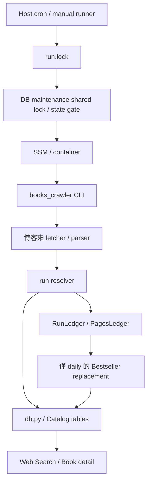
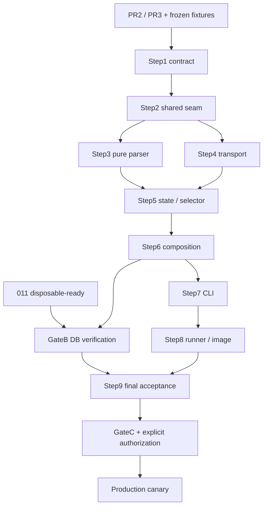

# Kingstone Category Crawler — Implementation Plan（修訂版）

> 日期：2026-10-25。Planning baseline：`ee29e02c3400ed644f5f4126f690cf7e49baf43f`。
> 本文件是實作計畫，不是已核准規格、實作成果或 production 授權。現有 contract 以 AGENTS.md 指向的 authority 為準；下文新增的金石堂規則為本次設計提案，須在 Step 1 完成 authority 決策後才實作。
> 狀態：**BLOCKED BEFORE IMPLEMENTATION**。PR3、011、來源 fixture 與 provider activation 的前置尚未具備。

## 0. 執行契約與 evidence

先讀 `AGENTS.md`、`HANDOFF.md`、`Docs/modules/crawler.md`、`Docs/data/data-model.md`；其他文件依當步影響讀取。涉及命名讀 `CONTEXT.md`，測試讀 test-plan，host 修改讀 deployment 與 ADR-006。

每步先讀 authority、affected implementation、targeted tests，記錄最多十行 evidence map，再完成一項可驗證變更。涉及 contract 的變更，同步更新實作、測試與 authority；純重構只在文件描述確實改變時更新文件。

不要把本計畫對未來 #115／#116 的介面描述當成現有程式；issue 編號沿用輸入計畫，本次未查詢 GitHub 即時狀態。開始實作時重新核對 merge commit、schema head 與測試證據。

| Evidence | 本次確認的現況／權責 |
|---|---|
| `Docs/modules/crawler.md` §2、§3、§17 | 多來源仍為目標 contract；adapter 不擁有跨來源 identity |
| `Docs/data/data-model.md` §7、§11、§14 | ISBN distinct-Book、補 NULL、single writer、010→PR3→011 |
| `Infrastructure/Persistence/Migrations/` | baseline 只有 001～009；沒有 010、011 |
| `crawler/books_crawler/models.py` | `SourceType.BOOKS_COM_TW`、舊 ISBN 型別與 `BookDraft` |
| `crawler/books_crawler/db.py` | 固定博客來、ISBN 首次命中、明確 transaction、無 DDL |
| `crawler/books_crawler/run.py` | `RunDependencies` 注入依賴；Catalog resolution 與 ranking 仍耦合 |
| `crawler/books_crawler/fetcher.py` | `Fetcher.get(url) -> str`；pacer 與博客來分類邏輯並存 |
| `crawler/deploy/run-crawler.sh` | daily/pages；共享 run.lock、maintenance shared lock、SSM、CA |
| `crawler/deploy/crawler.cron` | daily 沒有 `--scheduled`，pages 有；不能只加開關而忽略 cron |
| `crawler/tests/conftest.py`、`.github/workflows/ci.yml` | EF schema＋拋棄式 PostgreSQL；crawler pytest／Docker／.NET 驗證 |

本輪不修改實作、不連真站、不讀 `.env`、不操作 RDS。實作授權與 production 授權分開；通過技術 gate 不等於取得 production 授權。

## 1. Change Scope

### Problem / Goal

金石堂需完成 category discovery→detail→Catalog ingestion。跨來源 Source identity、ISBN、NULL enrichment、touch、transaction、計數重用 PR3 core；網站格式與分類樹邏輯集中於 `crawler/kingstone/`。

### Acceptance criteria

- AC1：離線金石堂 fixture 能走完整 discovery→detail→真實 PostgreSQL ingestion。
- AC2：fixture、unit、contract、integration tests 通過；必要 DB tests 不得以 skip 視為成功。
- AC3：博客來 daily/pages/first_book 對 PR3／PR4 核准 baseline 無非預期回歸。
- AC4：`crawler/docs/architecture.md`、`workflow-diagram.md`、`test-suite.md`、`backlog.md`、`update-history.md` 更新。
- AC5：來源差異集中金石堂 adapter；不複製 core、不新增 schema／DDL。

### Non-goals

本次不做誠品、金石堂 Bestseller、Offer／價格／庫存、帳號登入抓取、自動金石堂排程、平行 acquisition、新服務、Web 功能修改、migration、registry mutation 或大量資料回滾。

### Assumptions / UNKNOWN

- 同一 host、同一 crawler runner、同一 DB；跨主機／Web writer 啟用前另完成 data-model §7.5 序列化。
- root `/book/`、商品 `/basic/{id}/`、L3／terminal L2、`?page=N`、selected sort「依銷售」是輸入計畫提出的來源 contract，**尚無 repository fixture 證據**。不得先硬寫 selector 或宣稱已驗證。
- KINGSTONE activation 的 owner、工具與 rollback 方法為 UNKNOWN，須由既有 migration／seed 管理流程決定；crawler 只讀 registry。
- production grants、告警接收者、實際 source 可用性為 UNKNOWN；只阻塞相關 rollout，不假裝是已確認狀態。

## 2. Current System Analysis



- 現有入口：`books_crawler`、`books_crawler.pages`、`books_crawler.first_book`。
- 現有 core 尚未完成 provider registry、完整 Source identity 矩陣、distinct ISBN、補 NULL、獨立 touch、兩層 outcome。
- `run_pages` 仍使用 ranking row／parser，不能只更換 fetcher 就視為 generic discovery。
- schema 由 EF migration 擁有；crawler 寫 Catalog，Web 消費 Catalog，沒有新增 HTTP API。
- 依賴：curl_cffi、BeautifulSoup、psycopg、PostgreSQL；host 另依賴 SSM、Docker、cron、flock。
- Dockerfile 目前只 COPY `books_crawler/`，需加入金石堂 package。
- 現有觀測為 stdout summary、HTTP／failure log、診斷 artifacts、host logrotate；沒有本次可確認的 metrics／alert backend。
- HANDOFF 的 production snapshot 不是當前 host 驗證，不據此直接啟用或關閉任何來源。

## 3. Change Boundary

| Module | Ownership | 本次策略 |
|---|---|---|
| 金石堂 adapter | URL／ID、response classification、encoding、分類樹／頁面／detail parsing | 新增於 `crawler/kingstone/` |
| 共用 transport | TLS、session、pacing、timeout、bytes ceiling | 從現有能力最小抽取；保持博客來外部 Fetcher contract |
| 共用 retry／budget | 有限 attempts、clock／sleep、通用 deadline | 重用；policy 可由 job 組裝，不能散落多層 retry |
| 共用 ingestion | Source 矩陣、ISBN、補 NULL、touch、DB outcome | PR3 前置；本次只呼叫，缺能力先補前置 |
| 金石堂 discovery job | 有限分類批次、頁數、visited set、cursor 與結果 | 金石堂 package；不放 SQL 或 ISBN 規則 |
| 博客來 projection | TOP100、rank、duplicate Book、streak、snapshot | 保留原核准行為 |
| Host runner | mode dispatch、鎖、secret、container lifecycle | 最小新增金石堂入口與通用操作控制 |
| EF／registry 管理流程 | schema、provider seed／activation | 本次不修改 |

依賴：composition root→adapter＋shared runner；adapter→shared contracts；runner→shared ingestion→DB。core 不 import `kingstone`；adapter 不 import DB implementation。

建議金石堂檔案：`__main__.py`、`fetcher.py`、`parsers.py`、`urls.py`、`discovery.py`。其中 urls/discovery 是 adapter 內部拆分，不是新增 provider-specific core。實際 shared 路徑在 PR3 合併後於 Step 2 凍結。

不引入 plugin loader、selector DSL、新套件或第二套 persistence framework。若需廣泛重寫 shared DB recovery／transport，拆為前置工作，不藏在 adapter PR。

## 4. Data & State Design

### 4.1 資料與 transaction

無 schema change。只讀 `source_providers`；寫 `books`、`book_sources`、`book_identifiers`、`book_contributors`、`book_subjects`。金石堂不寫 `bestsellers`、AI／user tables 或 offers。

沿用 data-model §7，不在此重新定義 ISBN protocol。Source E/U 都查；0／1／≥2 distinct Book 分別新建／附加／ambiguous 新建；無 ISBN 不 heuristic merge。

- New Source：Book／Source／補值／關聯一次 transaction，失敗 rollback 全筆。
- Existing：不 fetch detail；touch 獨立 transaction。
- HTTP／parse 不占用 DB write transaction。
- 已 commit Catalog 不因後續 page、category、run 失敗撤銷。
- 所有 production provider 共享相同 `run.lock`；011 不解除 single-writer。

### 4.2 Observation contract

```text
Observation(provider_code, external_id?, canonical_url,
            context={category_code, page, position})
```

完全相同 `(provider_code, external_id, canonical_url)` 才做本 run ordinary dedup；不同 identity 組合都送共用 resolver。必須保留 shared resolver 的衝突／漂移語意。

若 external ID 從 canonical URL 唯一推導，同 ID／不同 canonical URL 在 adapter 輸出可能不可達；仍在共用 core tests 測 identity matrix，不為湊 adapter 案例製造無效 URL。

### 4.3 Category traversal 與 cursor

targets 經完整樹驗證、exact pair 去重後依 code ordinal ascending。code／URL 非一對一時 root FAILED。

初版是 **bounded page sweep**，每分類最多抓配置頁數，不宣稱完整走訪網站或覆蓋所有商品。

| Current → Trigger | New state | Cursor／side effect | Failure behavior |
|---|---|---|---|
| selected→完成末頁或 page cap | COMPLETED_IN_SCOPE | 推進已消費分類 cursor；記 page cap 是否截斷 | 已 commit 保留 |
| selected→page／item recoverable failure | FAILED_RECOVERABLE | 推進；加入 failed codes | 部分成功或 FAILED，依 run 規則 |
| selected→time budget stop | INTERRUPTED_BY_BUDGET | 已開始分類推進；加入 incomplete codes | 已 commit 保留，明確報告未完成 |
| selected→targeted max-items | INTERRUPTED_BY_SCOPE | targeted 無 sweep cursor | scope_limited，未宣稱分類完成 |
| selected→fatal DB／programming error | FAILED_FATAL | 不提供 normal continuation；保留診斷進度 | 停止 run，人工／下一 run 確認 |
| 尚未開始分類→budget 不足 | NOT_STARTED | cursor 不跨過此分類 | 下一次仍選此分類 |

**重要修訂**：budget 中斷後若永遠不推進分類，重跑仍可能反覆 touch 前段資料而餓死後續分類。本版採「已開始分類推進＋incomplete 清單」，保證 sweep 可前進；不保證中斷分類可透過從頭 targeted retry 最終完成。若產品要求分類內完整續傳，另立 checkpoint contract，不偽稱已有。

Continuation 輸出：`last_consumed_category_code`、`next_start_after_category`、`sweep_exhausted`、`failed_category_codes`、`incomplete_category_codes`，均由 summary 輸出，不新增 DB checkpoint。

- `--start-after-category CODE`：CODE 必須存在於目前完整 targets；找不到 exit 2，不 silent reset。
- 批次到 targets 尾端：`sweep_exhausted=true`，下一 cursor=null；不自動 wrap。
- 下一次完整 sweep 由操作者省略 cursor 明確重啟。
- cursor 已在最後分類：`SUCCESS, no_work=true, selected_categories=0`；為零 Catalog success 規則的唯一正常 no-work 例外。
- category 內 canonical next URL 重複即 PAGINATION_LOOP；不可用 page cap 把已知 loop 當成正常。

### 4.4 Run status／exit

判斷優先序：fatal→FAILED；no-work→SUCCESS；有 attempted acquisition 但 Catalog success=0→FAILED；有 recoverable／incomplete→PARTIAL_SUCCESS；其餘 SUCCESS。

`SUCCESS/PARTIAL_SUCCESS` exit 0，FAILED exit 1，CLI／provider disabled exit 2；wrapper maintenance／paused codes 沿用既有 contract。

頁數／分類數 cap 是事先選定 scope；到 cap 可 SUCCESS＋scope_limited。time budget 中斷已開始分類且已有成功時為 PARTIAL_SUCCESS。有效空頁可正常結束該分類，但整次 acquisition 零成功仍 FAILED，需明確 `no_catalog_progress` reason。

### 4.5 Uncertain commit

成功計數只在 commit 已確認後增加。commit unknown 時停止該 run 的後續 mutation，保留 intended Source／Book UUID、resolution、observation time；不得以一般 retry 重播 INSERT。

第一版採最小安全行為：記 `COMMIT_OUTCOME_UNKNOWN`、FAILED、保留 durable data。只有 PR3 shared layer 已有通過驗證的 reconciliation，才使用它，不新增金石堂專屬 DB recovery layer。

若另立 shared reconciliation 前置：

- 重新連線、查完整 E/U identity，核對 intended UUID／Book relation；不能只看相同 URL 就假定本次 commit 成功。
- touch 的 `last_seen_at >= intended_seen_at` 只能確認期望狀態成立，不必宣稱是哪次交易寫入。
- 一次 SELECT 看不到 Source，不代表舊 backend 已完成 rollback；舊 transaction finality 未確認時不自動 fresh write。
- reconciliation timeout／identity conflict／無法確認 finality：FAILED，停止 mutation；由有界 recovery 流程處理。
- 成功計數 exactly-once 僅限本 process 的 report，不承諾跨 crash 保存 run ledger。

## 5. Failure Analysis

分類：E=expected、T=transient、P=permanent、B=programming error。每個 failure 帶 stage、reason、attempt、provider、run ID；錯誤文字先 redact。

| Scenario | Detection／分類 | Behavior／user-visible effect | Retry／timeout | Rollback／recovery | Observability |
|---|---|---|---|---|---|
| 非法設定／URL／cursor | validator，P | exit2，零 provider HTTP；Catalog 不變 | 不 retry | 無 mutation | config reason |
| disabled provider | registry，E | exit2；fetch session 尚未建立 | 不 retry | 無 mutation | provider_disabled |
| registry／SSM／DB connect 不可用 | IO，T/P | run 不開始；既有網站資料仍可讀 | 共用有限策略 | 無 mutation | stage＋dependency |
| root blocked／invalid／zero targets | classifier/parser，P | FAILED | blocked 不重試；transient root 最多3次 | 無新 Catalog | root reason |
| page timeout／network／429／5xx | transport／status，T | recoverable page failure | 最多3次含首次；受 budget 約束 | 已 commit 保留 | status／attempt／latency |
| 3xx | status，P | permanent failure；不自動 follow | 不 retry | 無寫入 | unexpected_redirect |
| detail blocked／terminal absent | classifier，P/E | item failure；blocked 供 circuit 計數 | 不 retry 同 URL | 無該 item 寫入 | blocked／terminal reason |
| decode／必填 parse 失敗 | strict decode／draft，P | item 或 page failed | deterministic 不 retry | 無該 item 寫入 | bounded reason |
| optional 缺失 | parser，E | NULL／empty，仍可成功 | 無 | 不推測 | mapping warning |
| identity conflict | 共用 resolver，P | item failed | 不 retry | 不 touch、不補值 | source_identity_conflict |
| ISBN ambiguous | distinct count，E | 正常新建 Book | 無 | 單 transaction | ambiguous count |
| touch／write transient | shared DB policy，T | finite retry；不 refetch detail | 最多3次，採既有 allowlist | confirmed rollback 後重試 | SQLSTATE／attempt |
| constraint／permission／syntax | DB，P/B | 不通用重試；致命時 fail run | 不 retry deterministic error | rollback | SQLSTATE／stage |
| commit unknown | driver／shared outcome，T | FAILED，停止 mutation | 不 blind retry | §4.5 | commit_unknown |
| loop／scope／time limit | guard，P/E | §4.3～4.4 | 不以 retry 延長 run | 已 commit 保留 | cursor＋limit reason |
| concurrent invocation | host lock，E | 有界等待或 busy；不並行寫入 | run-lock wait 120秒提案 | 共用鎖 | lock_wait |
| process crash／watchdog | host exit／缺 terminal summary，T | FAILED；Catalog 可能部分落地 | 先確認舊 writer 結束 | transaction rollback 或 outcome unknown | signal／container ID |
| artifact IO／quota | IO／counter，T/P | 保留原始 failure；diagnostic failure 不遮蔽它 | 不循環寫檔 | 無資料回滾 | diagnostic_write_failed |
| 未預期 exception | top-level handler，B | FAILED | 不 retry programming error | transaction rollback | sanitized class＋run ID |

### DB bounded execution 前置

沿用 shared DB 層實作；需要明確 connection timeout、lock timeout、statement timeout 與整個 operation deadline。建議值為 connect10秒、lock5秒、statement30秒、operation60秒、開始前另保留5秒；包括 lookup、touch、persist、COMMIT acknowledgement。重試與backoff共用operation budget，不每次重新贈送60秒。

statement_timeout不能單獨當作端到端deadline保證；client等待與取消也需有界，COMMIT等待被取消仍可能成為unknown outcome。若PR3未提供可驗證的能力，Step2將此列為shared prerequisite；本次adapter不自行覆寫DB policy。DB-A（尚未mutation）安全性不等於值得重試，authentication／invalid DSN等永久錯誤仍不可重試。Source lookup錯誤的既有job語意依authority保留，不因抽共用層而默默改變博客來。

### HTTP、resource 與 circuit policy

- HTTP 最多3次；backoff 1／2秒；重試 owner 只有 shared runner，一個 request 不再被 fetcher retry 三次。
- 429／503 的 Retry-After 支援 delta-seconds、HTTP-date；合法0視為不額外等待。超過30秒為 RETRY_DEFERRED；invalid／past 值記 reason 並使用既有 backoff。不得早於合法要求重送。
- pace、backoff、Retry-After 合成「最早可請求時間」，取最大限制，不相加造成重複 sleep；fake monotonic clock 驗證。HTTP-date 只用 wall clock 轉成 delay。
- connect timeout10秒、total request timeout30秒；開始前保留實際尚需 pace＋request budget＋5秒。pacer 的隨機等待只抽樣一次，budget check 與執行共用同一目標。
- response decoded/decompressed body 上限5MiB；Content-Length 僅為提早拒絕線索，streamed 累積限制才是守門。驗證 compressed／chunked／錯誤長度，不先完整 buffer 再檢查。
- diagnostics 每 run 最多10 bundles、單 body256KiB、總5MiB；quota 滿只 warning一次。跨 run 磁碟保留由現有 host runbook 管理，仍需容量監控。
- response classifier 回 disposition、reason、circuit_signal、retry_after_seconds。transport 不理解 DOM，adapter 決定 encoding／challenge／terminal resource。
- known blocked=BLOCKING_EVIDENCE；valid normal／已確認正常終止頁=NORMAL_REACHABILITY；network、429、5xx、oversize／decode failure 無足夠頁面證據時=NO_REACHABILITY_EVIDENCE。
- block streak：blocking +1、normal reset、no-evidence preserve；3次停止新 provider requests並 FAILED；root blocked 立即 FAILED。相同 request attempts 不重複計作不同 blocked observations。

## 6. Security Analysis

- Batch 不新增使用者 authentication／authorization endpoint；CSRF、JWT policy 無變更。金石堂公開頁 acquisition 不帶帳號 cookie／token。
- 外部 HTML、seed、root links、next links 都不可信；所有 acquisition URL 在請求前經 adapter validator。
- 初始 URL 提案：HTTPS、`www.kingstone.com.tw`、無 userinfo、port absent/443；category code `[a-z0-9]+`、product ID `[A-Za-z0-9]+` case preserved。是否符合真實來源由 fixture gate 決定。
- category query 只允許唯一 `page=N`、正整數，page1→base；重複 key、未知 key、encoded slash/code、非法 host、fragment 依測試拒絕。若實際排序必須 query，先更新 approved contract，不能為保持本計畫拒絕真實合法流程。
- Product tracking query／fragment 只有在確認不參與 identity 後移除；不任意 percent-decode ID。
- 保留 TLS verification、container UID10001、CA read-only、SSM專用 DB credential、mode600暫存 env cleanup。
- SQL parameterized；adapter 無 SQL；role grants 須證明只允許必要 Catalog DML／registry SELECT。DDL、registry mutation、AI／user tables 寫入均無需求。
- logs／artifacts 不含 secret、session state；外部錯誤訊息也 redact；診斷內容先清理、再限額。敏感 raw fixture 不入 repo。
- description／table_of_contents 只供內部 AI 使用；不得改成頁面 raw HTML、不得新增至 JSON DTO。

## 7. Verification Strategy

| AC／failure | Test boundary | Fake／real | Expected |
|---|---|---|---|
| AC1 | root→分類→detail→ingestion | raw fixture＋真 parser＋真 PostgreSQL | KINGSTONE Source、正確 Book／關聯、Bestseller 不變 |
| AC2 parser／URL | 每種 page kind、selected sort、encoding、ID | pure unit／raw fixture | optional NULL、required fail、無猜測 |
| AC2 identity／ISBN | 0／1／≥2 Book、無 ISBN、E/U矩陣、漂移 | 真 EF-schema DB | shared outcome、補NULL、touch正確 |
| AC2 retry／limits | fake clock／sleep／session | unit／contract | exact attempts、Retry-After、deadline、stream byte ceiling |
| AC2 data failure | touch、insert、補值中途失敗 | 真 DB rollback＋fault injection | 無半套關聯、已commit保留 |
| AC2 commit unknown | 真commit後synthetic unknown；真rollback後unknown | 真 DB integration | 停止mutation；不blind retry、不錯計成功 |
| AC2 cursor | budget中斷、tail、missing code、page cap、loop | pure state tests | 推進／incomplete／no-work依contract |
| AC3 | 博客來daily/pages/first_book | 全既有fixture＋DB suite | 對PR3/PR4 baseline無非預期變更 |
| AC4 | docs／命令／test IDs | review＋link check | 五份文件對應實作與真實證據 |
| AC5 | dependencies／schema diff | static review | adapter無SQL；零migration／DDL；共用core |
| host control | daily/pages/kingstone modes、pause、CA、timeout | command fakes＋process test | 同一鎖、正確argv/env、cleanup與exit |
| watchdog | fake docker client提前結束但writer存活 | process-level integration | writer結束前鎖不釋放 |
| security | forbidden URLs、secrets、巨量回應 | unit／contract | 零非法請求、無secret log |

HTTP transport、clock、sleep、random可替換；fixture E2E不替換parser／DB ingestion。DB integration 使用 `crawler/tests/conftest.py` 的 disposable PostgreSQL＋EF migration，不讀開發／production DATABASE_URL。

fixtures metadata：source_url、captured_at_utc、capture_method、sha256、expected_page_kind；HTTP status未知就記null，不從browser另存HTML捏造200。representative page記category code／observed product count。

最低fixture：root（含重複與terminal L2）、分類首／次／末／空／錯誤／sort mismatch頁、detail完整／缺optional／無ISBN／invalid、blocked、provider error。錯誤fixture可為明確標示的derived fixture，來源實測與人工變體分開。

所有測試禁止 provider 真站；guard只允許測試所需本地服務，不能封鎖Docker/PostgreSQL後把DB tests skip當通過。

執行：crawler全pytest／ruff check／format check；`dotnet build Book-Finder.slnx -c Release`、`dotnet test Book-Finder.slnx --no-build -c Release`；受影響deploy tests、Docker離線smoke。沿用CI的Python3.14與host Python3.12驗證。無新migration，但要證明011 physical schema適用。

## 8. Observability

保留既有summary欄位名稱與語意：`existing_book_count`、`attached_source_count`、`existing_source_count`、`new_source_count`、`new_book_count`、`ambiguous_isbn_count`、`offer_updated_count=0`。不要以`isbn_attached_count`取代既有欄位；新增欄位必須有明確關係。

每run：run_id、provider_code、job_name、release、started/finished、duration、status、exit、scope_limited／reason；每stage log可用同run_id關聯，不新增distributed tracing服務。

追加：category／page attempted/completed/failed/incomplete、observations／exact duplicates、Catalog attempted/succeeded/failed、cursor欄位、HTTP attempts/status/retry/latency、DB error class／commit unknown、lock wait、watchdog／artifact failure。

明確區分attempt counters與logical item counters；重試不重複加logical count。可有in-flight／interrupted項，不強迫attempted=succeeded+failed而漏算中斷。

以既有logs形成低cardinality指標：operation volume、run／dependency latency、failure ratio、blocked／DB errors、lock wait、OOM／disk／artifact bytes。URL、Book UUID、run_id放logs，不當metric label。

production前指定owner與渠道：FAILED／commit unknown／watchdog即調查；持續429／5xx／blocked、零進度、超deadline、disk／memory門檻告警。沒有metrics backend時以runbook明確log查核owner／時限，不假裝已建dashboard。金石堂無自動排程，第一版不設「每日未執行」告警。

## 9. Deployment Strategy / Gates

### Gate A — offline implementation

需要PR2／PR3已合併且shared contracts有repository evidence；來源fixture、分類／排序／URL／batch policy已凍結至authority；本計畫UNKNOWN中影響實作的部分已解決。011未完成時可做離線adapter，但禁止對010 DB寫KINGSTONE。

### Gate B — DB verification

011 migration已存在並可在disposable DB套用；PR3／PR4 runtime相容證據具備；Gate A離線功能完成。DB integration必須全通過；本Change不補寫011。

### Gate C — production canary

Gate B通過、011 production已部署、image／runner／config可追溯、activation／rollback owner確定、role grants／operational tests具備、當次production與真站授權明確。registry操作由既有owner執行，不交給adapter。

部署順序：

1. PR2＋PR3按既有同release策略部署；PR4另通過011 gate與授權。
2. 本次建置immutable image與paired runner；保留既有非root、CA與secret模式。
3. 先設global disabled；部署runner/image/config，核對檔案與release provenance。
4. 若此次另有「保持博客來排程停用」的明確操作需求，設定schedule switches並驗證；不把停用BOOKS registry當成本次必要條件。
5. 由owner啟用KINGSTONE，驗證registry；失敗保持global disabled。
6. 核對watchdog、maintenance gate、limits；當次授權後global enable並手動targeted canary，無自動金石堂cron。

### Scheduled invocation

若新增`BOOKS_DAILY_SCHEDULE_ENABLED`／`BOOKS_PAGES_SCHEDULE_ENABLED`，unset=true維持既有行為；invalid=exit2；只對`--scheduled`生效。

**同一步更新cron**：daily改為`run-crawler.sh daily --scheduled`；pages維持`pages --scheduled`。兩者都測scheduled skip且manual仍可執行。provider disabled仍獨立exit2且零HTTP。

若無需分開global與schedule控制，可省略這組新開關，不為新增adapter必然擴充所有host控制。

### Compatibility

Old runtime指通過011相容驗證的PR3/PR4版本；不是v0.0.4。

| 組合 | 支援 |
|---|---|
| Old runtime＋011 | 前置gate已驗證才允許 |
| New runtime＋011 | 本次目標 |
| New runtime＋010或更早 | 不允許KINGSTONE ingestion；startup fail closed |
| Old runtime＋本次schema | schema未變；驗證KINGSTONE資料可讀 |
| v0.0.4＋011 | 不作rollback目標 |

one-shot無rolling worker相容問題，但已啟動container不能因換image就假定消失。runtime smoke與shared resolver tests不能被schema compat綠燈取代。

## 10. Rollback & Recovery

### Operational mitigation

global disable只阻止新run，不停止in-flight container。找出該run container ID，graceful stop；確認writer已終止後才釋放鎖或啟動下一run。保留run log、digest、cursor／incomplete資訊。

### Host lifecycle / watchdog

- 取得run.lock有界等待120秒，busy exit3；取得後啟動持鎖時鐘。既有maintenance shared lock順序維持。
- 金石堂持鎖目標1800秒：1755秒TERM、1785秒KILL，預留15秒reap；application acquisition budget最高1500秒。maintenance、SSM、startup都計入host budget，傳入container的是實際剩餘deadline，不能重新贈送完整1500秒。
- wrapper須記錄container ID（例如受控cidfile），watchdog對實際container執行停止，不能只kill前景`docker run` client。
- signal trap、SSM／Docker失敗、caller中斷、正常exit都走相同cleanup；secret清除、writer終止確認後才結束持鎖wrapper。
- Docker daemon／kernel異常下不能保證1800秒硬上限；若無法確認container已停止，fail closed、保留鎖並告警，由operator恢復。不得為達數字上限放出第二個writer。
- watchdog退出非零，reason=`host_run_deadline`；wrapper cleanup與停止失敗不可偽報成功。

### Code / config rollback

回到通過011相容驗證的release；確認crawler digest、runner、cron、config全部配對。schema-ahead CD可能不更新crawler，依`deploy/README.md`處理，不假定rollback Web即rollback crawler。先disable，再回復設定，驗證後才restore原開關；舊runner不認得的新鍵須移除／轉換。

### Data rollback

本次無Down migration。已commit來源／metadata保留；停止或code rollback不撤銷資料。不能直接刪除Source所連Book，因可能已共享或被收藏。NULL enrichment缺少完整before-image，採有證據的fix-forward；資料修復先產生唯讀impact report，正式刪改另取得授權。全庫snapshot restore不是預設恢復方案。

已送出的HTTP GET不可撤銷；本次沒有來源網站寫入side effect。

## 11. Evolution Analysis

誠品新增adapter／fixture／composition registration；DOM變化只動來源parser；API替換只動來源fetch/parse；新增consumer讀Catalog，不import來源parser。跨storage改shared persistence，非每家adapter。新writer／多主機先做既定advisory lock protocol。

最可能hotspot：分類續傳、source URL／external ID、shared draft、metadata enrichment／recovery與provider activation。checkpoint、Offer refresh、跨process recovery另立需求，不先造通用框架。

## 12. Implementation Steps

### Step 1 — 完成來源 contract 與前置清單

Purpose: 消除來源假設與責任未決。  
Files / Components: authoritative crawler／data docs、fixtures manifest、PR3／011 evidence。  
Change: 凍結targets、sort、URL、scope/cursor、activation owner；以fixture計算並寫入T_limit／P_limit；數值取輸入計畫的`max(ceil(T*1.5),T+20)`、`max(ceil(Pmax*2),Pmax+20)`作上限提案，驗證合理性。  
Dependencies: PR2／PR3、fixtures；011列DB gate。  
Failure considerations: 來源無證據／契約衝突時停止該部分。  
Tests: manifest hash、代表頁與反例對照。  
Observability: evidence map標注取得方式與UNKNOWN。  
Deployment considerations: registry activation另有owner。  
Done when: Gate A具備；未決數值／語意不留給實作者猜。

### Step 2 — 凍結共用 seam 與最小抽取

Purpose: 重用PR3 core。  
Files / Components: PR3 models／ingestion／DB／retry、現有Fetcher與tests。  
Change: 列出真實function/type；transport從provider classifier分離，保留博客來get→str外部contract；core不import adapter。  
Dependencies: Step1。  
Failure considerations: 缺DB safe-outcome／deadline能力先開shared prerequisite，不造金石堂DB層。  
Tests: 博客來unit＋fixture＋DB回歸、fake第二provider共用contract。  
Observability: 保留既有summary欄位與redact。  
Deployment considerations: 既有入口不變。  
Done when: 共用介面有測試，沒有兩套identity／persistence。

### Step 3 — 金石堂 URL 與 pure parsing

Purpose: raw HTML→targets／observations／draft。  
Files / Components: `kingstone/urls.py`、`parsers.py`、fixture tests。  
Change: root tree、selected sort、next link、detail mapping、strict decode；通用ISBN／日期規則委派core。  
Dependencies: Step1、2。  
Failure considerations: identity不一致、invalid page、required缺失、空頁。  
Tests: 原始＋derived fixtures、URL矩陣、optional NULL／date precision。  
Observability: 可判讀parse reason，不記完整內容。  
Deployment considerations: 無HTTP／DBside effect。  
Done when: parser無DB／runner依賴，fixtures完整通過。

### Step 4 — Transport 與金石堂 response adapter

Purpose: 有界fetch與分類。  
Files / Components: shared transport、`kingstone/fetcher.py`、tests。  
Change: raw response、stream ceiling、timeout、pacing；adapter決定encoding／ResponseDecision。  
Dependencies: Step2、3的page-kind contract。  
Failure considerations: 429／Retry-After／3xx／5xx／blocked／oversize／decode。  
Tests: fake session/clock、chunked／compressed ceiling、exact attempts、無provider真網路。  
Observability: request stage/status/duration／diagnostic quota。  
Deployment considerations: 不加新依賴，保留TLS／nonroot。  
Done when: bytes在stream時限額、retry只有一個owner、博客來回歸通過。

### Step 5 — Batch selector 與 run state

Purpose: deterministic有限探索與可解釋進度。  
Files / Components: `kingstone/discovery.py`、pure state tests。  
Change: category selection、visited pages、exact observations dedup、cursor／incomplete、budget／circuit與run status。  
Dependencies: Step3、4。  
Failure considerations: budget replay starvation、missing cursor、loop、zero progress、tail no-work。  
Tests: §4所有transitions；中斷後下一run選後續分類；不宣稱分類內完整續傳。  
Observability: category states／cursor／scope reason。  
Deployment considerations: 無新checkpoint storage。  
Done when: state tests覆蓋所有terminal state與優先序。

### Step 6 — Offline composition 與 Catalog integration

Purpose: 完成金石堂→共用ingestion。  
Files / Components: `kingstone/__main__.py`、composition、unit／integration tests。  
Change: provider check後才建立fetch session，注入runner；不新增business rule。  
Dependencies: Step2～5；DB verification須Gate B。  
Failure considerations: 重跑、attach／ambiguous、partial commit、unknown commit fail closed。  
Tests: 真fixture＋真DB全流程、E/U矩陣、0／1／≥2、NULL／AUTHOR／touch、Bestseller不變。  
Observability: shared counts＋logical item counters一次計數。  
Deployment considerations: 010禁止金石堂寫入。  
Done when: offline verified，Gate B後全部DB測試通過。

### Step 7 — CLI 與設定驗證

Purpose: operator取得明確有限scope。  
Files / Components: 金石堂CLI／config tests、README。  
Change: 支援無cursor sweep、`--start-after-category CODE [--max-categories N]`、`--category CODE [--max-items N]`；targeted必須從完整targets驗證membership。  
Dependencies: Step5、6。  
Failure considerations: duplicate/unknown flags、missing value、invalid integers、互斥flags、`--scheduled`一律exit2。  
Tests: CLI矩陣；設定在HTTP前驗證；未silent clamp。  
Observability: sanitized config reason、selected scope。  
Deployment considerations: host驗證上限並傳到container，直接container入口亦驗證。  
Done when: configured ceilings與CLI一致，cursor／no-work輸出完整。

設定預設／範圍：category page limit2（1..10）、max categories1（1..10）、run seconds1500（300..1500）、max canary items50（1..500）。`--max-items`僅targeted且不超設定上限；flags互斥同輸入計畫。不得以normal sweep item cap控制進度。

### Step 8 — Runner lifecycle 與 packaging

Purpose: production序列化與可停止。  
Files / Components: `run-crawler.sh`、Dockerfile、config example、cron（若需schedule switches）、deploy tests。  
Change: safe argv array傳遞flags／limits、打包kingstone、container ID追蹤、deadline／signal cleanup；schedule switches若加入，同步改daily cron。  
Dependencies: Step7。  
Failure considerations: writer存活時client退出、daemon unavailable、SSM timeout、maintenance wait、cleanup失敗。  
Tests: wrapper fakes＋process-level鎖／kill測試＋Docker離線smoke；CA／secret／exit／既有jobs回歸。  
Observability: container ID、lock wait、signal／deadline／cleanup結果。  
Deployment considerations: runner/image/config配對；release provenance核對。  
Done when: 所有入口同鎖、沒有孤兒writer導致下一writer啟動。

### Step 9 — 文件與完整驗收

Purpose: 交付可review結果。  
Files / Components: `crawler/docs/*`五份、README／deploy README、test reports。  
Change: workflow兩家adapter、architecture ownership、test-suite案例與boundary、backlog未解事項、真實git history；audit authority references。  
Dependencies: Step6 DB通過、Step8。  
Failure considerations: 不把unit／synthetic／DB證據混作production驗證。  
Tests: 全crawler／.NET／受影響deploy／lint／offline image smoke；schema diff零變更。  
Observability: 每重要failure有log／操作定位方法；指定rollout觀測owner。  
Deployment considerations: Gate C另外核准，實作AC不綁定live canary。  
Done when: AC1～5全有證據，未解L4事項單列，不擴大scope。

## 13. Dependency Order



parser與transport在shared seam凍結後可平行；文件隨各步更新。critical path是PR3／fixtures→shared seam→composition→011 DB verification與runner→驗收。此圖允許task平行，不自行授權多agent。

## 14. Risk Register

| Risk | Likelihood | Impact | Mitigation | Verification |
|---|---|---|---|---|
| PR3／011缺失 | 高 | 無法正確寫入 | 硬gate、另處理前置 | schema＋runtime evidence |
| URL／sort／tree假設錯誤 | 高 | 無法discovery | fixture先決、authority決策 | raw fixture contracts |
| shared core擴大或複製 | 中 | 博客來回歸／規則分歧 | 最小seam；DB recovery另立前置 | import/diff＋全回歸 |
| budget反覆處理同分類 | 中 | sweep飢餓 | 已開始分類推進＋incomplete | cross-run state tests |
| unknown commit被blind retry | 中 | 資料／計數不一致 | 第一版fail run；shared recovery需finality證據 | real DB fault injection |
| docker client死但container存活 | 中 | 同時writer | container ID停止確認後才放鎖 | process integration |
| schedule switch漏daily | 高（若不改cron） | 非預期啟動 | daily同步--scheduled | actual cron contract test |
| registry activation無owner | 高 | 無法canary | GateC owner／tool／undo明確 | registry evidence |
| metadata補值難撤銷 | 中 | 污染既有Book | 有限canary、NULL-only、fix-forward | enrichment／impact review |
| fixture通過但EC2被阻擋 | 中 | production不可用 | 另授權bounded canary | live evidence另列 |

## 15. Final Self Review

以下判定針對當前repository及可執行前置，不把「尚未寫程式」本身當成設計失敗。

| Item | Result | Evidence |
|---|---|---|
| Boundary | PASS | adapter／ingestion／host ownership與禁止複製core已定義 |
| Failure control | UNKNOWN | shared PR3 deadline／DB outcome seam與來源classifier尚待確認 |
| Verifiability | UNKNOWN | test matrix具體，但缺來源fixture與011 |
| Deployability | FAIL | PR3／011及registry activation前置未完成 |
| Observability | UNKNOWN | 欄位／failure mapping已定義，production owner／channel待確認 |
| Evolvability | PASS | 新provider沿用draft／ingestion，checkpoint等需求另立 |
| Security | UNKNOWN | URL來源證據、production grants待確認 |
| Rollback | UNKNOWN | stop／code／data策略已定義；可回復release與host lifecycle驗證未具備 |

**尚未 READY FOR IMPLEMENTATION。** 先完成Step1與Gate A前置，才能進入離線功能實作；011阻塞DB驗收與正式寫入。Gate C只控制另授權的production canary，不阻塞已完成AC的離線交付。
