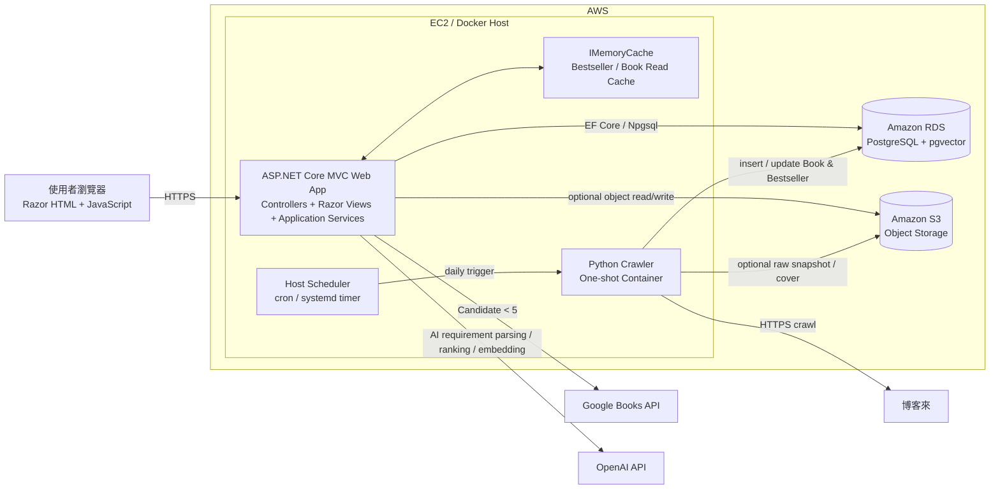
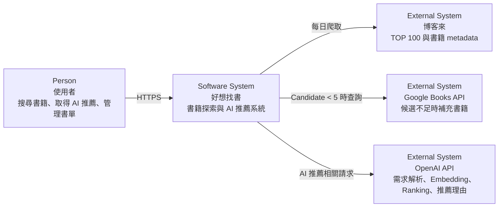
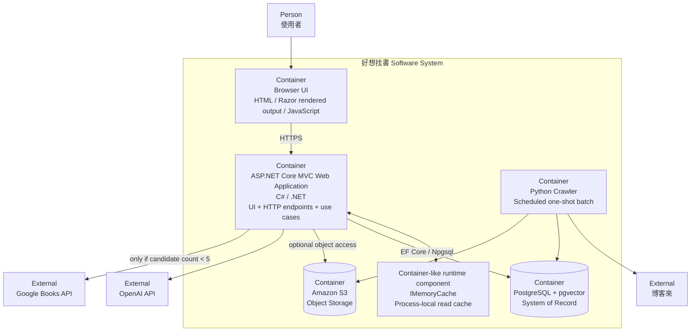
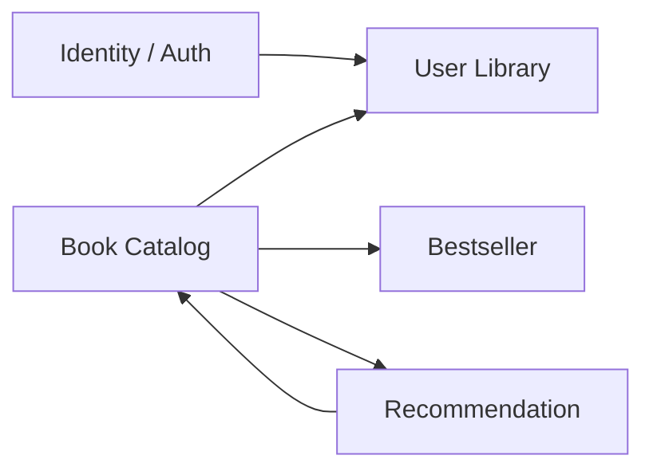
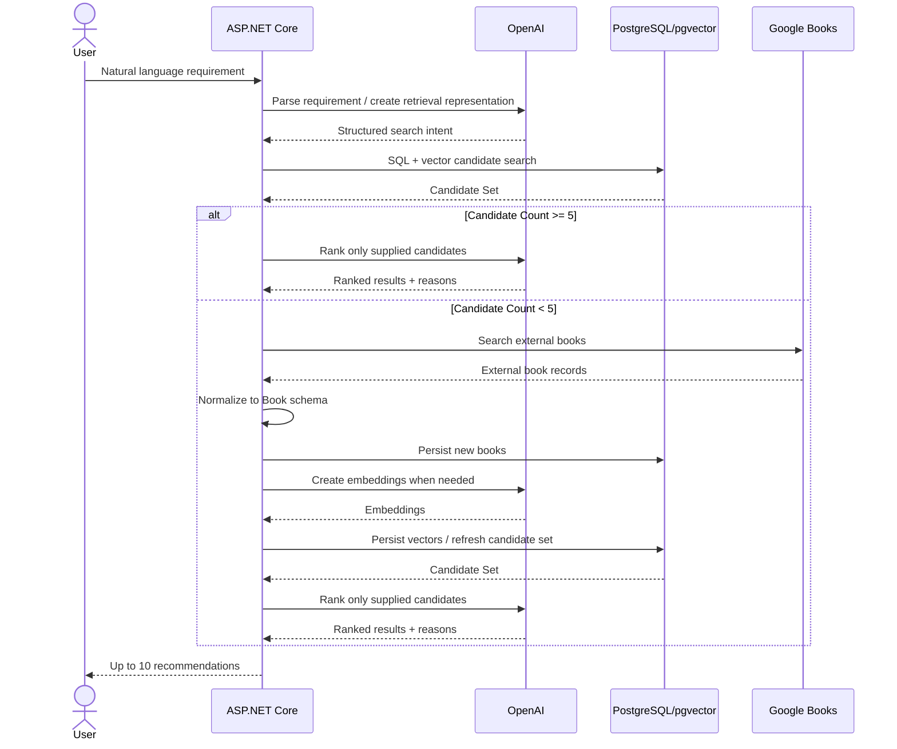
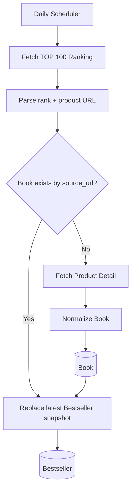
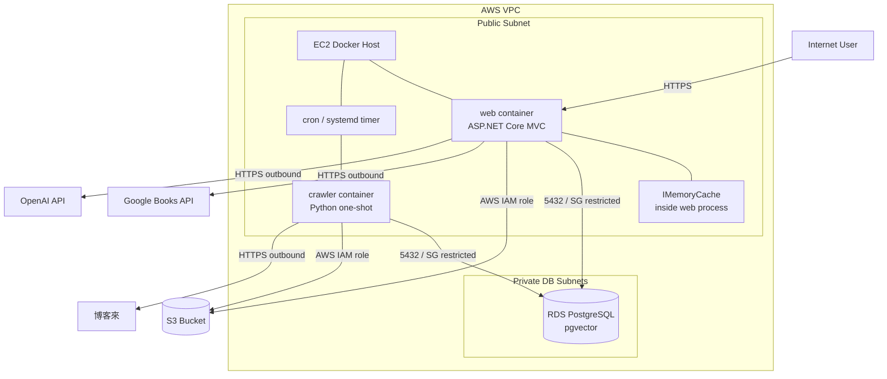

# 「好想找書」系統架構設計文件

> 文件定位：System Architecture Design  
> 專案：好想找書  
> 狀態：Architecture Baseline v0.1  
> 架構範圍：整體拓樸、C4 Context / Container、部署結構、設計方法與限制  
> 需求依據：`「好想找書」個人專案需求文件.md`

---

## 1. 文件目的

本文件定義「好想找書」第一版系統的整體架構基準，作為後續資料模型、API、模組規格、前後端介面、測試與部署文件的上位架構依據。

本文件不詳細定義：

- Database Schema 與欄位級約束。
- REST API request / response schema。
- Controller、Service、Repository 的 class-level 設計。
- Razor View 畫面規格。
- 單元測試案例與測試資料。

上述內容應拆分至 `Docs/` 下的專門設計文件，並由根目錄 `AGENTS.md` 負責文件路由。

---

## 2. 架構需求摘要

### 2.1 需求文件已明確定義的條件

1. 後端使用 C# / ASP.NET Core MVC。
2. 前端使用 Razor View 與 JavaScript。
3. ORM 使用 Entity Framework Core，PostgreSQL connector 使用 Npgsql。
4. Authentication 使用 JWT Bearer Authentication。
5. PostgreSQL 為系統主要書籍資料來源，並使用 pgvector 支援 AI / RAG 型檢索。
6. Python crawler 每日爬取博客來中文書 7 日暢銷總榜 TOP 100。
7. 新書第一次進入資料庫時取得完整 metadata；既有書籍每日只更新 Bestseller 資料。
8. 一般搜尋只查詢本地資料庫，不呼叫 Google Books API。
9. AI 推薦優先查詢本地資料庫；候選書籍少於 5 本時才呼叫 Google Books API。
10. Google Books 結果需轉換為系統統一 Book Schema 並寫入本地資料庫。
11. AI 最終只能推薦 Candidate Set 中存在的書籍，每次最多推薦 10 本。
12. OpenAI API 負責需求解析、搜尋條件產生、候選評估、排序與推薦理由。
13. 部署技術使用 Docker、AWS EC2、RDS；本架構另依專案技術棧納入 S3。

### 2.2 本文件新增的架構決策

以下屬於為了讓需求可實作而補上的 architecture decisions，不視為原始需求文字：

- 系統採 **Modular Monolith**，不在 MVP 階段拆分微服務。
- Razor View 與後端採**邏輯前後端分離**：Presentation 與 Application / Domain / Infrastructure 分層，但 Web UI 與 HTTP API 仍由同一 ASP.NET Core Web Application 部署。
- Python crawler 為獨立 one-shot container，由 EC2 排程器每日啟動，不常駐為 Web service。
- 第一版 Cache 使用 ASP.NET Core `IMemoryCache`，只快取可重建的唯讀查詢資料；不將 Cache 當作 source of truth。
- S3 作為非關聯物件儲存，第一版用於可選的書籍封面轉存、crawler 原始快照或部署產物；核心交易資料仍在 PostgreSQL。
- pgvector 要可工作，必須存在 embedding 產生與更新流程；依原需求「OpenAI API 透過 C# 呼叫」，第一版由 ASP.NET Core 的 Recommendation / Embedding infrastructure adapter 負責 query / book embedding，Python crawler 不直接呼叫 OpenAI。
- UI flow 已要求「AI 搜尋紀錄」，但原始主要 Entity 尚未定義對應資料模型；後續 Data Model 文件必須補上 Recommendation Search / Result History 類型的持久化模型。

---

## 3. 架構風格

### 3.1 主要架構模式

採用：

**Modular Monolith + ASP.NET Core MVC + Layered Architecture + Batch Crawler**

Web Application 內部依職責拆分：

```text
Presentation
    ↓
Application
    ↓
Domain
    ↓
Infrastructure
```

依賴方向原則：

- Presentation 可以呼叫 Application。
- Application 負責 use case orchestration。
- Domain 保存核心商業規則，不依賴 UI 或外部 API。
- Infrastructure 實作資料庫、OpenAI、Google Books、S3、Cache 等 adapter。
- Controller 不直接撰寫 SQL、呼叫 OpenAI API 或實作推薦規則。
- Razor View 不直接存取 Repository 或 DbContext。

### 3.2 為何不採微服務

目前系統具備單一產品領域、有限流量、單一主要資料庫與個人專案的部署條件。若此階段拆分 Auth、Catalog、Recommendation、Crawler 為多個 Web service，將額外引入：

- service discovery；
- service-to-service authentication；
- distributed tracing；
- network failure handling；
- distributed transaction / eventual consistency；
- 多服務部署與版本協調。

這些成本對 MVP 的需求沒有直接收益。因此先以清楚的模組邊界維持單體部署，待流量、團隊規模或獨立擴縮需求出現後再服務化。

---

## 4. 整體系統拓樸



### 4.1 核心資料來源優先級

```text
一般搜尋：
Browser → ASP.NET Core → PostgreSQL → Result

AI 推薦：
Browser → ASP.NET Core → OpenAI Requirement Parsing
        → PostgreSQL / pgvector Candidate Search
        → Candidate >= 5 → OpenAI Ranking
        → Candidate < 5  → Google Books → Normalize → PostgreSQL
                          → embedding / candidate refresh
                          → OpenAI Ranking
```

任何 AI 輸出都不得繞過 Candidate Set 直接產生不存在於候選集合的書籍推薦。

---

## 5. C4 Level 1 — System Context



### 5.1 Context 責任邊界

| System / Actor | 本系統依賴內容 | 本系統不應假設 |
|---|---|---|
| 使用者 | 搜尋條件、自然語言需求、書單操作 | 使用者輸入一定結構化或完整 |
| 博客來 | 暢銷榜排名、商品 URL、新書 metadata | HTML 結構永久不變 |
| Google Books | AI Candidate 不足時的外部書籍資料 | 一般搜尋可直接查 Google Books |
| OpenAI | 需求解析、向量化、候選排序、推薦理由 | LLM 可以自行決定不存在於 Candidate Set 的書 |

---

## 6. C4 Level 2 — Containers



### 6.1 Container 職責

#### Browser UI

- 顯示首頁、暢銷榜、一般搜尋、AI 搜尋、書籍詳細頁、使用者書單、登入 / 註冊。
- 使用 Razor HTML 作為主要畫面輸出。
- JavaScript 僅處理需要非同步互動的 UI 行為。
- 不持有商業規則。

#### ASP.NET Core MVC Web Application

- HTTP request handling。
- Razor View rendering。
- JWT authentication / authorization。
- 書籍查詢與 Bestseller 查詢。
- UserBook 操作。
- AI Recommendation orchestration。
- Google Books fallback orchestration。
- OpenAI adapter orchestration。
- EF Core transaction boundary。
- 由 C# Embedding infrastructure adapter 為 Recommendation query 與缺少向量的 Book 建立 embedding；可用 background backfill 或 recommendation-path 補齊策略，細節留待 Recommendation Module Spec 決定。

#### Python Crawler

- 每日擷取博客來中文書 7 日暢銷 TOP 100。
- 解析排名與商品 URL。
- 依商品 URL 判斷 Book 是否存在。
- 新書才讀取完整商品 metadata。
- 更新最新 Bestseller，移除已離榜項目。
- 不負責一般搜尋或使用者 HTTP request。

#### PostgreSQL + pgvector

- 系統主要 source of truth。
- 保存 User、Book、Bestseller、UserBook 與 AI 搜尋紀錄等持久資料。
- 提供一般 SQL 搜尋。
- 提供向量相似度檢索。
- 支援 transaction 與 relational constraints。

#### IMemoryCache

- 只保存可以從 PostgreSQL 重建的資料。
- 適合快取 TOP 100、Book detail 等熱門唯讀資料。
- 不快取使用者密碼、JWT、AI 搜尋歷史等敏感或一致性要求較高的資料。
- Application restart 後 cache 清空為可接受行為。

#### Amazon S3

- 儲存非關聯物件。
- 可用於書籍封面轉存、crawler 原始快照或部署產物。
- 不儲存 UserBook、Bestseller 排名等需要 relational consistency 的資料。

---

## 7. Web Application 內部模組邊界

第一版建議依業務能力切為下列 modules，而不是依純技術資料夾切割商業責任。



| Module | 主要責任 | 主要外部依賴 |
|---|---|---|
| Identity / Auth | 註冊、登入、登出、Current User、JWT | PostgreSQL |
| Book Catalog | Book 查詢、Book detail、一般搜尋、統一 metadata | PostgreSQL / pgvector |
| Bestseller | 最新 TOP 100 查詢 | PostgreSQL、Cache |
| Recommendation | Requirement parsing、candidate retrieval、fallback、ranking、推薦理由、搜尋紀錄 | PostgreSQL / pgvector、OpenAI、Google Books |
| User Library | 加入 / 移除書單、reading status、rating | PostgreSQL、Identity、Catalog |

Crawler 為獨立 batch deployable，但與 Web 共用 Book / Bestseller 的資料契約。Crawler 不應複製另一套不相容的 Book schema。

---

## 8. AI Recommendation 架構

### 8.1 推薦流程



### 8.2 LLM 邊界

LLM 不具備下列自主權：

- 不直接執行任意 SQL。
- 不自行建立未經系統 normalize 的 Book。
- 不推薦 Candidate Set 外的書。
- 不以博客來 Bestseller rank 直接替代 AI relevance ranking。
- 不繞過 Application Service 寫入資料庫。

若未來要讓 LLM 產生 SQL，必須另行設計 query allow-list、read-only DB role、statement validation、timeout 與 row limit；本版不將「LLM 任意 SQL」列為預設架構。

---

## 9. Crawler 架構



### 9.1 一致性原則

- `source_url` 是博客來來源書籍的 identity 判斷依據。
- 既有 Book 不因每日榜單刷新重新抓取完整 metadata。
- Bestseller 只保存最新榜單，MVP 不保留歷史榜單。
- 更新 Bestseller 時應以 transaction 或等價的 replace strategy 避免產生半套榜單。
- Crawler failure 不應造成既有可用榜單被提前刪除；新資料驗證完成後才替換 current snapshot。

---

## 10. Cache 設計

### 10.1 第一版策略

採 `IMemoryCache`，因 MVP 只有單一 Web application instance，避免過早引入 Redis / ElastiCache。

適合 cache：

- 最新 Bestseller TOP 100。
- 高頻 Book detail。
- 可接受短暫 stale 的公開 catalog lookup。

不適合 cache：

- UserBook 寫入結果。
- Authentication state。
- AI Recommendation history。
- 需要 transaction read-your-write 的操作。

### 10.2 Invalidation

- Crawler 成功完成 Bestseller replacement 後，下一次讀取應取得新榜單；若 Web 與 Crawler 無 process-level invalidation channel，使用短 TTL 讓 cache 自然失效。
- Book 新增後不要求全域清除一般搜尋 cache，因此第一版建議不要 cache 任意搜尋結果。

### 10.3 擴充條件

若未來部署多個 Web instance 或導入 Auto Scaling，`IMemoryCache` 不再能提供跨節點一致 cache。此時再評估 Amazon ElastiCache / Redis。

---

## 11. AWS Deployment View

### 11.1 部署拓樸



### 11.2 Deployable Units

#### `web` image

- ASP.NET Core MVC application。
- Razor Views / static web assets。
- EF Core migrations artifact。
- Application / Domain / Infrastructure assemblies。

#### `crawler` image

- Python crawler runtime。
- HTML parser / HTTP client。
- PostgreSQL writer。
- 必要的 metadata normalization 與 PostgreSQL writer；不直接呼叫 OpenAI。

兩個 images 版本應可獨立 build，但必須共享版本化的 data contract / schema expectations。Crawler 新增的 Book 若尚無 embedding，由 C# Recommendation / Embedding 流程補齊；Python container 不持有 OpenAI integration。

### 11.3 Network Boundary

- 公網只需要對 Web 入口開放 HTTPS。
- RDS 不對 Internet 開放；只允許 EC2 所屬 Security Group 存取 PostgreSQL port。
- Crawler 與 Web 需要 outbound HTTPS 存取第三方服務。
- S3 透過 EC2 IAM role 存取，不在 repository 儲存長期 AWS Access Key。

---

## 12. Authentication 與安全邊界

原需求指定 JWT Bearer Authentication。考量 Razor View 為 server-rendered UI，後續 API / Interface Spec 必須明確定義 token transport。

第一版建議：

- JWT 由 ASP.NET Core Identity/Auth module 發行與驗證。
- 瀏覽器端優先使用 `HttpOnly`、`Secure`、適當 `SameSite` 的 cookie 保存 token，並由 JWT Bearer middleware 從受控位置讀取；避免 JavaScript 可直接讀取長效 token。
- Authorization rule 留在 server side。
- 密碼只保存強雜湊，不保存 plaintext。
- OpenAI / Google Books / AWS secrets 不輸出到 Razor HTML 或 browser JavaScript。

若後續決定改採純 `Authorization: Bearer` header，應在前後端介面文件中同步修正 token storage、CSRF / XSS threat model。

---

## 13. 故障與降級策略

| Failure | 預期行為 |
|---|---|
| PostgreSQL unavailable | 核心查詢與使用者寫入失敗；回傳一致的 5xx，不以 cache 當永久資料來源 |
| OpenAI unavailable | AI 搜尋失敗或暫時不可用；一般搜尋、榜單、書單仍可運作 |
| Google Books unavailable | Candidate < 5 時不補外部資料；不得假造結果，可回傳既有候選或明確錯誤 |
| 博客來 crawler failure | 保留上一份有效 Bestseller，不清空既有榜單 |
| S3 unavailable | 若只儲存非核心物件，核心書籍與書單功能應盡可能繼續運作 |
| Cache miss / restart | 回 PostgreSQL 讀取，功能正確性不受影響 |

---

## 14. 效能、流量與可用性限制

### 14.1 已知限制

需求文件未定義：

- 預估 DAU / MAU。
- peak RPS。
- API latency SLO。
- Availability SLO。
- RTO / RPO。
- 最大 Book 數量。
- AI request concurrency。

因此本文件不虛構固定 QPS 或毫秒級 SLA。

### 14.2 第一版架構假設

本架構以個人專案 / MVP、低至中等流量為基準：

- 單一 EC2 Web instance。
- 單一 RDS primary。
- process-local cache。
- 每日一次 crawler。
- AI Recommendation 為高延遲外部依賴路徑；一般搜尋不依賴 LLM。

因此第一版不具備 Web node high availability。EC2 故障會中斷 Web 服務；這是 MVP 的已知 trade-off。

### 14.3 Scale-out Path

若流量增加，按下列順序擴充：

1. 先針對 PostgreSQL query、index、pgvector index 與 cache hit rate 做量測。
2. Web application stateless 化後增加多 EC2 / container instances。
3. 將 `IMemoryCache` 改為 Redis / ElastiCache。
4. 增加 Load Balancer。
5. AI Recommendation 若成為主要瓶頸，再拆為獨立 service / async job。
6. Crawler 若來源與分類大量增加，再拆為 queue-based ingestion pipeline。

---

## 15. 可觀測性基準

第一版至少應具備：

- ASP.NET Core structured application logs。
- Request correlation / trace id。
- Crawler run id、開始時間、結束時間、成功 / 失敗、抓取數、insert / existing / failed count。
- External API latency、status、timeout、retry count。
- AI Recommendation 記錄 candidate count、fallback 是否觸發、最終 result count，但不得記錄 secrets。
- Database exception 與 migration version。

後續 Deployment / Operations 文件再定義 logging destination、retention、metrics 與 alerts。

---

## 16. 目前需求中的設計缺口

這些問題不阻礙建立架構基線，但在後續設計文件中必須被正式決定：

1. **AI 搜尋紀錄資料模型**：UI flow 已存在 AI History，但主要 Entity 未定義。
2. **Embedding contract**：`Docs/data/data-model.md` 已指定獨立 `book_embeddings`，但該表尚未建立（延後至 `008_embedding` migration）；embedding model、vector dimension 與更新策略仍待 Recommendation module 決定。
3. **Hybrid retrieval algorithm**：keyword / metadata filter / vector similarity 如何組合尚未定義。
4. **JWT transport**：Razor UI 使用 cookie-carried JWT 或 browser Bearer header 尚未被原需求指定。
5. **S3 的產品用途**：技術棧已指定 S3，但原功能需求未要求上傳檔案；本文件暫定為非核心 object storage。
6. **Google Books duplicate resolution**：Google Books book 如何與既有博客來 Book 去重，不能只靠博客來 source URL。
7. **OpenAI model / embedding model**：應由設定檔管理，不應硬編碼在 Domain logic；實際型號後續由 AI module spec 決定。
8. **Crawler 對博客來 HTML 變更的驗證與告警**：需要在 Crawler Module / Test Plan 補足。
9. **評論功能**：需求列為進階目標，本版架構保留擴充空間但不納入 MVP module。

---

## 17. 後續設計文件切分

建議後續在 `Docs/` 中維護：

```text
Docs/
├── requirements/
│   └── product-requirements.md
├── architecture/
│   ├── system-architecture.md
│   └── architecture-decisions.md
├── data/
│   └── data-model.md
├── api/
│   └── api-spec.md
├── modules/
│   ├── identity-auth.md
│   ├── book-catalog.md
│   ├── bestseller.md
│   ├── recommendation.md
│   ├── user-library.md
│   └── crawler.md
├── interfaces/
│   └── frontend-backend.md
├── ui/
│   └── ui-flow.md
├── testing/
│   └── test-plan.md
└── deployment/
    └── deployment.md
```

文件選讀與 Agent 工作規則由 repository root 的 `AGENTS.md` 定義。

---

## 18. Architecture Decision Summary

| ID | 決策 | 狀態 |
|---|---|---|
| ADR-001 | MVP 採 Modular Monolith，不拆微服務 | Accepted |
| ADR-002 | Razor View 與 backend 邏輯分層，但同一 Web deployable | Accepted |
| ADR-003 | PostgreSQL + pgvector 為主要 source of truth | Required |
| ADR-004 | 一般搜尋只查 Local DB | Required |
| ADR-005 | Candidate < 5 才使用 Google Books | Required |
| ADR-006 | AI 只能排序 Candidate Set | Required |
| ADR-007 | Crawler 為每日 one-shot Docker batch | Accepted |
| ADR-008 | MVP 使用 process-local `IMemoryCache` | Accepted |
| ADR-009 | S3 只保存非 relational object | Accepted / 待產品用途確認 |
| ADR-010 | AI History 需要新增持久化模型 | Proposed |

---

## 19. 參考資料

- 專案需求：`「好想找書」個人專案需求文件.md`。
- 使用者指定技術棧：.NET Core / ASP.NET Core MVC、Razor View、PostgreSQL + pgvector、Python crawler、AWS EC2 / RDS / S3、Docker。
