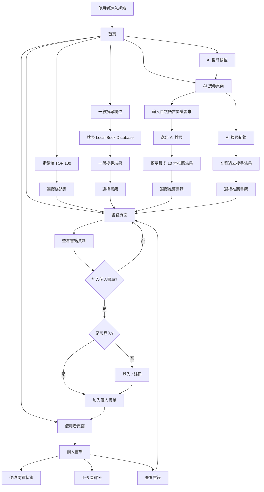

# 「好想找書」個人專案


# 1. 專案基本介紹

## 1.1 專案介紹

本專案是一個以「書籍探索與 AI 推薦」為核心的 Web 系統。

系統每日爬取博客來中文書 7 日暢銷總榜 TOP 100，建立本地書籍資料庫。使用者可透過一般搜尋查詢資料庫中的書籍，或以自然語言描述閱讀需求，由 AI 分析需求並推薦適合的書籍。

AI 推薦優先搜尋本地資料庫。候選書籍少於 5 本時，系統呼叫 Google Books API 搜尋外部資料，將結果轉換為系統統一格式並寫入資料庫，再進行推薦。

使用者可將書籍加入個人書單、管理閱讀狀態並給予 1～5 星評分。

## 1.2 產品目標

### 最小可行性範圍
- 協助需求模糊的使用者找到適合的書。
- 提供外部連結供使用者購買、閱讀書籍。
- 以博客來暢銷榜建立高機率符合使用者興趣的候選書籍資料。
- 建立可持續累積的本地書籍資料庫。
- 提供個人書單
- 提供使用者帳戶基礎功能(註冊、登入、登出)
### 進階開發目標
- 書籍評分功能。
- 書籍頁面中的評論功能。
- 其他書商、圖書館的資料爬蟲。
- 各書商書籍比價。
- CI/CD

## 1.3 核心流程

```text
博客來 TOP 100
    ↓
Crawler
    ↓
Local Book Database
    ↓
使用者描述閱讀需求
    ↓
AI 分析需求
    ↓
透過pgvector 搜尋 Local Database
    ↓
候選書籍 < 5
    ↓
Google Books API
    ↓
補充 Local Database
    ↓
AI Ranking
    ↓
最多推薦 10 本
    ↓
加入個人書單
    ↓
閱讀狀態 / 1～5 星評分
```

## 1.4 前端流程

### 1. 主要頁面

系統前端包含以下主要頁面：

```text
首頁
├── 暢銷榜書籍總覽
├── 一般搜尋
├── AI 搜尋
└── 導覽列

書籍頁面
└── 書籍詳細資料

AI 搜尋頁面
├── AI 搜尋輸入
├── 推薦結果
└── AI 搜尋紀錄

使用者頁面
├── 個人書單
├── 閱讀狀態
└── 書籍評分

登入 / 註冊頁面
```

---

### 2. 整體前端流程圖



---

# 2. User Story

> 作為一名知道自己大致想閱讀什麼、但不知道具體書名的使用者，我希望能以自然語言描述閱讀需求，讓系統從真實書籍資料中找出並推薦適合的書籍，說明推薦理由，並讓我將感興趣的書加入個人書單、管理閱讀狀態與評分。

---

# 3. 技術規格

## 3.1 Backend

- Language：C#
- Framework：ASP.NET Core MVC
- ORM：Entity Framework Core
- PostgreSQL Connector：Npgsql
- Authentication：JWT Bearer Authentication

## 3.2 Frontend

- C# Razor View
- JavaScript

## 3.3 Database

- PostgreSQL+pgvector提供傳統sql與RAG集成
- 本地資料庫作為系統主要書籍資料來源

主要 Entity：

```text
User
Book
Bestseller
UserBook
```

## 3.4 External Services

### 博客來

用途：

- 每日取得中文書 7 日暢銷總榜 TOP 100。
- 新書首次進入資料庫時取得商品詳細資料。

書籍是否已存在，以博客來商品網址作為判斷依據。

### Google Books API

僅供 AI Recommendation 使用。

觸發條件：

```text
Local Candidate Count < 5
```

取得資料後轉換成系統 Book Schema 並寫入資料庫。

一般搜尋與博客來爬蟲不呼叫 Google Books API。

### OpenAI API

- 透過C# 呼叫。

用途：

- 分析自然語言閱讀需求。
- 產生搜尋條件。
- 評估 Candidate Books。
- 排序推薦結果。
- 產生推薦理由。

AI 只能推薦 Candidate Set 中存在的書籍。推薦依據為使用者需求與書籍 metadata。原始規格亦要求推薦建立在真實 metadata 與書籍描述上。

## 3.5 Crawler

- Python
- 每日執行一次。
- 第一版爬取博客來中文書總榜 TOP 100。
- 未來擴充各分類 TOP 100。
- 只保存最新排行榜。
- 已存在書籍只更新 Bestseller 資料。
- 新書才進入商品頁取得完整 metadata。
- 書籍存在判斷依據：博客來商品網址。

## 3.6 Deployment

- Docker
- EC2
- RDS
- Scheduled Crawler

---

# 4. 功能需求

## 4.1 使用者系統

系統應提供：

- 註冊
- 登入
- 登出
- 取得目前使用者資訊

使用者資料至少包含：

```text
id
email
password_hash
display_name
created_at
```

原始規格已定義相同的基本使用者需求。

## 4.2 博客來暢銷榜爬蟲(第一週優先實作並完成可Demo版本)

系統每日：

1. 取得博客來中文書 7 日暢銷總榜 TOP 100。
2. 取得排名與商品網址。
3. 使用商品網址查詢 Book 是否存在。
4. 新書進入商品頁取得完整 metadata 並建立 Book。
5. 已存在書籍沿用原 Book 資料。
6. 更新目前 Bestseller 排名。
7. 移除已不在最新 TOP 100 的 Bestseller 紀錄。

Book 資料不因每日爬蟲重新更新。

## 4.3 暢銷榜瀏覽(第一週優先實作並完成可Demo版本)

使用者可以：

- 查看目前 TOP 100。
- 查看排名。
- 查看基本書籍資訊。
- 進入書籍詳細頁。

第一版不提供：

- 歷史榜單
- 排名趨勢
- 歷史日期查詢

## 4.4 一般書籍搜尋(第一週優先實作並完成可Demo版本)

使用者可依：

- 關鍵字
- 書名
- 作者
- ISBN

搜尋本地資料庫。

流程：

```text
User
↓
Local Database
↓
Result
```

查無結果時直接回傳空結果。

## 4.5 書籍詳細資料

Book 應使用統一資料格式，至少涵蓋：

```text
title
subtitle
authors
publisher
published_date
description
isbn
categories
page_count
thumbnail_url
source_url
```

原始規格已定義相近的 Google Books metadata 範圍。

## 4.6 AI 書籍推薦

使用者輸入自然語言閱讀需求。

系統流程：

```text
User Requirement
↓
AI Requirement Parsing
↓
Local Database Search
↓
Candidate Count
```

若 Candidate ≥ 5：

```text
Candidate Set
↓
AI Ranking
```

若 Candidate < 5：

```text
Google Books API
↓
Normalize
↓
Save to Database
↓
Candidate Set
↓
AI Ranking
```

推薦規則：

- 每次最多推薦 10 本。
- 候選不足時可回傳少於 10 本。
- AI 只能推薦 Candidate Set 中的書。
- 博客來排名不影響 AI Recommendation Ranking。
- AI Ranking 依據為使用者需求與 Book Metadata。
- 每本推薦結果應提供推薦理由。
- 可提供 difficulty 與 relevance。

## 4.7 個人書單

使用者可以：

- 加入書籍。
- 查看個人書單。
- 移除書籍。
- 修改閱讀狀態。
- 給予 1～5 星評分。

閱讀狀態：

```text
WANT_TO_READ
READING
FINISHED
```

原始規格已使用這三種閱讀狀態。

Rating：

```text
nullable
1～5
```
