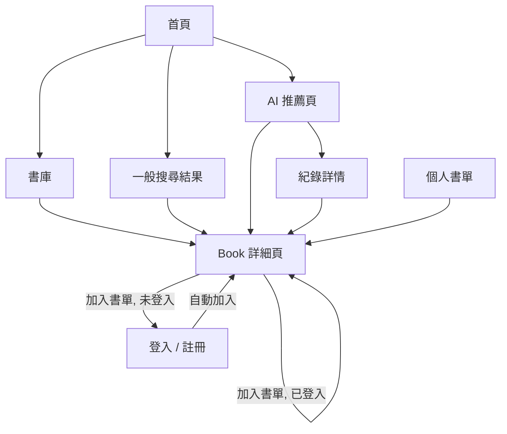

# UI Flow

> Path: `Docs/ui/ui-flow.md`
> Authority: 頁面路由、導覽、各頁顯示內容、空狀態與錯誤呈現
> JSON 端點與錯誤格式見 `Docs/api/api-spec.md`；各頁背後的規則見對應 module 文件。

## 1. 互動模式

- 頁面以 Razor 伺服器渲染；一般表單（登入、註冊、登出、搜尋）用 GET / POST，POST 成功後重導（PRG）。
- 只有下列互動以 JavaScript 呼叫 JSON 端點，結果就地更新：
  - AI 推薦送出；
  - Library 加入、修改 Reading Status、評分、移除。
- JavaScript 不持有商業規則；驗證以伺服器為準。

## 2. 路由

| 路由 | 頁面 | 需登入 | 規格 |
|---|---|:---:|---|
| `/` | 首頁 | | §3.1 |
| `/books?page=` | 書庫（全量瀏覽，分頁） | | `book-catalog.md` §3.6 |
| `/bestsellers` | 301 導向 `/books`（暢銷榜 Web 暫停，2026-10-24） | | `bestseller.md` |
| `/search?q=&page=` | 一般搜尋結果 | | `book-catalog.md` §3 |
| `/books/{id}` | Book 詳細頁 | | `book-catalog.md` §4 |
| `/ai?page=` | AI 推薦輸入 + AI 搜尋紀錄列表 | ✅ | §3.4 |
| `/ai/history-list?page=` | AI 搜尋紀錄列表片段（只有列表區塊，供 `/ai` 推薦成功後重新取得） | ✅ | §3.4 |
| `/ai/history/{id}` | 單次 AI 搜尋紀錄詳情 | ✅ | `recommendation.md` §12 |
| `/library?status=` | 個人書單 | ✅ | `user-library.md` §4 |
| `/account/login?returnUrl=&pendingAction=` | 登入 | | `identity-auth.md` |
| `/account/register?returnUrl=&pendingAction=` | 註冊 | | `identity-auth.md` |
| `POST /account/logout` | 登出後導向 `/` | ✅ | |

未登入存取「需登入」頁面 → 導向 `/account/login?returnUrl=<原路徑>`。

## 3. 頁面

### 3.1 共用版面

導覽列：Logo（回首頁）、書庫、AI 推薦、個人書單；右側未登入顯示「登入 / 註冊」，已登入顯示 display_name 與「登出」。

### 3.2 首頁 `/`

1. 一般搜尋框 → 送出至 `/search?q=`。
2. AI 推薦框 → 需求文字不放進 URL，改存入瀏覽器 `sessionStorage`。已登入：直接導向 `/ai`；未登入：導向 `/account/login?returnUrl=/ai`，登入後回到 `/ai`。`/ai` 讀取 `sessionStorage` 的文字預填輸入框，並清除該儲存內容。
3. 書庫隨機 10 本 + 「查看完整書庫」（連結 `/books`）。書庫為空時顯示「書庫還沒有書」。

### 3.3 Book 詳細頁 `/books/{id}`

基本書目資料（不含簡介與目錄，BOOK-05）、醒目的「在博客來查看完整介紹」按鈕與其他外部連結（每個 Book Source 一個）、Library 區塊（`user-library.md` §5）。規則見 `book-catalog.md` §4。

### 3.4 AI 推薦頁 `/ai`

- 需求輸入框 + 送出按鈕。
- 送出後：按鈕停用、顯示「AI 正在為你找書…（約需 10～30 秒）」；等待 JSON 回應（伺服器端逾時 60 秒）。
- 成功：顯示最多 10 本結果（排名、封面、書名、作者、推薦理由、相關度、難度或「—」），點擊進入 Book 詳細頁；同時以 `/ai/history-list?page=1` 重新取得下方紀錄列表（第 1 頁，這次搜尋在最前面），網址改回 `/ai`。失敗時列表不變。
- 0 本結果：顯示「找不到符合的書，試著換個描述」。
- 下方：AI 搜尋紀錄列表（新到舊，每頁 20 筆），每列顯示需求文字（列表截成兩行）、時間（Asia/Taipei `yyyy-MM-dd HH:mm`）、結果數「N 本」，點擊進入 `/ai/history/{id}`。分頁規則同一般搜尋：頁碼不合法視為第 1 頁、超過最後一頁導向最後一頁（`book-catalog.md` §3.3）。
- `/ai/history/{id}`：需求全文、時間、當時的排名、封面、書名、作者、推薦理由、相關度（格式同推薦結果）、難度（即時讀取，沒有時「—」）；0 本結果顯示「這次沒有找到符合的書」。書名、封面、作者為目前的 Book 資料，排名、理由、相關度為當時的快照（#16 決定）。

### 3.5 錯誤與空狀態

| 情境 | 呈現 |
|---|---|
| 書庫為空 | 「書庫還沒有書」 |
| 搜尋無結果 / 空白輸入 | 「找不到符合的書」 |
| 書單為空 | 「還沒有加入任何書」+ 前往書庫連結 |
| AI 紀錄為空 | 「還沒有 AI 搜尋紀錄」 |
| AI 推薦 429（每日上限） | 「今天的 AI 推薦次數已用完，明天再來」 |
| AI 推薦失敗 / 逾時 | 「AI 推薦暫時無法使用，請稍後再試」，保留輸入文字 |
| JSON 端點 401 | 導向登入頁並帶 `returnUrl` 為目前頁面；書籍頁「加入書單」另帶 `pendingAction=add-to-library`，登入後自動加入（`identity-auth.md` §6） |
| `/books/{id}`、`/ai/history/{id}` 不存在或非本人 | 404 頁 |
| 伺服器錯誤 | 共用錯誤頁（不顯示 stack trace） |

### 3.6 一般搜尋結果 `/search`

搜尋框（預填目前關鍵字）、「共 N 筆，第 p／P 頁」、結果列表（書名、作者、出版社、出版日期、封面，點擊進入 Book 詳細頁）、上一頁／下一頁與頁碼。規則見 `book-catalog.md` §3。

### 3.7 書庫 `/books?page=`

「共 N 筆，第 p／P 頁」、結果列表（書名、作者、出版社、出版日期、封面，點擊進入 Book 詳細頁）、上一頁／下一頁與頁碼。書庫為空時只顯示「書庫還沒有書」，不顯示筆數與分頁。規則見 `book-catalog.md` §3.6。

## 4. 主要流程

