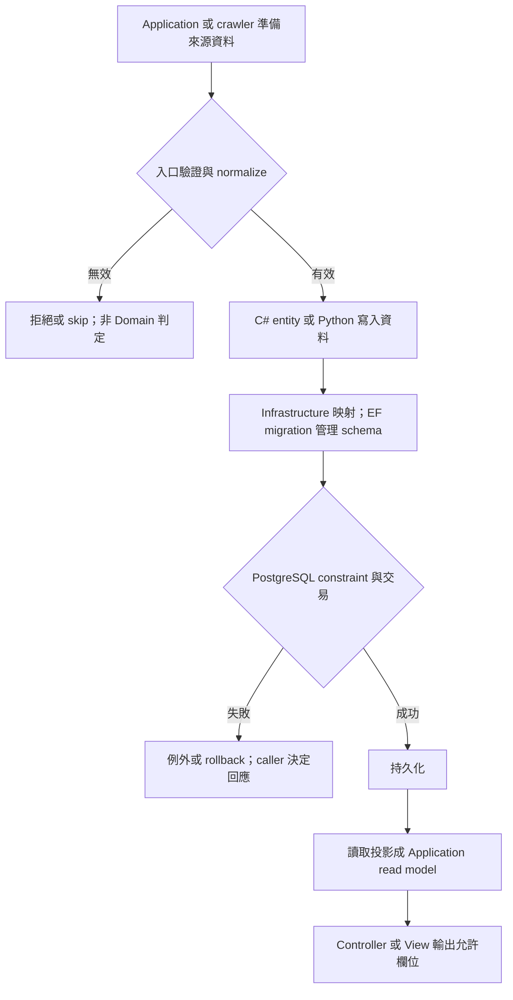
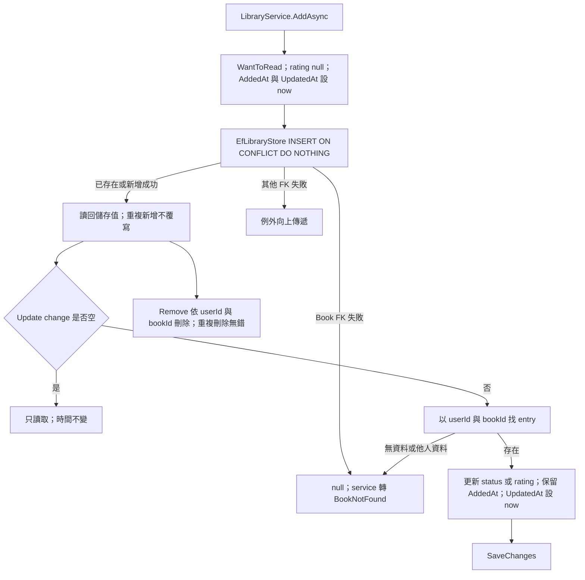
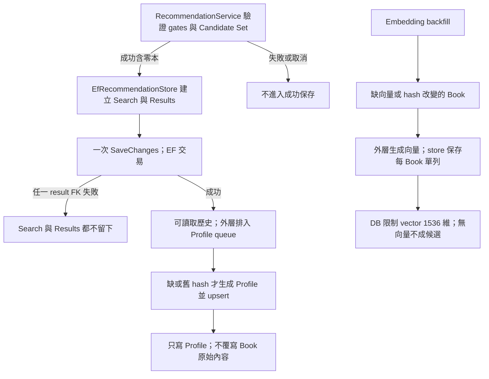

# Domain 生命週期與責任流程

查核：2026-10-24；HEAD `91333c3`。Domain 是資料實體與 enum，沒有 HTTP 入口、factory、驗證方法、repository、cache 或 I/O。圖中 Application、Infrastructure、crawler 節點只標示跨層責任，不表示 Domain 自行執行。

入口對照：[Book](../Entities/Book.cs) 與 [BookSource](../Entities/BookSource.cs) 由 ingestion 使用；[User](../Entities/User.cs) 用於認證；[LibraryEntry](../Entities/LibraryEntry.cs) 由 [LibraryService](../../Application/Library/LibraryService.cs) 建立；[RecommendationSearch](../Entities/RecommendationSearch.cs)／[RecommendationResult](../Entities/RecommendationResult.cs) 由推薦 store 保存；[BookAiProfile](../Entities/BookAiProfile.cs)／[BookEmbedding](../Entities/BookEmbedding.cs) 用於背景衍生資料；[Bestseller](../Entities/Bestseller.cs) 由 crawler 更新。Authority：[資料模型](../../Docs/data/data-model.md)、[書單](../../Docs/modules/user-library.md)、[推薦](../../Docs/modules/recommendation.md)、[crawler](../../Docs/modules/crawler.md)。

## 共用建立與映射

`required` 是編譯期建構要求，不能取代 runtime 非空、長度、範圍、enum 或 ISBN 驗證。實體沒有自動時間／ID constructor。Book UUID 可由 EF/provider 生成；推薦 store 明確指定 UUIDv7 與 UTC 時鐘。取消由 service/store 的 CancellationToken 傳遞，entity 沒有取消或重試責任。

## Library Entry

狀態 WantToRead、Reading、Finished 沒有 entity 級轉移限制，可直接互轉。評分可在任意狀態設為 1–5 或清空；無 entry 更新不會自動新增。權限由可信 caller userId 與 store 條件共同保證，複合主鍵不等於認證。

## 推薦與衍生資料

Profile 的框架、topics、difficulty 可為 null；不存在的 Book 在 source load 回傳 null、stale 查詢忽略。Embedding scan 不讀 publisher／table of contents。現況 store `FallbackUsed=false`，Google Books fallback 尚未接入，entity flag 存在不代表流程已完成。

## 刪除、榜單與公開邊界

Book 的來源、識別碼、contributors、subjects、書單、Profile、Embedding 為 CASCADE；若仍被 Bestseller 或 RecommendationResult 引用，RESTRICT 會阻擋刪除。User 刪除 CASCADE 書單與搜尋，搜尋刪除 CASCADE results。Bestseller rank 為 1–100 主鍵、BookId 唯一，可缺號。完整解析、三次嘗試、限制級 skip、連續錯誤中止與舊榜保護在 crawler，不在四欄實體。

Book.Description／TableOfContents 只供 AI，User.PasswordHash 也是內部資料；實體沒有 JsonIgnore，必須以投影隔離。Domain 不直接對外序列化。

本圖僅靜態結構查核，未渲染 Mermaid。互參：[架構](architecture.md)、[待辦](backlog.md)、[歷史](update-history.md)、[案例](test-suite.md)。
