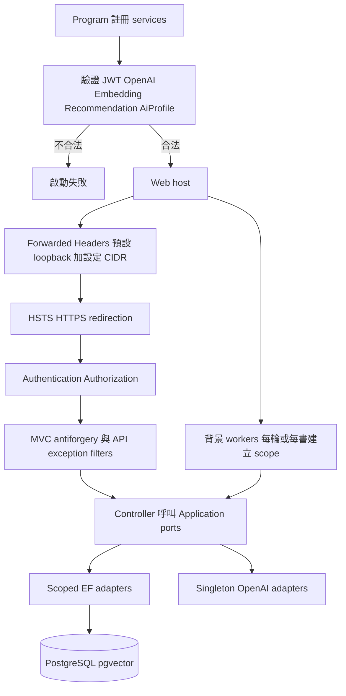
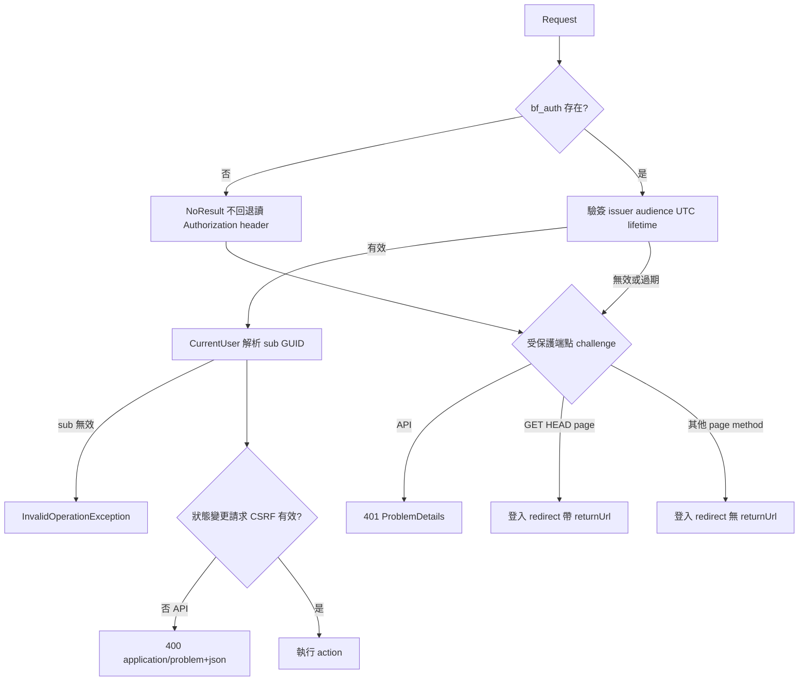
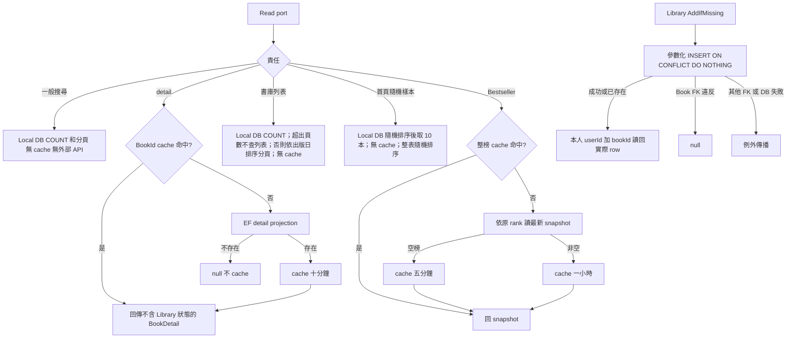
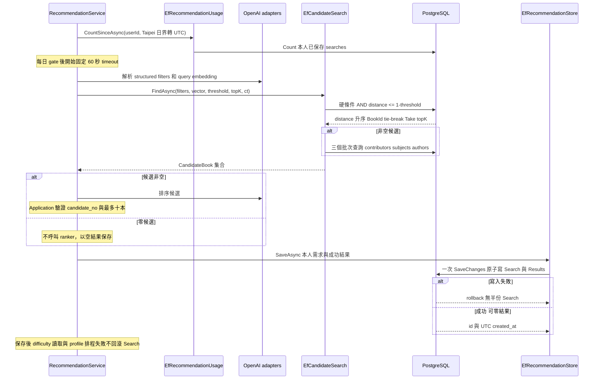
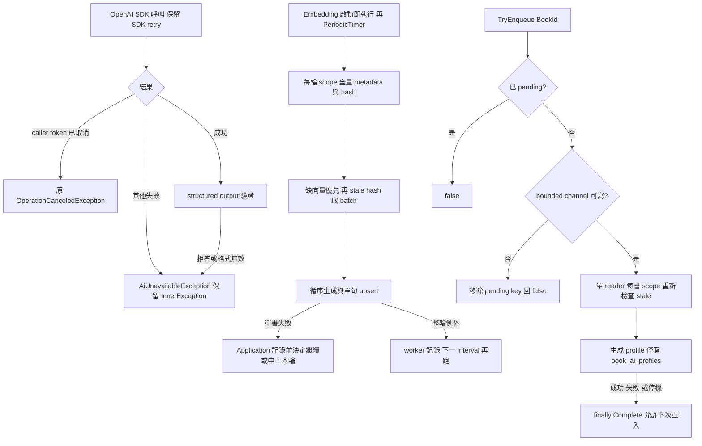

# Infrastructure 流程

> 查核日期：2026-10-24；基準 `91333c3`。本次只做文件靜態檢查，未執行 build、測試、migration、部署或外部服務。

本目錄實作 Application ports：Persistence、Identity、OpenAi、Caching、BackgroundJobs、Hosting；並非 AWS 部署資料夾。[Program](../../Program.cs) 是 DI 與 middleware 組裝點；業務 gate 在 Application。

## 入口與 authority

| 入口來源 | 主要責任 | 規格 |
|---|---|---|
| AuthServiceCollectionExtensions、AuthTokenIssuer、AuthCookie、CurrentUser、SafeReturnUrl | cookie-only JWT、CSRF、API 錯誤、local returnUrl | [Identity](../../Docs/modules/identity-auth.md) |
| EfUserStore、AspNetPasswordHashing | account persistence／PasswordHasher adapter | Identity、[data model](../../Docs/data/data-model.md) |
| EfBookSearch、EfBookBrowse、EfBookDetailReader、EfBestsellerReader、cache decorators | Local DB 搜尋、書庫列表與隨機樣本、detail、原排名 snapshot（後端保留，#109 後無 Web 呼叫者） | [Catalog](../../Docs/modules/book-catalog.md)、[Bestseller](../../Docs/modules/bestseller.md) |
| EfLibraryStore | 本人 Library Entry 的 add／find／update／remove／list | [Library](../../Docs/modules/user-library.md) |
| EfCandidateSearch、EfRecommendationUsage／Store／History | 候選、用量、成功保存、本人歷史 | [Recommendation](../../Docs/modules/recommendation.md) |
| OpenAI parser／embedding／ranker／profile generator | SDK、strict JSON、錯誤轉譯 | Recommendation |
| EmbeddingBackfillWorker／store、BookProfileQueue／Worker／store | 定時補齊與推薦後 profile 排程 | Recommendation §9–10 |
| AppDbContext、Configurations、Migrations | schema mapping、pgvector、snake_case、constraints | data model |
| HostingSetup | trusted proxy CIDR 與 Data Protection keys | [Deployment](../../Docs/deployment/deployment.md) |

## 組裝與框架邊界

HostingSetup 略過空白 CIDR、拒絕無效 CIDR，不清除預設 loopback 信任。KeysPath 未設定維持框架 default；設定後持久化 key ring 並使用 application name `Book-Finder`。Web 啟動不自動 migrate；schema 部署為獨立步驟。

## 認證與安全出口

Token 為 HS256、一天有效、無 sliding renewal。Cookie 固定 HttpOnly、Secure、SameSite=Lax、Path=/；Delete 使用相同屬性。SafeReturnUrl 以 MVC local URL 判定，不合格或空值回 `/`。登入限流是明確暫緩，不能從本圖推定存在。

## Read adapters、cache 與書單

書庫 `EfBookBrowse` 的列表為 COUNT、分頁查詢、再以 `BookAuthors` 一次讀作者；offset 以 `long` 計算，超出總數時直接回空頁且保留 TotalCount。排序為出版日有值者在前、新到舊，無日期者在後，再以 Id 決定順序。隨機樣本為 `OrderBy(EF.Functions.Random())` 後取前 N 筆，再一次讀作者；兩者都只投影列表需要的欄位，不讀 description／table_of_contents。DI 註冊於 [Program](../../Program.cs)：`IBookBrowse` → `EfBookBrowse`、`BookBrowseService` 皆 scoped，與搜尋註冊相鄰；Bestseller 註冊不變。

Library Update 先以本人 composite key 載入 tracked row；不存在回 null；存在則變更 status／rating keep-clear-set，保留 AddedAt、更新 UpdatedAt，一次 SaveChanges 後讀回。Remove 為本人條件單句 DELETE、可重複。List 本人過濾、UpdatedAt 新到舊、BookId tie-break，再批次讀作者。公開 projections 排除 description／table_of_contents。

## 候選與成功保存

空候選只有排名 SQL；非空通常共四個 SQL。Filters null 不加入條件；ILike 經 LikePattern escape；`zh` 包含地區，`zh-TW` 精確比對；年與頁數含端點，NULL 不符合已指定範圍。排名不讀 Bestseller rank 或 Book AI Profile。History List 以本人 filter、long offset 防溢位；Get 對他人與不存在皆 null，結果 rank/reason 是保存快照，書名作者封面取目前 Book。

**未實作規格目標**：Recommendation 在 Candidate Set `<5` 時編排 Catalog ingestion；Catalog 擁有 normalization、跨來源 identity 與 Book persistence 規則，Infrastructure 實現 Google／EF adapter mechanics。Catalog 完成後由 Recommendation 同步 embedding、重跑檢索；Google 失敗保留原 local candidates，零候選不呼叫 ranker、保存零結果 Search。當前 `EfRecommendationStore` 固定 `FallbackUsed=false`。

## OpenAI 與背景狀態

Embedding vector(1536) 由 DB 拒絕錯維度；upsert 無 change tracking。Profile 不覆寫來源簡介／目錄，失敗不立即重試，下次出現在結果時重新排程。兩種 workers 各自 Enabled 可停用；host stopping 正常取消，Embedding rounds 不重疊。Queue 與 pending dictionary 僅 process-local、非 durable/global 去重。Search 保存後的 profile enrichment 一般錯誤由 reader／scheduler 記 Warning 並降級；caller 已取消時 OperationCanceledException 仍傳播，但 Search 不回滾。此階段使用 caller token，已不受 60 秒 timeout token 控制，不能概括成「所有失敗皆不保存」。

## 文件導航

[流程](workflow-diagram.md) · [架構](architecture.md) · [待辦](backlog.md) · [歷史](update-history.md) · [案例](test-suite.md)
