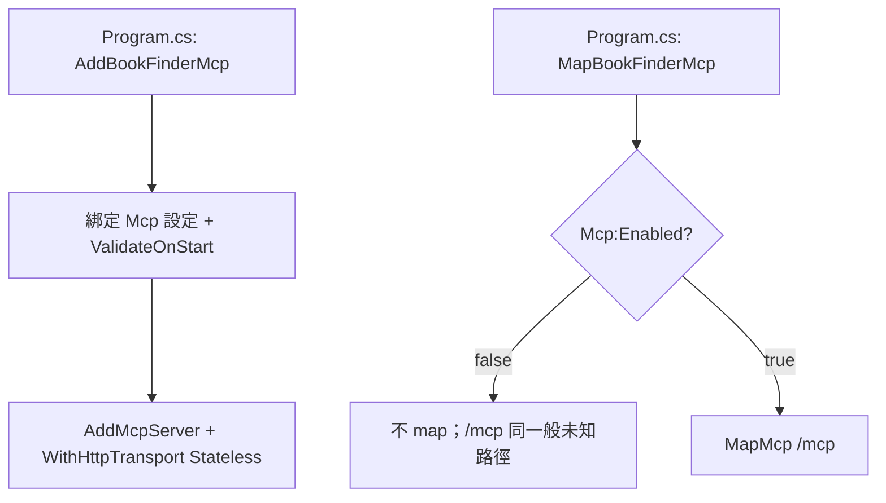
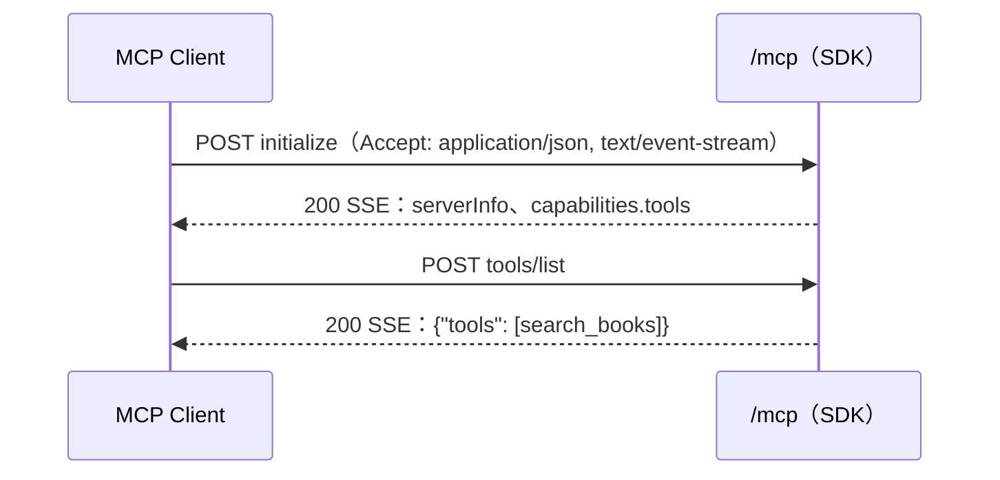
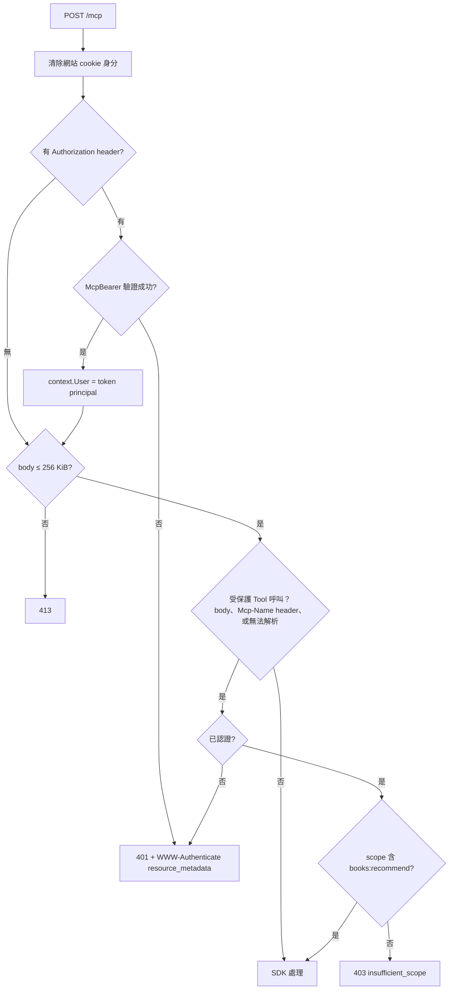
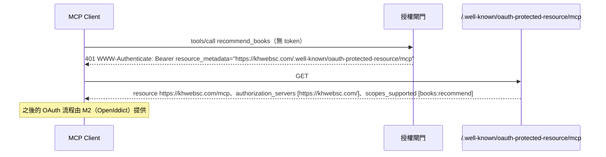
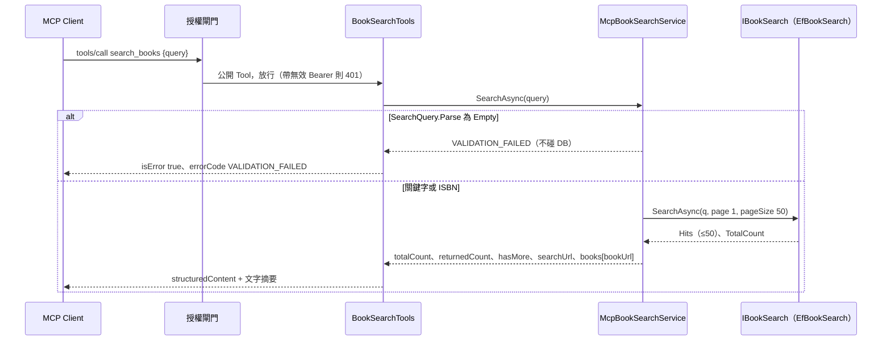

# Mcp 流程

> 建立：2026-11-14（MCP-001）；MCP-002 加入授權閘門。M1 加入 `search_books`；兩支 AI Tool 在之後的票加入。

## 1. 啟動

`Mcp:Enabled = true` 但 `PublicBaseUrl` 不合法時，host 啟動失敗（`OptionsValidationException`）。

## 2. 匿名請求（目前唯一的流程）

- `Accept` 必須同時包含 `application/json` 與 `text/event-stream`，只給一種會回 406。
- Stateless：不需要 session header；`tools/list` 不帶 `MCP-Protocol-Version` 也可以。
- 不設 cookie、不需要 antiforgery token、不碰資料庫。

## 3. 授權閘門（POST `/mcp`）

拒絕路徑（X1～X3）都不呼叫 SDK，所以 Tool handler 不會執行。

## 4. `search_books`（公開）

- 只查本地 DB，沒有外部 fallback；0 本時 `books = []`，仍有 `searchUrl`。
