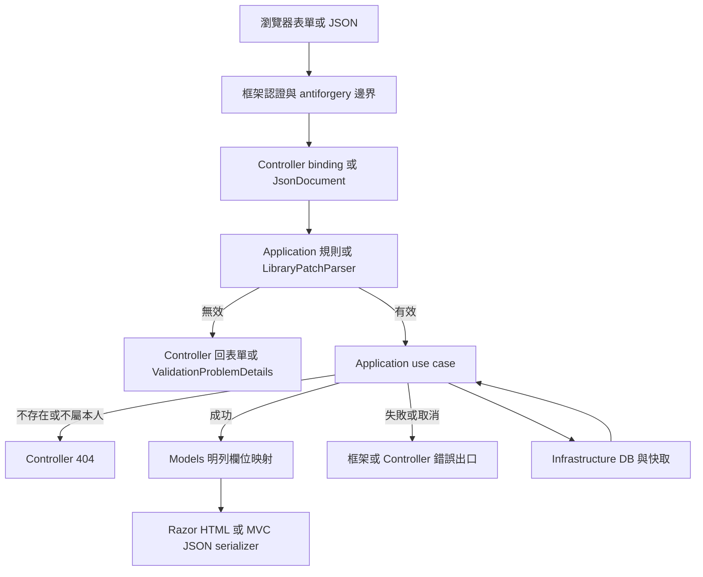
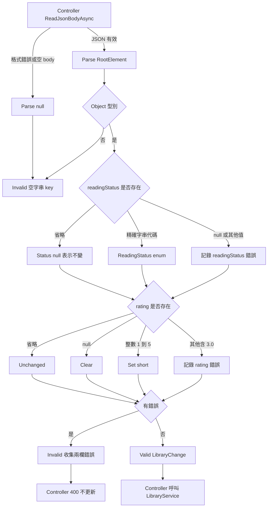
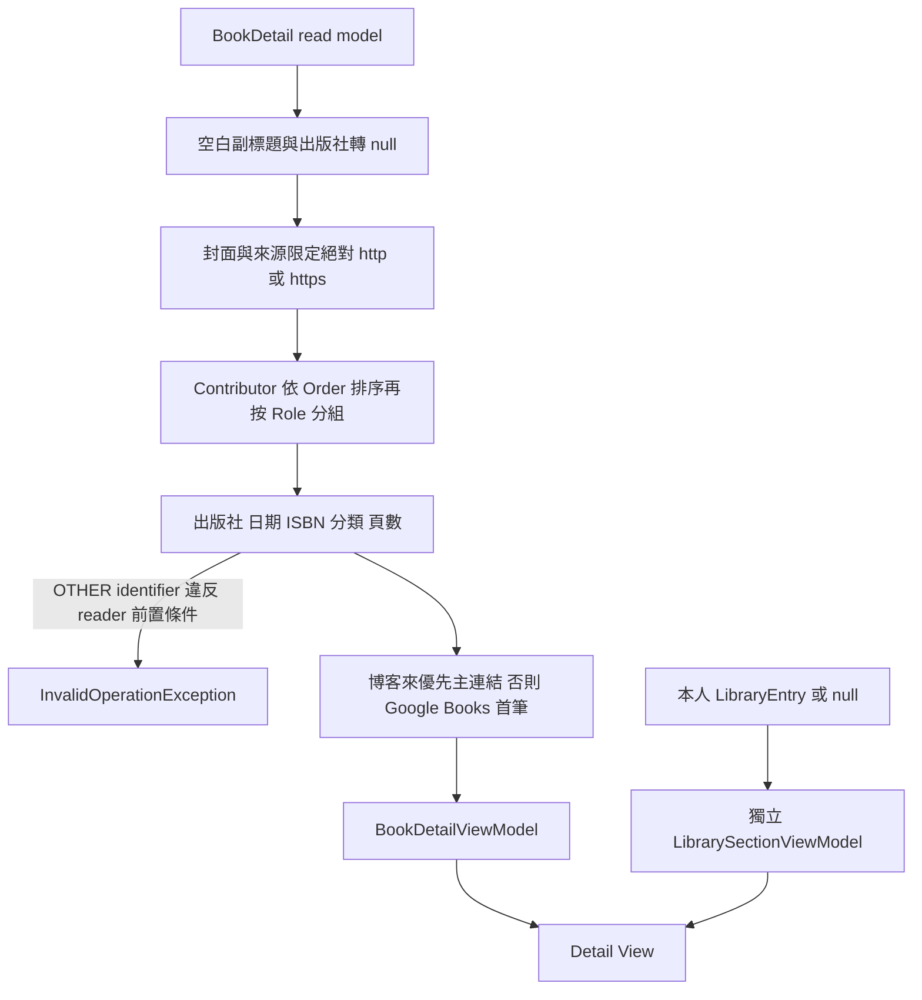
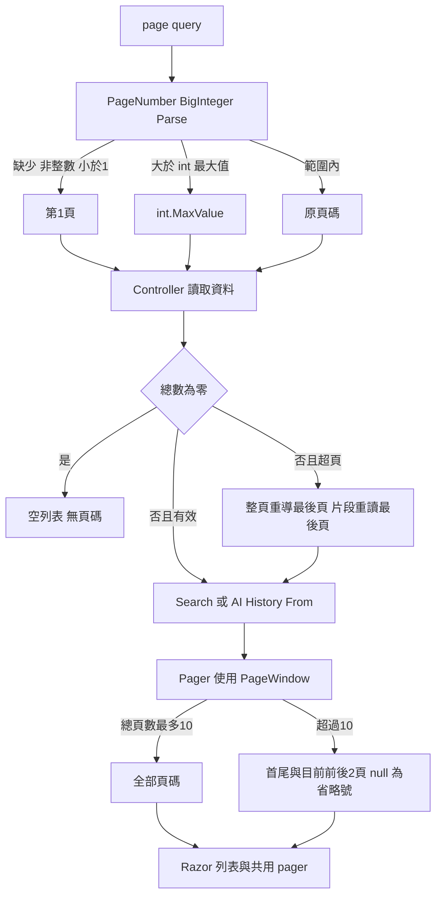

# Models 資料生命週期

> 查核日期：2026-10-24；基準：`91333c3`；目標：`Models/`。本次只做靜態閱讀，未執行 build、測試、Mermaid renderer、資料庫或外部服務。開始時來源無未提交修改；其他代理既有的 `Controllers/docs/` 不屬本文件範圍。

## 範圍與入口

此目錄是 MVC presentation model、JSON DTO 及純轉換 helper，**不是 EF Entity 目錄**。資料表、constraint、migration 在 Domain／Infrastructure；Models 不自行保存、交易、快取或呼叫外部服務。

| 入口／呼叫端 | 目標模型／責任 | 規格 |
|---|---|---|
| [AccountController](../../Controllers/AccountController.cs) | [LoginForm](../LoginForm.cs)、[RegisterForm](../RegisterForm.cs)：binding、錯誤後重顯 | [identity-auth](../../Docs/modules/identity-auth.md) §3–6 |
| [RecommendationsController](../../Controllers/RecommendationsController.cs) | [RecommendationRequest](../RecommendationRequest.cs)、[RecommendationResponse](../RecommendationResponse.cs)：JSON 邊界 | [API](../../Docs/api/api-spec.md) §3 |
| [LibraryApiController](../../Controllers/LibraryApiController.cs) | [LibraryPatchParser](../LibraryPatchParser.cs)、[LibraryEntryResponse](../LibraryEntryResponse.cs) | API §4 |
| [BooksController](../../Controllers/BooksController.cs) | [BookDetailViewModel](../BookDetailViewModel.cs)、[ContributorDisplay](../ContributorDisplay.cs)、[LibrarySectionViewModel](../LibrarySectionViewModel.cs) | [Catalog](../../Docs/modules/book-catalog.md) §4、[Library](../../Docs/modules/user-library.md) §5 |
| [SearchController](../../Controllers/SearchController.cs) | [SearchResultsViewModel](../SearchResultsViewModel.cs)、[PageNumber](../PageNumber.cs) | Catalog §3 |
| [AiController](../../Controllers/AiController.cs) | [AiHistoryListViewModel](../AiHistoryListViewModel.cs)、[AiHistoryDetailViewModel](../AiHistoryDetailViewModel.cs) | [Recommendation](../../Docs/modules/recommendation.md) §12、[UI](../../Docs/ui/ui-flow.md) §3.4 |
| [LibraryController](../../Controllers/LibraryController.cs) | [LibraryPageViewModel](../LibraryPageViewModel.cs)、[LibraryControlsViewModel](../LibraryControlsViewModel.cs) | Library §4 |
| [HomeController](../../Controllers/HomeController.cs)、[BestsellersController](../../Controllers/BestsellersController.cs) | [BestsellerListViewModel](../BestsellerListViewModel.cs)、[ErrorViewModel](../ErrorViewModel.cs) | [Bestseller](../../Docs/modules/bestseller.md)、UI §3.5 |
| 搜尋／歷史列表與 Library 返回登入 | [PageWindow](../PageWindow.cs)、[PagerViewModel](../PagerViewModel.cs)、[LoginLink](../LoginLink.cs) | Catalog §3.3、identity-auth §6 |

## 共用生命週期

圖中的 DB 寫入、cache、外部呼叫、取消 token 均在模型之外。Models 的同步轉換沒有 retry、skip、abort、cancellation token；不會因映射失敗重試 DB 或 OpenAI。JSON camelCase 與 HTML escaping 是框架／View 責任；DTO 本身沒有 serializer 設定。

## PATCH：省略與 null 分開

未知欄位忽略；欄位名稱大小寫精確匹配；`{}` 是有效空變更。空變更不更新時間的行為由 Application／store 實現，不是 parser 寫 DB。Controller 不論 Content-Type 都解析 JSON，並在 parser 結果失效前處理 `JsonDocument`。

## 書目顯示與公開欄位

`BookDetailViewModel` 只有 Title、Subtitle、ThumbnailUrl、Contributors、InfoRows、Links；description／table of contents 無欄位。Contributor role 未定義時 label 轉換拋例外。日期 formatter 已移到 Application/Catalog；Models 不猜出版精度。缺值列直接略過，分類會過濾空白。

LibrarySection 的三態：匿名 Controls=null；登入未收藏 Controls 存在但 Hidden=true、預設 WantToRead／null；已收藏 Hidden=false 並帶 Entry 值。`InLibrary` 從 Controls 推導，避免重複狀態。Book detail catalog 快取與使用者 Library 區塊由 Controller 分離。

## 分頁、列表及歷史

Search 的 Query trim 後放入 `Uri.EscapeDataString`；空作者／出版社／封面轉 null，日期依精度。AI 列表每頁 20，時間由 Application/Common/TaipeiTimeZone 格式化；總頁數以 long 中間計算避免加法溢位。Pager 本身不重導，From 要求 caller 先處理超頁。

AI 詳情保留快照 rank／reason／relevance，書名／作者／封面為目前 Book。`relevance=null` 不顯示相關度；否則乘100並 AwayFromZero 四捨五入。難度從此次讀取的字典取得，缺少顯示「—」。封面 helper 只檢查小寫 `http://`／`https://` 前綴，與 Book detail 的 Uri 驗證不同，見待辦 M-B02。

Bestseller 逐筆保留原 rank，不重新編號；作者用「、」串接；CapturedAt 缺少時 UpdatedAtText=null，否則台北時間加「更新」。空 Entries 的 IsEmpty=true。ErrorViewModel 僅以 RequestId 非 null／empty 決定是否顯示追蹤編號，不提供 stack trace。

## 表單及 JSON 回應

表單是 nullable mutable class，不帶 DataAnnotations；AccountService 統一驗證，Controller 以 ModelState 回傳錯誤，成功簽發 cookie／處理 pending action／安全重導。LoginLink 只編碼 returnUrl，不驗證目的地；真正限制 local URL 的 [SafeReturnUrl](../../Infrastructure/Identity/SafeReturnUrl.cs) 位於 Infrastructure/Identity，因依賴 MVC IUrlHelper 而放在該層，不是 Application 元件。pendingAction 依現有固定 ASCII 代碼使用，不是任意文字輸入 API。

RecommendationResponse 只投影 searchId／createdAt／fallbackUsed／results；每筆 rank／book／reason／relevance／difficulty，book 只含 id／title／authors／thumbnailUrl。LibraryEntryResponse 只含 bookId／readingStatus／rating／addedAt／updatedAt，enum 轉精確代碼、UTC 轉 +08:00，不洩露 userId 或整個 entity。目前 fallbackUsed 固定 false，尚未實作的目標見 M-B03，不能宣稱 fallback 完成。

相關文件：[流程](workflow-diagram.md) · [架構](architecture.md) · [待辦](backlog.md) · [歷史](update-history.md) · [測試案例](test-suite.md)。
