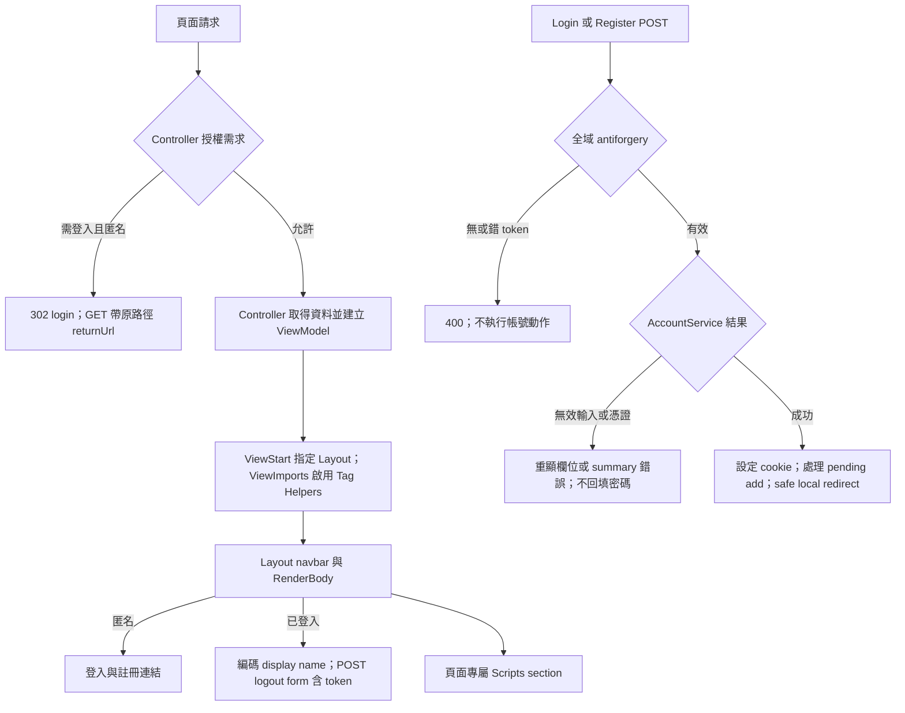
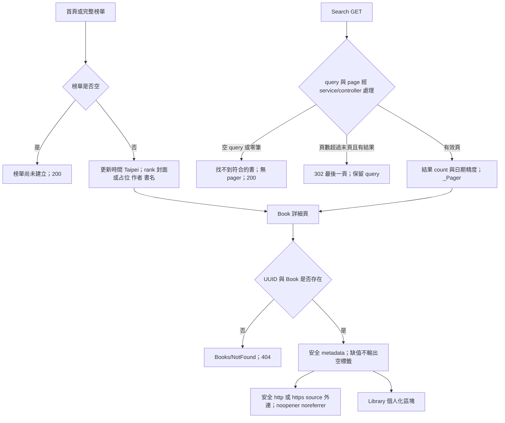
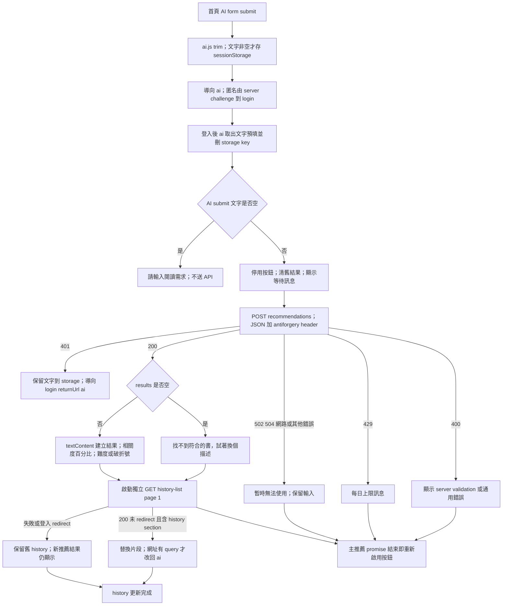
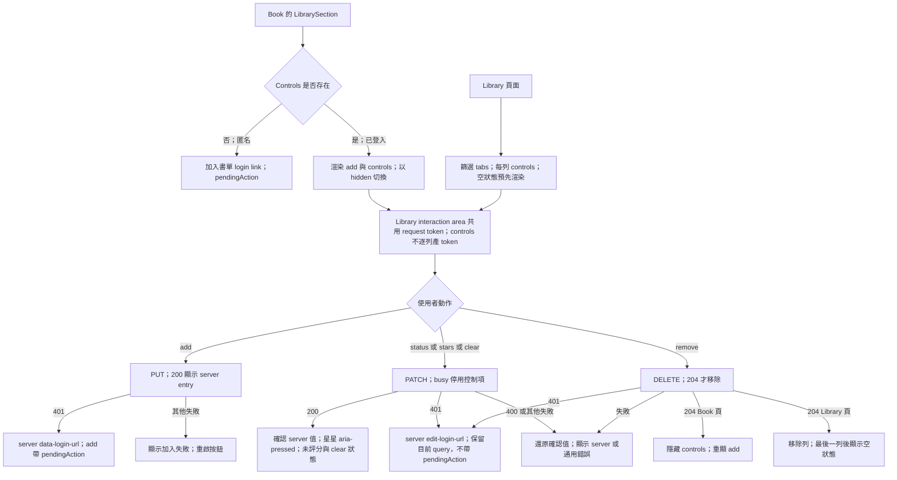

# Views 頁面與互動流程

查核：2026-10-24；HEAD `91333c3`。範圍是 Views 原始 Razor／scoped CSS；Controller、Models、JavaScript 是定位呼叫及呈現責任的依賴來源。Authority：[UI Flow](../../Docs/ui/ui-flow.md)、[API](../../Docs/api/api-spec.md)、[Catalog](../../Docs/modules/book-catalog.md)、[Library](../../Docs/modules/user-library.md)、[Identity](../../Docs/modules/identity-auth.md)、[Recommendation](../../Docs/modules/recommendation.md)。沒有本次執行或瀏覽器證據。

## 入口與呈現單元

| HTTP 入口 | View／主要 partial | 資料來源與邊界 |
|---|---|---|
| GET `/` | [Home/Index](../Home/Index.cshtml)、_SearchForm、_BestsellerEntries | HomeController；榜單前十筆，保留原 rank |
| GET `/bestsellers` | [Bestsellers/Index](../Bestsellers/Index.cshtml)、_BestsellerEntries | BestsellerService 完整目前榜單，不分頁 |
| GET `/search?q=&page=` | [Search/Index](../Search/Index.cshtml)、_SearchForm、_Pager | SearchController／SearchResultsViewModel；只有 local DB |
| GET `/books/{id}` | [Books/Detail](../Books/Detail.cshtml)、_LibrarySection、_LibraryControls | catalog read model + 每次獨立 user Library 查詢 |
| GET/POST `/account/login`、`/account/register` | [Login](../Account/Login.cshtml)、[Register](../Account/Register.cshtml) | AccountController；POST token、成功 cookie/redirect、失敗表單 |
| POST `/account/logout` | _Layout 內 form | 登入限制＋全域 antiforgery；成功回首頁 |
| GET `/library?status=` | [Library/Index](../Library/Index.cshtml)、_LibraryControls | 需登入；未知 status 視為全部 |
| GET `/ai?page=` | [Ai/Index](../Ai/Index.cshtml)、_AiHistoryList、_Pager | 需登入；每頁二十筆本人紀錄 |
| GET `/ai/history-list?page=` | [Ai/_AiHistoryList](../Ai/_AiHistoryList.cshtml) | 需登入；只回片段，無 layout |
| GET `/ai/history/{id}` | [Ai/History](../Ai/History.cshtml) 或 [Ai/NotFound](../Ai/NotFound.cshtml) | 需登入；不存在／非本人／無效 UUID 同 404 |
| `/Home/Error` | [Shared/Error](../Shared/Error.cshtml) | 非 Development exception handler；RequestId，不輸出 stack trace |

## 共用 layout、認證與一般表單

_ViewImports/_ViewStart 是完整 View 的框架組合，不是 HTTP endpoints。PartialView 的 history fragment 不跑完整 layout；_ValidationScriptsPartial 存在但目前沒有 caller，不能宣稱登入表單已載入 jQuery client validation。Razor 編碼與 token 生成不等於 server 授權或商業規則。

## Catalog 頁面、空狀態與 404

Pager 只在 TotalCount>0 顯示；上一頁／下一頁不存在時為 disabled span，當前頁為 aria-current，省略號不是連結。封面 null 顯示「無封面」。簡介與目錄不得進 HTML；Book 完整介紹導向來源網站。Book 模型先過濾安全 URL，Views 不自行 normalize；其他列表也依各自模型／reader 決定 cover 值。

## AI 輸入、結果與歷史 refresh

刷新 history 是額外非同步 fetch，推薦主流程按鈕復原不等待它完成。sessionStorage 被瀏覽器封鎖時不拋出未處理錯誤，但文字無法交接；需求不放 URL。AI form 沒 action/method，textarea 沒 name，依 JS 送 JSON；無 JS 不會完成推薦。前端沒有自訂 AbortController／60 秒 timer，60 秒由 server contract 保護，不宣稱瀏覽器有逾時取消。

歷史完整頁 `/ai` 超頁 redirect；fragment 超頁重新讀末頁後回片段，非 redirect。詳情 rank/reason/relevance 是保存快照，書名／封面／作者是目前資料，difficulty 即時讀取失敗降級「—」。空列表「還沒有 AI 搜尋紀錄」；零結果詳情「這次沒有找到符合的書」。

## Library 互動

Library interaction area 共用可用 request token；完整 authenticated document 的 Layout logout form 也會產 token，不能斷言整頁只有一個 input。library.js 從 document 中第一個 matching antiforgery input 取值，不限 Library 區域。狀態與星星 labels 在 server partial，JS 只送請求與切狀態。PATCH rating 省略保留、null 清空由 API/parser 保證；錯誤回復使用 WeakMap 保存最近確認值。Library filter 不會因 PATCH 自動重排／移走列，不能從 server filter 推論 client 即時重查（見待辦）。跨頁、取消及 DB rollback 均屬 controller/service/store。

互參：[架構](architecture.md)、[待辦](backlog.md)、[歷史](update-history.md)、[案例](test-suite.md)。本次 Mermaid 僅結構檢查、未渲染。
