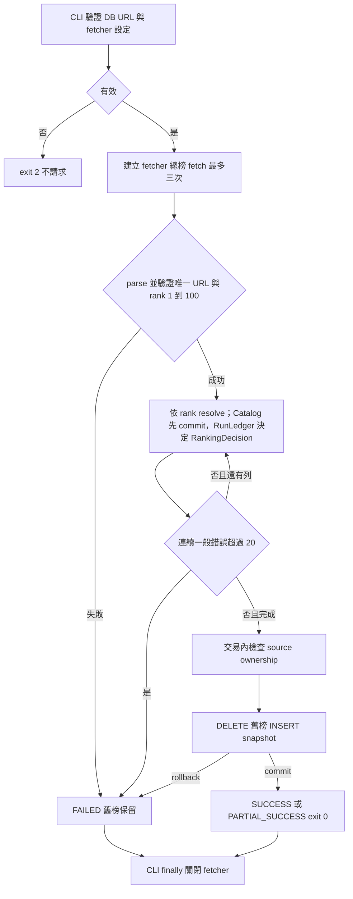
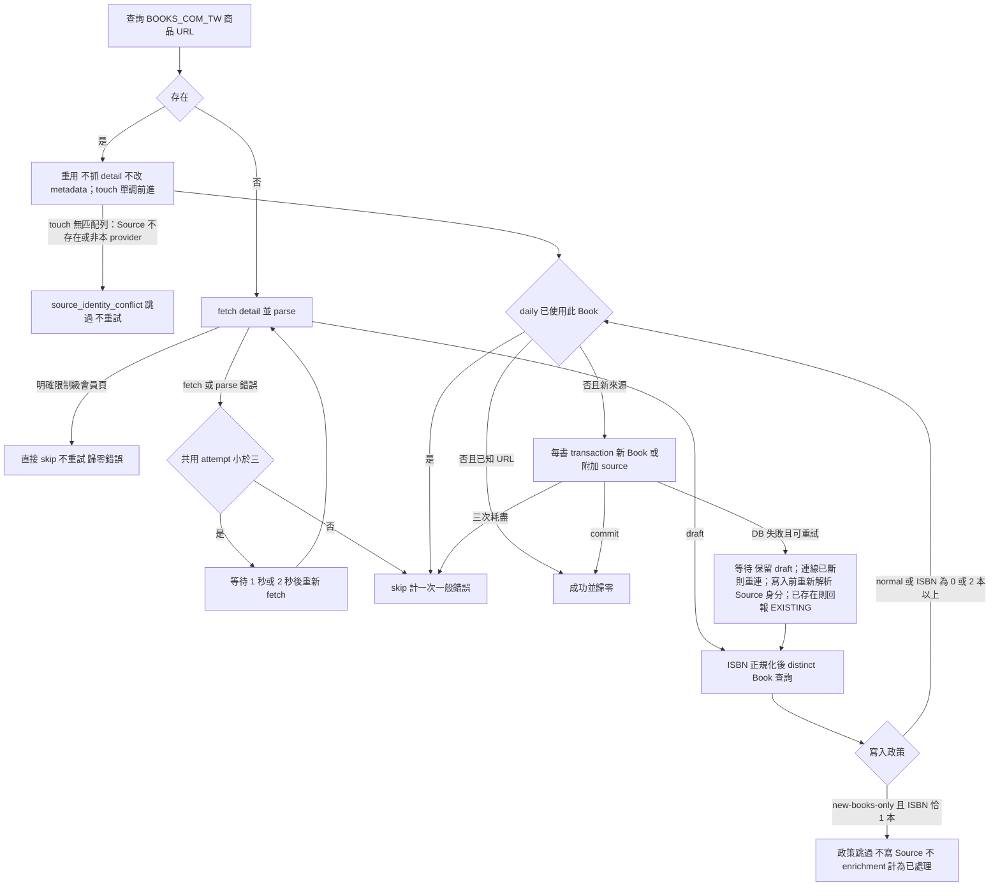
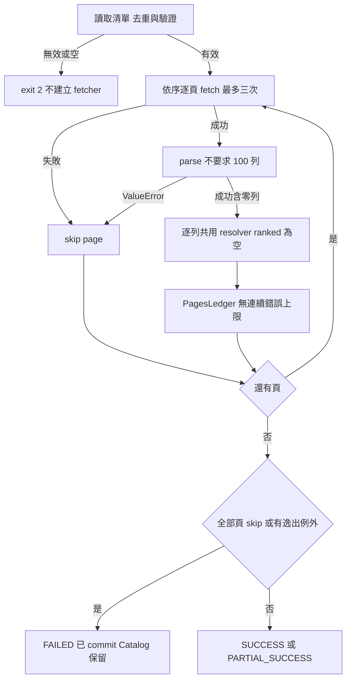
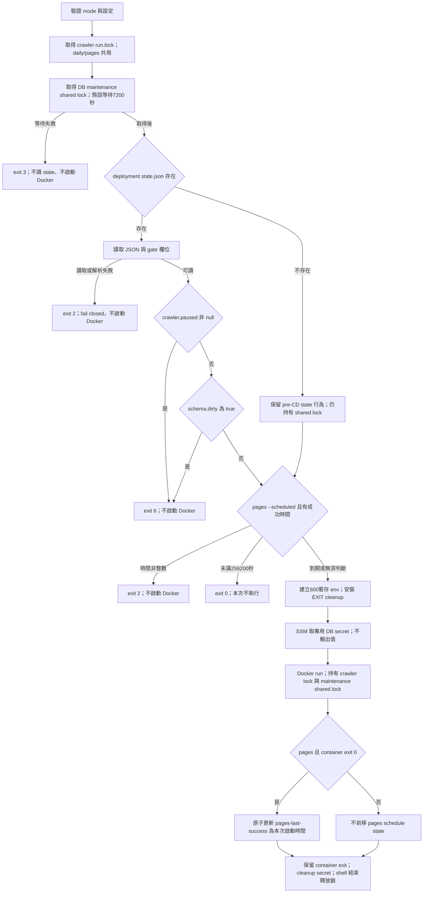

# Crawler 工作流程

**版本範圍**：crawler 核心以 `91333c3` 為原始查核基準；host wrapper／deployment coordination 另查核 PR #100 merge target `main` 的 `ce7b4f46c0889db6b10216294cac658136796ad7`（2026-10-24 擷取）。下述 host 流程描述合併後的 target 行為，不表示文件分支內較早的 wrapper 已變更；target 證據使用固定 SHA 連結。未執行 build、測試、部署或真實抓取。

> 查核 2026-10-24；核心基準 `91333c3`。核心來源依原始基準靜態閱讀；host 另依上述 merge-target snapshot；本次未執行 build、測試、部署、外部服務或真實抓取。

## 入口

[Crawler authority](../../Docs/modules/crawler.md)、[資料契約](../../Docs/data/data-model.md)、[部署](../../Docs/deployment/deployment.md)、[測試策略](../../Docs/testing/test-plan.md)、[名詞](../../CONTEXT.md)。

| 入口 | 程式與責任 |
|---|---|
| `python -m books_crawler` | [cli](../books_crawler/cli.py) → `run_once`，每日總榜 |
| `python -m books_crawler.first_book` | [first_book](../books_crawler/first_book.py) → `run_first_book`，只匯入第一名 |
| `python -m books_crawler.pages` | [pages](../books_crawler/pages.py) → `run_pages`，分類補書 |
| `python -m kingstone` | [cli](../kingstone/cli.py) → `run_pages`，金石堂分類列表頁（KINGSTONE，CB-07 Phase 5）；清單檔 `crawler/kingstone-pages.txt`；流程見下方「金石堂入口」 |
| `python -m books_crawler.inspect_page URL` | [inspect_page](../books_crawler/inspect_page.py)，單頁 browser 診斷，無 DB、不重試 |
| cron → wrapper daily／pages | [target run-crawler.sh](https://github.com/Arthur801/Book-Finder/blob/ce7b4f46c0889db6b10216294cac658136796ad7/crawler/deploy/run-crawler.sh)，serialization／maintenance locks、state gate、SSM、Docker 與排程 |

## 每日總榜（現行實作）



來源：[run](../books_crawler/run.py)、[ranking](../books_crawler/ranking.py)、[ledger](../books_crawler/ledger.py)、[catalog_core/persistence](../catalog_core/persistence.py)、[db](../books_crawler/db.py)，規格 §5～§6、§13～§14、§16。總榜 fetch 失敗才重試；parse／完整性錯誤不重試且在開 DB 前失敗。輸入須 100 列，輸出可缺號甚至空 snapshot；空榜仍替換是已定規則。first-book 仍驗證 100 列，只 resolve rank 1，不替換榜單；一般失敗 FAILED，限制級 PARTIAL_SUCCESS。榜內重複（DUPLICATE_BOOK）在 Catalog 寫入之後由 RunLedger 決定，記為跳過與一般錯誤，不重試。

## 共用單列管線

本流程由 `catalog_core.service.resolve_item` 實作（provider-neutral）；Books 只提供 fetch／parse callback（`books_crawler/run.py` 的 `_fetch_and_parse`）與 log 行（rank 欄位、限制級、attempt、identity warning、ISBN 附加）。下圖即兩者合起來的行為。寫入政策（`write_policy`，預設 `NORMAL`）只在 NEW 路徑的 ISBN 比對後生效：Books 永遠使用 `NORMAL`，因此圖中的「政策跳過」分支不會出現在 Books；金石堂 run 才可能走到它（見下方「金石堂逐頁 run」）。



已存在的 Source 以 `touch_source(provider, source_id, now)` 更新 `last_seen_at`：寫成 `GREATEST(last_seen_at, now)`，且只作用於本 provider（BOOKS_COM_TW）的該 Source。時鐘倒退不會把時間往回拉；touch 匹配不到列時拋 `SourceTouchConflict`，本列記為 `source_identity_conflict` 跳過，不重試、不抓詳細頁；資料庫錯誤仍照三次重試。

fetch／parse／write 共用最多三次嘗試。ISBN lookup 失敗也沿用 draft；已知 URL 的 `find_source` DB 例外在 retry 外，整次失敗。重複 Book 確定性 skip，不重試，已知 URL attempts=0、ISBN 重複記實際次數。限制級、重用、附加、成功都重設 streak；20 本仍繼續，第 21 本終局一般錯誤才中止，累計錯誤無上限。每書已 commit Catalog 保留；替換交易保護舊榜與既有來源時間。

## Pages 與其他入口



Pages 不保存分類 rank／Bestseller、不刷新既有來源時間；新來源初始化的文字差距見 CB-01。空成功解析頁不是 skipped page；直接 `run_pages(deps, [])` 成功，但 CLI 空清單拒絕。

## Host wrapper 與 deployment coordination（merge-target 現況）

來源：[target run-crawler.sh](https://github.com/Arthur801/Book-Finder/blob/ce7b4f46c0889db6b10216294cac658136796ad7/crawler/deploy/run-crawler.sh)；authority：[target deployment](https://github.com/Arthur801/Book-Finder/blob/ce7b4f46c0889db6b10216294cac658136796ad7/Docs/deployment/deployment.md) §8／[target crawler deploy README](https://github.com/Arthur801/Book-Finder/blob/ce7b4f46c0889db6b10216294cac658136796ad7/crawler/deploy/README.md)。`run.lock` 為 daily/pages 共用的 crawler serialization lock；不是每種 mode 各自獨立的鎖。



順序必須是 crawler serialization lock → DB maintenance shared lock → deployment state gate → pages schedule gate → SSM → Docker。Deploy migration 取得同一 maintenance lock 的 exclusive lock；先拿 shared lock 再讀 state，避免讀完 clean state 後 deploy 才 pause／migration、crawler 卻用舊讀值啟動的 race。Shared lock 持有至 Docker 執行結束；不能在 state gate 後提前釋放。

`DB_MAINTENANCE_LOCK` 預設 `/var/lib/book-finder/db-maintenance.lock`，`DB_MAINTENANCE_WAIT_S` 預設 `7200`，`BOOKFINDER_STATE_FILE` 預設 `/var/lib/book-finder/state.json`。`crawler.paused != null` 即跳過；否則檢查 `schema.dirty is True`。這是 wrapper 所讀欄位的 gate，不是完整 host state schema validator。State 不存在只保留舊 state 行為，並未略過 maintenance lock；state 存在但不能讀／解析或缺少 gate 所需欄位則 fail closed。

Paused／dirty exit 6、maintenance timeout exit 3、state 無法解析 exit 2 都在 SSM／Docker 前結束，不更新 pages 成功時間。正常啟動後維持 `--rm --pull=never`、curl、artifact bind mount、container exit passthrough 與 secret cleanup。Cron UTC 20:00／21:00 對應台灣 04:00／05:00；72h 從上次 pages exit 0 的啟動時間計算。以上是程式／測試來源證據，並非 EC2／SSM／正式部署驗證。


Fetcher 每次含首次／重試以 3～30 秒目標循序節流，解析／DB／backoff 抵扣已耗時間；實際可超過 30 秒。無 redirect、保留 TLS。challenge、連線異常頁、非 200／request error 為 FetchError，不切換 adapter；browser 啟動失敗整次 FAILED。不具應用層取消協定。診斷 curl 存原始 HTML 與選定 JSON，browser 加 PNG；診斷失敗不覆蓋原錯誤，inspect_page 一次請求無 DB。

相關：[流程](workflow-diagram.md)／[架構](architecture.md)／[待辦](backlog.md)／[歷史](update-history.md)／[案例](test-suite.md)。

## 本地 runner（`deploy/local/`，Phase 6 M4）

入口：`deploy/local/run-local-crawler.sh daily|first_book|pages|kingstone`（使用者在本機手動執行，不經 cron）。順序與 exit code 的完整說明見 [deploy README](../deploy/README.md) §9。

Invocation order（本地）：

1. 讀 `CRAWLER_LOCAL_CONF`。`CRAWLER_ENABLED` 先於其他驗證：`false` → `skipped=disabled`、exit 0、無任何外部工作；其他值非法 → exit 10。必要值與格式、CA bundle（`0644`、非 symlink）、artifacts 目錄（owner 10001 或 world-writable）驗證失敗 → exit 10。
2. 本地 `run.lock`，非阻塞，所有 mode 共用；已被持有 → exit 11。
3. SSH 唯讀讀取 EC2 `state.json`（`BatchMode=yes`，`python3 -I` 判定，與 `run-crawler.sh` 同規則）：paused／dirty → `skipped=…`、exit 6；讀不到或檔案不存在 → exit 12（fail closed）。
4. Orphan check：`docker ps -a --filter label=com.bookfinder.role=catalog-crawler`。running／restarting／paused／removing → `ORPHAN_WRITER`、exit 13，不取 secret；exited／dead／created → `docker rm` 後繼續；docker 不可用 → exit 18。
5. DB secret：`DB_SECRET_SOURCE=ssm`（`aws ssm get-parameter --with-decryption --profile`）或 `file`（600、owner 為自己、非 symlink）；空值 → exit 15。secret 只經 stdin 與 bash 變數傳遞，不進 argv、log 或 env。
6. 改寫連線字串（`runner_support.py rewrite-url`）：保留 userinfo 與 path（不解碼），host 必須等於 `RDS_ENDPOINT`（否則 exit 17），port 換成 `LOCAL_DB_PORT`，加上 `hostaddr=127.0.0.1`、`sslmode=verify-full`、`sslrootcert=/etc/book-finder/rds-ca-bundle.pem`；寫入 600 的 env file（只含 `DATABASE_URL`，mktemp 建立）。
7. 開 tunnel：`ssh -N -o ExitOnForwardFailure=yes -o ServerAliveInterval=30 -o ServerAliveCountMax=3 -o BatchMode=yes -L 127.0.0.1:<port>:<RDS>:5432 <alias>`（背景）；以 `python3 -I` 檢查本機埠，上限 `TUNNEL_WAIT_SECONDS`；ssh 先退出或逾時 → exit 16。
8. 啟動 container：`docker run --rm=false --pull=never --init --network host --name book-finder-crawler-active`，labels `com.bookfinder.role`／`mode`／`provider`，`--cidfile`、`--env-file`，artifacts 與 CA 的 bind mount（CA 唯讀）。kingstone 使用 `KINGSTONE_CRAWLER_IMAGE`、預設 CMD，並傳入 `CRAWLER_RUN_HARD_LIMIT_SECONDS`；博客來使用 `CRAWLER_IMAGE` 與對應 module，傳入 `CRAWLER_FETCHER=curl`。
9. Watchdog：`docker run` 客戶端存活期間每秒檢查，觸發條件為超過 hard limit、收到 INT／TERM，或客戶端已結束但 container 仍在運作。流程為 `docker stop -t <grace>`（paused 先 `docker unpause`）→ 仍在運作則 `docker kill` → 以 `docker ps` 確認；absent、exited、dead、created 才算已停止。確認失敗 → `ORPHAN_WRITER`、exit 14，不 `rm`，下一次啟動於步驟 4 被擋下。確認停止 → exit 20（hard limit 或客戶端異常）或 21（signal）。
10. 正常結束：確認 container 已非運作後 `docker rm`，回傳 container 的 exit code（0、1、2，或 Docker 自身的其他值原樣傳回）。
11. 清理（EXIT trap，所有路徑含錯誤與 signal）：關閉 tunnel（kill 後 wait）、刪除 env file 與 cidfile；fd 9 關閉即放鎖。子程序以 `9>&-` 不繼承鎖。

Writer fencing 只依 container 名稱與 label 判定：同一時間最多一個 `book-finder-crawler-active`；provider 與 mode 只作為 label，不分別建立鎖。

來源：[run-local-crawler.sh](../deploy/local/run-local-crawler.sh)、[runner_support.py](../deploy/local/runner_support.py)。測試：[test_local_runner.py](../tests/test_local_runner.py)（CR-T20）。

## 金石堂入口（`python -m kingstone`，Phase 5 M2）

```text
python -m kingstone（於 crawler/ 執行）→ kingstone.cli.main()
  1 logging：kingstone、catalog_core → stdout INFO
  2 ensure_runtime_unicode_supported 失敗 → exit 2
  3 DATABASE_URL 未設或空白 → exit 2（不輸出值）
  4 load_config(env)：KingstoneConfigError → exit 2
  5 load_page_urls(config.pages_file)：PageListError → exit 2（建立 fetcher 之前）
  6 provider_enabled(DATABASE_URL, KINGSTONE)：psycopg.Error → exit 1；非 True（停用或未註冊）→ exit 2
  7 budget = SoftBudget(soft)；fetcher = fetcher_factory(config, budget)（預設 KingstoneFetcher，budget_remaining = budget.remaining）
  8 DatabaseSession（lazy 連線）→ SessionCatalogStore → KingstoneRunDependencies(write_policy = config)
      run_pages(deps, page_urls) → report.exit_code（SUCCESS／PARTIAL_SUCCESS → 0，FAILED → 1）
  9 finally：fetcher.close()
```

- 「停用」與「未註冊」都是設定錯誤（exit 2），都不建立 fetcher、不發出請求。
- Exit 1 只來自步驟 6 的查詢失敗與 run 的 FAILED（包括清單所有頁都被跳過）。
- `CRAWLER_RUN_HARD_LIMIT_SECONDS` 只被讀取與驗證；強制終止由本地 runner watchdog 執行（Phase 6 M4，見「本地 runner」），本入口不計時、不殺程序。
- 來源：[cli](../kingstone/cli.py)、[run](../kingstone/run.py)、[config](../kingstone/config.py)、[page_list](../kingstone/page_list.py)、[persistence](../catalog_core/persistence.py)（只讀 `provider_enabled`，寫入由 run 經 store 呼叫）。

## 金石堂逐頁 run（Phase 4 M2）

caller：`kingstone.cli.main`（Phase 5 M2），組裝見上節。詳見 [architecture](architecture.md)「Run（逐頁流程）」。

```text
run_pages(deps, page_urls)
  for url in 清單（去重，清單順序）:
    budget.exhausted？ 是 → stop_for_budget（不再發請求；剩下的頁 not reached）
    fetch_list_page(url)
      BUDGET_EXHAUSTED → stop_for_budget（該頁 not reached）
      其他 AcquisitionError → record_page_skipped（reason = kind 小寫）
    parse_list_html → KingstoneParseError → record_page_skipped（parse_error）
    page_started(url)
    for 每張卡:
      budget.exhausted？ 是 → stop_for_budget（該頁 interrupted，停止）
      resolve_item(store, (KINGSTONE, 詳細頁 URL, km_code), fetch_draft)
        identity EXISTING → touch（不抓詳細頁）
        identity NEW → fetch_draft（最多 3 次；只有資料庫失敗才重試，draft 保留）
          fetch_detail_page
            BUDGET_EXHAUSTED → 該卡失敗 budget_exhausted → stop_for_budget（頁 interrupted）
            其他 AcquisitionError → 該卡失敗（kind 小寫，不重試）
          parse_detail_html：ProductNotFound → product_not_found；KingstoneParseError → parse_error
          km_code 與卡片不符 → parse_error
          ISBN 查詢：write_policy 為 new-books-only 且恰 1 本 → ItemPolicySkipped（不呼叫 persist，計為已處理）
          其他 → persist_new_source（資料庫失敗後下一次先 re-resolve identity；政策跳過不寫入，因此不會走到 re-resolve）
      record_item
    page_completed(url)
  report（terminal status 規則見 architecture「Run 帳本與 terminal status」）
  fatal（identity 查詢的 psycopg.Error、未預期例外、ValueError）→ 停止，report.error
```

- 呼叫端責任：組裝 `KingstoneRunDependencies`（含 `write_policy`，無預設值；config 的預設為 `new-books-only`）；把同一個 `SoftBudget` 交給真 fetcher（`budget_remaining=budget.remaining`）；注入 `clock`、`sleep` 與 `run_id`。
- 重跑（replay）：同一份清單再跑一次。Existing 只 touch；未完成的 New 才抓詳細頁。政策跳過的書沒有 Source，因此下一次 run 仍是 New，會再抓一次詳細頁。
- `new-books-only` 的全部政策跳過 run 是合法 SUCCESS，但零寫入：報告以 `write_policy`、`policy_skipped` 與 `zero_progress_reason=null` 與真正零進度區分；它不能作為 promotion 到 `normal` 的證據。
- 結果：`KingstoneReport`；一行 INFO `mode=kingstone …`；FAILED 另有一行 ERROR。exit code 由 `report.exit_code` 決定，由 `kingstone.cli` 回傳（Phase 5 M2）；hard limit 的強制執行由 runner 負責（Phase 6）。

