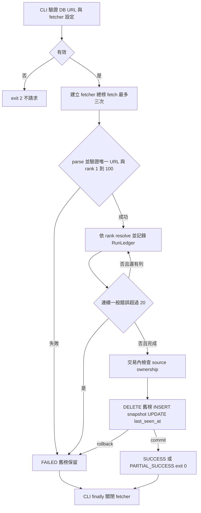
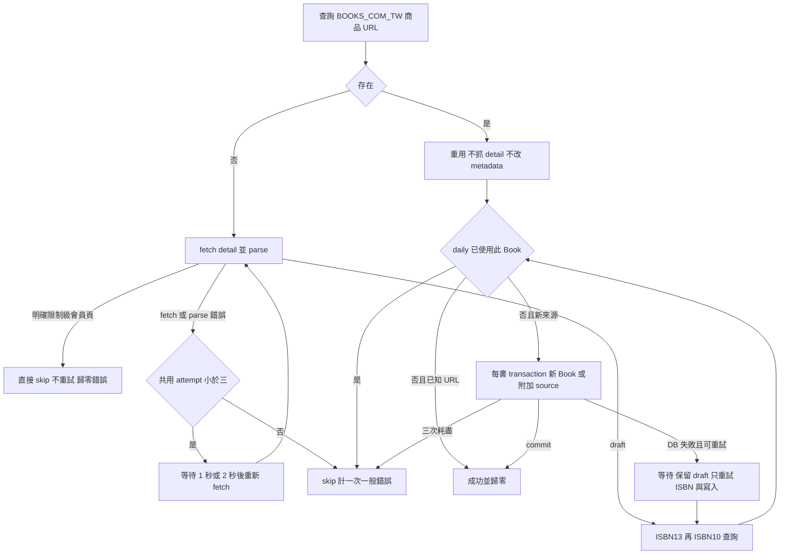
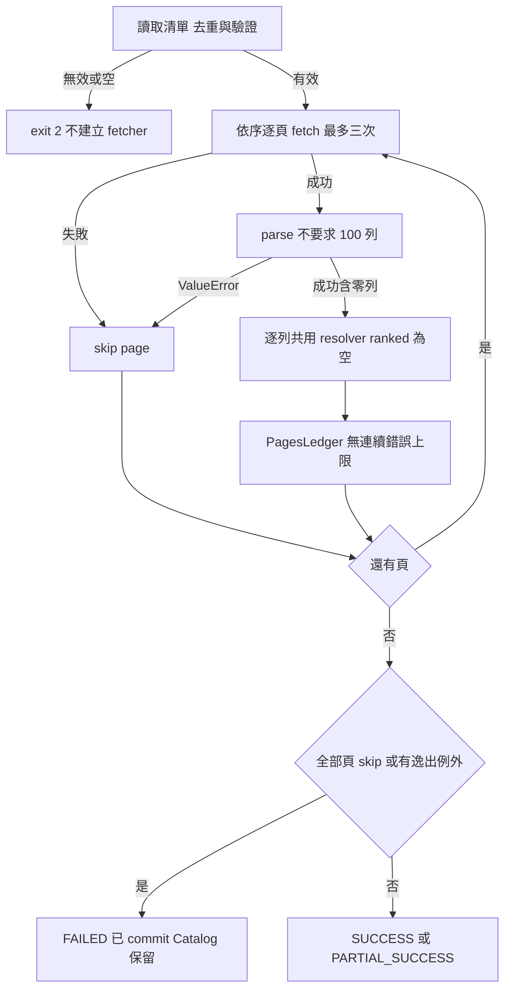
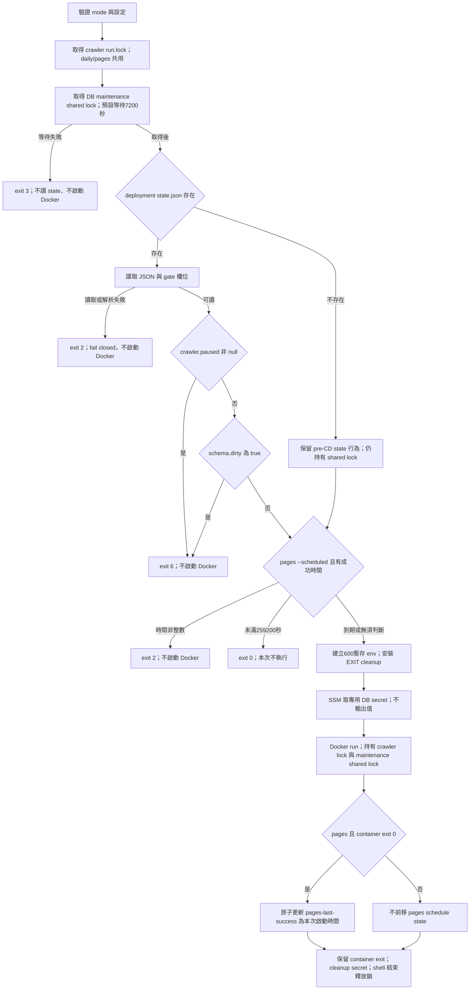

# Crawler 工作流程

**版本範圍**：crawler 核心以 `91333c3` 為原始查核基準；host wrapper／deployment coordination 另查核 PR #100 merge target `main` 的 `ce7b4f46c0889db6b10216294cac658136796ad7`（2026-10-24 擷取）。下述 host 流程描述合併後的 target 行為，不表示文件分支內較早的 wrapper 已變更；target 證據使用固定 SHA 連結。未執行 build、測試、部署或真實抓取。

> 查核 2026-10-24；核心基準 `91333c3`。核心來源依原始基準靜態閱讀；host 另依上述 merge-target snapshot；本次未執行 build、測試、部署、外部服務或真實抓取。

## 入口

[Crawler authority](../../Docs/modules/crawler.md)、[資料契約](../../Docs/data/data-model.md)、[部署](../../Docs/deployment/deployment.md)、[測試策略](../../Docs/testing/test-plan.md)、[名詞](../../CONTEXT.md)。

| 入口 | 程式與責任 |
|---|---|
| `python -m books_crawler` | [cli](../books_crawler/cli.py) → `run_once`，每日總榜 |
| `python -m books_crawler.first_book` | [first_book](../books_crawler/first_book.py) → `run_first_book`，只匯入第一名 |
| `python -m books_crawler.pages` | [pages](../books_crawler/pages.py) → `run_pages`，分類補書 |
| `python -m books_crawler.inspect_page URL` | [inspect_page](../books_crawler/inspect_page.py)，單頁 browser 診斷，無 DB、不重試 |
| cron → wrapper daily／pages | [target run-crawler.sh](https://github.com/Arthur801/Book-Finder/blob/ce7b4f46c0889db6b10216294cac658136796ad7/crawler/deploy/run-crawler.sh)，serialization／maintenance locks、state gate、SSM、Docker 與排程 |

## 每日總榜（現行實作）

來源：[run](../books_crawler/run.py)、[ranking](../books_crawler/ranking.py)、[ledger](../books_crawler/ledger.py)、[db](../books_crawler/db.py)，規格 §11～14、§16。總榜 fetch 失敗才重試；parse／完整性錯誤不重試且在開 DB 前失敗。輸入須 100 列，輸出可缺號甚至空 snapshot；空榜仍替換是已定規則。first-book 仍驗證 100 列，只 resolve rank 1，不替換榜單；一般失敗 FAILED，限制級 PARTIAL_SUCCESS。

## 共用單列管線

fetch／parse／write 共用最多三次嘗試。ISBN lookup 失敗也沿用 draft；已知 URL 的 `find_source` DB 例外在 retry 外，整次失敗。重複 Book 確定性 skip，不重試，已知 URL attempts=0、ISBN 重複記實際次數。限制級、重用、附加、成功都重設 streak；20 本仍繼續，第 21 本終局一般錯誤才中止，累計錯誤無上限。每書已 commit Catalog 保留；替換交易保護舊榜與既有來源時間。

## Pages 與其他入口

Pages 不保存分類 rank／Bestseller、不刷新既有來源時間；新來源初始化的文字差距見 CB-01。空成功解析頁不是 skipped page；直接 `run_pages(deps, [])` 成功，但 CLI 空清單拒絕。

## Host wrapper 與 deployment coordination（merge-target 現況）

來源：[target run-crawler.sh](https://github.com/Arthur801/Book-Finder/blob/ce7b4f46c0889db6b10216294cac658136796ad7/crawler/deploy/run-crawler.sh)；authority：[target deployment](https://github.com/Arthur801/Book-Finder/blob/ce7b4f46c0889db6b10216294cac658136796ad7/Docs/deployment/deployment.md) §8／[target crawler deploy README](https://github.com/Arthur801/Book-Finder/blob/ce7b4f46c0889db6b10216294cac658136796ad7/crawler/deploy/README.md)。`run.lock` 為 daily/pages 共用的 crawler serialization lock；不是每種 mode 各自獨立的鎖。

順序必須是 crawler serialization lock → DB maintenance shared lock → deployment state gate → pages schedule gate → SSM → Docker。Deploy migration 取得同一 maintenance lock 的 exclusive lock；先拿 shared lock 再讀 state，避免讀完 clean state 後 deploy 才 pause／migration、crawler 卻用舊讀值啟動的 race。Shared lock 持有至 Docker 執行結束；不能在 state gate 後提前釋放。

`DB_MAINTENANCE_LOCK` 預設 `/var/lib/book-finder/db-maintenance.lock`，`DB_MAINTENANCE_WAIT_S` 預設 `7200`，`BOOKFINDER_STATE_FILE` 預設 `/var/lib/book-finder/state.json`。`crawler.paused != null` 即跳過；否則檢查 `schema.dirty is True`。這是 wrapper 所讀欄位的 gate，不是完整 host state schema validator。State 不存在只保留舊 state 行為，並未略過 maintenance lock；state 存在但不能讀／解析或缺少 gate 所需欄位則 fail closed。

Paused／dirty exit 6、maintenance timeout exit 3、state 無法解析 exit 2 都在 SSM／Docker 前結束，不更新 pages 成功時間。正常啟動後維持 `--rm --pull=never`、curl、artifact bind mount、container exit passthrough 與 secret cleanup。Cron UTC 20:00／21:00 對應台灣 04:00／05:00；72h 從上次 pages exit 0 的啟動時間計算。以上是程式／測試來源證據，並非 EC2／SSM／正式部署驗證。

Fetcher 每次含首次／重試以 3～30 秒目標循序節流，解析／DB／backoff 抵扣已耗時間；實際可超過 30 秒。無 redirect、保留 TLS。challenge、連線異常頁、非 200／request error 為 FetchError，不切換 adapter；browser 啟動失敗整次 FAILED。不具應用層取消協定。診斷 curl 存原始 HTML 與選定 JSON，browser 加 PNG；診斷失敗不覆蓋原錯誤，inspect_page 一次請求無 DB。

相關：[流程](workflow-diagram.md)／[架構](architecture.md)／[待辦](backlog.md)／[歷史](update-history.md)／[案例](test-suite.md)。
