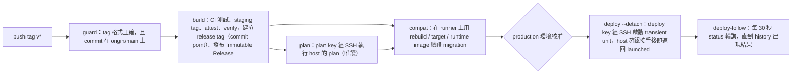

# 部署 Runbook（CD：tag 觸發、核准後部署到單台 EC2）

> Path: `deploy/README.md`
> 規格與理由：`Docs/deployment/deployment.md`、`Docs/architecture/architecture-decisions.md` ADR-006。本文件只寫操作步驟；與程式不一致時以程式為準，並回報文件衝突。
> 標記 **L4** 的操作屬 `AGENTS.md` §2.3：需要使用者當下的明確授權。CD 的 `production` 核准即為 tag 部署的授權；人工程序（resolve-run、reconcile-schema、resume-crawler、install-host、還原 snapshot）每一次都需要使用者明確同意。
> 所有 `<...>` 是佔位符，不要照抄；真實網域、AWS 資源名稱與 key 不寫入 repository。

---

## 1. 架構概觀

### 1.1 流程



- 手動重新部署或回滾：`workflow_dispatch`，只能從 `main` 發起，指定已發布的 `release_tag`，不 build。
- 首次從 systemd 切換到 Docker：dispatch 時加上 `cutover=true`（見 §3）。

### 1.2 信任邊界

| 層 | 內容 | 誰能改 | 何時使用 |
|---|---|---|---|
| Host 程式 | `/opt/book-finder/host/`（symlink 指向 `host-versions/<id>/`），來源為 `deploy/host/`：`deploy-entry`、`book-finder-admin`、`bookfinder_host/` | 只能經 `install-host`（L4） | plan、deploy、status 都會執行 |
| Release metadata | image 內 `/opt/release/migrations.txt`、`RELEASE_API` | 發布流程 | plan 只當資料讀取，以 `docker create` + `docker cp`（不帶 `-L`）取出，先檢查一般檔案、不跟隨 symlink |
| Release 內容 | `compose.prod.yaml`、`run-crawler.sh`、`crawler.cron`、`efbundle`（image 內） | 發布流程 | 只有核准後、digest 一致、`release_api` 在 host 支援範圍內時才會使用 |
| Release SQL | `sql/<id>.sql`（Immutable Release 的 asset） | 發布流程 | 只供審閱與 audit；**執行的是 image 內的 efbundle** |

程式不會執行 release 內的程式來讀 metadata（`docker cp` 只複製檔案）。

### 1.3 state.json 與 history.jsonl

| 檔案 | 路徑（預設） | 角色 |
|---|---|---|
| state | `/var/lib/book-finder/state.json`（`STATE_FILE`） | 目前的 production 狀態：revision、runtime、previous_runtime、schema（applied、rebuild、dirty）、crawler（digest、雜湊、paused）。每次寫入都 atomic（tmp、fsync、rename）並遞增 `revision` |
| history | `HISTORY_FILE`（`history.jsonl`） | append-only。**部署結果的唯一 durable 來源**：每次部署寫 `started` 與 `completed` 兩筆；人工操作寫 `operator-started` 與 `operator-completed` |

`status <run_id>` 的判定（`bookfinder_host/history.py`）：

| 結果 | 條件 |
|---|---|
| `completed:<result>` | history 有該 run 的 completed（即使 unit 狀態矛盾，也以 history 為準） |
| `running` | 沒有 completed，unit 是 active 或 activating |
| `indeterminate` | 沒有 completed、unit 不在執行中，且有 started（或 history 最後一行不完整） |
| `not-started` | 沒有 started（started 寫在任何變更之前，所以可以安全重新 dispatch） |

### 1.4 Chain 分類

比較 state 的 applied（每項為 `id` + `source_hash`）與目標 release 的 manifest：

| 分類 | 條件 | 部署時 |
|---|---|---|
| `in-sync` | 兩者完全相同 | 不跑 migration；可用於首次 cutover |
| `forward` | applied 是目標的嚴格前綴 | 先 pause crawler、建 snapshot、跑 efbundle，再切換 web |
| `schema-ahead` | 目標是 applied 的嚴格前綴（DB 比目標新） | 不跑 migration，web 換成目標版本；**crawler 不變**（S7） |
| `divergent` | 其他情況（含同 id 但 source_hash 不同） | 拒絕，exit 2 |

### 1.5 退出碼對照

`plan`、`deploy` 與人工指令使用下列退出碼。`status` 指令只要查詢本身成功，固定回傳 exit 0；部署狀態看 JSON 的 `status` 欄位，例如 `completed:success`、`running`、`indeterminate` 或 `not-started`，**不要用 `status` 的 exit code 判斷部署是否成功**。`history result` 是寫入 history 的 `result` 欄位，只適用於有 `completed` 紀錄的部署或人工操作；`plan` 不寫 history，回 exit 0 時也沒有 `result`。判讀部署結果時，`status` 回報的 `completed:<result>` 與 completed 紀錄的 `exit_code` 要一起看：同一個退出碼（例如 3）可能對應不同 `result`，見下方「exit 3 的 history 對照」。

| 碼 | 名稱 | 常見原因 | history result | 操作者要做什麼 |
|---|---|---|---|---|
| 0 | OK | plan 可以部署；或 deploy 成功：web 已切換到目標 release；crawler 符合該 chain 的預期狀態（in-sync / forward 更新至目標 crawler，schema-ahead 維持目前的 crawler） | `success` | 無 |
| 1 | ROLLED_BACK | in-sync 或 schema-ahead 的 web 切換失敗，已回到舊 runtime | `rolled-back` | 看 journal 的健康檢查失敗原因，修正後再 dispatch。不需要 reconcile |
| 2 | BAD_INPUT | 參數或 SSH 指令格式錯誤；release metadata 或內容不合格；`divergent`；`release_api` 超出 host 支援範圍；schema-ahead 的 `crawler_digest` 不是目前的；cutover 條件不符；compose 不支援 `format: raw`；設定檔錯誤；人工指令的確認值不符 | `rejected` | 不要重試同一組參數；依 stderr 的原因修正 |
| 3 | DRIFT | state 不存在（需 bootstrap）；runtime 或 schema 與 state 不符；CAS 失敗（revision 過期）；deploy 或 db-maintenance lock 逾時；目前 runtime 健康檢查失敗（未改動）；snapshot 失敗（未 migrate，crawler 已恢復）；run id 已使用；unit 已存在；crawler 仍 paused；互動式 deploy 的跟隨逾時（回報 `running`；CD 使用 `--detach`，不會遇到此項）；operator 指令遇到損壞的 history 尾端（§5.1）。`result` 依發生點而異，見下方「exit 3 的 history 對照」 | `drift` 或 `rejected`（依發生點） | 依原因處理。未改動時修正後重新 plan，再 dispatch |
| 4 | FAILED_MIGRATION | efbundle 結束碼非 0，或 DB 的 migration id 與目標不符 | `failed-migration` | schema 保持 dirty、crawler 保持 paused。走 §5.2 與 §5.3 |
| 5 | FAILED_DOWN | forward 之後 web 失敗（I5：不自動回滾）；或回滾本身失敗 | `failed-down` | 人工恢復（L4）。crawler 保持 paused |
| 6 | DIRTY | schema 為 dirty，plan 與 deploy 都拒絕。`run-crawler.sh` 以 exit 6 跳過：`skipped=paused`（crawler 已暫停）或 `skipped=dirty`（schema dirty），兩者都不啟動容器 | `rejected`（deploy）；crawler 不寫 history | dirty：走 §5.2 `reconcile-schema --mark-clean`；paused：走 §5.3 `resume-crawler` |
| 7 | PARTIAL_CRAWLER | web 已是目標版本，但 crawler 更新失敗；crawler 保持（或變成）paused | `partial-crawler` | 查 history 的 `crawler_substeps` 與 journal，再走 §5.3 `resume-crawler` |
| 8 | INDETERMINATE | 有未解決的 indeterminate run 或 operator operation；本次結果無法證明（例如 started 之後發生未預期例外）；history 最後一行不完整時，plan、SSH 端 deploy 與 deploy unit 本體也以 exit 8 拒絕（operator 指令則為 exit 3，見 §5.1） | `blocked-indeterminate`（被擋下時）或無 completed | **不要重新 dispatch**。走 §5.1 `resolve-run` |

### exit 3 的 history 對照

同為 exit 3，寫入 history 的 `result` 依發生點不同。下表是現行程式的行為（本次只修正文件，程式未改；統一與否見 DEP-B17）：

| 發生點 | history 寫入 | `result` |
|---|---|---|
| deploy unit：deploy lock 逾時（`commands.run_deploy_unit`，started 之後） | completed | `drift` |
| deploy unit：state 不存在（N6，需 bootstrap） | completed | `drift` |
| deploy unit：gate 失敗（revision CAS、runtime／schema 預期、chain、cutover 條件、systemd 仍 active、observed drift；經 `RESULT_BY_EXIT[DRIFT]`） | completed | `rejected` |
| 狀態機 step 0：crawler 仍 paused | completed | `drift` |
| 狀態機 step 1：目前 runtime 健康檢查失敗（未改動） | completed | `drift` |
| 狀態機 step 2 至 3：release 目錄不可用或內容取出失敗、同 digest 的 compose 不同、SSM 讀取或 env 檔寫入失敗 | completed | `drift` |
| forward：db-maintenance lock 逾時；snapshot 失敗（未 migrate，crawler 已恢復） | completed | `drift` |
| `resolve-run --result drift`（operator 記錄） | completed | `drift` |
| operator 指令：驗證為「未改變」的失敗（指令仍 exit 3） | operator-completed | `failed` |
| 不寫 history：unit 本體的 run id 已使用（在 started 之前拒絕） | 無 | — |
| 不寫 history：SSH 入口的 run id 已使用、unit 已存在、`systemd-run` 失敗、unit 狀態無法讀取 | 無 | — |
| 不寫 history：`plan` 的 drift、state 不存在或 lock 忙碌（`plan` 不寫 history） | 無 | — |
| 不寫 history：operator 指令的 lock 忙碌、history 尾端損壞（§5.1）、operator-started 寫入失敗 | 無 | — |
| 不寫 history：`deploy --detach` 的 not-started 寬限到期（unit 從未寫入 started）；不帶 `--detach` 的跟隨逾時（回報 `running`，run 仍在執行） | 無 | — |

判讀：`status` 回報 `completed:<result>` 時，請同時看 completed 紀錄的 `exit_code`。`rejected` 表示 gate 在改動前拒絕；`drift` 的來源多樣（lock、step 0、step 1、migration 前的 snapshot 等），需依 journal 的原因判斷是否已改動系統。

### run-crawler.sh 的退出碼

cron 入口 `run-crawler.sh`（`crawler/deploy/run-crawler.sh`）的退出碼如下；它不寫 deploy 的 history。

| 碼 | 條件 |
|---|---|
| 0 | `CRAWLER_ENABLED=false`（輸出 `skipped=disabled`，在任何鎖之前）；`pages` 未到 72 小時（`schedule=not-due`）；crawler 容器以 0 結束 |
| 1 | `CRAWLER_IMAGE`、`AWS_REGION` 或 `DATABASE_URL_PARAMETER` 未設定（shell 的 `:?` 檢查） |
| 2 | 用法錯誤；`DB_CA_BUNDLE` 不合法（字元、symlink、非一般檔案、非 0644、超過 1 MiB）；`CRAWLER_ENABLED` 不是 `true` 或 `false`（空值也拒絕）；state 存在但無法讀取（fail closed）；`pages-last-success` 內容不合法；SSM 的 DB URL 為空或含換行 |
| 3 | db-maintenance lock 等待逾時（`DB_MAINTENANCE_WAIT_S`，預設 7200 秒），輸出 `maintenance=busy` |
| 6 | state 的 `crawler.paused` 不為 null（`skipped=paused`），或 `schema.dirty` 為 true（`skipped=dirty`）；都不啟動容器 |
| 其他 | crawler 容器的結束碼原樣傳回（`exit "$result"`）；容器內的 2 為 crawler 的設定錯誤，數字與上表的 2 相同 |


CD 端的判定（`.github/scripts/cd_release.py`）：plan 的退出碼非 0 直接失敗；deploy 的 `completed:success` 才算成功；`indeterminate` 與其他失敗結果都要人工處理；`not-started` 在 120 秒寬限後才判定為「未動，可重新 dispatch」。CD 的 deploy job 以 `--detach` 啟動（見下），之後由 `deploy-follow` 每 30 秒呼叫 `status`，最多跟隨 160 分鐘（`FOLLOW_TIMEOUT_S`，job timeout 180 分鐘）。ssh 退出碼 255（連線失敗或中斷）視為沒有回應，繼續輪詢；其他非零退出碼的 `status` 失敗會讓 job 失敗，結果寫為 `unknown`，操作者需以 `status <run_id>` 手動查詢。

**`deploy --detach` 與 `launched`**：`--detach` 只等 host 確認 run 已被 unit 接手（已寫入 `started`、或已有結果）就返回，最多 60 秒。接手後回報的 `{"status": "launched"}` 配合退出碼 0，**不是結果**，只表示 unit 會繼續執行，結果仍以 history 為準。60 秒內仍未確認時，同樣回報 `launched`（退出碼 0），並在 stderr 寫出 `poll status <run_id>`。若 unit 從未寫入 `started` 且超過 30 秒寬限，`--detach` 回報 `not-started` 並以退出碼 3 結束，表示未動，可以重新 dispatch。不帶 `--detach` 的 `deploy` 會在同一連線內跟隨到結果，`FOLLOW_TIMEOUT_S` 到期時回報 `running`（退出碼 3）。

### 1.6 Build 的 commit point（release tag）

CD 的 `build` job 對每個 image（web、crawler）依序執行。`<TAG>` 是 release tag，staging tag 是 `build-<run_id>-<run_attempt>`：

1. 推送到 staging tag（每次 attempt 的名稱不同，rerun 不會撞到先前的 staging push）；
2. `actions/attest-build-provenance` 為該 digest 產生 attestation；
3. `cd_release.py verify-attestation` 驗證 attestation：signer workflow 是 `cd.yml`、source ref 是 `refs/tags/<TAG>`、source digest 是 tag 的 commit；
4. 只有驗證通過後，才以 `docker buildx imagetools create --prefer-index=false --tag <TAG>` 建立 release tag。**這一步是 commit point**；缺少 `--prefer-index=false` 時，單一 manifest 的來源會被包成新的 image index，digest 改變，`confirm-release` 會拒絕；
5. `confirm-release` 確認 release tag 解析到剛才 attest 的 digest。

**不變式**：存在的 release tag 一定有符合規定的 provenance。commit point 之前崩潰（build、push、attest 或 verify 失敗，runner 中斷）不會留下 release tag，rerun 會重新 build。已存在的 release tag 會被 `verify-attestation` 驗證後才重用；驗證失敗則拒絕重建，不會覆寫既有 tag。

**staging tag 的清理（手動）**：staging tag 不會被程式刪除，會留在 GHCR（`ghcr.io/arthur801/book-finder-web`、`…-crawler`）。清理方式：

- 位置：GitHub 網頁上該 package 的版本列表（GHCR 的 owner 為 `arthur801`，入口為 GitHub 的 Packages）。確切的選單名稱與路徑**待確認**，以實際頁面為準。
- GHCR 以 digest 管理版本，tag 只是附加在版本上的名稱。`docker buildx imagetools create` 的預設行為（`--prefer-index=true`）對單一 manifest 的來源會建立新的 image index，digest 改變（來源：[Docker 文件 `docker buildx imagetools create`](https://docs.docker.com/reference/cli/docker/buildx/imagetools/create/)）；CD 因此固定使用 `--prefer-index=false`。加上此旗標後，release tag 解析到與 staging tag 相同的 digest（CI 的 `deploy/integration/imagetools-roundtrip.sh` 在本機 registry 驗證此行為），所以 staging tag 與 release tag 通常指向同一個 GHCR 版本。**刪除一個版本會同時移除它上面的所有 tag。**
- 只刪除版本上所有 tag 都是 `build-*` 的版本。版本上只要有 `v*` tag，就不得刪除。

**`confirm-release` 失敗時（L4 等級）**：release tag 已指向一個 digest，但該 digest 不是剛才 attest 的那個。此時 release tag 指向未 attest 的 image，任何人拉取該 tag 都會取得它。處理步驟：

1. 不要 rerun。rerun 會看到既有的 release tag，`verify-attestation` 失敗，拒絕重建。
2. 在 GHCR 找出該 release tag 所在的版本（不是 attest 的那個 digest），確認它上面沒有其他 release 會用到的 tag，然後刪除該版本。
3. 確認 GHCR 上該 tag 已不存在，再 rerun 整個 workflow。

---

## 2. 一次性設定

### 2.1 EC2 前置條件

| 項目 | 要求 | 來源 |
|---|---|---|
| Docker Engine + Compose plugin | 安裝並設定開機自動啟動（`systemctl enable docker`）。compose 的 `restart: unless-stopped` 依賴此設定 | `compose.prod.yaml`；host 以 `docker compose` 操作 |
| python3 | ≥ 3.12（Ubuntu 24.04 預設即可）。`deploy-entry` 與 `book-finder-admin` 都以 `#!/usr/bin/env python3` 執行 | `deploy/ruff.toml` 的 `target-version = "py312"`；CI 在 3.12 跑 `deploy/tests` |
| AWS CLI v2 | 位於 `/usr/local/bin/aws`（預設 `AWS_CLI`）。以 root 執行時，此檔必須為 root 擁有、group 與 other 不可寫，否則設定載入失敗 | `config.check_root_owned` |
| util-linux `flock` | 已安裝（`run-crawler.sh` 使用 `flock`） | `crawler/deploy/run-crawler.sh` |
| cron | 已安裝並啟動（Ubuntu：`cron`） | `crawler/deploy/README.md` §3 |
| logrotate | 已安裝 | `crawler/deploy/crawler.logrotate` |
| systemd | `systemd-run`、`systemctl` 可用（deploy 以 transient unit 執行） | `commands.py`、`runs.py` |
| 目錄 | 見 §2.5 | 程式不會建立 lock 檔所在的目錄 |

### 2.2 IAM 權限（EC2 instance role）

由程式呼叫的 AWS CLI 指令推導（`bookfinder_host/adapters.py`、`config.py`、`crawler/deploy/run-crawler.sh`）：

| AWS CLI 呼叫 | 所需權限 | 資源 |
|---|---|---|
| `ssm get-parameter --with-decryption`（host 讀取 SSM_DB_CONNECTION、SSM_OPENAI_KEY、SSM_JWT_KEY、DATABASE_URL_PARAMETER；設定 SSM_MIGRATION_CONNECTION 時另讀取它；crawler 讀取它自己的 DB URL 參數） | `ssm:GetParameter` | 上述參數的 ARN（`SSM_MIGRATION_CONNECTION` 的 ARN 只在設定它時需要，例如 `arn:aws:ssm:<AWS_REGION>:<account>:parameter/book-finder/prod/migration-connection`） |
| 上一列的 SecureString 解密（若使用客戶管理 KMS key） | `kms:Decrypt` | 該 KMS key |
| `rds create-db-snapshot` | `rds:CreateDBSnapshot` | `<RDS_INSTANCE_ID>` 與其 snapshot |
| `rds wait db-snapshot-available`（內部呼叫 DescribeDBSnapshots） | `rds:DescribeDBSnapshots` | 同上 |

不需要 ECR、S3 或 `rds:DeleteDBSnapshot`。snapshot 的清理由人工以另外的身分執行（§5.7）。Image 來自 GHCR，host 不使用 AWS 憑證拉取。

### 2.3 SSM 參數

| host.conf 鍵 | 用途 | 值的格式 | 限制（程式檢查） |
|---|---|---|---|
| `SSM_DB_CONNECTION` | web 與 efbundle 的 `ConnectionStrings__DefaultConnection` | .NET 連線字串：`Host=<host>;Port=5432;Database=<db>;Username=<user>;Password=<password>`。採用 `DB_CA_BUNDLE`（§2.4）時，必須與 systemd web 的 `/etc/book-finder/web.env` 使用同一個 verify-full 字串：`Host=<host>;Port=5432;Database=<db>;Username=<user>;Password=<password>;SSL Mode=VerifyFull;Root Certificate=<DB_CA_BUNDLE>` | 非空、單行、無控制字元。程式不記錄值。不得為了連線而改成 `Require`（不驗證憑證） |
| `SSM_MIGRATION_CONNECTION`（選填，§2.4） | 只給 efbundle 的 `ConnectionStrings__DefaultConnection`（寫入獨立的 `migrate-<run_id>.env`，web 的 env file 不含它） | 與 `SSM_DB_CONNECTION` 相同格式的 .NET 連線字串，但使用**擁有 schema 物件的 migration 角色**（能在 schema public 建立物件、ALTER 既有 table）。採用 `DB_CA_BUNDLE` 時同樣使用 `SSL Mode=VerifyFull;Root Certificate=<DB_CA_BUNDLE>`。web 應保留權限最小的角色（`SSM_DB_CONNECTION`） | 非空、單行、無控制字元。程式不記錄值。未設定時 efbundle 使用 `SSM_DB_CONNECTION`（行為與之前相同） |
| `SSM_OPENAI_KEY` | web 的 `OPENAIAPI_KEY` | OpenAI API key 原文 | 非空、單行 |
| `SSM_JWT_KEY` | web 的 `Jwt__SigningKey` | 隨機字串，**至少 32 bytes**（web 啟動時驗證，`JwtOptions.MinimumSigningKeyBytes = 32`） | 非空、單行；長度由 web 檢查 |
| `DATABASE_URL_PARAMETER` | host 的 psql 讀取 `__EFMigrationsHistory`（唯讀查詢） | `postgresql://<user>:<URL 編碼的密碼>@<RDS 端點>:5432/<db>?sslmode=require`；設定 `DB_CA_BUNDLE` 後為 `postgresql://<user>:<URL 編碼的密碼>@<RDS 端點>:5432/<db>?sslmode=verify-full&sslrootcert=<DB_CA_BUNDLE>` | 必須以 `postgres://` 或 `postgresql://` 開頭，且不含空白 |
| 爬蟲的 DB URL 參數（`crawler.conf` 的 `DATABASE_URL_PARAMETER`） | 爬蟲容器的 `DATABASE_URL` | 同上（psycopg 格式，不是 .NET 格式） | 見 `crawler/deploy/README.md` §3 |

- 類型建議 `SecureString`（程式以 `--with-decryption` 讀取）。
- 建議 host 與爬蟲使用各自的參數，讓爬蟲只拿到自己的 DB URL（程式不強制）。
- 不要把這些值寫進 repository、compose 檔、image、log 或 shell history。
- 參數名稱（路徑）是部署者自行選擇，文件中的 `/book-finder/prod/...` 只是範例（`Docs/deployment/deployment.md` §5）。
- **預設權限（使用 `SSM_MIGRATION_CONNECTION` 時必讀）**：`ALTER DEFAULT PRIVILEGES` 只影響之後由**該角色**建立的物件。若 web 角色只有 DML 權限，migration 角色建立的新 table 不會自動授權給 web 角色，web 會在啟動後查詢時失敗。因此在第一次 forward migration 之前，由 RDS 的管理者為 migration 角色設定：

  ```sql
  ALTER DEFAULT PRIVILEGES FOR ROLE <migration role> IN SCHEMA public GRANT SELECT, INSERT, UPDATE, DELETE ON TABLES TO <web role>;
  ```

  若資料表使用 identity 或 serial 欄位，web 角色另需序列的權限（`GRANT USAGE, SELECT ON SEQUENCES …`）。既有的 table 不受 `ALTER DEFAULT PRIVILEGES` 影響，需以 `GRANT` 另行授權。

### 2.4 `/etc/book-finder/host.conf`

檔案是「資料」，不是 shell：每行 `KEY=VALUE`，只允許上列的鍵，值只能包含 `A-Za-z0-9@/:._=+,-`，不能有空白、`$`、引號或 `#`（行首 `#` 為註解）。重複或未知的鍵都會拒絕。檔案大小上限 64 KiB。

**必填**（缺少即拒絕）：

| 鍵 | 說明 | 範例格式 |
|---|---|---|
| `STATE_FILE` | state.json 絕對路徑。須與 `crawler` 的 `BOOKFINDER_STATE_FILE` 相同（預設 `/var/lib/book-finder/state.json`） | `/var/lib/book-finder/state.json` |
| `HISTORY_FILE` | history.jsonl 絕對路徑 | `/var/lib/book-finder/history.jsonl` |
| `DEPLOY_LOCK_FILE` | deploy 的 exclusive lock 檔（所在目錄必須已存在） | `/var/lib/book-finder/deploy.lock` |
| `WEB_IMAGE_REPOSITORY` | web image 的 repository，**不含** tag 或 digest | `ghcr.io/arthur801/book-finder-web` |
| `PSQL_IMAGE` | 含 `psql` 與 `/bin/sh` 的 image，**必須以 digest 指定** | `<repository>@sha256:<digest>` |
| `DATABASE_URL_PARAMETER` | §2.3 的 psql 用 SSM 參數名稱 | `<SSM 參數名稱>` |
| `AWS_REGION` | SSM 與 RDS 所在 region | `<AWS_REGION>` |
| `SYSTEMD_UNIT` | 目前（舊）systemd 服務的 unit 名稱。cutover 時會 stop 它 | `<現有 unit 名稱>.service` |
| `PUBLIC_URL` | 公開網址，健康檢查經 nginx 測試。必須是 `https://…`；或 `http://127.0.0.1…`（僅本機整合測試） | `https://<your-domain>/` |
| `RDS_INSTANCE_ID` | snapshot 的 DB instance 識別碼 | `<RDS_INSTANCE_ID>` |
| `SSM_DB_CONNECTION` | §2.3 | `<SSM 參數名稱>` |
| `SSM_OPENAI_KEY` | §2.3 | `<SSM 參數名稱>` |
| `SSM_JWT_KEY` | §2.3 | `<SSM 參數名稱>` |
| `CRAWLER_IMAGE_REPOSITORY` | crawler image 的 repository，不含 tag 或 digest | `ghcr.io/arthur801/book-finder-crawler` |

**選填**（括號內為程式預設值）：

| 鍵 | 預設 | 說明 |
|---|---|---|
| `DB_CA_BUNDLE` | 未設定（不掛載任何 CA 檔，行為與之前完全相同） | RDS 的 CA bundle 絕對路徑，例如 `/etc/book-finder/global-bundle.pem`。字元只允許 `A-Za-z0-9._/-`。設定後，程式（在任何變更之前，不合法即 exit 2）檢查：必須是一般檔案、不能是 symlink、others 可讀（0644）、不超過 1 MiB。通過後以唯讀方式掛到 efbundle、psql 查詢與 web 容器的**同一路徑**。web 容器需要 release 內附的 `compose.ca-bundle.yaml`，沒有它的 release 會在變更前被拒絕；回滾到沒有它的舊 release 會 failed-down 並說明原因，不自動回滾。 |
| `SSM_MIGRATION_CONNECTION` | 未設定（efbundle 使用 `SSM_DB_CONNECTION`，行為與之前相同） | §2.3 的 SSM 參數名稱，指向 migration 角色的連線字串。在步驟 3 與 `SSM_DB_CONNECTION` 一起讀取並檢查（與 web 的值相同的規則），寫入獨立的 `migrate-<run_id>.env`（600，用後刪除），只供 efbundle 使用。讀取失敗為 drift，不做任何變更。所有部署（包括不含 migration 的 in-sync）都會讀取它，讓錯誤在變更前出現。**警告：只能在已安裝能辨識此鍵的 host 版本之後（`install-host`，§2.7、§5.5）才加入 host.conf。** 舊版 host 遇到未知鍵會拒絕整份 host.conf（exit 2），部署無法開始。 |
| `COMPOSE_PROJECT` | `book-finder` | compose project 名稱；runtime 以此 label 找 web container |
| `LOCK_TIMEOUT_S` | `10` | 取得 deploy lock 的最長等待（秒，必須為有限正數） |
| `FOLLOW_TIMEOUT_S` | `6000` | 不帶 `--detach` 的 `deploy` 跟隨 status 的上限（秒）。超過後回傳 `running`（exit 3）。CD 使用 `--detach`，不受此值限制；CD 的跟隨上限是 `cd_release.py` 的 `FOLLOW_TIMEOUT_S`（160 分鐘） |
| `CRAWLER_CONF` | `/etc/book-finder/crawler.conf` | 爬蟲的 shell 設定檔；CD 會改寫其中的 `CRAWLER_IMAGE=` 行 |
| `DB_MAINTENANCE_LOCK` | `/var/lib/book-finder/db-maintenance.lock` | 與爬蟲的 lock 必須是同一個檔（爬蟲的預設值相同） |
| `RELEASES_DIR` | `/opt/book-finder/releases` | 已 materialize 的 release 目錄，以 web digest 的 hex 命名 |
| `RUN_DIR` | `/run/book-finder` | 暫存 env file（`web-<run_id>.env`，以及設定 `SSM_MIGRATION_CONNECTION` 時的 `migrate-<run_id>.env`；權限 600，用後刪除） |
| `CRAWLER_RUNNER` | `/opt/book-finder/run-crawler.sh` | 爬蟲執行腳本的安裝位置 |
| `CRON_FILE` | `/etc/cron.d/book-finder-crawler` | 爬蟲排程的安裝位置 |
| `AWS_CLI` | `/usr/local/bin/aws` | AWS CLI 絕對路徑 |

範例（所有值都要換成實際值；此處不提供可直接使用的數值）：

```text
STATE_FILE=/var/lib/book-finder/state.json
HISTORY_FILE=/var/lib/book-finder/history.jsonl
DEPLOY_LOCK_FILE=/var/lib/book-finder/deploy.lock
WEB_IMAGE_REPOSITORY=ghcr.io/arthur801/book-finder-web
PSQL_IMAGE=<repository>@sha256:<digest>
DATABASE_URL_PARAMETER=<SSM 參數名稱>
AWS_REGION=<AWS_REGION>
SYSTEMD_UNIT=<現有 unit>.service
PUBLIC_URL=https://<your-domain>/
RDS_INSTANCE_ID=<RDS_INSTANCE_ID>
SSM_DB_CONNECTION=<SSM 參數名稱>
SSM_OPENAI_KEY=<SSM 參數名稱>
SSM_JWT_KEY=<SSM 參數名稱>
CRAWLER_IMAGE_REPOSITORY=ghcr.io/arthur801/book-finder-crawler
```

建議權限 `root:root 0600`（程式不檢查，屬建議）。`PSQL_IMAGE` 使用 `--pull=never` 執行，程式不會替它拉取：安裝後先手動 `docker pull <PSQL_IMAGE>`。

### 2.5 目錄

程式不會建立 lock 檔所在的目錄，請先建立。**只建立不存在的目錄，絕不對已存在的目錄重新執行 `install -d -m`**：`install -d` 會把既有目錄的權限改成指定值。2026-10-24 production 因此出現 500：`install -d -m 0750 /etc/book-finder` 把早就存在的目錄從 0755 改成 0750，web 的服務使用者無法再讀取其中的 CA bundle。

```bash
[ -d /opt/book-finder ] || sudo install -d -m 0755 /opt/book-finder
[ -d /var/lib/book-finder ] || sudo install -d -m 0750 /var/lib/book-finder
[ -d /var/log/book-finder ] || sudo install -d -m 0750 /var/log/book-finder
[ -d /etc/book-finder ] || sudo install -d -m 0755 /etc/book-finder
```

權限要求：

| 路徑 | 權限 | 原因 |
|---|---|---|
| `/etc/book-finder` | `0755` | web 的服務使用者要能穿越此目錄讀取 CA bundle（`DB_CA_BUNDLE`） |
| `/etc/book-finder/global-bundle.pem`（CA bundle） | `0644` | 公開憑證，容器內的非 root 使用者（uid 1654）必須能讀；設定 `DB_CA_BUNDLE` 時檢查 |
| `host.conf`、`crawler.conf`、`web.env` | `0600` | 含設定或機密，只給 root |

檢查：`stat -c '%a %U:%G %n' /etc/book-finder /etc/book-finder/global-bundle.pem` 應分別為 `755` 與 `644`。若目錄或檔案權限不符，請用 `sudo chmod` 修正並記錄原因，不要重新執行 `install -d`。

**目錄權限是操作者的要求，程式不檢查**：`config.check_ca_bundle` 只檢查 CA 檔案本身（一般檔案、非 symlink、others 可讀、不超過 1 MiB），不檢查 `/etc/book-finder` 是否可讓服務使用者穿越（DEP-B15）。只讀的單行檢查：`stat -c %a /etc/book-finder`（應為 `755`）。

`/opt/book-finder/releases`、`/run/book-finder` 由程式建立（`makedirs`）。`/var/lib/book-finder/crawler` 由 `run-crawler.sh` 建立。

### 2.6 `deployer` 使用者、SSH key、sudoers、Security Group

**使用者與 key**

- 建立 `deployer` 使用者（`EC2_USER` 必須是這個名稱）。密碼登入關閉。
- 產生兩組 key（在操作者的電腦上，不要放進 repository）：`plan` 與 `deploy`。公開金鑰放入 `~deployer/.ssh/authorized_keys`，各加上 forced command：

```text
restrict,command="sudo /opt/book-finder/host/deploy-entry --plan-only" ssh-ed25519 AAAA…（plan 公鑰） cd-plan
restrict,command="sudo /opt/book-finder/host/deploy-entry" ssh-ed25519 AAAA…（deploy 公鑰） cd-deploy
```

- `deploy-entry` 讀取 `SSH_ORIGINAL_COMMAND`。`--plan-only` 時只接受 `plan` 與 `status`，拒絕 `deploy`（`commands.main`）。
- 私鑰只放進 GitHub environment secret（§2.8），不放在任何其他地方。

**sudoers**

```text
# /etc/sudoers.d/book-finder-deploy（以 visudo -cf 檢查後放置）
Defaults!/opt/book-finder/host/deploy-entry env_keep += "SSH_ORIGINAL_COMMAND"
deployer ALL=(root) NOPASSWD: /opt/book-finder/host/deploy-entry
```

- 預設的 `sudo` 會清除 `SSH_ORIGINAL_COMMAND`（env_reset）。`deploy-entry` 靠這個變數讀取 forced command，清除後每次呼叫都會失敗。
- 第一行只對 `deploy-entry` 這個指令保留該變數（`Defaults!<command>` 的範圍只限於該指令）。其他 `sudo` 指令的 env_reset 不變；operator 的 `book-finder-admin` 也不受影響。
- 第二行只允許 `deployer` 以 root 執行這個入口。
- 若忘記第一行，`deploy-entry` 會在 `SUDO_USER` 存在而指令為空時，以 exit 2 回報此行的確切內容（`commands.SUDO_EMPTY_COMMAND_MESSAGE`），不會以一般的 usage 錯誤代替。
- 修正後以 `sudo -l -U deployer` 確認權限沒有擴大。

> **待確認（在 EC2 上驗證，上線前必須通過）**：在放上 sudoers 後，以 plan key 執行：
>
> ```bash
> ssh -i <plan key> -o IdentitiesOnly=yes deployer@<EC2_HOST> "status 1-1"
> ```
>
> 必須回傳 `{"run_id": "1-1", "status": "not-started"}` 且退出碼為 0。從未使用過的 run id 只會讀取 history 與 unit 狀態，不會改動任何東西。若回傳 `rejected: SSH_ORIGINAL_COMMAND is empty under sudo…`，表示第一行未生效，不要啟用 CD。

**Security Group**

- TCP 22（SSH）只開放給需要的來源；TCP 80 與 443 對外開放，供 host nginx 做 ACME 驗證與 HTTPS（nginx 設定不在本 repository 中，**待確認**）。PostgreSQL 的 5432 只允許 EC2 的 Security Group 存取 RDS，不需要對 EC2 外開放。
- 風險與緩解：
  - SSH 來源：GitHub-hosted runner 的 IP 不固定，無法只用 IP 限制。主要防線是 key-only 登入、forced command 與 `restrict`。
  - 若要限制來源 IP，需自行評估 GitHub 的 Actions IP 範圍（**待確認**）。操作者自己的 IP 可保留獨立規則。
  - 可選：安裝 fail2ban（建議，非程式要求）。
  - sshd 設定：停用密碼登入（`PasswordAuthentication no`）；操作者與 `deployer` 的 key 分開。

### 2.7 首次安裝 host 程式（`install-host`，L4）

前提：`/etc/book-finder/host.conf` 已存在，§2.5 的目錄已建立，操作者已 `git checkout` 目標 tag 到一個目錄（例如 `<checkout>`）。

```bash
sudo python3 <checkout>/deploy/host/book-finder-admin install-host \
  --source <checkout>/deploy/host --reason "首次安裝 host 程式（<tag>）"
```

- `--source` 必須是絕對路徑，且目錄內要有 `bookfinder_host/`、`deploy-entry`、`book-finder-admin`（不能是 symlink）。
- 命令會印出 `host_api_range: old=… new=…`，並要求輸入新的範圍（例如 `1-1`）確認；`--yes-i-verified <值>` 可供腳本使用。
- 安裝後的位置：`/opt/book-finder/host/` 是 symlink，指向 `/opt/book-finder/host-versions/<16 位 hex>/`。之後以 `/opt/book-finder/host/deploy-entry` 和 `/opt/book-finder/host/book-finder-admin` 呼叫。
- 版本目錄先完整寫入並 fsync，再以 rename 原子替換 symlink。任何時間點 crash，`/opt/book-finder/host` 都指向完整的一套程式（S9）。
- 舊版是普通目錄時，程式以 `renameat2(RENAME_EXCHANGE)` 替換；若該系統不支援，會拒絕並且不改動內容。
- 殘留的 `host.new-*` 目錄（中斷的舊版遷移）會讓下一次安裝拒絕，並指示以 rename 手動移入 `host-versions/`。

### 2.8 GitHub 設定（L4 設定，由使用者在 GitHub 上進行）

**Environments**（Settings → Environments）

| Environment | Secrets | Variables | 其他 |
|---|---|---|---|
| `production-plan` | `PLAN_SSH_KEY`（plan 私鑰）、`SSH_KNOWN_HOSTS` | `EC2_USER`（= `deployer`）、`EC2_HOST`（EC2 位址） | 只跑唯讀的 plan。是否設 reviewer 由使用者決定（**待決定**；程式不依賴） |
| `production` | `DEPLOY_SSH_KEY`（deploy 私鑰）、`SSH_KNOWN_HOSTS` | `EC2_USER`、`EC2_HOST` | **Required reviewers 必設**：這是核准關卡。`deploy` job 在核准前不會連到 host |

- `SSH_KNOWN_HOSTS` 的內容要先在可信的環境核對 EC2 的 host key 指紋（例如與 EC2 上 `/etc/ssh/ssh_host_ed25519_key.pub` 的指紋比對），再存入。
- 兩個 environment 的 **Deployment branches and tags** 都設為 `main` 分支與 `v*` tag（`cd.yml` 的 guard 也會檢查 tag 在 main 上）。

**Immutable Releases**（Settings → Releases → Enable release immutability）

- 必須在**第一個 release 之前**開啟。這個設定只對開啟後發布的 release 生效。
- 開啟後（依 GitHub 官方文件 [Immutable releases](https://docs.github.com/en/code-security/supply-chain-security/understanding-your-software-supply-chain/immutable-releases)）：publish 之後 release asset 與 Git tag 不能修改；刪除 immutable release 後可以刪除其 Git tag，但該 tag 名稱仍不能再次使用。title 與 release notes 仍可編輯。只對開啟後發布的 release 生效。建議順序：先建立 draft、上傳全部 asset，再 publish。`gh release verify <tag>` 可檢查 release 是否 immutable。
- Immutable Releases 已於 2025-10-28 GA（[changelog](https://github.blog/changelog/2025-10-28-immutable-releases-are-now-generally-available/)）；第一次正式 release 前仍須確認 repository 已啟用此設定。

**`v*` tag ruleset**（建議，程式不強制）

- 建議限制只有操作者能建立、更新或刪除 `v*` tag。

**GHCR package visibility**

- `ghcr.io/arthur801/book-finder-web` 與 `…-crawler` 的可見性會影響 host 的 `docker pull`。若 package 是 private，host 需要以唯讀權限的 token 執行 `docker login ghcr.io`（程式不會登入，**待確認**：採 public 或 private）。

### 2.9 第一個 release tag

- Tag 名稱在 Immutable Release 下**不能重用**，即使 release 已刪除。發布後發現問題，只能發新的 patch tag（例如 `v1.2.4`）。
- 建議在 Immutable Releases 開啟後才推送第一個 tag；推送前確認目標 commit 已在 `main` 上。
- `validate-tag` 的格式：`v<major>.<minor>.<patch>` 加上選用的 `-<prerelease>`（`cd_release.py` 的 `TAG_RE`）。

---

## 3. 首次切換 systemd → Docker（L4，需當下授權）

前提：web 目前以 systemd 執行（`Docs/deployment/deployment.md` §3.1），RDS 的 migration 歷史與某個已發布 release 的 manifest **完全相同**（in-sync）。

### 3.1 前置條件

1. §2 全部完成，`install-host` 成功。
2. 爬蟲腳本與排程已安裝：`run-crawler.sh` 到 `CRAWLER_RUNNER`、`crawler.cron` 到 `CRON_FILE`（bootstrap 會讀取並計算兩者的雜湊，缺任一個就拒絕）。`crawler.conf` 的 `CRAWLER_IMAGE=` 必須已設定為 `<CRAWLER_IMAGE_REPOSITORY>@<crawler digest>`（例如 `ghcr.io/arthur801/book-finder-crawler@sha256:<digest>`），並已 `docker pull`（爬蟲以 `--pull=never` 執行）。bootstrap-state 會讀取並驗證此值，與 `--crawler-digest` 不一致時拒絕；`resume-crawler` 也會檢查。
3. 目標 release 的 tag 已發布。`bootstrap-state --release` 與 `--web-digest` 必須指向同一個已發布 release：程式只檢查 tag 的格式，**不驗證 tag 與 digest 的對應**，由操作者確認（對照 GitHub Release 的 `release.json`）。
4. `docker pull <PSQL_IMAGE>` 已完成。
5. 若 EC2 無法從來源網站取得頁面（博客來封鎖 EC2 IP），在安裝 `crawler.cron` 之前於 `crawler.conf` 加上 `CRAWLER_ENABLED=false`。`bootstrap-state` 要求 `crawler.cron` 存在，因此不能略過安裝；設為 `false` 後 cron 仍會觸發，但每次都以 `skipped=disabled` 立即結束（`crawler/deploy/README.md` §5.1）。此開關跨部署保留；要恢復時改為 `true`。版本：`CRAWLER_ENABLED` 自 `v0.0.2` 起由 `run-crawler.sh` 支援（`v0.0.1` 的 `run-crawler.sh` 不認得此設定，會照常執行）。部署時使用的 release 必須含此設定；目前 production 為 `v0.0.4`（營運觀察），已包含。`DB_CA_BUNDLE` 自 `v0.0.3` 起可用（§2.4）。

### 3.2 `bootstrap-state`（N6，L4）

```bash
sudo /opt/book-finder/host/book-finder-admin bootstrap-state \
  --release <tag> --web-digest sha256:<web digest> --crawler-digest sha256:<crawler digest> \
  --systemd-unit <現有 unit>.service --reason "首次切換前建立 state（<tag>）"
```

程式檢查的前置條件（任一不成立就拒絕，不寫入任何東西）：

| 條件 | 程式檢查 |
|---|---|
| state 不存在 | `state already exists; bootstrap-state runs only once per host` |
| systemd unit 是 active | `systemd unit … is not active` |
| DB 的 migration id **完全等於**目標 manifest 的 id | `database migrations … are not exactly the release manifest` |
| release_api 在 host 支援範圍內 | `outside the host range` |
| 兩個爬蟲檔案可讀 | `crawler files cannot be read` |

- 「schema 不是 dirty」沒有獨立檢查：state 不存在時，dirty 不可能存在。
- 印出的信任假設（stderr）：**假設現有 DB 是由這些 migration 原始碼建立的**。操作者應在執行前確認，並在 reason 中寫明依據。
- 確認方式：輸入 web digest（或 `--yes-i-verified <web digest>`）。
- 成功後寫入 `revision=1`、`runtime={kind:systemd, unit, version:"pre-cd"}`、`previous_runtime=null`、schema（applied 取自 manifest，rebuild 指向此 release）、crawler（digest 與雜湊）。
- CD 從不建立 state。沒有 state 時 CD 的 plan 會回傳 exit 3（需要 bootstrap）。

### 3.3 Dispatch（cutover）

- GitHub Actions → CD → Run workflow，分支選 `main`，`release_tag` 填 `<tag>`，`cutover` 勾選。
- `plan-outputs` 會要求：runtime 必須是 systemd、chain 必須是 in-sync；否則拒絕。
- 核准 `production`。

### 3.4 Host 會做什麼

依 `machine.py` 的順序：

1. 取得 deploy lock、CAS 檢查 revision、runtime、schema；schema dirty 則 exit 6。
2. 用 `docker compose` 的 probe 確認 raw env_file 支援，失敗 exit 2。
3. 健康檢查：`http://127.0.0.1:5000/`（`X-Forwarded-Proto: https`）最多 3 次，每次請求逾時 5 秒，失敗後等 1 秒再試；3 次都不是 200 即以 drift（exit 3）結束，且尚未改動 runtime。所有健康檢查請求都帶 `User-Agent: book-finder-deploy/<HOST_API_RANGE 的 max>`（例如 `book-finder-deploy/1`），不使用 urllib 預設的 `Python-urllib/3.x`。
4. 把 target release 的檔案複製到 `RELEASES_DIR/<web digest hex>/`（若已存在，compose 檔的雜湊必須相同）。
5. 從 SSM 讀取三個 secret，寫入 `RUN_DIR/web-<run_id>.env`（600）。
6. **cutover**：先 `systemctl stop <SYSTEMD_UNIT>`（它占用 5000 埠），再 `docker compose -p book-finder up -d --remove-orphans`。
7. 健康檢查：先檢查本機 `127.0.0.1:5000`，通過後檢查 `PUBLIC_URL`；兩段各以 90 秒為判定預算，都要回 200（不跟隨 redirect；每個請求都帶上面的 `User-Agent`）。每次請求逾時 5 秒，請求之間等 2 秒；預算到期時的最後一次回應即為判定，因此實際可能超出預算約 5 秒。**edge（host nginx、WAF、CDN）的規則必須放行 `book-finder-deploy/*`**；若 edge 依 User-Agent 拒絕，公開階段會一直得到 403，即使應用程式正常（見 §7.2 第 7 項）。
8. 成功：更新 crawler（pull、smoke、安裝 `run-crawler.sh`、`crawler.cron`、改寫 `crawler.conf`），然後 `runtime=docker`、`previous_runtime=systemd`，寫 completed。
9. 失敗（web）：先把診斷寫入 deploy unit 的 journal（見 §3.6），再回滾。systemd 舊 runtime 的回滾是 `compose down`，再 `systemctl start <SYSTEMD_UNIT>`；docker 舊 release 的回滾是 `compose up` 舊的 compose 檔。回滾後的健康檢查與第 7 步使用同一個函式與同樣的預算（本機 90 秒，再 `PUBLIC_URL` 90 秒）。

state.json 是 production state，只在影響復原語意的轉換（pause、dirty、migrated、promote、resume）時以 CAS 寫入；執行紀錄是 history.jsonl（started/completed）。

### 3.5 驗證

- `curl -sI https://<your-domain>/` 回 200（host 會自動檢查，人工再確認一次）。
- 瀏覽器確認：首頁、登入、書庫頁面正常。
- `sudo cat /var/lib/book-finder/state.json`：`runtime.kind` 為 `docker`，`previous_runtime.kind` 為 `systemd`。
- `sudo tail /var/lib/book-finder/history.jsonl`：最後一筆 completed 的 `result` 為 `success`。

### 3.6 切換失敗與回滾

- **切換後健康檢查失敗、回滾成功**：結果 `rolled-back`（exit 1）。回滾後的健康檢查與切換後相同，會等到預算內恢復（本機 90 秒，再 `PUBLIC_URL` 90 秒）才算成功。systemd 已恢復，state 沒有改變（仍是 systemd）。可以修正後重新 dispatch。
- **切換失敗的診斷**：健康檢查失敗後，在 `compose down` 或回滾之前，deploy unit 的 journal 會寫入三件事：
  - 失敗的階段：`health check failed at the local stage` 或 `… at the public stage`；
  - 最後一次的狀態碼（`0 (no response)` 表示沒有收到回應）；
  - 若失敗的是公開階段且狀態碼為 4xx，另寫一行 `stage=public status=403 — the edge refused the request; check nginx/WAF rules for the User-Agent`。這表示本機正常、是 edge 拒絕了請求，不是應用程式故障；
  - web container log 的最後 80 行（`web container log, last N lines:` 之後）。
  
  回滾的健康檢查失敗時，journal 只寫階段與最後狀態碼（`rollback health check failed at the … stage`）。env 檔中三個 secret 的值，以及連線字串中 `Password=` 的值，都會先以 `***` 取代才寫入；env 檔內容從不寫入。`docker logs` 失敗時只寫一行 `container log unavailable: …`，不影響回滾。
- **回滾也失敗**：結果 `failed-down`（exit 5）。只有在預算內 web 都沒有恢復時才會是這個結果。此時 web 可能沒有在運行，需要人工：
  - 檢查 `docker ps -a --filter label=com.docker.compose.project=book-finder`。
  - 嘗試 `systemctl start <SYSTEMD_UNIT>`（L4）。
  - 不要修改 state.json；把 history 中的 run id、journal 與狀態交給後續的人工判斷。
- **cutover 成功後不要手動切回 systemd**：state 已記錄為 docker，手動切換會造成 drift（S5）。要回到舊版，應使用 §4.2 的 dispatch 部署較舊的 release。

### 3.7 停用舊的 systemd unit

cutover 成功並驗證後：

```bash
sudo systemctl disable <SYSTEMD_UNIT>
```

理由：compose 以 `restart: unless-stopped` 運行，並綁定 `127.0.0.1:5000`。若 systemd unit 在開機時仍是 enabled，兩者會搶同一個埠。程式不會自動停用它。unit 檔本身會保留。是否移除由操作者決定，程式不處理。

---

## 4. 日常部署

### 4.1 推送 tag → 核准 → 觀察

1. 在 `main` 上的 commit 打 tag：`git tag v1.2.3 <commit> && git push origin v1.2.3`。
2. CD 執行 `guard`、`test`（即 `ci.yml` 的 `workflow_call`）、`build`（staging tag、attest、verify、建立 release tag 作為 commit point，再發布 Immutable Release；見 §1.6）。
3. `plan`：SSH 呼叫 host 的 `plan`，job summary 顯示 host 的 JSON 與 decision（chain、pending、cutover、crawler）。
4. 人工檢查 summary：
   - `chain` 與 `pending`（待套用的 migration id）是否符合預期；
   - `pending` 的 SQL 內容（summary 來自 target release 的 asset，不是重新產生，N8）；
   - `compat` 的結果（`Docs/testing/test-plan.md` §6.1）；
   - 若 `classification` 是 `forward`，注意 snapshot 會被建立，且 host 會等待它變成 available。
5. 在 `production` 環境核准，`deploy` job 才會連到 host。
6. `deploy` job 先執行 `deploy … --detach`，host 確認 run 已被接手（最多 60 秒）後即返回 `launched`。接著 `deploy-follow` 每 30 秒呼叫 `status <run_id>`，直到 history 出現結果；job timeout 為 180 分鐘。觀察該 job 的輸出，直到它回報結果。成功後檢查 §3.5 的項目（首頁、登入、書庫）。

結果判讀：

| CD 結果 | 意義 | 下一步 |
|---|---|---|
| `completed:success` | 成功 | 驗證 |
| `completed:rejected` / `drift` | 未改動 | 依 §1.5 修正後重新 dispatch |
| `completed:rolled-back` | web 已回滾 | 查 journal 的失敗階段、狀態碼與 container log 尾端（§3.6），修正後重新 dispatch |
| `completed:failed-migration` / `failed-down` / `partial-crawler` | 需人工 | §5 |
| `indeterminate` | 結果無法證明 | **不要重新 dispatch**，走 §5.1 |
| `not-started` | 未改動 | 可以重新 dispatch（會得到新的 run id） |
| `launched`（只出現在 `deploy --detach` 的輸出） | 不是結果，unit 仍在執行 | 由 CD 的 `deploy-follow` 繼續輪詢；人工時以 `status <run_id>` 查詢 |

操作者若在 SSH 上直接執行 `deploy …`（不帶 `--detach`），會在同一連線內跟隨到結果，與 `--detach` 加入前的行為相同。連線中斷時 unit 不會停止，以 `status <run_id>` 查詢即可。正常部署由 CD 發起，操作者一般不需要手動執行 `deploy`。

### 4.2 重新部署或回滾（dispatch）

- 在 Actions 的 CD 工作流程手動執行，分支 `main`，`release_tag` 填已發布的 tag。
- 只接受已發布（非 draft）的 release。Dispatch 不 build，直接使用該 release 的 `release.json` 與 image digest。
- 回滾到較舊的版本：目標若比 DB 舊，chain 會是 `schema-ahead`。web 換成舊版，migration 不執行，**crawler 維持目前的 digest**（S7，`crawler_digest` 必須等於 state 中的值，否則 exit 2）。
- 若舊版的 `release_api` 超出 host 的支援範圍，會被拒絕（exit 2）。

### 4.3 schema-ahead 的意義（S6、S7）

- 資料庫的 migration 比目前部署的 web 新。舊版 web 在新的 schema 上執行，必須通過 forward smoke（S6，沒有 override）。
- 舊版 crawler 不會更新（S7）。理由：crawler 的 smoke 不連 DB，無法證明舊版 crawler 能在較新的 schema 上運作。
- compat 的 `runtime` smoke 對所有分類都只供參考，不會阻擋部署。

---

## 5. 人工程序（每一項都是 L4）

所有人工指令都需要：
- 在 EC2 上以操作者自己的 SSH 登入（CD 的 key 做不到）；
- 以 `sudo /opt/book-finder/host/book-finder-admin <指令> … --reason "…"` 執行（`--reason` 必填，單行，最多 400 字元）；
- 輸入程式顯示的確認值，或以 `--yes-i-verified <值>` 傳入。

人工指令採用 operator 協定：先寫 `operator-started` 並 fsync → 才改變任何東西 → 寫 `operator-completed`。若只有 started 沒有 completed，該操作視為 indeterminate，之後所有部署與人工指令（`resolve-run` 除外）都會以 exit 8 拒絕，直到 `resolve-run` 處理它（S8、S10）。

### 5.1 `resolve-run`：處理 indeterminate

適用：`status` 回報 `indeterminate`、plan 或 deploy 以 exit 8 拒絕、或某個人工操作的 started 沒有 completed。

檢查清單（全部完成後才執行）：

1. **Journal**：`sudo journalctl -u book-finder-deploy-<run_id> --no-pager`（`run_id` 是 `<github run id>-<attempt>`）。unit 的紀錄可能已被 `--collect` 回收，此時 journal 也可能已輪替。
2. **State**：`sudo cat /var/lib/book-finder/state.json`，記下 revision、runtime、schema.dirty、crawler.paused。
3. **History**：`sudo grep '<run_id>' /var/lib/book-finder/history.jsonl`，確認是否有 started、是否有 completed。最後一行不完整時，程式會回報 `history: final line is incomplete`。
4. **DB**：以操作者的權限（非 CD）查詢 `__EFMigrationsHistory`，與 state 的 applied 比對。
5. **Runtime**：`docker ps -a --filter label=com.docker.compose.project=book-finder`，確認 web 是否在運行、映像是哪一個 digest。
6. 決定結果。可用值（程式的 `RESOLVE_EXIT`）：`success`(0)、`rolled-back`(1)、`failed-migration`(4)、`failed-down`(5)、`partial-crawler`(7)、`drift`(3)。

```bash
sudo /opt/book-finder/host/book-finder-admin resolve-run <run_id> --result <結果> \
  --reason "依 journal、state、DB 與 runtime 核對後判定（說明依據）"
```

- 程式會拒絕：run 仍在執行中（unit active）、run 已有 completed、run 從未 started。
- 若 history 最後一行損壞但完整，會拒絕並要求人工檢查檔案。
- 若最後一行不完整（沒有換行），程式會把碎片保存到 `<HISTORY_FILE>.tail-<時間>-<run_id>`（權限 600），記下 sha256，再重寫 history；修復紀錄寫在 operator-completed 的 `tail_repair` 欄位。
- **history 尾端損壞時的退出碼（DEP-B08）**：`plan`、SSH 端的 deploy 與 deploy unit 本體因 history 最後一行不完整而以 exit 8 拒絕，不寫入。人工指令（`resolve-run` 以外，如 `reconcile-schema`、`resume-crawler`）以 exit 3 拒絕，訊息為 `history final line is incomplete; resolve-run repairs it …`，同樣不寫入。修復方式是對碎片所屬的 run 或 operator operation 執行下列 `resolve-run`：修復時先把碎片保存到 sidecar，再重寫 history。若 `resolve-run` 因找不到對應的 started 而拒絕（`never started`），表示無法自動判斷，停止並由使用者決定，不要手動編輯 `history.jsonl`。
- 解除後程式會提醒 dirty 與 paused 仍需要 §5.2 與 §5.3 處理。

處理 operator operation（`op-<yyyymmddHHMMSS>-<4 hex>`）：

```bash
sudo /opt/book-finder/host/book-finder-admin resolve-run <op_id> --result success|failed --reason "…"
```

`failed` 只能在確認「該操作完全沒有改變任何東西」時使用，否則會把未知結果記成失敗。

### 5.2 `reconcile-schema --mark-clean`：解除 dirty（N2）

適用：schema dirty（exit 4 或 6）。**程式不會修改資料庫**，只改寫 state 與 history。

人工驗證清單（全部確認後才執行）：

1. 從 history 找到失敗的 run、其 completed 的 `exit_code` 與 `state_summary`。
2. 以 `psql`（操作者的權限）查詢 `SELECT "MigrationId" FROM "__EFMigrationsHistory" ORDER BY "MigrationId";`，記下已套用的 id。
3. 對照失敗的 migration：`<id>.sql`（release 的 asset）與 `Infrastructure/Persistence/Migrations/<id>.cs`。確認 DDL 與資料變更是否完整、是否有手動補救。本專案已實測 efbundle 每個 migration 各自在 transaction 中執行；此外 CI（`.github/scripts/check_migrations.py`）禁止 `suppressTransaction` 與 `CONCURRENTLY`，因此這個復原前提成立。失敗時 DB 停在 migration 的邊界。
4. 確認資料庫的 schema 與預期相符（例如相關的 table、column、index）。
5. 確認 RDS 的 pre-migration snapshot 仍存在（id 記在 completed 紀錄的 `snapshot_id`）。
6. **Provenance（程式無法驗證）**：`--rebuild-web-digest` 必須來自已發布的 `release.json`（host 上沒有 `gh` 與 sigstore，不會驗證 attestation）。

執行：

```bash
sudo /opt/book-finder/host/book-finder-admin reconcile-schema --mark-clean \
  --rebuild-release <tag> --rebuild-web-digest sha256:<digest> \
  --expect-schema-digest sha256:<digest> --reason "…（依據：上列驗證）"
```

- `--rebuild-release` 與 `--rebuild-web-digest` 必須是能涵蓋 DB 已套用 id 的 release（通常是 plan 輸出中 `schema.rebuild` 的值，或失敗的目標 release）。
- 程式會列出 DB 的 migration id 與該前綴的 schema digest。`--expect-schema-digest` 必須與它完全相同，且要輸入同一個值確認。
- 若 DB 的 id 不是 release manifest 的前綴，或 state 已記錄的 id 與 manifest 不符（divergent），程式拒絕。
- 成功後 `schema.dirty=false`，`schema.applied` 與 `schema.rebuild` 更新。crawler 仍是 paused，需走 §5.3。
- **Provenance（人工責任）**：host 上沒有 `gh` 與 sigstore，程式無法驗證 image attestation。操作者必須先確認 `--rebuild-web-digest` 來自已發布的 `release.json`（release 的 Immutable asset），不可只憑 tag 或記憶輸入。

### 5.3 `resume-crawler`：恢復爬蟲（N3、S11）

適用：`crawler.paused` 不是 null（forward 失敗或 partial-crawler）。

前提（程式檢查）：schema 不是 dirty；`crawler.conf` 的 `CRAWLER_IMAGE=` 等於 `<CRAWLER_IMAGE_REPOSITORY>@<digest>`；已安裝的 `run-crawler.sh` 與 `crawler.cron` 雜湊與 state 相同。

人工檢查：**先確認 web 健康**（`PUBLIC_URL` 回 200、`docker ps` 顯示 web 運行）。程式不檢查 web，只檢查爬蟲的設定與檔案。

一般情況（爬蟲沒有改動，只是被 pause）：

```bash
sudo /opt/book-finder/host/book-finder-admin resume-crawler --crawler-digest sha256:<state 中的 digest> \
  --reason "web 健康檢查通過；爬蟲檔案與 state 一致（依據）"
```

部分更新（partial-crawler：`crawler_substeps` 顯示 image、smoke、run_crawler、crawler_cron、crawler_conf 的部分成功）：

1. 確認已安裝的 `run-crawler.sh` 與 `crawler.cron` 來自某個已發布 release（取該 release 的 checkout 或 image 內 `/opt/release/` 的檔案比對）。
2. 確認 `crawler.conf` 的 `CRAWLER_IMAGE=` 是要採用的 crawler digest。
3. 執行：

```bash
sudo /opt/book-finder/host/book-finder-admin resume-crawler --crawler-digest sha256:<新 digest> \
  --adopt-release <tag> --adopt-web-digest sha256:<web digest> --reason "…"
```

**Provenance（人工責任）**：`--adopt-*` 與 `--crawler-digest` 的 image 來源，host 無法驗證 attestation（沒有 `gh` 與 sigstore）。操作者必須先確認 `--adopt-web-digest` 與 `--crawler-digest` 來自已發布的 `release.json`，而且已安裝的檔案確實來自該 release。

`--adopt-*` 會讀取 `RELEASES_DIR/<web digest hex>/` 的 `run-crawler.sh` 與 `crawler.cron`（須通過 release 內容檢查），並要求已安裝的檔案與它們完全相同，然後把 provenance 記為該 release。`--adopt-release` 的 tag 無法從目錄本身驗證，程式只記錄操作者的宣告。

### 5.4 Drift：人工修復程序（L4）

**程式目前沒有 drift 的修復指令**（待辦）。以下是人工程序，每一步都需要使用者明確授權。不要手動編輯 state.json。

**第一步：判斷是哪一種 drift。** 看 `plan` 的輸出（CD summary 或 `plan` 的 JSON）：

| 來源 | 意義 | 處理 |
|---|---|---|
| `drift` 陣列中以 `runtime:` 或 `runtime kind:` 開頭 | runtime 與 state 不符：web container 沒在運行、映像不是 state 的 digest、container 數量不是一個、kind 不一致（systemd／docker） | 走第二步 |
| `drift` 陣列中以 `schema:` 開頭 | DB 的 migration id 序列與 state 不同 | 走第三步（停止） |
| `runtime: observation failed` 或 `schema: observation failed` | 無法觀察（docker、systemctl 或 DB 查詢失敗） | 先修復觀察的失敗（例如 docker 未啟動），再重新 plan |
| revision 不符（deploy 的 `expect-revision`，exit 3 `revision is N, expected M`） | state 在 plan 之後改變 | 不是 drift：重新 plan，再 dispatch |

**第二步：runtime drift（state 的 kind 為 docker）。**

1. 讀出 state 記錄的 runtime（不要改動檔案）：

   ```bash
   sudo python3 -m json.tool /var/lib/book-finder/state.json | sed -n '/"runtime"/,/}/p'
   ```

   記下 `tag`、`web_digest`、`release_dir`、`compose_sha256`。

2. 確認 release 的 compose 檔沒有被改動（`machine.py` 在 rollback 時也做同樣的檢查）：

   ```bash
   sha256sum <release_dir>/compose.prod.yaml
   ```

   輸出的雜湊必須等於 state 的 `compose_sha256`。不符，或 `release_dir` 不存在：**停止**，走第四步。

3. 確認映像在本機：

   ```bash
   docker image inspect <WEB_IMAGE_REPOSITORY>@<web_digest> >/dev/null || docker pull <WEB_IMAGE_REPOSITORY>@<web_digest>
   ```

   `<WEB_IMAGE_REPOSITORY>` 是 host.conf 的值，`<web_digest>` 是 state 的 `web_digest`。

4. 準備 env file，內容與 `machine._render_env` 相同，三個值從 SSM 讀取。寫入時不要把值印到畫面或 shell history：

   ```bash
   sudo install -m 0600 /dev/null /run/book-finder/web-manual.env
   # 對 ConnectionStrings__DefaultConnection、OPENAIAPI_KEY、Jwt__SigningKey 各寫一行 NAME=VALUE，
   # 值來自 host.conf 中的 SSM_DB_CONNECTION、SSM_OPENAI_KEY、SSM_JWT_KEY 參數（aws ssm get-parameter --with-decryption）。
   ```

   值必須是單行，且不含換行。

5. 以 `adapters.RealCompose.up` 相同的參數啟動（`machine._compose_env` 只設定兩個變數）：

   ```bash
   sudo env WEB_IMAGE=<WEB_IMAGE_REPOSITORY>@<web_digest> WEB_ENV_FILE=/run/book-finder/web-manual.env \
     docker compose -p <COMPOSE_PROJECT> -f <release_dir>/compose.prod.yaml up -d --remove-orphans
   ```

   `<COMPOSE_PROJECT>` 是 host.conf 的值（預設 `book-finder`）。

6. 健康檢查（與 host 相同）：

   ```bash
   curl -s -o /dev/null -w '%{http_code}\n' -H 'X-Forwarded-Proto: https' http://127.0.0.1:5000/   # 必須是 200
   curl -s -o /dev/null -w '%{http_code}\n' <PUBLIC_URL>                                        # 必須是 200，且不跟隨 redirect
   ```

7. 刪除 env file：`sudo rm -f /run/book-finder/web-manual.env`。
8. 重新 plan。`drift` 必須為空，才可以 dispatch。

注意：手動操作**不會寫入 history**，程式也沒有對應的 operator 指令。說明寫在 issue 或部署紀錄中。

**kind 為 systemd 的 runtime drift**：unit 不是 active 時，人工 `sudo systemctl start <SYSTEMD_UNIT>`（L4），再用同樣的健康檢查確認。不要在 cutover 後回到 systemd（見 §3.6）。

**多於一個 web container**：停止，不自行刪除。以 L4 調查哪一個是 state 指向的 release。

**第三步：schema drift。** 停止。不要執行 efbundle，也不要用 `reconcile-schema` 處理未 dirty 的 schema（`reconcile-schema` 只清除 dirty）。比對 `__EFMigrationsHistory` 與 state 的 applied 清單，找出多出或缺少的 id，並把結果交給使用者決定（L4）。目前沒有程式化的解法。

**第四步：無法判斷或無法修復。** 保留目前狀態，不改 state、不重試 deploy。把 plan 輸出、`docker ps`、`history.jsonl` 的最後幾行一併保存。

### 5.5 Host 升級（`install-host`，N4、S9）

流程與 §2.7 相同，但 `--source` 指向新版 tag 的 `deploy/host`。

- 程式會讀取 state 的 `runtime` 與 `previous_runtime`。若其中 docker 的 `release_api` 不在新版的 `HOST_API_RANGE` 內，拒絕安裝（exit 2）。
- 新版程式宣告的範圍 `[min, max]`，必須同時支援 current 與 previous。只有 host 有不相容改動時才提高 `min`，且提高前要確認 current 與 previous 都已經升級。
- 安裝的版本保留 current 與 previous 的目錄，其他 `host-versions/<id>` 會被清除。
- 中斷的安裝可以重跑（staging 目錄會被清除）。

### 5.6 還原 RDS snapshot（L4，一律人工）

程式不會自動還原。資料會回到 snapshot 的時間點，**snapshot 之後的寫入會遺失**。

1. 找出 history 中該 run 的 `snapshot_id`（格式 `book-finder-pre-<tag>-<時間>`）。
2. 以操作者的 AWS 身分，把 snapshot 還原為**新的** DB instance（名稱由操作者決定，例如 `<NEW_INSTANCE_ID>`；不要覆蓋 `<RDS_INSTANCE_ID>`）。
3. 驗證新 instance：migration 歷史、資料、pgvector 擴充。
4. 更新 SSM 參數（`SSM_DB_CONNECTION` 與爬蟲的 DB URL）指向新端點。
5. 在 EC2 上確認 web 與爬蟲連到新 instance。
6. 程式沒有「還原後更新 state」的指令。還原後 DB 與 state 的對應要如何處理，需由操作者另行決定（**待確認**）。

### 5.7 Snapshot 保留

- 每次 forward migration 都會建立一個 snapshot（`book-finder-pre-…`）。程式不刪除 snapshot。
- 規劃：保留最近 3 個。超出的部分由操作者手動刪除（需要 `rds:DeleteDBSnapshot`，不在 host 的 IAM 中）。
- 刪除前確認沒有進行中的 migration，且沒有 state 或 history 還需要它。

---

## 6. 查看 journal 與 unit

| 要看什麼 | 指令 |
|---|---|
| 某次部署的完整 log | `sudo journalctl -u book-finder-deploy-<run_id> --no-pager` |
| 目前的 deploy unit | `systemctl list-units 'book-finder-deploy-*'` |
| history 的最後幾筆 | `sudo tail -n 5 /var/lib/book-finder/history.jsonl` |
| state | `sudo cat /var/lib/book-finder/state.json` |
| web container | `docker ps --filter label=com.docker.compose.project=book-finder` |
| 爬蟲 log | `/var/log/book-finder/crawler-*.log`（見 `crawler/deploy/README.md` §7） |

Journal 是**輔助資訊**，不是結果的來源。結果以 history 為準（N7）。切換失敗時，journal 另外含有失敗的健康檢查階段、最後狀態碼與 web container log 最後 80 行（secret 已遮蔽，見 §3.6），這些在 container 被回滾刪除之前寫入。

### 6.1 CI 與 compat 的 log

- CD 的 `compat` job 上傳 `compat-report` artifact（JSON），summary 有逐項結果。
- PR 的 `Docker image` job 在 `Migrations/`、`deploy/`、`Dockerfile` 等路徑有變動時執行 compat。

---

## 7. 已知限制與待確認（在 EC2 上驗證）

### 7.1 刻意偏離規格的設計

規格（N3）原本是：只有 forward 的部署會 pause crawler，in-sync 與 schema-ahead 的部署不設 paused。實作與它有兩處偏離，兩處都是刻意的：

- **in-sync 部署的 crawler 步驟失敗會設 paused。** 原因：web 已切到新版，crawler 的檔案或 `crawler.conf` 可能只更新了一半；若不 pause，cron 可能跑一個半更新的 crawler。schema-ahead 不執行 crawler 步驟（S7，crawler 維持目前 digest），因此不適用此偏離。
- **`reconcile-schema` 與 `resume-crawler --adopt-release` 無法在 host 上驗證 image attestation。** host 沒有 `gh` 與 sigstore，因此操作者必須先確認 digest 來自已發布的 `release.json`，再執行這兩個指令（已列入 §5.2 與 §5.3 的 L4 檢查清單）。

### 7.2 已知限制與待確認

| # | 項目 | 狀態 | 驗證方式 |
|---|---|---|---|
| 1 | **sudoers 的 `env_keep` 行是否生效**（§2.6） | **已由營運確認（2026-10-24）** | 營運觀察：以 plan key 執行 `status 1-1` 回傳 `not-started`，CD 的 plan job 也已能到達 host。非自動化測試 |
| 2 | `systemd-run` 以 root 執行 transient unit，`INVOCATION_ID` 是否由 systemd 設定 | **已由營運確認（2026-10-24）**（營運觀察，非本次驗證） | cutover run `40078171943` 以 transient unit `book-finder-deploy-40078171943-1` 完成，並寫入 `completed:success`（system manager 執行）。本機 `--user` 驗證屬於補充證據 |
| 3 | SSH 斷線後 unit 是否仍會完成 | **已由營運確認（2026-10-24）**（營運觀察，非本次驗證） | 以 SSH `--detach` 啟動的 cutover run `40078171943`，其 unit 仍完成並寫入 `completed:success` |
| 4 | psql 容器能否連到 RDS（docker 預設 bridge 網路到 RDS 端點） | **已由營運確認（2026-10-24）**（營運觀察，非本次驗證） | host 的 `plan` 經 psql 容器讀取 RDS 的 `__EFMigrationsHistory`，結果 in-sync、9 個 migration |
| 5 | Compose 的 `env_file: format: raw` 在 EC2 的 Docker Compose 版本是否支援 | **已由營運確認（2026-10-24）**（營運觀察，非本次驗證） | 程式內 probe 在 Docker Compose 5.6.1 上通過（不支援時 exit 2）。其他 Compose 版本未驗證 |
| 6 | `docker cp`（不帶 `-L`）遇到 symlink 只複製連結本身 | 本機實測：不帶 `-L` 的 `docker cp` 複製出的是連結本身（`/opt/release/migrations.txt -> /etc/shadow` 複製後仍指向 host 的 `/etc/shadow`）。EC2 上的 Docker 版本未驗證 | 程式的 release 檢查會拒絕 symlink，不依賴此行為的正確性；**待確認** |
| 7 | host nginx 設定（不在本 repository）：是否把 `PUBLIC_URL` 的請求轉發到 `127.0.0.1:5000` 並加上 `X-Forwarded-Proto`，且不依 User-Agent 拒絕 `book-finder-deploy/*`（§3.4） | 待確認 | `curl -sI <PUBLIC_URL>` 回 200，且 web 能辨識為 HTTPS；`curl -sI -A 'book-finder-deploy/1' <PUBLIC_URL>` 也回 200 |
| 8 | Web 的 `ForwardedHeaders__KnownNetworks__0`（`172.31.250.0/24`）是否涵蓋 host nginx 經 docker-proxy 的來源位址 | 待確認（compose 註解的推論） | 健康檢查與登入 cookie 的 `Secure` 行為 |
| 9 | 爬蟲的 `docker run --pull=never`：image 是否已由 host 拉取 | 程式在 `_update_crawler` 會 pull；bootstrap 前需手動 pull | `docker image inspect <CRAWLER_IMAGE>` |
| 10 | GHCR package 是否 public；若 private，host 的登入方式 | 待確認（§2.8） | `docker pull` 不需登入即可成功 |
| 11 | 確認 repository 已啟用 Immutable Releases（GA 日期 2025-10-28，見 §2.8） | **已由營運確認（2026-10-24）**（營運觀察） | 各 release 的 `immutable=true` |
| 12 | 客戶管理 KMS key 是否使用（影響 `kms:Decrypt`） | 待確認 | SSM 參數的 key 設定 |
| 13 | 不變式編號 `S1`、`S2` | 已在 v5 併入其他不變式：S1 → N7（transient unit 不用 `--pipe`），S2 → I6（GC 保留被引用的 image 與目錄）。ADR-006 保留編號說明 | 無須額外處理 |
| 14 | `google-books-api-key`（`deployment.md` §5） | 在 #14（Google Books fallback）實作時才使用；目前程式未讀取，host 也不注入 | 不屬於本次部署；實作 #14 時再納入 host.conf 與 SSM 設定 |
| 15 | `production-plan` 是否設 reviewer | 待決定（程式不依賴） | — |
| 16 | 爬蟲與 host 的 `DB_MAINTENANCE_LOCK` 預設值相同（程式以預設值一致） | 若 host.conf 改了 `DB_MAINTENANCE_LOCK`，爬蟲的環境變數也要改，否則兩者不會互斥 | 比對兩處的設定 |
| 17 | **第一個正式 release 在 GHCR 上的 end-to-end 確認**（§1.6） | **已由營運確認（2026-10-24）**（營運觀察，非本次驗證） | `Confirm the web/crawler release tag` 步驟對 v0.0.1 至 v0.0.4 皆通過（來源為 GitHub runner 上的單一 manifest）。若日後的 release 失敗，仍依 §1.6 處理（L4） |
| 18 | Build 留下的 staging tag（`build-<run_id>-<run_attempt>`）的 GHCR 清理 | 待確認（GHCR 網頁的確切路徑） | 依 §1.6：只刪除版本上所有 tag 都是 `build-*` 的版本；有 `v*` tag 的版本不得刪除 |
| 19 | **EC2 被博客來擋下，crawler 停用**（2026-10-24 手動試跑失敗） | 已知限制。在修正之前，crawler 以 `CRAWLER_ENABLED=false` 停用（`crawler/deploy/README.md` §5.1）；需發布支援此開關的 release 後才會生效。恢復前須確認 EC2 可取得頁面，或採用替代資料管道（`Docs/deployment/deployment.md` §8） | 在 EC2 手動執行 `run-crawler.sh daily` 取得成功結果後，將 `CRAWLER_ENABLED` 改為 `true` 並觀察一次排程 |
| 20 | **2026-10-24 production 500（`/etc/book-finder` 權限被改動）** | 已修正文件（§2.5 只建立不存在的目錄，並說明 0755 與 0644 的原因）；`DB_CA_BUNDLE`（§2.4）讓 web、efbundle、psql 與 crawler 容器以唯讀方式掛載同一個 CA 路徑，verify-full 不需放寬為 `Require`（#103）。尚未在 EC2 上啟用 `DB_CA_BUNDLE`，待上線時確認 | 設定 `DB_CA_BUNDLE` 後，`stat` 檢查 §2.5 的權限，並以 `docker compose … config` 確認 web 有唯讀掛載（見 `deploy/tests/test_release_files.py`） |
| 21 | **2026-10-24 兩次 cutover 都 `failed-down`：公開健康檢查的 User-Agent 被 edge 擋下（403）** | 已修正（issue #105 的 User-Agent 修正）。健康檢查原本使用 urllib 的 `Python-urllib/3.x`，production 站台對它回 403（EC2 上 `RealHttp.status(PUBLIC_URL)` 得 403；`curl -A 'Python-urllib/3.12'` 也得 403；一般 curl 得 200）。本機階段（只檢查 port）一直通過，所以公開階段從未在 production 通過，兩次 cutover 都在切換後的健康檢查失敗、回滾後 `failed-down`。修正後 host 送出 `book-finder-deploy/<max>`；edge 必須放行此 UA | 在 EC2 執行 `curl -sI -A 'book-finder-deploy/1' <PUBLIC_URL>` 回 200，且 journal 不再出現 `stage=public status=403` 那一行 |
| 22 | **2026-10-24 v0.0.6 `failed-migration`：efbundle 以 web 角色執行，權限不足** | 已修正（#121）。原因：host 把 `SSM_DB_CONNECTION`（權限最小的 web 角色）交給 efbundle；該角色不能在 schema public 建立物件，也不能 ALTER 由管理角色擁有的 table。EF 在 `NpgsqlHistoryRepository.CreateIfNotExists()` 以 `42501: permission denied for schema public` 失敗，早於任何 DDL。原先 efbundle 的輸出未寫入 journal，只能從 exit code 推測。修正：(a) 選填 `SSM_MIGRATION_CONNECTION`（§2.3、§2.4）；(b) 失敗時把 efbundle 輸出的最後 80 行（已遮蔽）寫入 journal。恢復步驟（每一步都是 L4，需要使用者授權）：(1) 依 §5.2 的 1～5 確認 `__EFMigrationsHistory` 與 schema；(2) `reconcile-schema --mark-clean`（§5.2）解除 dirty；(3) `resume-crawler`（§5.3）恢復爬蟲；(4) 若要使用 `SSM_MIGRATION_CONNECTION`，先確認 host 已支援此鍵（§2.4 警告），再設定 SSM 與 host.conf；(5) 重新 dispatch 該 forward 部署（§4.2）。 | 以 `deploy/tests/host/test_machine.py` 的 migration 測試（分開的 env file、失敗時清除、輸出遮蔽）與 `test_config.py` 驗證；EC2 上的實際權限行為待下一次 forward migration 驗證（營運觀察前不列為通過） |