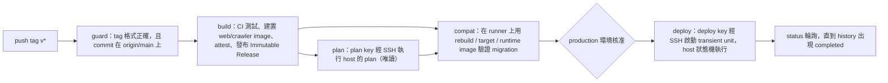

# 部署 Runbook（CD：tag 觸發、核准後部署到單台 EC2）

> Path: `deploy/README.md`
> 規格與理由：`Docs/deployment/deployment.md`、`Docs/architecture/architecture-decisions.md` ADR-006。本文件只寫操作步驟；與程式不一致時以程式為準，並回報文件衝突。
> 標記 **L4** 的操作屬 `AGENTS.md` §2.3：需要使用者當下的明確授權。CD 的 `production` 核准即為 tag 部署的授權；人工程序（resolve-run、reconcile-schema、resume-crawler、install-host、還原 snapshot）每一次都需要使用者明確同意。
> 所有 `<...>` 是佔位符，不要照抄；真實網域、AWS 資源名稱與 key 不寫入 repository。

---

## 1. 架構概觀

### 1.1 流程



- 手動重新部署或回滾：`workflow_dispatch`，只能從 `main` 發起，指定已發布的 `release_tag`，不 build。
- 首次從 systemd 切換到 Docker：dispatch 時加上 `cutover=true`（見 §3）。

### 1.2 信任邊界

| 層 | 內容 | 誰能改 | 何時使用 |
|---|---|---|---|
| Host 程式 | `/opt/book-finder/host/`（symlink 指向 `host-versions/<id>/`），來源為 `deploy/host/`：`deploy-entry`、`book-finder-admin`、`bookfinder_host/` | 只能經 `install-host`（L4） | plan、deploy、status 都會執行 |
| Release metadata | image 內 `/opt/release/migrations.txt`、`RELEASE_API` | 發布流程 | plan 只當資料讀取，以 `docker create` + `docker cp`（不帶 `-L`）取出，先檢查一般檔案、不跟隨 symlink |
| Release 內容 | `compose.prod.yaml`、`run-crawler.sh`、`crawler.cron`、`efbundle`（image 內） | 發布流程 | 只有核准後、digest 一致、`release_api` 在 host 支援範圍內時才會使用 |
| Release SQL | `sql/<id>.sql`（Immutable Release 的 asset） | 發布流程 | 只供審閱與 audit；**執行的是 image 內的 efbundle** |

程式不會執行 release 內的程式來讀 metadata（`docker cp` 只複製檔案）。

### 1.3 state.json 與 history.jsonl

| 檔案 | 路徑（預設） | 角色 |
|---|---|---|
| state | `/var/lib/book-finder/state.json`（`STATE_FILE`） | 目前的 production 狀態：revision、runtime、previous_runtime、schema（applied、rebuild、dirty）、crawler（digest、雜湊、paused）。每次寫入都 atomic（tmp、fsync、rename）並遞增 `revision` |
| history | `HISTORY_FILE`（`history.jsonl`） | append-only。**部署結果的唯一 durable 來源**：每次部署寫 `started` 與 `completed` 兩筆；人工操作寫 `operator-started` 與 `operator-completed` |

`status <run_id>` 的判定（`bookfinder_host/history.py`）：

| 結果 | 條件 |
|---|---|
| `completed:<result>` | history 有該 run 的 completed（即使 unit 狀態矛盾，也以 history 為準） |
| `running` | 沒有 completed，unit 是 active 或 activating |
| `indeterminate` | 沒有 completed、unit 不在執行中，且有 started（或 history 最後一行不完整） |
| `not-started` | 沒有 started（started 寫在任何變更之前，所以可以安全重新 dispatch） |

### 1.4 Chain 分類

比較 state 的 applied（每項為 `id` + `source_hash`）與目標 release 的 manifest：

| 分類 | 條件 | 部署時 |
|---|---|---|
| `in-sync` | 兩者完全相同 | 不跑 migration；可用於首次 cutover |
| `forward` | applied 是目標的嚴格前綴 | 先 pause crawler、建 snapshot、跑 efbundle，再切換 web |
| `schema-ahead` | 目標是 applied 的嚴格前綴（DB 比目標新） | 不跑 migration，web 換成目標版本；**crawler 不變**（S7） |
| `divergent` | 其他情況（含同 id 但 source_hash 不同） | 拒絕，exit 2 |

### 1.5 退出碼對照

同一組代碼用於 `plan`、`deploy`、`status` 與人工指令。`history result` 是寫入 history 的 `result` 欄位。

| 碼 | 名稱 | 常見原因 | history result | 操作者要做什麼 |
|---|---|---|---|---|
| 0 | OK | plan 可以部署；或 deploy 成功（web 與 crawler 都在目標版本） | `success` | 無 |
| 1 | ROLLED_BACK | in-sync 或 schema-ahead 的 web 切換失敗，已回到舊 runtime | `rolled-back` | 看 journal 的健康檢查失敗原因，修正後再 dispatch。不需要 reconcile |
| 2 | BAD_INPUT | 參數或 SSH 指令格式錯誤；release metadata 或內容不合格；`divergent`；`release_api` 超出 host 支援範圍；schema-ahead 的 `crawler_digest` 不是目前的；cutover 條件不符；compose 不支援 `format: raw`；設定檔錯誤；人工指令的確認值不符 | `rejected` | 不要重試同一組參數；依 stderr 的原因修正 |
| 3 | DRIFT | state 不存在（需 bootstrap）；runtime 或 schema 與 state 不符；CAS 失敗（revision 過期）；deploy 或 db-maintenance lock 逾時；目前 runtime 健康檢查失敗（未改動）；snapshot 失敗（未 migrate，crawler 已恢復）；run id 已使用；unit 已存在；crawler 仍 paused；SSH 等待逾時（回報 `running`） | `drift` | 依原因處理。未改動時修正後重新 plan，再 dispatch |
| 4 | FAILED_MIGRATION | efbundle 結束碼非 0，或 DB 的 migration id 與目標不符 | `failed-migration` | schema 保持 dirty、crawler 保持 paused。走 §5.2 與 §5.3 |
| 5 | FAILED_DOWN | forward 之後 web 失敗（I5：不自動回滾）；或回滾本身失敗 | `failed-down` | 人工恢復（L4）。crawler 保持 paused |
| 6 | DIRTY | schema 為 dirty，plan 與 deploy 都拒絕。`run-crawler.sh` 也會以 exit 6 跳過（`skipped=dirty`） | `rejected` | 走 §5.2 `reconcile-schema --mark-clean` |
| 7 | PARTIAL_CRAWLER | web 已是目標版本，但 crawler 更新失敗；crawler 保持（或變成）paused | `partial-crawler` | 查 history 的 `crawler_substeps` 與 journal，再走 §5.3 `resume-crawler` |
| 8 | INDETERMINATE | 有未解決的 indeterminate run 或 operator operation；本次結果無法證明（例如 started 之後發生未預期例外） | `blocked-indeterminate`（被擋下時）或無 completed | **不要重新 dispatch**。走 §5.1 `resolve-run` |

CD 端的判定（`.github/scripts/cd_release.py`）：plan 的退出碼非 0 直接失敗；deploy 的 `completed:success` 才算成功；`indeterminate` 與其他失敗結果都要人工處理；`not-started` 在 120 秒寬限後才判定為「未動，可重新 dispatch」；CD 最多輪詢 150 分鐘。

---

## 2. 一次性設定

### 2.1 EC2 前置條件

| 項目 | 要求 | 來源 |
|---|---|---|
| Docker Engine + Compose plugin | 安裝並設定開機自動啟動（`systemctl enable docker`）。compose 的 `restart: unless-stopped` 依賴此設定 | `compose.prod.yaml`；host 以 `docker compose` 操作 |
| python3 | ≥ 3.12（Ubuntu 24.04 預設即可）。`deploy-entry` 與 `book-finder-admin` 都以 `#!/usr/bin/env python3` 執行 | `deploy/ruff.toml` 的 `target-version = "py312"`；CI 在 3.12 跑 `deploy/tests` |
| AWS CLI v2 | 位於 `/usr/local/bin/aws`（預設 `AWS_CLI`）。以 root 執行時，此檔必須為 root 擁有、group 與 other 不可寫，否則設定載入失敗 | `config.check_root_owned` |
| util-linux `flock` | 已安裝（`run-crawler.sh` 使用 `flock`） | `crawler/deploy/run-crawler.sh` |
| cron | 已安裝並啟動（Ubuntu：`cron`） | `crawler/deploy/README.md` §5 |
| logrotate | 已安裝 | `crawler/deploy/crawler.logrotate` |
| systemd | `systemd-run`、`systemctl` 可用（deploy 以 transient unit 執行） | `commands.py`、`runs.py` |
| 目錄 | 見 §2.5 | 程式不會建立 lock 檔所在的目錄 |

### 2.2 IAM 權限（EC2 instance role）

由程式呼叫的 AWS CLI 指令推導（`bookfinder_host/adapters.py`、`config.py`、`crawler/deploy/run-crawler.sh`）：

| AWS CLI 呼叫 | 所需權限 | 資源 |
|---|---|---|
| `ssm get-parameter --with-decryption`（host 讀取 SSM_DB_CONNECTION、SSM_OPENAI_KEY、SSM_JWT_KEY、DATABASE_URL_PARAMETER；crawler 讀取它自己的 DB URL 參數） | `ssm:GetParameter` | 上述五個參數的 ARN |
| 上一列的 SecureString 解密（若使用客戶管理 KMS key） | `kms:Decrypt` | 該 KMS key |
| `rds create-db-snapshot` | `rds:CreateDBSnapshot` | `<RDS_INSTANCE_ID>` 與其 snapshot |
| `rds wait db-snapshot-available`（內部呼叫 DescribeDBSnapshots） | `rds:DescribeDBSnapshots` | 同上 |

不需要 ECR、S3 或 `rds:DeleteDBSnapshot`。snapshot 的清理由人工以另外的身分執行（§5.7）。Image 來自 GHCR，host 不使用 AWS 憑證拉取。

### 2.3 SSM 參數

| host.conf 鍵 | 用途 | 值的格式 | 限制（程式檢查） |
|---|---|---|---|
| `SSM_DB_CONNECTION` | web 與 efbundle 的 `ConnectionStrings__DefaultConnection` | .NET 連線字串：`Host=<host>;Port=5432;Database=<db>;Username=<user>;Password=<password>` | 非空、單行、無控制字元。程式不記錄值 |
| `SSM_OPENAI_KEY` | web 的 `OPENAIAPI_KEY` | OpenAI API key 原文 | 非空、單行 |
| `SSM_JWT_KEY` | web 的 `Jwt__SigningKey` | 隨機字串，**至少 32 bytes**（web 啟動時驗證，`JwtOptions.MinimumSigningKeyBytes = 32`） | 非空、單行；長度由 web 檢查 |
| `DATABASE_URL_PARAMETER` | host 的 psql 讀取 `__EFMigrationsHistory`（唯讀查詢） | `postgresql://<user>:<URL 編碼的密碼>@<RDS 端點>:5432/<db>?sslmode=require` | 必須以 `postgres://` 或 `postgresql://` 開頭，且不含空白 |
| 爬蟲的 DB URL 參數（`crawler.conf` 的 `DATABASE_URL_PARAMETER`） | 爬蟲容器的 `DATABASE_URL` | 同上（psycopg 格式，不是 .NET 格式） | 見 `crawler/deploy/README.md` §3 |

- 類型建議 `SecureString`（程式以 `--with-decryption` 讀取）。
- 建議 host 與爬蟲使用各自的參數，讓爬蟲只拿到自己的 DB URL（程式不強制）。
- 不要把這些值寫進 repository、compose 檔、image、log 或 shell history。
- 參數名稱（路徑）是部署者自行選擇，文件中的 `/book-finder/prod/...` 只是範例（`Docs/deployment/deployment.md` §5）。

### 2.4 `/etc/book-finder/host.conf`

檔案是「資料」，不是 shell：每行 `KEY=VALUE`，只允許上列的鍵，值只能包含 `A-Za-z0-9@/:._=+,-`，不能有空白、`$`、引號或 `#`（行首 `#` 為註解）。重複或未知的鍵都會拒絕。檔案大小上限 64 KiB。

**必填**（缺少即拒絕）：

| 鍵 | 說明 | 範例格式 |
|---|---|---|
| `STATE_FILE` | state.json 絕對路徑。須與 `crawler` 的 `BOOKFINDER_STATE_FILE` 相同（預設 `/var/lib/book-finder/state.json`） | `/var/lib/book-finder/state.json` |
| `HISTORY_FILE` | history.jsonl 絕對路徑 | `/var/lib/book-finder/history.jsonl` |
| `DEPLOY_LOCK_FILE` | deploy 的 exclusive lock 檔（所在目錄必須已存在） | `/var/lib/book-finder/deploy.lock` |
| `WEB_IMAGE_REPOSITORY` | web image 的 repository，**不含** tag 或 digest | `ghcr.io/arthur801/book-finder-web` |
| `PSQL_IMAGE` | 含 `psql` 與 `/bin/sh` 的 image，**必須以 digest 指定** | `<repository>@sha256:<digest>` |
| `DATABASE_URL_PARAMETER` | §2.3 的 psql 用 SSM 參數名稱 | `<SSM 參數名稱>` |
| `AWS_REGION` | SSM 與 RDS 所在 region | `<AWS_REGION>` |
| `SYSTEMD_UNIT` | 目前（舊）systemd 服務的 unit 名稱。cutover 時會 stop 它 | `<現有 unit 名稱>.service` |
| `PUBLIC_URL` | 公開網址，健康檢查經 nginx 測試。必須是 `https://…`；或 `http://127.0.0.1…`（僅本機整合測試） | `https://<your-domain>/` |
| `RDS_INSTANCE_ID` | snapshot 的 DB instance 識別碼 | `<RDS_INSTANCE_ID>` |
| `SSM_DB_CONNECTION` | §2.3 | `<SSM 參數名稱>` |
| `SSM_OPENAI_KEY` | §2.3 | `<SSM 參數名稱>` |
| `SSM_JWT_KEY` | §2.3 | `<SSM 參數名稱>` |
| `CRAWLER_IMAGE_REPOSITORY` | crawler image 的 repository，不含 tag 或 digest | `ghcr.io/arthur801/book-finder-crawler` |

**選填**（括號內為程式預設值）：

| 鍵 | 預設 | 說明 |
|---|---|---|
| `COMPOSE_PROJECT` | `book-finder` | compose project 名稱；runtime 以此 label 找 web container |
| `LOCK_TIMEOUT_S` | `10` | 取得 deploy lock 的最長等待（秒，必須為有限正數） |
| `FOLLOW_TIMEOUT_S` | `6000` | SSH 端跟隨 status 的上限（秒）。超過後回傳 `running`（exit 3），CD 繼續以 run id 輪詢 |
| `CRAWLER_CONF` | `/etc/book-finder/crawler.conf` | 爬蟲的 shell 設定檔；CD 會改寫其中的 `CRAWLER_IMAGE=` 行 |
| `DB_MAINTENANCE_LOCK` | `/var/lib/book-finder/db-maintenance.lock` | 與爬蟲的 lock 必須是同一個檔（爬蟲的預設值相同） |
| `RELEASES_DIR` | `/opt/book-finder/releases` | 已 materialize 的 release 目錄，以 web digest 的 hex 命名 |
| `RUN_DIR` | `/run/book-finder` | 暫存 env file（`web-<run_id>.env`，權限 600，用後刪除） |
| `CRAWLER_RUNNER` | `/opt/book-finder/run-crawler.sh` | 爬蟲執行腳本的安裝位置 |
| `CRON_FILE` | `/etc/cron.d/book-finder-crawler` | 爬蟲排程的安裝位置 |
| `AWS_CLI` | `/usr/local/bin/aws` | AWS CLI 絕對路徑 |

範例（所有值都要換成實際值；此處不提供可直接使用的數值）：

```text
STATE_FILE=/var/lib/book-finder/state.json
HISTORY_FILE=/var/lib/book-finder/history.jsonl
DEPLOY_LOCK_FILE=/var/lib/book-finder/deploy.lock
WEB_IMAGE_REPOSITORY=ghcr.io/arthur801/book-finder-web
PSQL_IMAGE=<repository>@sha256:<digest>
DATABASE_URL_PARAMETER=<SSM 參數名稱>
AWS_REGION=<AWS_REGION>
SYSTEMD_UNIT=<現有 unit>.service
PUBLIC_URL=https://<your-domain>/
RDS_INSTANCE_ID=<RDS_INSTANCE_ID>
SSM_DB_CONNECTION=<SSM 參數名稱>
SSM_OPENAI_KEY=<SSM 參數名稱>
SSM_JWT_KEY=<SSM 參數名稱>
CRAWLER_IMAGE_REPOSITORY=ghcr.io/arthur801/book-finder-crawler
```

建議權限 `root:root 0600`（程式不檢查，屬建議）。`PSQL_IMAGE` 使用 `--pull=never` 執行，程式不會替它拉取：安裝後先手動 `docker pull <PSQL_IMAGE>`。

### 2.5 目錄

程式不會建立 lock 檔所在的目錄，請先建立（權限為建議值，程式不檢查）：

```bash
sudo install -d -m 0755 /opt/book-finder
sudo install -d -m 0750 /var/lib/book-finder /var/log/book-finder
sudo install -d -m 0750 /etc/book-finder
```

`/opt/book-finder/releases`、`/run/book-finder` 由程式建立（`makedirs`）。`/var/lib/book-finder/crawler` 由 `run-crawler.sh` 建立。

### 2.6 `deployer` 使用者、SSH key、sudoers、Security Group

**使用者與 key**

- 建立 `deployer` 使用者（`EC2_USER` 必須是這個名稱）。密碼登入關閉。
- 產生兩組 key（在操作者的電腦上，不要放進 repository）：`plan` 與 `deploy`。公開金鑰放入 `~deployer/.ssh/authorized_keys`，各加上 forced command：

```text
restrict,command="sudo /opt/book-finder/host/deploy-entry --plan-only" ssh-ed25519 AAAA…（plan 公鑰） cd-plan
restrict,command="sudo /opt/book-finder/host/deploy-entry" ssh-ed25519 AAAA…（deploy 公鑰） cd-deploy
```

- `deploy-entry` 讀取 `SSH_ORIGINAL_COMMAND`。`--plan-only` 時只接受 `plan` 與 `status`，拒絕 `deploy`（`commands.main`）。
- 私鑰只放進 GitHub environment secret（§2.8），不放在任何其他地方。

**sudoers**

```text
# /etc/sudoers.d/book-finder-deploy（以 visudo -cf 檢查後放置）
deployer ALL=(root) NOPASSWD: /opt/book-finder/host/deploy-entry
```

> **待確認（在 EC2 上驗證，上線前必須通過）**：預設的 `sudo` 會清除 `SSH_ORIGINAL_COMMAND`（env_reset），deploy-entry 會看到空指令而拒絕所有呼叫。程式內的測試直接設定環境變數，**沒有經過 sudo**，因此這個問題不會被測試發現。
> 在 EC2 上確認：用 plan key 執行 `status <某 run id>`，若回傳 `rejected`（空指令），就要修正 sudoers。候選做法（待驗證，不是程式保證）：
> 1. `Defaults!/opt/book-finder/host/deploy-entry env_keep += "SSH_ORIGINAL_COMMAND"`；或
> 2. 以 `SETENV:` 標記允許 `sudo --preserve-env=SSH_ORIGINAL_COMMAND`，並把 forced command 改為 `sudo --preserve-env=SSH_ORIGINAL_COMMAND /opt/book-finder/host/deploy-entry`。
> 修正後以 `sudo -l -U deployer` 確認權限沒有擴大。

**Security Group**

- 只開放 TCP 22（SSH）。HTTP、HTTPS 依 nginx 設定開放（nginx 不在本 repository 中，**待確認**）。
- 風險與緩解：
  - SSH 來源：GitHub-hosted runner 的 IP 不固定，無法只用 IP 限制。主要防線是 key-only 登入、forced command 與 `restrict`。
  - 若要限制來源 IP，需自行評估 GitHub 的 Actions IP 範圍（**待確認**）。操作者自己的 IP 可保留獨立規則。
  - 可選：安裝 fail2ban（建議，非程式要求）。
  - sshd 設定：停用密碼登入（`PasswordAuthentication no`）；操作者與 `deployer` 的 key 分開。

### 2.7 首次安裝 host 程式（`install-host`，L4）

前提：`/etc/book-finder/host.conf` 已存在，§2.5 的目錄已建立，操作者已 `git checkout` 目標 tag 到一個目錄（例如 `<checkout>`）。

```bash
sudo python3 <checkout>/deploy/host/book-finder-admin install-host \
  --source <checkout>/deploy/host --reason "首次安裝 host 程式（<tag>）"
```

- `--source` 必須是絕對路徑，且目錄內要有 `bookfinder_host/`、`deploy-entry`、`book-finder-admin`（不能是 symlink）。
- 命令會印出 `host_api_range: old=… new=…`，並要求輸入新的範圍（例如 `1-1`）確認；`--yes-i-verified <值>` 可供腳本使用。
- 安裝後的位置：`/opt/book-finder/host/` 是 symlink，指向 `/opt/book-finder/host-versions/<16 位 hex>/`。之後以 `/opt/book-finder/host/deploy-entry` 和 `/opt/book-finder/host/book-finder-admin` 呼叫。
- 版本目錄先完整寫入並 fsync，再以 rename 原子替換 symlink。任何時間點 crash，`/opt/book-finder/host` 都指向完整的一套程式（S9）。
- 舊版是普通目錄時，程式以 `renameat2(RENAME_EXCHANGE)` 替換；若該系統不支援，會拒絕並且不改動內容。
- 殘留的 `host.new-*` 目錄（中斷的舊版遷移）會讓下一次安裝拒絕，並指示以 rename 手動移入 `host-versions/`。

### 2.8 GitHub 設定（L4 設定，由使用者在 GitHub 上進行）

**Environments**（Settings → Environments）

| Environment | Secrets | Variables | 其他 |
|---|---|---|---|
| `production-plan` | `PLAN_SSH_KEY`（plan 私鑰）、`SSH_KNOWN_HOSTS` | `EC2_USER`（= `deployer`）、`EC2_HOST`（EC2 位址） | 只跑唯讀的 plan。是否設 reviewer 由使用者決定（**待決定**；程式不依賴） |
| `production` | `DEPLOY_SSH_KEY`（deploy 私鑰）、`SSH_KNOWN_HOSTS` | `EC2_USER`、`EC2_HOST` | **Required reviewers 必設**：這是核准關卡。`deploy` job 在核准前不會連到 host |

- `SSH_KNOWN_HOSTS` 的內容要先在可信的環境核對 EC2 的 host key 指紋（例如與 EC2 上 `/etc/ssh/ssh_host_ed25519_key.pub` 的指紋比對），再存入。
- 兩個 environment 的 **Deployment branches and tags** 都設為 `main` 分支與 `v*` tag（`cd.yml` 的 guard 也會檢查 tag 在 main 上）。

**Immutable Releases**（Settings → Releases → Enable release immutability）

- 必須在**第一個 release 之前**開啟。這個設定只對開啟後發布的 release 生效。
- 開啟後：publish 之後 asset 不能修改或刪除，tag 鎖定在原 commit，也不能刪除。（以上行為的來源是計畫檔 `cheerful-finding-shell.md` §7 的查證，不是程式碼。）
- 尚未確認此功能是否已 GA（**待確認**）。

**`v*` tag ruleset**（建議，程式不強制）

- 建議限制只有操作者能建立、更新或刪除 `v*` tag。

**GHCR package visibility**

- `ghcr.io/arthur801/book-finder-web` 與 `…-crawler` 的可見性會影響 host 的 `docker pull`。若 package 是 private，host 需要以唯讀權限的 token 執行 `docker login ghcr.io`（程式不會登入，**待確認**：採 public 或 private）。

### 2.9 第一個 release tag

- Tag 名稱在 Immutable Release 下**不能重用**，即使 release 已刪除。發布後發現問題，只能發新的 patch tag（例如 `v1.2.4`）。
- 建議在 Immutable Releases 開啟後才推送第一個 tag；推送前確認目標 commit 已在 `main` 上。
- `validate-tag` 的格式：`v<major>.<minor>.<patch>` 加上選用的 `-<prerelease>`（`cd_release.py` 的 `TAG_RE`）。

---

## 3. 首次切換 systemd → Docker（L4，需當下授權）

前提：web 目前以 systemd 執行（`Docs/deployment/deployment.md` §3.1），RDS 的 migration 歷史與某個已發布 release 的 manifest **完全相同**（in-sync）。

### 3.1 前置條件

1. §2 全部完成，`install-host` 成功。
2. 爬蟲腳本與排程已安裝：`run-crawler.sh` 到 `CRAWLER_RUNNER`、`crawler.cron` 到 `CRON_FILE`（bootstrap 會讀取並計算兩者的雜湊，缺任一個就拒絕）。`crawler.conf` 的 `CRAWLER_IMAGE=` 應設為 `ghcr.io/arthur801/book-finder-crawler@sha256:<digest>`，並已 `docker pull`（爬蟲以 `--pull=never` 執行）。bootstrap 本身不檢查 `CRAWLER_IMAGE=`；之後的 `resume-crawler` 會檢查。
3. 目標 release 的 tag 已發布（`bootstrap-state --release` 的值必須是這個 tag，它的 web image 會被讀取 metadata）。
4. `docker pull <PSQL_IMAGE>` 已完成。

### 3.2 `bootstrap-state`（N6，L4）

```bash
sudo /opt/book-finder/host/book-finder-admin bootstrap-state \
  --release <tag> --web-digest sha256:<web digest> --crawler-digest sha256:<crawler digest> \
  --systemd-unit <現有 unit>.service --reason "首次切換前建立 state（<tag>）"
```

程式檢查的前置條件（任一不成立就拒絕，不寫入任何東西）：

| 條件 | 程式檢查 |
|---|---|
| state 不存在 | `state already exists; bootstrap-state runs only once per host` |
| systemd unit 是 active | `systemd unit … is not active` |
| DB 的 migration id **完全等於**目標 manifest 的 id | `database migrations … are not exactly the release manifest` |
| release_api 在 host 支援範圍內 | `outside the host range` |
| 兩個爬蟲檔案可讀 | `crawler files cannot be read` |

- 「schema 不是 dirty」沒有獨立檢查：state 不存在時，dirty 不可能存在。
- 印出的信任假設（stderr）：**假設現有 DB 是由這些 migration 原始碼建立的**。操作者應在執行前確認，並在 reason 中寫明依據。
- 確認方式：輸入 web digest（或 `--yes-i-verified <web digest>`）。
- 成功後寫入 `revision=1`、`runtime={kind:systemd, unit, version:"pre-cd"}`、`previous_runtime=null`、schema（applied 取自 manifest，rebuild 指向此 release）、crawler（digest 與雜湊）。
- CD 從不建立 state。沒有 state 時 CD 的 plan 會回傳 exit 3（需要 bootstrap）。

### 3.3 Dispatch（cutover）

- GitHub Actions → CD → Run workflow，分支選 `main`，`release_tag` 填 `<tag>`，`cutover` 勾選。
- `plan-outputs` 會要求：runtime 必須是 systemd、chain 必須是 in-sync；否則拒絕。
- 核准 `production`。

### 3.4 Host 會做什麼

依 `machine.py` 的順序（每個動作都先寫 state 再進行下一步）：

1. 取得 deploy lock、CAS 檢查 revision、runtime、schema；schema dirty 則 exit 6。
2. 用 `docker compose` 的 probe 確認 raw env_file 支援，失敗 exit 2。
3. 健康檢查：`http://127.0.0.1:5000/`（`X-Forwarded-Proto: https`）三次，每次 5 秒。
4. 把 target release 的檔案複製到 `RELEASES_DIR/<web digest hex>/`（若已存在，compose 檔的雜湊必須相同）。
5. 從 SSM 讀取三個 secret，寫入 `RUN_DIR/web-<run_id>.env`（600）。
6. **cutover**：先 `systemctl stop <SYSTEMD_UNIT>`（它占用 5000 埠），再 `docker compose -p book-finder up -d --remove-orphans`。
7. 健康檢查：本機 `127.0.0.1:5000` 與 `PUBLIC_URL`，每個 90 秒內都要回 200（不跟隨 redirect）。
8. 成功：更新 crawler（pull、smoke、安裝 `run-crawler.sh`、`crawler.cron`、改寫 `crawler.conf`），然後 `runtime=docker`、`previous_runtime=systemd`，寫 completed。
9. 失敗（web）：回滾。systemd 舊 runtime 的回滾是 `compose down`，再 `systemctl start <SYSTEMD_UNIT>`，並檢查健康。

### 3.5 驗證

- `curl -sI https://<your-domain>/` 回 200（host 會自動檢查，人工再確認一次）。
- 瀏覽器確認：首頁、登入、暢銷榜頁面正常。
- `sudo cat /var/lib/book-finder/state.json`：`runtime.kind` 為 `docker`，`previous_runtime.kind` 為 `systemd`。
- `sudo tail /var/lib/book-finder/history.jsonl`：最後一筆 completed 的 `result` 為 `success`。

### 3.6 切換失敗與回滾

- **切換後健康檢查失敗、回滾成功**：結果 `rolled-back`（exit 1）。systemd 已恢復，state 沒有改變（仍是 systemd）。可以修正後重新 dispatch。
- **回滾也失敗**：結果 `failed-down`（exit 5）。此時 web 可能沒有在運行，需要人工：
  - 檢查 `docker ps -a --filter label=com.docker.compose.project=book-finder`。
  - 嘗試 `systemctl start <SYSTEMD_UNIT>`（L4）。
  - 不要修改 state.json；把 history 中的 run id、journal 與狀態交給後續的人工判斷。
- **cutover 成功後不要手動切回 systemd**：state 已記錄為 docker，手動切換會造成 drift（S5）。要回到舊版，應使用 §4.2 的 dispatch 部署較舊的 release。

### 3.7 停用舊的 systemd unit

cutover 成功並驗證後：

```bash
sudo systemctl disable <SYSTEMD_UNIT>
```

理由：compose 以 `restart: unless-stopped` 運行，並綁定 `127.0.0.1:5000`。若 systemd unit 在開機時仍是 enabled，兩者會搶同一個埠。程式不會自動停用它。unit 檔本身會保留。是否移除由操作者決定，程式不處理。

---

## 4. 日常部署

### 4.1 推送 tag → 核准 → 觀察

1. 在 `main` 上的 commit 打 tag：`git tag v1.2.3 <commit> && git push origin v1.2.3`。
2. CD 執行 `guard`、`test`（即 `ci.yml` 的 `workflow_call`）、`build`（建置、attest、發布 Immutable Release）。
3. `plan`：SSH 呼叫 host 的 `plan`，job summary 顯示 host 的 JSON 與 decision（chain、pending、cutover、crawler）。
4. 人工檢查 summary：
   - `chain` 與 `pending`（待套用的 migration id）是否符合預期；
   - `pending` 的 SQL 內容（summary 來自 target release 的 asset，不是重新產生，N8）；
   - `compat` 的結果（§6.2）；
   - 若 `classification` 是 `forward`，注意 snapshot 會被建立，且 host 會等待它變成 available。
5. 在 `production` 環境核准，`deploy` job 才會連到 host。
6. 觀察 deploy job 的輸出，直到 `status` 回報結果。成功後檢查 §3.5 的項目（首頁、登入、暢銷榜）。

結果判讀：

| CD 結果 | 意義 | 下一步 |
|---|---|---|
| `completed:success` | 成功 | 驗證 |
| `completed:rejected` / `drift` | 未改動 | 依 §1.5 修正後重新 dispatch |
| `completed:rolled-back` | web 已回滾 | 查 journal，修正後重新 dispatch |
| `completed:failed-migration` / `failed-down` / `partial-crawler` | 需人工 | §5 |
| `indeterminate` | 結果無法證明 | **不要重新 dispatch**，走 §5.1 |
| `not-started` | 未改動 | 可以重新 dispatch（會得到新的 run id） |

### 4.2 重新部署或回滾（dispatch）

- 在 Actions 的 CD 工作流程手動執行，分支 `main`，`release_tag` 填已發布的 tag。
- 只接受已發布（非 draft）的 release。Dispatch 不 build，直接使用該 release 的 `release.json` 與 image digest。
- 回滾到較舊的版本：目標若比 DB 舊，chain 會是 `schema-ahead`。web 換成舊版，migration 不執行，**crawler 維持目前的 digest**（S7，`crawler_digest` 必須等於 state 中的值，否則 exit 2）。
- 若舊版的 `release_api` 超出 host 的支援範圍，會被拒絕（exit 2）。

### 4.3 schema-ahead 的意義（S6、S7）

- 資料庫的 migration 比目前部署的 web 新。舊版 web 在新的 schema 上執行，必須通過 forward smoke（S6，沒有 override）。
- 舊版 crawler 不會更新（S7）。理由：crawler 的 smoke 不連 DB，無法證明舊版 crawler 能在較新的 schema 上運作。
- compat 的 `runtime` smoke 對所有分類都只供參考，不會阻擋部署。

---

## 5. 人工程序（每一項都是 L4）

所有人工指令都需要：
- 在 EC2 上以操作者自己的 SSH 登入（CD 的 key 做不到）；
- 以 `sudo /opt/book-finder/host/book-finder-admin <指令> … --reason "…"` 執行（`--reason` 必填，單行，最多 400 字元）；
- 輸入程式顯示的確認值，或以 `--yes-i-verified <值>` 傳入。

人工指令採用 operator 協定（M3c）：先寫 `operator-started` 並 fsync → 才改變任何東西 → 寫 `operator-completed`。若只有 started 沒有 completed，該操作視為 indeterminate，之後所有部署與人工指令（`resolve-run` 除外）都會以 exit 8 拒絕，直到 `resolve-run` 處理它（S8、S10）。

### 5.1 `resolve-run`：處理 indeterminate

適用：`status` 回報 `indeterminate`、plan 或 deploy 以 exit 8 拒絕、或某個人工操作的 started 沒有 completed。

檢查清單（全部完成後才執行）：

1. **Journal**：`sudo journalctl -u book-finder-deploy-<run_id> --no-pager`（`run_id` 是 `<github run id>-<attempt>`）。unit 的紀錄可能已被 `--collect` 回收，此時 journal 也可能已輪替。
2. **State**：`sudo cat /var/lib/book-finder/state.json`，記下 revision、runtime、schema.dirty、crawler.paused。
3. **History**：`sudo grep '<run_id>' /var/lib/book-finder/history.jsonl`，確認是否有 started、是否有 completed。最後一行不完整時，程式會回報 `history: final line is incomplete`。
4. **DB**：以操作者的權限（非 CD）查詢 `__EFMigrationsHistory`，與 state 的 applied 比對。
5. **Runtime**：`docker ps -a --filter label=com.docker.compose.project=book-finder`，確認 web 是否在運行、映像是哪一個 digest。
6. 決定結果。可用值（程式的 `RESOLVE_EXIT`）：`success`(0)、`rolled-back`(1)、`failed-migration`(4)、`failed-down`(5)、`partial-crawler`(7)、`drift`(3)。

```bash
sudo /opt/book-finder/host/book-finder-admin resolve-run <run_id> --result <結果> \
  --reason "依 journal、state、DB 與 runtime 核對後判定（說明依據）"
```

- 程式會拒絕：run 仍在執行中（unit active）、run 已有 completed、run 從未 started。
- 若 history 最後一行損壞但完整，會拒絕並要求人工檢查檔案。
- 若最後一行不完整（沒有換行），程式會把碎片保存到 `<HISTORY_FILE>.tail-<時間>-<run_id>`（權限 600），記下 sha256，再重寫 history；修復紀錄寫在 operator-completed 的 `tail_repair` 欄位。
- 解除後程式會提醒 dirty 與 paused 仍需要 §5.2 與 §5.3 處理。

處理 operator operation（`op-<yyyymmddHHMMSS>-<4 hex>`）：

```bash
sudo /opt/book-finder/host/book-finder-admin resolve-run <op_id> --result success|failed --reason "…"
```

`failed` 只能在確認「該操作完全沒有改變任何東西」時使用，否則會把未知結果記成失敗。

### 5.2 `reconcile-schema --mark-clean`：解除 dirty（N2）

適用：schema dirty（exit 4 或 6）。**程式不會修改資料庫**，只改寫 state 與 history。

人工驗證清單（全部確認後才執行）：

1. 從 history 找到失敗的 run、其 completed 的 `exit_code` 與 `state_summary`。
2. 以 `psql`（操作者的權限）查詢 `SELECT "MigrationId" FROM "__EFMigrationsHistory" ORDER BY "MigrationId";`，記下已套用的 id。
3. 對照失敗的 migration：`<id>.sql`（release 的 asset）與 `Infrastructure/Persistence/Migrations/<id>.cs`。確認 DDL 與資料變更是否完整、是否有手動補救。每個 migration 在自己的 transaction 中執行（計畫檔 §7 第 4 項的實測），因此失敗時 DB 停在 migration 的邊界。本專案的 CI 禁止 `suppressTransaction` 與 `CONCURRENTLY`（`check_migrations.py`），這個前提才成立。
4. 確認資料庫的 schema 與預期相符（例如相關的 table、column、index）。
5. 確認 RDS 的 pre-migration snapshot 仍存在（id 記在 completed 紀錄的 `snapshot_id`）。

執行：

```bash
sudo /opt/book-finder/host/book-finder-admin reconcile-schema --mark-clean \
  --rebuild-release <tag> --rebuild-web-digest sha256:<digest> \
  --expect-schema-digest sha256:<digest> --reason "…（依據：上列驗證）"
```

- `--rebuild-release` 與 `--rebuild-web-digest` 必須是能涵蓋 DB 已套用 id 的 release（通常是 plan 輸出中 `schema.rebuild` 的值，或失敗的目標 release）。
- 程式會列出 DB 的 migration id 與該前綴的 schema digest。`--expect-schema-digest` 必須與它完全相同，且要輸入同一個值確認。
- 若 DB 的 id 不是 release manifest 的前綴，或 state 已記錄的 id 與 manifest 不符（divergent），程式拒絕。
- 成功後 `schema.dirty=false`，`schema.applied` 與 `schema.rebuild` 更新。crawler 仍是 paused，需走 §5.3。

### 5.3 `resume-crawler`：恢復爬蟲（N3、S11）

適用：`crawler.paused` 不是 null（forward 失敗或 partial-crawler）。

前提（程式檢查）：schema 不是 dirty；`crawler.conf` 的 `CRAWLER_IMAGE=` 等於 `<CRAWLER_IMAGE_REPOSITORY>@<digest>`；已安裝的 `run-crawler.sh` 與 `crawler.cron` 雜湊與 state 相同。

人工檢查：**先確認 web 健康**（`PUBLIC_URL` 回 200、`docker ps` 顯示 web 運行）。程式不檢查 web，只檢查爬蟲的設定與檔案。

一般情況（爬蟲沒有改動，只是被 pause）：

```bash
sudo /opt/book-finder/host/book-finder-admin resume-crawler --crawler-digest sha256:<state 中的 digest> \
  --reason "web 健康檢查通過；爬蟲檔案與 state 一致（依據）"
```

部分更新（partial-crawler：`crawler_substeps` 顯示 image、smoke、run_crawler、crawler_cron、crawler_conf 的部分成功）：

1. 確認已安裝的 `run-crawler.sh` 與 `crawler.cron` 來自某個已發布 release（取該 release 的 checkout 或 image 內 `/opt/release/` 的檔案比對）。
2. 確認 `crawler.conf` 的 `CRAWLER_IMAGE=` 是要採用的 crawler digest。
3. 執行：

```bash
sudo /opt/book-finder/host/book-finder-admin resume-crawler --crawler-digest sha256:<新 digest> \
  --adopt-release <tag> --adopt-web-digest sha256:<web digest> --reason "…"
```

`--adopt-*` 會讀取 `RELEASES_DIR/<web digest hex>/` 的 `run-crawler.sh` 與 `crawler.cron`（須通過 release 內容檢查），並要求已安裝的檔案與它們完全相同，然後把 provenance 記為該 release。`--adopt-release` 的 tag 無法從目錄本身驗證，程式只記錄操作者的宣告。

### 5.4 Drift

- 程式會把 runtime 或 schema 與 state 的差異列在 plan 的 `drift` 欄位，CD 會拒絕部署（exit 3）。
- **程式沒有 drift 的修復指令**。修復方式（例如手動 `docker compose up` 回到 state 記錄的 release）需要人工判斷，屬 L4，且**待確認**。
- 處理完成後，應重新 plan，確認 `drift` 為空，才能 dispatch。不要直接編輯 state.json。

### 5.5 Host 升級（`install-host`，N4、S9）

流程與 §2.7 相同，但 `--source` 指向新版 tag 的 `deploy/host`。

- 程式會讀取 state 的 `runtime` 與 `previous_runtime`。若其中 docker 的 `release_api` 不在新版的 `HOST_API_RANGE` 內，拒絕安裝（exit 2）。
- 新版程式宣告的範圍 `[min, max]`，必須同時支援 current 與 previous。只有 host 有不相容改動時才提高 `min`，且提高前要確認 current 與 previous 都已經升級。
- 安裝的版本保留 current 與 previous 的目錄，其他 `host-versions/<id>` 會被清除。
- 中斷的安裝可以重跑（staging 目錄會被清除）。

### 5.6 還原 RDS snapshot（L4，一律人工）

程式不會自動還原。資料會回到 snapshot 的時間點，**snapshot 之後的寫入會遺失**。

1. 找出 history 中該 run 的 `snapshot_id`（格式 `book-finder-pre-<tag>-<時間>`）。
2. 以操作者的 AWS 身分，把 snapshot 還原為**新的** DB instance（名稱由操作者決定，例如 `<NEW_INSTANCE_ID>`；不要覆蓋 `<RDS_INSTANCE_ID>`）。
3. 驗證新 instance：migration 歷史、資料、pgvector 擴充。
4. 更新 SSM 參數（`SSM_DB_CONNECTION` 與爬蟲的 DB URL）指向新端點。
5. 在 EC2 上確認 web 與爬蟲連到新 instance。
6. 程式沒有「還原後更新 state」的指令。還原後 DB 與 state 的對應要如何處理，需由操作者另行決定（**待確認**）。

### 5.7 Snapshot 保留

- 每次 forward migration 都會建立一個 snapshot（`book-finder-pre-…`）。程式不刪除 snapshot。
- 規劃：保留最近 3 個。超出的部分由操作者手動刪除（需要 `rds:DeleteDBSnapshot`，不在 host 的 IAM 中）。
- 刪除前確認沒有進行中的 migration，且沒有 state 或 history 還需要它。

---

## 6. 查看 journal 與 unit

| 要看什麼 | 指令 |
|---|---|
| 某次部署的完整 log | `sudo journalctl -u book-finder-deploy-<run_id> --no-pager` |
| 目前的 deploy unit | `systemctl list-units 'book-finder-deploy-*'` |
| history 的最後幾筆 | `sudo tail -n 5 /var/lib/book-finder/history.jsonl` |
| state | `sudo cat /var/lib/book-finder/state.json` |
| web container | `docker ps --filter label=com.docker.compose.project=book-finder` |
| 爬蟲 log | `/var/log/book-finder/crawler-*.log`（見 `crawler/deploy/README.md` §6） |

Journal 是**輔助資訊**，不是結果的來源。結果以 history 為準（N7）。

### 6.1 CI 與 compat 的 log

- CD 的 `compat` job 上傳 `compat-report` artifact（JSON），summary 有逐項結果。
- PR 的 `Docker image` job 在 `Migrations/`、`deploy/`、`Dockerfile` 等路徑有變動時執行 compat。

---

## 7. 已知限制與待確認（在 EC2 上驗證）

| # | 項目 | 狀態 | 驗證方式 |
|---|---|---|---|
| 1 | **sudo 是否保留 `SSH_ORIGINAL_COMMAND`**（§2.6） | **待確認，上線前必要** | 以 plan key 執行 `status`，確認不是 `rejected` |
| 2 | `systemd-run` 以 root 執行 transient unit，`INVOCATION_ID` 是否由 systemd 設定 | 待確認。本機只以 `--user` manager 驗證（`cheerful-finding-shell.md` §7 第 5 項） | 第一次正式部署前，用 system manager 的一次性 unit 驗證 |
| 3 | SSH 斷線後 unit 是否仍會完成 | 本機以 `--user` 驗證；system manager 語意相同，**待確認** | 同上 |
| 4 | psql 容器能否連到 RDS（docker 預設 bridge 網路到 RDS 端點） | 待確認 | 操作者在 EC2 上以 `docker run --rm --pull=never -e DATABASE_URL <PSQL_IMAGE> …` 做唯讀查詢。URL 從 shell 環境注入，不寫進命令列 |
| 5 | Compose 的 `env_file: format: raw` 在 EC2 的 Docker Compose 版本是否支援 | 程式內有 probe，不支援會 exit 2。**版本號待記錄** | `docker compose version`，記錄於此處 |
| 6 | `docker cp`（不帶 `-L`）遇到 symlink 只複製連結本身 | 本機實測成立（`cheerful-finding-shell.md` §7 第 3 項）。EC2 上的 Docker 版本未驗證 | 程式的 release 檢查會拒絕 symlink，不依賴此行為的正確性；**待確認** |
| 7 | host nginx 設定（不在本 repository）：是否把 `PUBLIC_URL` 的請求轉發到 `127.0.0.1:5000` 並加上 `X-Forwarded-Proto` | 待確認 | `curl -sI <PUBLIC_URL>` 回 200，且 web 能辨識為 HTTPS |
| 8 | Web 的 `ForwardedHeaders__KnownNetworks__0`（`172.31.250.0/24`）是否涵蓋 host nginx 經 docker-proxy 的來源位址 | 待確認（compose 註解的推論） | 健康檢查與登入 cookie 的 `Secure` 行為 |
| 9 | 爬蟲的 `docker run --pull=never`：image 是否已由 host 拉取 | 程式在 `_update_crawler` 會 pull；bootstrap 前需手動 pull | `docker image inspect <CRAWLER_IMAGE>` |
| 10 | GHCR package 是否 public；若 private，host 的登入方式 | 待確認（§2.8） | `docker pull` 不需登入即可成功 |
| 11 | Immutable Releases 是否已 GA | 待確認（查證結果：尚未確認） | GitHub 文件 |
| 12 | 客戶管理 KMS key 是否使用（影響 `kms:Decrypt`） | 待確認 | SSM 參數的 key 設定 |
| 13 | `S1`、`S2` 不變式 | 在 `cheerful-finding-shell.md` 中沒有定義（只有 S3～S11）。本文件沒有引用它們 | 需使用者確認是否遺漏 |
| 14 | `deployment.md` 的 `GOOGLE_BOOKS` 相關 SSM 參數：程式碼中未找到讀取該設定的位置 | 待確認 | `grep -rn GoogleBooks` 只找到來源類型，沒有 API key 設定 |
| 15 | `production-plan` 是否設 reviewer | 待決定（程式不依賴） | — |
| 16 | 爬蟲與 host 的 `DB_MAINTENANCE_LOCK` 預設值相同（程式以預設值一致） | 若 host.conf 改了 `DB_MAINTENANCE_LOCK`，爬蟲的環境變數也要改，否則兩者不會互斥 | 比對兩處的設定 |
