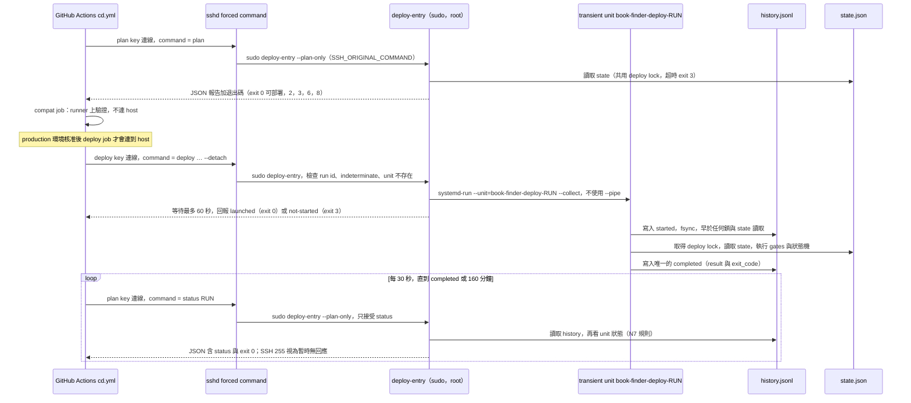
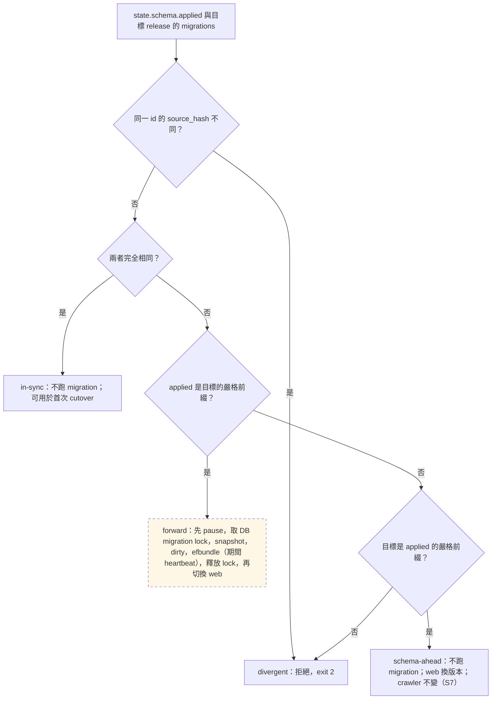
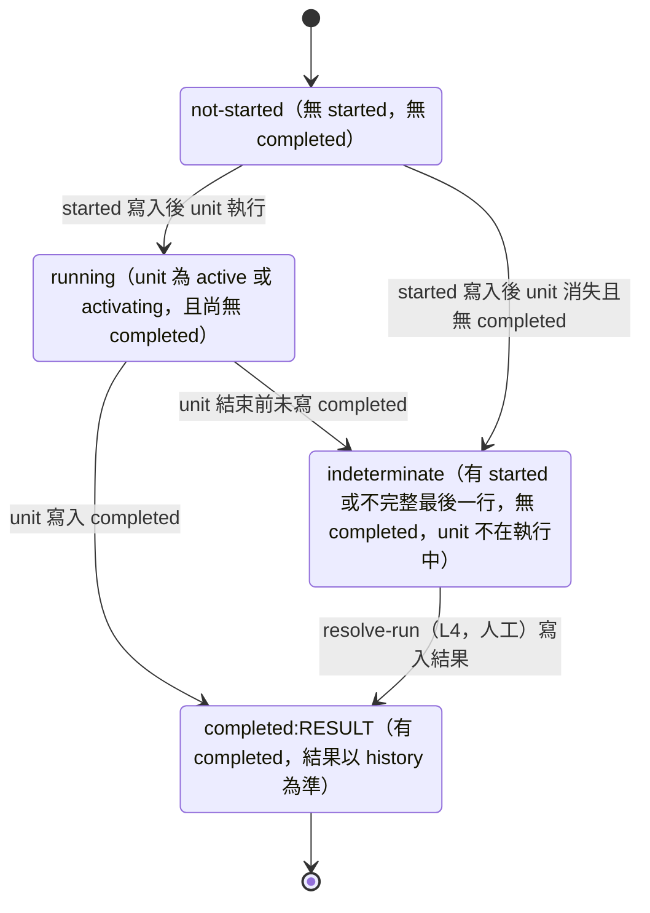
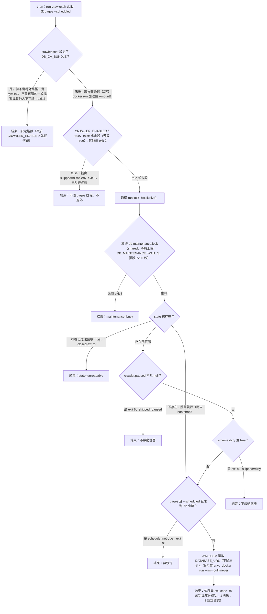
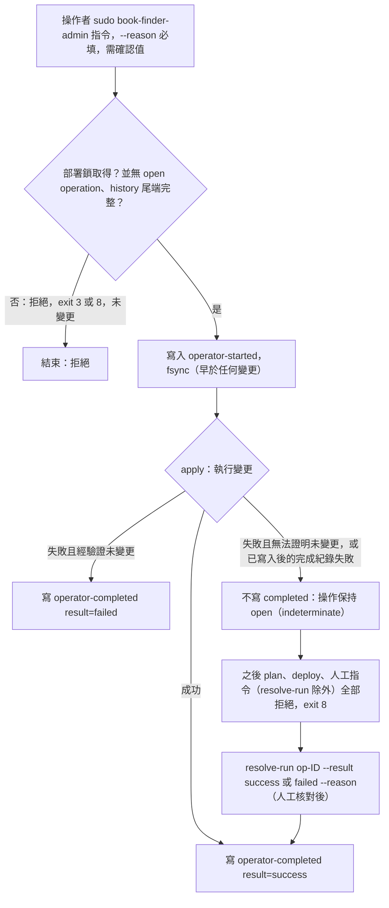

# deploy/ 流程圖：產物、部署狀態機與恢復路徑

> 目標：`deploy/`（CD 與 EC2 host 程式），含分散在 repository 其他位置的 CD 來源。
> 查核基準：2026-10-25，HEAD `5563d80`（#121 的程式 commit；前一基準 `01db2d7`，tag `v0.0.4`）。工作樹 clean（僅有既存的未追蹤 `.venv`）。
> 規格 authority：[deploy/README.md](../README.md)（runbook）、[Docs/deployment/deployment.md](../../Docs/deployment/deployment.md)、[ADR-006](../../Docs/architecture/architecture-decisions.md)、[test-plan §6](../../Docs/testing/test-plan.md)。
> 本文件是流程的可讀摘要；細節與退出碼以 runbook 與程式為準。遇到衝突時，見 [architecture.md](architecture.md) 的「文件與程式衝突」。

## 0. 圖例

| 樣式 | 意義 |
|---|---|
| 一般節點 | 已在程式中實作，且有測試覆蓋（測試位置見 [test-suite.md](test-suite.md)） |
| 虛線、橘色底（`notrun`） | 程式已實作，但**尚未在 production 執行過**（forward migration、snapshot、efbundle 寫入 dirty 的路徑、rollback 的 docker 分支等，依營運觀察記錄） |
| 退出碼 `exit N` | `deploy-entry` 與 `book-finder-admin` 的退出碼，對照表見 [deploy/README.md §1.5](../README.md) |

## 1. 入口清單

| 入口 | 觸發者與方式 | 主要來源 | 規格 |
|---|---|---|---|
| CD 自動發布 | `push` tag `v*` | [.github/workflows/cd.yml](../../.github/workflows/cd.yml)（`guard`、`test`、`build`） | runbook §1.1、§1.6、§4.1 |
| CD 手動部署或回滾 | `workflow_dispatch`（只能從 `main`，`release_tag` 已發布，可選 `cutover`） | 同上（`resolve`、`plan`、`compat`、`deploy`） | runbook §4.2、§3.3 |
| CD 腳本 | cd.yml 各步驟呼叫 | [.github/scripts/cd_release.py](../../.github/scripts/cd_release.py) | runbook §1.5（CD 端判定） |
| host SSH 入口（plan key） | SSH forced command：`sudo deploy-entry --plan-only` | [deploy/host/deploy-entry](../host/deploy-entry)、[commands.py](../host/bookfinder_host/commands.py) | runbook §2.6 |
| host SSH 入口（deploy key） | SSH forced command：`sudo deploy-entry` | 同上 | runbook §2.6、ADR-006 |
| transient unit 本體 | `systemd-run` 啟動 `deploy-entry --unit-body deploy ...` | [commands.py](../host/bookfinder_host/commands.py)（`run_deploy_unit`）、[runs.py](../host/bookfinder_host/runs.py) | N7 |
| 人工指令（L4） | 操作者 SSH 後 `sudo book-finder-admin <指令>` | [book-finder-admin](../host/book-finder-admin)、[operator_cli.py](../host/bookfinder_host/operator_cli.py) | runbook §5 |
| 爬蟲排程 | host cron 呼叫 `run-crawler.sh daily` 與 `pages --scheduled` | [crawler/deploy/run-crawler.sh](../../crawler/deploy/run-crawler.sh)、[crawler.cron](../../crawler/deploy/crawler.cron) | deployment.md §8、[crawler/deploy/README.md](../../crawler/deploy/README.md) |
| CI 的 Docker 與 compat 檢查 | PR 與 push；CD 以 `workflow_call` 呼叫 `ci.yml` | [.github/workflows/ci.yml](../../.github/workflows/ci.yml)、[deploy/migration-test/compat.sh](../migration-test/compat.sh) | test-plan §6、§6.1 |
| 本機整合測試（手動） | `BOOKFINDER_IT=1 bash deploy/integration/run-local.sh` | [deploy/integration/run-local.sh](../integration/run-local.sh) | test-plan §6.2 |

## 2. 總覽：從 tag 或 dispatch 到服務就緒

只有 tag 路徑會建置與發布；dispatch 路徑只讀取已發布的 `release.json`，不建置。

```mermaid
flowchart LR
  T1["push tag v*"] --> G1["guard：tag 格式正確，且 commit 在 origin/main 上"]
  T2["workflow_dispatch：release_tag，cutover 可選，分支必須是 main"] --> G2["guard：release_tag 已發布（非 draft）"]
  G1 --> TEST["test：呼叫 ci.yml（與 PR 相同的測試）"]
  TEST --> WEB1["web：推送 staging tag build-run-attempt"]
  WEB1 --> WEB2["web：attest-build-provenance"]
  WEB2 --> WEB3["web：verify-attestation 檢查 signer、source ref、source commit"]
  WEB3 --> WEB4{"commit point：imagetools create --prefer-index=false --tag 寫入 release tag"}
  WEB4 --> WEB5["web：confirm 確認 release tag 解析到 attest 的 digest"]
  WEB5 --> CRW["crawler：同樣的 staging、attest、verify、commit point、confirm"]
  CRW --> REL["抽出 release 檔案，建立 release.json 與 upload set，發布 Immutable Release"]
  REL --> PLAN
  G2 --> RES["resolve：驗證已發布 release.json、tag 與 commit，以及兩個 image 的 attestation"]
  RES --> PLAN
  PLAN["plan：production-plan 環境，SSH plan key 唯讀呼叫 host"] --> COMPAT["compat：runner 上以 rebuild、target、runtime image 驗證 migration"]
  COMPAT --> APPROVE{"production 環境 required reviewer 核准"}
  APPROVE --> DEP["deploy --detach：SSH deploy key 啟動 transient unit"]
  DEP --> HOST["host 狀態機：見第 4 節"]
  HOST --> FOLLOW["deploy-follow：每 30 秒呼叫 status，最多 160 分鐘"]
  FOLLOW --> OUT["history 出現 completed，CD 判定結果"]
  OUT --> VERIFY["人工驗證：首頁、登入、書庫（runbook §3.5、§4.1）"]
  HOST -.-> SNAP["forward 路徑：snapshot、設 dirty、efbundle"]
  classDef notrun stroke-dasharray: 5 5,fill:#fff7e6
  class SNAP notrun
```

**commit point 的不變式**：存在的 release tag 一定已通過 `verify-attestation`。commit point 之前失敗，不會留下 release tag；rerun 會重新 build。`confirm` 失敗時 release tag 已指向未 attest 的 digest，依 runbook §1.6 人工處理（L4）。

## 3. 時序：GitHub Actions、SSH forced command 與 transient unit

`plan` 與 `status` 使用 plan key；`deploy` 使用 deploy key。`deploy --detach` 只回報「已被 unit 接手」，結果以 history 為準。

## 4. host 部署狀態機（steps 0 到 7，所有退出路徑）

對應程式：[machine.py](../host/bookfinder_host/machine.py) 的 `_execute`、`_forward_migration`、`_switch`、`_rollback`、`_finish_*`。前置的 unit gate 在 [commands.py](../host/bookfinder_host/commands.py) 的 `run_deploy_unit` 與 `_deploy_locked`。每個已知結果在 `started` 之後只寫一筆 `completed`（N7）。

```mermaid
flowchart TD
  UE["unit 啟動（run_deploy_unit）"] --> U0{"history 已有相同 run id？"}
  U0 -- "是：exit 3，不寫入" --> UX0["結束：drift（run id 已使用，未寫入）"]
  U0 -- "否" --> U1{"history 可讀且最後一行完整？"}
  U1 -- "否：exit 8，不寫入" --> UX1["結束：blocked-indeterminate"]
  U1 -- "是" --> U2["unit：寫入 started，fsync"]
  U3{"deploy lock 取得？"}
  U3 -- "逾時 exit 3（busy），寫 completed" --> X3A["結束：drift"]
  U4{"state 存在且可讀？"}
  U4 -- "不存在 exit 3（需 bootstrap）" --> X3B["結束：drift"]
  U4 -- "損毀 exit 2" --> X2A["結束：rejected"]
  U5{"其他 run 為 indeterminate？"}
  U5 -- "是 exit 8" --> X8A["結束：blocked-indeterminate"]
  U6{"gates：revision、runtime、schema 預期；dirty 6；release metadata；release_api 範圍；divergent 2；chain 符合；schema-ahead crawler digest；cutover 條件；systemd 無 cutover（S5）；observed drift"}
  U6 -- "不通過（2、3 或 6）" --> X6["結束：依 gate 的退出碼寫 completed"]
  U2 --> U3
  U3 -- "取得" --> U4
  U4 -- "可讀" --> U5
  U5 -- "否" --> U6
  U6 -- "通過" --> S0

  S0{"step 0：crawler.paused 不為 null？"}
  S0 -- "是 exit 3" --> X3C["結束：drift（需先 resume-crawler）"]
  S0 -- "否" --> S0b{"compose 支援 env_file format raw？（probe，不啟動服務）"}
  S0b -- "否 exit 2" --> X2B["結束：rejected"]
  S0b -- "是" --> S1{"step 1：本機 127.0.0.1:5000 健康（3 次探測）"}
  S1 -- "否 exit 3，未變更" --> X3D["結束：drift"]
  S1 -- "是" --> S2{"step 2：取出 release 並驗證內容"}
  S2 -- "取出失敗 exit 3" --> X3E["結束：drift"]
  S2 -- "內容拒絕（symlink、超量、結構、缺少 CA override）exit 2" --> X2C["結束：rejected"]
  S2 -- "同 digest 目錄的 compose 不同 exit 3" --> X3F["結束：drift"]
  S2 -- "成功" --> S3{"step 3：SSM 讀取三個 secret（設定 SSM_MIGRATION_CONNECTION 時另讀一個），寫 web-RUN.env（600）；forward 時另寫 migrate-RUN.env（600，只供 efbundle；連線字串附加 Options=-c client_connection_check_interval=10000）"}
  S3 -- "讀取失敗 exit 3" --> X3G["結束：drift"]
  S3 -- "值為空或含控制字元 exit 2" --> X2D["結束：rejected"]
  S3 -- "成功" --> CH{"step 4：chain"}

  CH -- "forward" --> F0["step 4a：取得 db-maintenance lock（exclusive，逾時 exit 3）"]
  F0 --> FR{"step 4a（b）：殘留容器檢查（label efbundle、deploy-lock）"}
  FR -- "running 或非 exited／dead：exit 3，未改動任何狀態" --> X3R["結束：drift"]
  FR -- "無，或 exited／dead：journal 後 docker rm" --> F1["step 4b：pause crawler，寫 state"]
  F1 --> FL{"step 4b（lock）：取得 DB advisory lock（專用 psql session，exclusive，server 端 lock_timeout 60 秒）"}
  FL -- "逾時或失敗（crawler 持有 shared）：恢復 crawler，未 migrate，exit 3" --> X3L["結束：drift"]
  FL -- "取得" --> F2{"step 4c：建立 RDS snapshot 並等待 available"}
  F2 -- "失敗：釋放 lock，恢復 crawler，未 migrate，exit 3" --> X3H["結束：drift"]
  F2 -- "成功" --> F3["step 4d：設 dirty，寫 state"]
  F3 --> F4["step 4e：efbundle（image 內；讀 migrate-RUN.env）；執行中每 5 秒 heartbeat lock session 並 poll efbundle"]
  F4 -- "lock session 掉線或 heartbeat 無回應：SIGTERM，30 秒後 SIGKILL，再執行 (a)；dirty 與 paused 保留；不重試，exit 4" --> FWL["(a) 等待，或 session 無法回應；結果仍為 failed-migration，不進入 id 驗證"]
  FWL --> X4L["結束：failed-migration（人工，§5.2、§5.3）"]
  F4 -- "efbundle 自行結束" --> FPROOF{"final 驗證：同一 lock session alive，且 heartbeat 成功？（先於 (a)）"}
  FPROOF -- "否：journal efbundle 輸出；不 terminate（已結束）；dirty 與 paused 保留，不 switch，exit 4" --> X4P["結束：failed-migration（人工，§5.2、§5.3）"]
  FPROOF -- "是" --> FWAIT{"step 4e（a）：等待 migration 連線結束（pg_stat_activity 無 application_name=bookfinder-efbundle，≤120 秒，lock 持有中）"}
  FWAIT -- "仍存在：保留 lock（不 unlock），dirty 與 paused 保留，exit 4" --> X4W["結束：failed-migration（人工，§5.2、§5.3）"]
  FWAIT -- "已結束；或 lock session 無法回應（維持原結果）" --> F5{"exit 0 且 DB migration id 與 manifest 完全相同？"}
  F5 -- "否：dirty 與 paused 保留，efbundle 輸出尾端寫入 journal，exit 4" --> X4["結束：failed-migration（人工，§5.2、§5.3）"]
  F5 -- "是：清除 dirty 寫 state" --> SW
  F5 -. "釋放 lock（(a) 仍存在時不釋放）；釋放失敗只記 journal，不改變結果" .-> SW
  CH -- "in-sync 或 schema-ahead" --> SW

  SW{"step 5：cutover 時先 systemctl stop unit，再 compose up；健康檢查本機 90 秒，再 PUBLIC_URL 90 秒"}
  SW -- "compose 或 stop 失敗，或健康失敗" --> WF{"step 7：web 失敗"}
  SW -- "健康通過" --> S6

  WF -- "forward：I5，不自動回滾" --> X5A["結束：failed-down（crawler 保持 paused）"]
  WF -- "in-sync 或 schema-ahead" --> RB{"回滾到舊 runtime"}
  RB -- "systemd：compose down，systemctl start unit" --> RBH["回滾後健康檢查（同預算）"]
  RB -- "docker：舊 compose sha 不符，或缺 CA override 且設定 DB_CA_BUNDLE，exit 5" --> X5B["結束：failed-down"]
  RB -- "docker：compose up 舊 release" --> RBH
  RBH -- "通過" --> X1["結束：rolled-back，exit 1"]
  RBH -- "失敗" --> X5C["結束：failed-down，exit 5（人工，L4）"]

  S6{"step 6：schema-ahead？"}
  S6 -- "是" --> X0S["結束：success，crawler 維持目前 digest，不 pull、不安裝（S7）"]
  S6 -- "否" --> CR["crawler：pull image，smoke，安裝 run-crawler.sh，安裝 crawler.cron，改寫 crawler.conf（依序）"]
  CR -- "全部成功" --> X0["結束：success，exit 0，runtime docker，previous systemd，crawler 更新"]
  CR -- "任一步失敗" --> X7["結束：partial-crawler，exit 7；in-sync 會 pause crawler；forward 已 paused"]

  classDef notrun stroke-dasharray: 5 5,fill:#fff7e6
  class F0,F1,F2,F3,F4,F5 notrun
  class X5A,X5B,X5C notrun
```

**不變式對照**（ADR-006）：I3 dirty 期間拒絕；I5 forward 後不自動回滾；I6 回滾先驗證 compose 雜湊；N2 只有人工 `reconcile-schema` 能清 dirty；N3 forward 期間 crawler paused。

## 5. chain 分類（比較 state 的 applied 與目標 manifest）

依 [deploy/README.md §1.4](../README.md)。`plan` 只在 `in-sync` 與 `forward` 時列出 pending。

## 6. history `status` 狀態（N7）

`status` 永遠以退出碼 0 回報 JSON；判定只看 history 與 unit 狀態，依 [history.py](../host/bookfinder_host/history.py) 的 `status()` 規則 ①到 ④，**第一條符合者勝**。

注意：`completed` 優先於 unit 狀態。`--collect` 回收 failed unit 不會改變結果。`dispatch` 只會在 `not-started` 時安全重送；`indeterminate` 不可重送（exit 8）。

## 7. 爬蟲執行閘門（lock、state、paused、dirty、disabled）

對應 [run-crawler.sh](../../crawler/deploy/run-crawler.sh)。順序是程式與 N3 的規定：先拿 maintenance lock（shared），才讀 state，避免 TOCTOU。

## 8. 人工指令協定（operator protocol，S8、S10）

對應 [operator_cli.py](../host/bookfinder_host/operator_cli.py) 的 `_perform`。五個人工指令：`bootstrap-state`、`reconcile-schema`、`resume-crawler`、`resolve-run`、`install-host`。

**未在 production 執行的路徑**：`resolve-run` 處理 operator operation 的完整流程、`reconcile-schema --mark-clean`、`resume-crawler --adopt-release` 目前沒有記錄在 production 的實際執行（營運觀察只記錄 cutover 與 crawler 停用）。`install-host` 的 symlink 交換已有整合測試（`test_install_host.py`）覆蓋，production 的 host 版本未記錄。

## 9. 驗證與維護

- 本文件是結構檢查（Mermaid 標頭、fences、相對連結），未以 renderer 渲染。
- 圖中的退出碼由 `exit_codes.py` 與 `machine.py` 核對；`compat` 與整合測試的結果屬於已有測試，本次未執行。
- 修改流程時同步更新：runbook §1、本文件、[architecture.md](architecture.md)、[test-suite.md](test-suite.md)，並依 ADR-006 的規定更新 ADR 與 runbook（state、history 或 exit code 格式變更時）。
