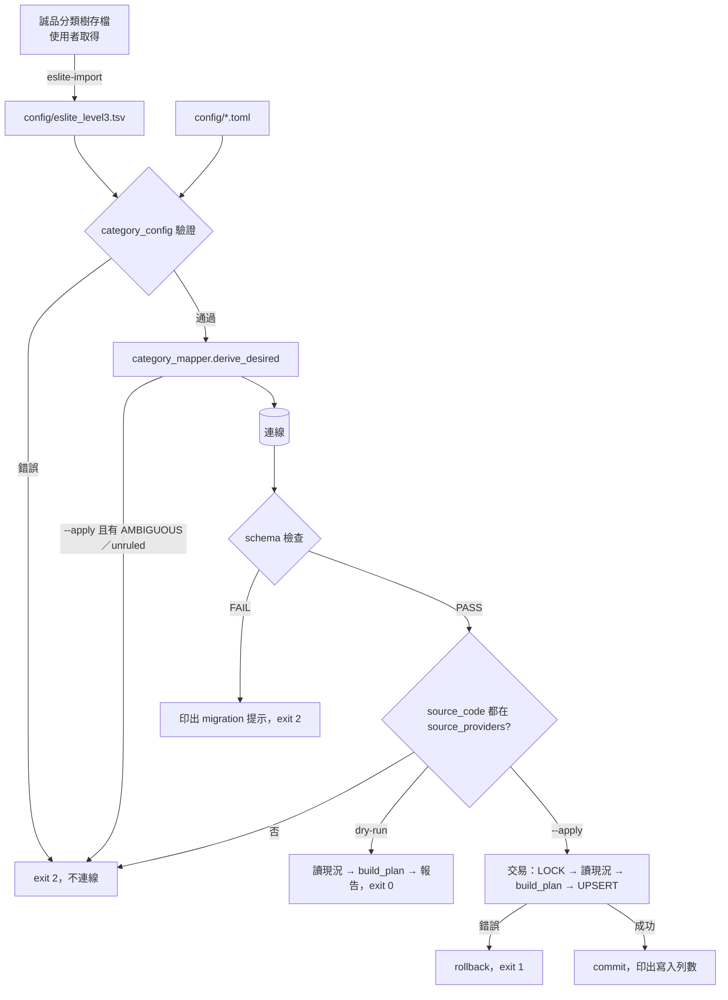

# scripts/categories 流程

> 建立：2026-11-14，分類計畫 P2。指令用法見 [README](../README.md)。

## 規則維護與同步

- `verify`：與 dry-run 相同的計畫；有 insert／update／AMBIGUOUS／unruled 時 exit 1。orphan 不算 drift。
- `audit`：依各來源列出 Subject 數與已對應數（對應到 active 分類才算），書的分類覆蓋（有分類、沒有分類、兩類以上；一本書透過任一來源的 Subject 都算），可選 `--unmapped-csv` 輸出未對應清單。
- `init`：只做 schema 檢查。

## 上線順序（計畫 §7）

1. migration `AddCanonicalCategories` 經 CD 套用。
2. `init` → `sync --dry-run`（審核報告）→ `sync --apply`（使用者執行、需授權）。
3. `audit` 確認覆蓋率。
4. 之後的分類頁（P4、P5）讀這兩張表。

新出現、沒有規則的 Subject 只會出現在報告中；補規則後再跑 `sync`。誠品分類樹改變時，重新取得存檔並執行 `eslite-import`，審核 TSV 的 diff 後再 `sync`。

互參：[架構](architecture.md)、[案例](test-suite.md)。
