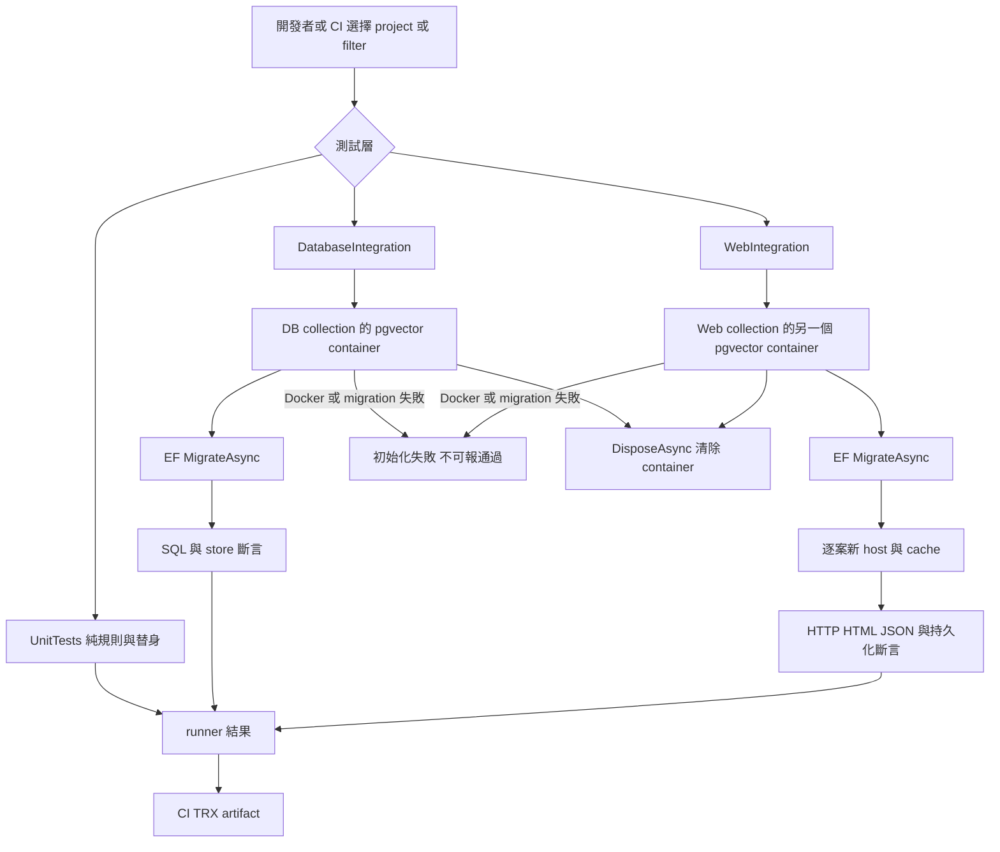
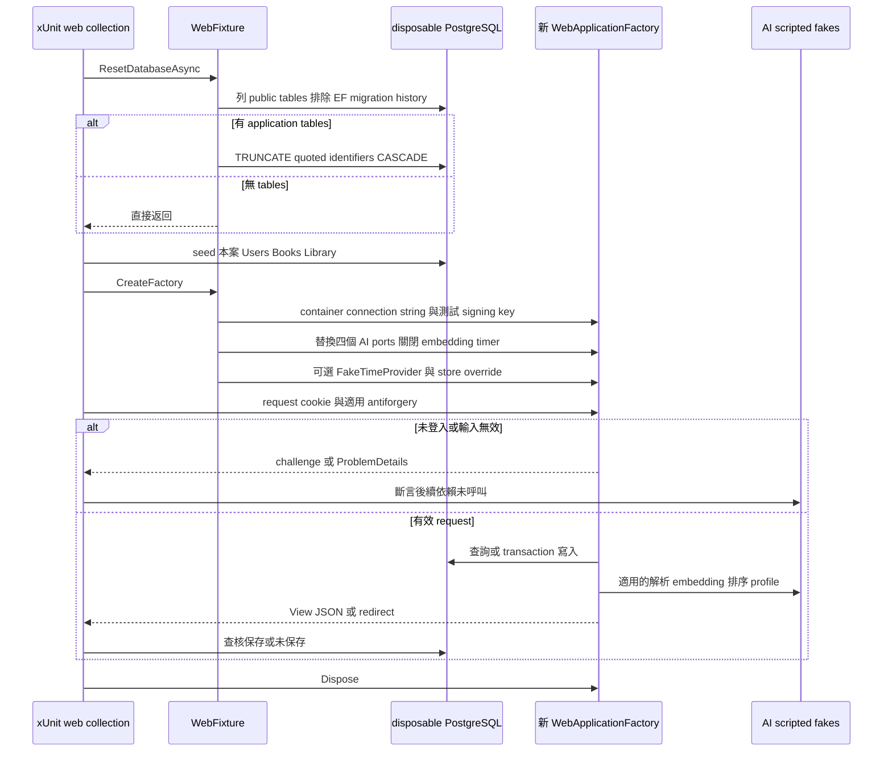
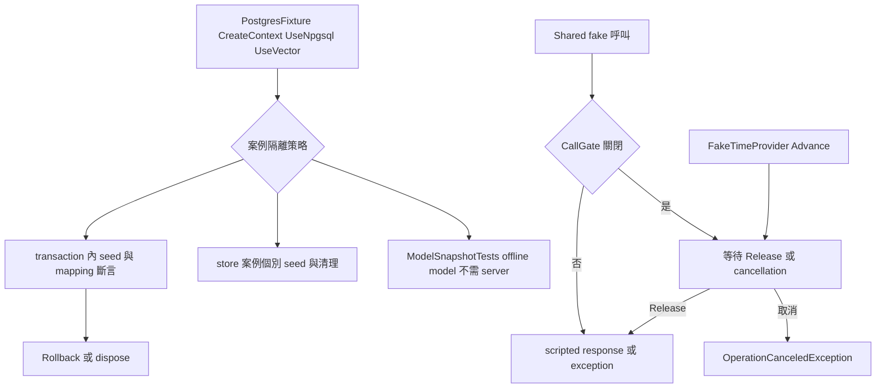

# tests 執行與隔離流程

> 查核日 2026-10-24；HEAD `91333c3`。本次僅靜態查核，未執行 build、測試、Docker、外部服務或瀏覽器。

Authority：[test-plan](../../Docs/testing/test-plan.md)；詞彙：[CONTEXT](../../CONTEXT.md)。本目錄負責測試選擇、fixture 隔離、替身與結果斷言，業務 contract 仍由各模組與 API/data spec 決定。

## 主要入口

| 入口 | 責任／來源 |
|---|---|
| `dotnet test Book-Finder.slnx` | [solution](../../Book-Finder.slnx) 的三個 test projects |
| UnitTests | [project](../UnitTests/UnitTests.csproj)：規則、service、cache、背景工作與 SDK fake transport |
| DatabaseIntegration | [project](../DatabaseIntegration/DatabaseIntegration.csproj)：EF migration、constraint、stores、pgvector |
| WebIntegration | [project](../WebIntegration/WebIntegration.csproj)：in-process HTTP、Razor、auth、antiforgery、EF persistence |
| CI | [ci.yml](../../.github/workflows/ci.yml)：restore/build/test、TRX artifact，另跑目錄外 pytest、Docker smoke、migration compat |

## Web 資料與副作用

[WebFixture](../WebIntegration/WebFixture.cs) 的 `web` collection 序列執行；reset 必須由案例主動呼叫。逐案新 host 避免 IMemoryCache 污染。config reload 關閉、WebRootFileProvider 為 NullFileProvider，避免 inotify 耗盡；因此不驗證實體靜態資產或瀏覽器 JavaScript。

組裝守衛（composition-root guards）：部分 WebIntegration 測試不經 HTTP，而是建立 factory 後從 `app.Services.CreateScope()` 解析 service（例如 BookBrowseService、BestsellerService），直接驗證 DI 鏈與 EF 查詢。Bestseller 守衛每案建立獨立 factory，因為 IMemoryCache 在 host 內，不能在同一 factory 內 reset DB 後期待空結果。

## DB、時間、失敗與取消

[PostgresFixture](../DatabaseIntegration/PostgresFixture.cs) 沒有統一逐案 truncate；[SchemaTests](../DatabaseIntegration/SchemaTests.cs) mapping 使用 rollback，[constraints.sql](../DatabaseIntegration/constraints.sql) 自行回復測資。不得套用 Web reset 假設至所有 DB 案例。空 Candidate Set 可成功保存空 Recommendation Search；核心 parse／embed／candidate／rank 階段失敗或核心 60 秒逾時不得保存；成功保存後的 difficulty 讀取／profile 排程失敗不回滾 Recommendation Search，且使用 caller token，由 [service tests](../UnitTests/RecommendationServiceTests.cs) 與 [API tests](../WebIntegration/RecommendationApiTests.cs) 分層驗證。CallGate 配合 fake time 避免 real sleep。

## 目錄外流程

[crawler/tests](../../crawler/tests) 是 pytest，HTML fixtures／DB integration／local Chromium 均不在本目錄；local browser 測試可因缺 Chromium skip，並非網站 E2E。[CI checker tests](../../.github/scripts/tests)、[deploy tests](../../deploy/tests)、[Docker smoke](../../deploy/smoke/web-smoke.sh)、[migration compat](../../deploy/migration-test/compat.sh) 由 CI 各自選擇，不隨 solution 執行。MVP 網站 E2E 瀏覽器仍明確暫緩。

[架構](architecture.md) · [待辦](backlog.md) · [歷史](update-history.md) · [案例](test-suite.md)
