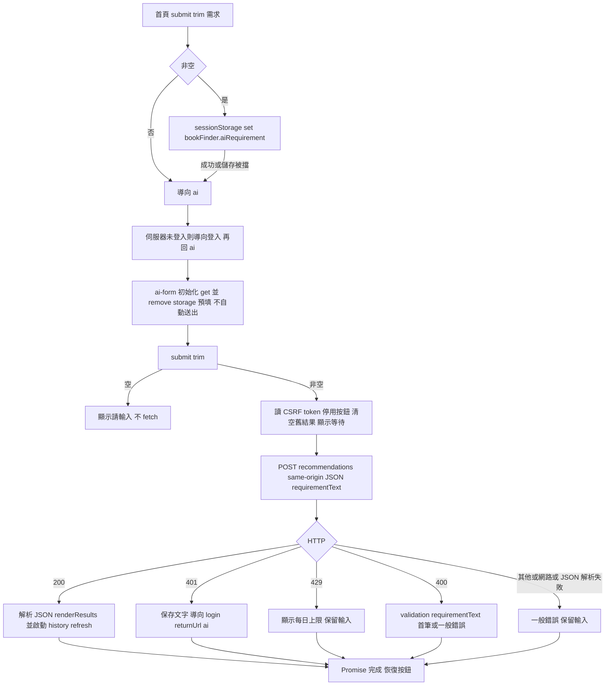
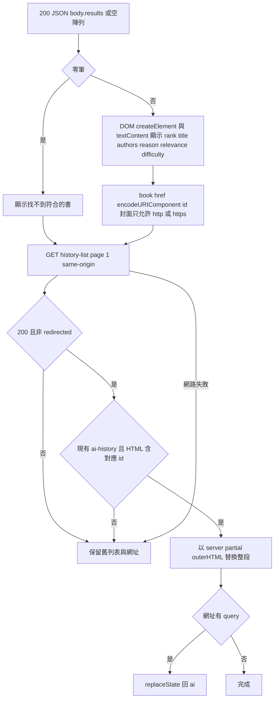
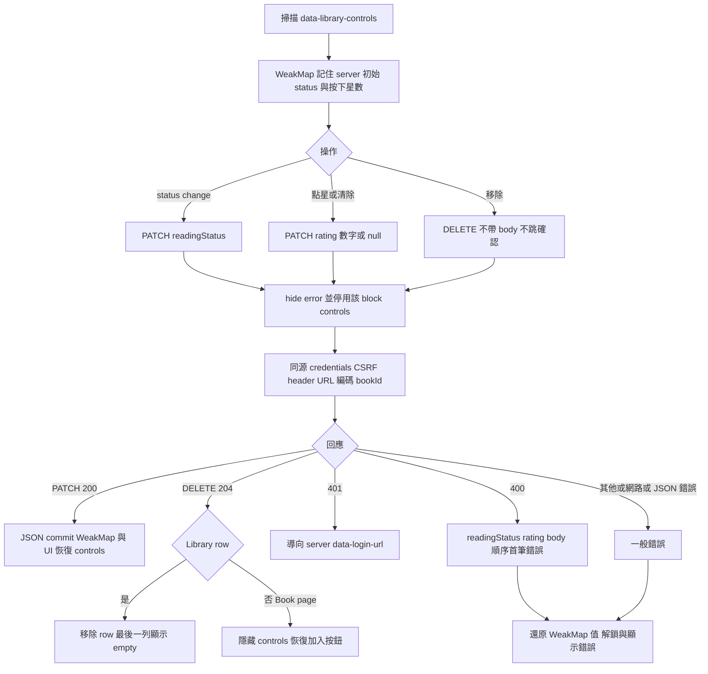
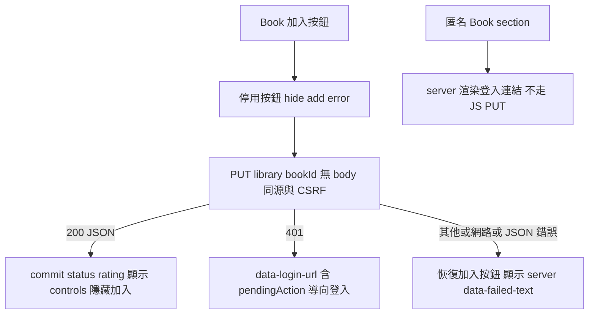

# wwwroot 工作流程

> 查核：2026-10-24；HEAD `91333c334148fa5bfe07055d0e799dc13bb0bb4e`。當前工作樹靜態證據；本次未執行 build、測試、瀏覽器、網路或發布。只新增本目錄五份文件。

[UI authority](../../Docs/ui/ui-flow.md)、[API](../../Docs/api/api-spec.md)、[Library](../../Docs/modules/user-library.md)、[Recommendation](../../Docs/modules/recommendation.md)、[Identity](../../Docs/modules/identity-auth.md)。以下為現行自有 JS 與 DOM 的流程；商業規則、身分驗證、交易與每日額度在伺服器。

## 入口與渲染邊界

| 資產 | 觸發入口／責任 |
|---|---|
| [ai.js](../js/ai.js) | [Home](../../Views/Home/Index.cshtml) 的 home-ai-form；[Ai](../../Views/Ai/Index.cshtml) 的 ai-form、ai-requirement、ai-submit、ai-status、ai-results |
| [library.js](../js/library.js) | [Book section](../../Views/Books/_LibrarySection.cshtml)、[Library 頁](../../Views/Library/Index.cshtml)、[共用 controls](../../Views/Shared/_LibraryControls.cshtml) 的 data attributes |
| [site.js](../js/site.js) | [Layout](../../Views/Shared/_Layout.cshtml) 載入；目前只有模板註解，無行為 |
| [site.css](../css/site.css) | Layout；響應字級、focus、stars、history 兩行截斷 |
| lib／favicon | Layout 使用 Bootstrap、jQuery；validation 套件由 View 引用；第三方實作不逐行展開 |
| 靜態 endpoint | [Program](../../Program.cs) MapStaticAssets／WithStaticAssets，生成與發布由 Web SDK 負責 |

## Home、sessionStorage 與推薦

Storage 被封鎖會被 catch；無法攜帶文字時讓使用者重填。home 空白不覆寫已有 key；takeRequirement 嘗試一次讀取後刪除，讀／刪例外回 null。maxlength=500 是 HTML 限制，伺服器才是最終驗證；等待文案 10～30 秒不是 JS timeout，60 秒由 server 負責。JS 沒有 AbortController、client retry 或取消狀態。

## 結果與歷史刷新

[partial](../../Views/Ai/_AiHistoryList.cshtml) 是列表／pager 唯一來源；時區、排序、20 筆分頁由 server 決定。refreshHistory 沒有 return 到推薦 promise，按鈕可在刷新完成前恢復；刷新失敗不抹掉已成功的結果。JSON 值一律 textContent；同源 server HTML 才以 outerHTML 插入，包含 id 的 guard 不是通用 HTML sanitizer。0 結果仍刷新成功搜尋紀錄。

## 書單狀態與 API

PATCH 只送變更欄位；null 清 rating 與省略不同。失敗恢復 server 最後確認值；select 原生先改值，錯誤再還原。401 分支直接導航，沒有先解鎖（假定頁面離開）。按鈕 disabled 是 UI 防連點，非 server concurrency 保證；沒有程式層 request generation guard。篩選頁改 status 不移除或重新排序 row，直到 reload；是明訂行為。CSRF 由 document.querySelector 取整個 document 第一個 matching Razor antiforgery input（可能是 Layout logout token）；只有 selector 完全找不到 input 才傳空值，並非只檢查 Library 區域。JS 不簽發 token、不讀 JWT。

相關：[流程](workflow-diagram.md)／[架構](architecture.md)／[待辦](backlog.md)／[歷史](update-history.md)／[案例](test-suite.md)。
